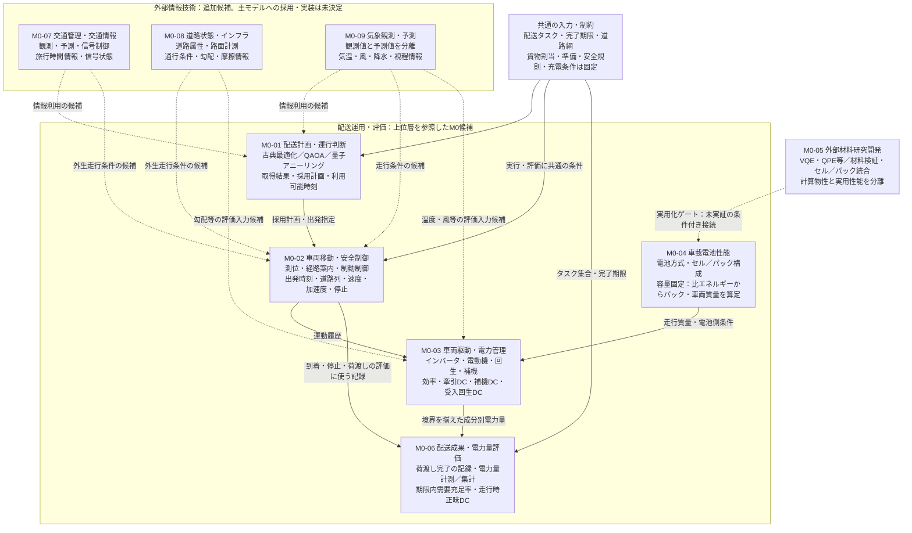
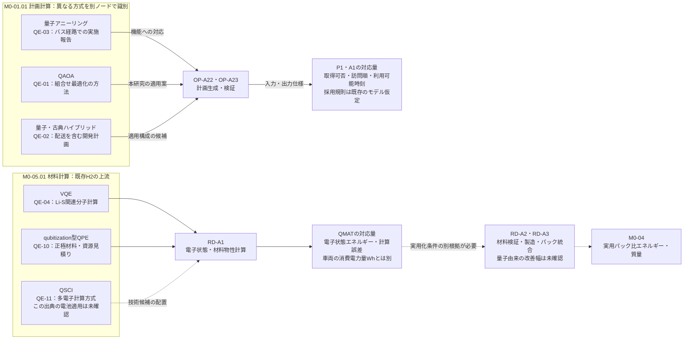
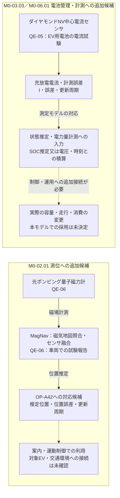

# 量子技術がEV配送の需要充足と運用電力量に影響を及ぼす仕組みと成立条件

**EV配送の技術構造・パラメータ対応と専門家による概念モデルの精緻化**\
研究設計の記述基準日：2026年10月20日（概念モデル図・技術根拠を含む改訂原稿）

本リポジトリは、EV配送を社会技術システムの事例とし、古典技術を基準に量子技術の追加的な貢献可能性を検討する修士研究のコード・資料・保存結果を公開するものである。

現在の研究では、**技術名・技術方式を主たる分析単位**とし、IDEF0を用いて機能・ICOMを整理し、配送移動・電力消費を記述するパラメータへ対応付ける。専門家インタビューでは事前概念モデルを最初に提示し、技術による分解とパラメータ対応を求め、研究者の事前構造図と比較する。因果関係の有無・方向・強さや改善率は直接質問しない。

**公開リポジトリの主な実装・保存結果は、既存の限定的な定量実験に関するものである。** 更新後のシミュレーション案はインタビュー用の概念モデルとして扱い、実装済みの数値モデルとは区別する。専門家インタビュー、M0の正式な提示版固定、専門家別構造の取得、M1の作成は未実施である。

## 1. 研究目的・研究課題・仮説

### 研究目的

必要な配送需要の充足と、そのサービス提供に伴う運用電力量の低減を両立する観点から、量子技術が電気自動車を用いた配送に影響を及ぼす仕組みと、その効果の成立条件を明らかにする。

量子技術が必ず改善効果をもたらすことを前提とせず、効果が成立しない条件や逆転する条件も対象とする。

### 研究課題

量子技術のうち、どのような技術が、どのような仕組みを通じて、電気自動車を用いた配送の需要充足と運用電力量に影響を及ぼし、その効果はどのような条件で成立するか。

### H1：計算方法の相違による運用電力量への作用

量子計算は、古典計算とは異なる計画取得過程を通じて、配送・充電の運用に作用し、配送需要充足と運用電力量に異なる影響を及ぼし得る。

異なる経路の取得を成立の必須条件とせず、計画取得可否・取得時間等の相違も扱う。

### H2：電池性能の媒介効果

量子化学計算の成果が実用電池性能の改善につながる場合、電池性能の変化は車両・充電条件を通じて、配送需要充足と運用電力量に影響する。

材料計算の成果と、材料・セル・パックを経た実用電池性能の改善を区別する。

### H3：周辺条件による効果の変化

H1およびH2の効果の方向と大きさは、交通状況、運転特性、充電条件等の周辺要因との相互作用によって変化する。

上記の目的・問いはREADMEの採用済み表現、H1〜H3の本文はREADMEに記録された正式凍結版v1.0.1の文言を保持する。正式凍結資料の名称は `RESEARCH_OBJECTIVE_RQ_HYPOTHESES_FREEZE_20261014_v1_0_1.md` であり、公開リポジトリには同梱されていない。仮説の支持・棄却は未判定であり、今回のインタビューを仮説の直接的な因果検証とは位置付けない。

## 2. 対象システムと評価境界

都市部のEV配送について、計画取得・採用、車両出発、道路上の移動、駆動・電力管理、電池、荷渡し完了と記録を扱う。量子材料計算と実用化は、配送運用とは区別した外部の研究開発過程として参照する。既存実験の単一車両・合成需要・固定顧客集合を、一般的な配送システムの定義にはしない。

### 成果指標

| 指標 | 定義と注意点 |
|---|---|
| 期限内需要充足率 | 評価対象として固定した配送タスク集合に対し、実サービス完了時刻が各期限以内であるタスクの割合。未完了と観測欠測を区別する |
| 走行時の電池側正味DC電力量 | 同じ計量・集計境界における、牽引DC＋補機DC−電池が受け入れた回生DC。電池端子の正味計測と成分別集計を重複加算しない |

「運用電力量」は、上記の車両走行時の電池側正味DCを指す。対象区間には信号待ち・渋滞等の交通上の一時停止を含め、配送作業のための停車、充電、その他の待機は区別する。空調・電池温度管理・その他補機も、この対象区間内の消費を扱う。ログからの区間識別、計測条件、欠測処理の操作化・検証は別に必要である。

計算設備・量子計算機・データセンター、車外充電・充電損失、物流拠点、車両・電池製造の電力量は主要指標へ加算しない。この境界での比較を、物流全体やライフサイクル全体の電力量評価とはしない。

配送成果と電力量は併記し、未配送によって電力量が小さくなっただけの状態を省エネルギー効果と認定しない。

### 既存の最小因果モデルとの関係

Version 0.2は13主変数・13接続関係・2効果修飾の構造基準版であり、すべての接続が経験的な因果関係ではない。比較・属性構成・指標定義・算術関係・条件付き仮定を区別する。

| 対象 | 現段階で保持する範囲 |
|---|---|
| H1 | 計画取得→採用→出発・実走行→実サービス完了。実走行から電力量への接続も参照する |
| H2 | 量子材料計算→検証・実用化→パック性能は条件付き。容量・非電池質量・積載条件を固定し、比エネルギー→車両質量→電力量を中心とする |
| H3 | 出発余裕と走行条件の2条件群。周辺条件の直接作用とは区別する |
| D6 | H2から期限内需要充足率への経路は未接続を維持する。将来の採否は未決定であり、ゼロ効果・関係不存在の認定ではない |

貨物割当、倉庫・積込、充電運用、安全制約等の固定・非展開方針を維持する。安全支援、量子センシング、交通・道路・気象技術を分類に記載しても、これらの条件や既存因果リンクを自動変更しない。

## 3. 研究方法

### 技術名による分解とパラメータ対応

国内外の政策・研究開発プロジェクト資料を技術候補の主要な抽出元とし、技術資料・原著等で名称と定義を確認する。政策目標、プロジェクト名、技術方式、材料、製品、開発目標、実施結果を区別する。国・事業への所属は出典情報であり、技術の種類階層ではない。

技術概念には恒久IDを付け、原表記・代表名・別名・略語を保存する。同義、上位・下位、構成、利用の関係を区別し、一つの技術を適用先ごとに重複登録しない。方式未詳の場合はその状態を保持する。

**技術を分解した結果は、配送移動または電力消費の何らかのパラメータに対応付ける。** 定義、単位、モデル上の位置までを記録し、直接対応しない上流技術は中間機能・量を介して整理する。説明できない対応は未確定として残し、技術名だけから数値・関数・改善率を補わない。

ここでいうパラメータは広義の対応量であり、係数、状態量、意思決定変数、観測値、予測値、評価出力を区別する。実際の気象条件と予測値、車両の真の位置と推定位置、実消費電力量と計測誤差は同じ量ではない。

### IDEF0の役割

[IDEF0の原典](https://nvlpubs.nist.gov/nistpubs/Legacy/FIPS/fipspub183.pdf)を参照し、機能、Input、Control、Output、Mechanismを整理する。技術は機能を実現する手段等へ対応付け、技術名の階層図とIDEF0機能図は区別する。技術分類上の親子関係、機能間授受、パラメータ対応、因果関係は異なる種類の関係である。名称・概念関係の管理には[SKOS](https://www.w3.org/TR/skos-reference/)を補助参照する。

### 研究の流れ

```text
国内外の政策・プロジェクト・技術資料
  |
  v
技術名・方式の抽出と階層化       --+
                                   |
既存定量モデル・保存結果         --+--> M0
                                   |
IDEF0機能・ICOM／パラメータ辞書  --+

M0：更新後シミュレーション案の概念モデル
  |
  v
冒頭にM0を提示／専門家による技術分解
  |
  v
専門家別構造 Ei と発言・対応量の保存
  |
  v
M0とEiの構造比較 <--- M0（上記の事前概念モデル）
  |
  v
研究者の採用・保留・不採用
  |
  v
M1：採用変更を反映した概念モデル
  |
  v
既存因果構造・数値モデルへの含意の考察
```

この図は研究工程を示すものであり、調査済みの結果や実証された因果関係を示すものではない。既存177件の記述は照合資産として利用し、技術分類の範囲の上限にはしない。

## 4. 提示する概念モデルと技術構造

| モデル・資料 | 役割 |
|---|---|
| 既存定量モデル | 実装済みの入力・計算・保存結果と、その表現範囲を確認する |
| 因果構造Version 0.2 | 成果への作用に関する既存の仮定・定義・保留事項を、事後解釈の参照構造として保持する |
| FD-v0.1・ICOM | 34機能と機能間授受を、技術の配置・機能対応の参照辞書として用いる |
| M0 | 更新後のシミュレーション案を、技術・機能・パラメータで記述した事前概念モデル。正式提示版は未固定 |
| 専門家別構造 Ei | 提示モデルを起点とした各専門家の分解結果。独立に一から収集したモデルとは区別する |
| M1 | 専門家別結果との比較と研究者の採否を反映する改訂モデル。未作成 |

M0候補の上位層は、配送計画・運行判断、車両移動・安全制御、車両駆動・電力管理、車載電池、外部材料研究開発、配送成果・電力量評価である。交通管理・交通情報、道路状態・インフラ、気象観測・予測は追加候補として区別する。

### 概念モデル本体

以下は研究工程ではなく、EV配送システムの技術的な位置、処理、受け渡す量、成果指標を表すM0候補である。



**図M0-A：更新後シミュレーション案を表す概念モデル本体。** 研究工程ではなく、対象システムの入力、処理、技術の配置、受渡す量、評価出力を示す。実線はこの概念案で置く処理・授受関係、破線は条件付き又は未採用の拡張接続である。線の違いは実証の強弱を表さず、実線も実装済み・実証済みを意味しない。M0-番号は上位のモデル位置であり、IDEF0の機能IDや因果リンクIDを置き換えない。

図はIDEF0の機能・ICOMへ対応付けるための模式図であり、全境界矢印の図形規則を満たす正式IDEF0図の完成認定ではない。Version 0.2の13接続関係を増やした図でもない。材料系から期限内需要充足率への新規経路は追加していない。交通・道路・気象の3候補層も採用済みとはしない。外部条件の真値を走行・電力量へ渡すことと、その観測値・予測値を計画・制御へ渡すことは別の接続である。情報精度の変化を実際の気象・道路条件の変化として代入しない。

### 提示表の形式

提示表は**4列・1技術名1行**とする。第1列の位置IDで、全体図のどの上位層に属するかを追跡する。以下は形式を示す代表例であり、全技術一覧でも実装済み一覧でもない。

| 上位層・位置ID | 技術名・技術方式 | 対応機能（IDEF0） | 対応パラメータ候補 |
|---|---|---|---|
| M0-01.01-02 配送計画 | QAOA | 計画生成（OP-A22） | 訪問順、取得可否、計画利用可能までの時間〔s〕 |
| M0-01.01-03 配送計画 | 量子アニーリング | 計画生成（OP-A22） | 訪問順、取得可否、計画旅行時間〔s〕 |
| M0-02.01-01 車両移動 | GNSS測位 | 測位・案内（OP-A42） | 推定位置・測位誤差〔m〕、更新周期〔s〕 |
| M0-02.02-03 安全制御 | AEB | 運動制御・制動（OP-A43、OP-A45） | 制動開始時刻、目標減速度〔m/s²〕 |
| M0-03.01-01 電動駆動 | 駆動用インバータ | 電力変換（OP-A441） | 変換効率〔無次元〕、損失電力〔W〕 |
| M0-03.02-01 制動 | 回生制動 | 制動・回生（OP-A45） | 回生生成量と電池受入量〔Wh〕 |
| M0-04.01-02 車載電池 | 全固体電池 | 蓄電（OP-A51） | パック化後の比エネルギー〔Wh/kg〕、質量〔kg〕 |
| M0-05.01-02 材料研究 | VQE | 電子状態計算（RD-A1） | 対象物性、計算誤差。パック性能との対応は別途必要 |
| M0-06.01-03 成果評価 | 電力量計測技術 | 電力量記録（OP-A63） | 電力量〔Wh〕、計測誤差、計量区間 |

位置IDはモデル内の配置を表し、恒久的な技術IDとは分離する。階層を移動しても技術同一性を失わず、分割・統合では旧新IDの対応を保存する。

量子技術の関与候補は、計画計算、材料計算、センシング・計測を分けて扱う。量子inspired方式を量子実機計算と同一視しない。量子材料計算から実用品への接続、量子センサから車両制御への接続は自動的に成立するとしない。技術登録、対象システムへの適用、モデル上の採用、実装、効果実証を別々の状態として管理する。

### 量子関与を配置する根拠

**技術名の存在、用途・開発計画、試験結果、対象EVへの適用、配送成果の実証は別である。** 以下の出典は関与箇所を検討する根拠であり、全技術を可変要因として採用したことを意味しない。QE-IDは研究設計総括書の出典IDと共通である。総括書が未配置でも以下の原資料に直接アクセスできる。

| 配置・技術 | 一次資料・確認箇所 | 裏付ける範囲と限界 |
|---|---|---|
| M0-01：量子アニーリング | [QE-03：Quantum Shuttle: Traffic Navigation with Quantum Computing](https://arxiv.org/html/2006.14162v1)。§1、§3.1–3.4、§5 | バスの交通データ→候補道路経路→D-Wave→案内アプリを接続した運用報告。固定顧客訪問順やEV配送の電力量改善とは別である。 |
| M0-01：量子・古典ハイブリッド | [QE-02：QCMobility — Quantum Computing & Mobility](https://www.dlr.de/en/qt/research-transfer/projects-missions/qcmobility)。Planned tenders：Road transport／Integration of quantum-based methods | 配送の荷捌き地点と量子・古典の入出力接続を開発対象とする。個別方式・運用効果はこの説明だけでは未同定。 |
| M0-01：QAOA | [QE-01：A Quantum Approximate Optimization Algorithm](https://arxiv.org/abs/1411.4028v1)。Abstract | 組合せ最適化方式の原典。配送への適用は本研究の設計・理想計算と区別し、原典だけで実務適用を認定しない。 |
| M0-05：VQE | [QE-04：Quantum computation of dominant products in lithium-sulfur batteries](https://arxiv.org/html/2001.01120v2)。Abstract、.1 Working equations、.2 Computational details、.5 Quantum chemistry calculations on quantum devices | Li-S関連分子の電子状態計算。量子実機を用いた対象とシミュレータを用いた対象を区別し、パック改善値へ変換しない。 |
| M0-05：qubitization型QPE | [QE-10：Quantum simulation of battery materials using ionic pseudopotentials](https://arxiv.org/html/2302.07981v2)。Abstract／§2.3／§6 Application: lithium-excess cathode materials／§7 Resource estimation | 正極材料へのアルゴリズム・資源推定。実機での実用電池開発の実績ではない。 |
| M0-02候補：量子磁力計・MagNav | [QE-06：Quantum-assured magnetic navigation achieves positioning accuracy better than a strategic-grade INS in airborne and ground-based field trials](https://arxiv.org/html/2504.08167v1)。Q-CTRL MagNav System／System architecture／Q-CTRL optically-pumped magnetometers／Ground trials | 地図・古典慣性航法等と融合した車両測位試験。推定位置・誤差に対応するが、制御・配送成果への接続は未確認。 |
| M0-03／06候補：NV中心電流センサ | [QE-05：電池の充放電電流を広い電流レンジで高精度に計測するダイヤモンド量子センサを世界で初めて開発](https://www.titech.ac.jp/news/2022/064800)。概要／研究成果／今後の展開／論文情報 | EV用電池の充放電試験を実施機関が報告。電流・誤差に対応する。容量・電費改善の試算を実測結果にしない。 |
| M0-07候補：量子inspired信号制御 | [QE-07：QI-TraSiCo – quantum computing for network-wide traffic light control in real time](https://www.dlr.de/en/ts/research-transfer/projects/qi-trasico)。冒頭の目的・prototypic implementation／Challenge | 信号制御と計算側の接続を扱う。量子inspiredであり量子実機の効果の証明ではない。 |
| M0-08候補：量子重力勾配計 | [QE-08：Quantum sensing for gravity cartography](https://research.birmingham.ac.uk/en/publications/quantum-sensing-for-gravity-cartography/)。Abstract／大学発表の検出対象の説明 | 地下構造検出の研究。道路の勾配・摩擦ではなく、配送の通行条件への接続は未確定のため保留する。 |
| M0-09候補：光qudit型量子GAN | [QE-09：Quantum Generative Adversarial Networks with phoTonic Integrated Circuits (QuGANTIC)](https://cordis.europa.eu/project/id/101099430)。Objective：quDit PIC、quantum Generative Adversarial Networks、weather phenomena | 気象現象を用途目標に挙げる段階。具体的気象量、予測精度、配送入力への接続は未確認。 |

QE-05は研究実施機関の報告本文を確認し、原著は[DOI](https://doi.org/10.1038/s41598-022-18106-x)で示すが今回本文を取得していない。QE-08は所属機関の原著要旨と発表を確認した。その他も指定箇所の確認に限定し、全資料の全文精読や追試ではない。

QSCIは[QE-11：原論文](https://arxiv.org/html/2302.11320v1)の要旨で方式を識別できるが、この箇所では電池用途を同定できないため材料計算の名称候補に留める。普通のLiDAR、AEB、インバータ、電動機に量子関与があると一律に認定しない。

#### 量子技術とパラメータの対応図





上図の実線は技術・機能・出力量の対応、破線は未確定の用途接続・実用化である。計測精度の改善を実際の消費量の変化と同一視しない。通常の因果リンクの追加や効果の正負の認定ではない。

## 5. 既存定量実験と保存結果

### 計算工程と範囲

| 工程 | 実装・保存結果の対象 | 主な制限 |
|---|---|---|
| 入力 | OSM・PLATEAU・公的統計に基づく道路・合成配送需要 | 実注文データではなく、一部の生成過程・入力は公開配布に含まれない |
| 配送計画 | 固定顧客集合・単一車両の訪問順。目的は道路旅行時間最小化 | 車両間割当・充電・電力量を同時最適化していない。時間窓はサービス開始で判定する |
| 古典計算 | 3・4・5顧客の全列挙、25・99・125顧客のヒューリスティックとLP下界 | 大規模側の経路を大域最適解とは呼ばない |
| 量子計算 | 3・4顧客の理想状態ベクトルQAOA。正式定式化は補助変数なしのPUBO | 量子実機・誤り耐性量子計算の実行ではない。シミュレータ実行時間は実用量子計算時間の代用ではない |
| 車両走行 | 訪問順から道路経路・停車条件を構成し、SUMO軌跡を保存 | 保存条件は単一車両・背景交通なし。位置・速度の出力はセンサ誤差の表現ではない |
| 電池・電力量 | 容量20 kWh、比エネルギー180・220・250 Wh/kgの固定軌跡質量感度 | 量子材料計算や実用パック改善の結果ではない |

Controlled-DCは平坦路面、回生なし、補機除外、一括駆動効率0.9の限定モデルである。比エネルギーを変えてもSUMOの軌跡を再生成せず、同じ速度履歴に質量条件を与える。転がり抵抗は速度依存式の二条件であり、路面摩擦や濡れ・凍結を評価したものではない。既存の残量会計を、SOCに基づく停止・充電・再計画の実装とはしない。

詳細は[定量研究ガイド](docs/QUANTITATIVE_GUIDE.md)と[Controlled-DC凍結仕様](01_research_design/methodology/CONTROLLED_MASS_TO_DC_MODEL_FREEZE.json)を参照する。`net_DC_Wh`という出力名があっても、全成分を含む正味DCを評価したことにはならない。

### 保存結果の要点

| 対象 | 保存記録の内容 |
|---|---|
| 最終共通Protocol | 3顧客は78条件中78経路、4顧客は78条件中64経路を取得。14件の未取得を配送不可能・消費ゼロとしない |
| Method×Battery | 共通取得64ブロックで、各比較条件のTはゼロ59・非ゼロ5。Tは電池相対削減率の方式差についての規模間差で、単位は百分率ポイントである |
| 古典6規模 | 3・4・5・25・99・125顧客、468論理条件・460固有問題。重複や部分集合を独立標本としない |
| 配送サービス診断 | 遅延136停止・116経路、帰還期限超過4経路の記録がある。実サービス完了に基づく期限内需要充足率ではない |

これらは保存記録の要約であり、本README改訂で再計算した値ではない。Tは需要充足率でも量子優位の判定でもない。定義・母集団・保存値は[保存結果の分析](docs/QUANTITATIVE_GUIDE.md#7-analysis-and-frozen-results)を参照する。

## 6. インタビューと比較分析

### 提示と質問

インタビュー冒頭にM0全体図を提示し、担当領域の4列表と書込み用分解図を用いる。提示前の自由聴取は行わない。提示図を正解とせず、技術の追加・明示的削除・分割・統合・階層移動を認める。

> この概念モデルの担当領域を、区別すべき技術名・技術方式に分解してほしい。それぞれが担う機能と、配送移動または電力消費のどのパラメータに対応するかを示してほしい。

名称・方式、分解関係、機能・ICOM、対応量の定義・単位・計量位置、区分理由、未対応箇所を確認する。数値回答を必須にせず、因果関係の有無・方向・強さや改善率を直接質問しない。自発的な因果的発言は別に保存し、因果検証の結果として扱わない。

実施前には対象者の専門範囲、人数・時間、予備面接、倫理手続、参加・録音・引用への同意、保管・撤回条件を確定する。これらの詳細を承認済み・実施済みとは記載しない。使用したM0・質問票の版、図の書込み、発言位置、研究者による整理を追跡する。

### 比較と成果

| 比較対象 | 記録すること |
|---|---|
| 技術名・概念 | 同義語、異なる方式の混同、技術未特定、名称変更 |
| 階層・構成 | 分割・統合、所属変更、種類と構成・利用関係の違い |
| 機能・ICOM | 技術が実現する機能、授受、制約、実現手段の対応 |
| パラメータ | 定義、単位、計量境界、集約粒度、観測・予測・状態・出力の違い |

まずM0と各専門家の構造Eiを比較し、その後に研究者が採用・保留・不採用を理由付きで判断する。各専門家の原図・原発言を保持し、採用された変更だけをM1に反映する。無回答・専門外・判断不能・言及なしを、削除・支持・不存在へ読み替えない。

T1〜T7、I1〜I5は本研究で提案した比較・解釈コードであり、IDEF0原典の既成分類ではない。明示的支持T7を構造変更件数に含めず、解釈コードは変更の存在だけから自動付与しない。

研究結果は、専門家別の技術分解、M0との構造比較、パラメータ対応の差異、採用変更を反映したM1の順にまとめる。因果的説明とのズレと数値モデル更新への示唆は考察で扱い、構造差異だけで因果関係の正誤を断定しない。

## 7. 数値モデル更新への接続と評価

技術分解の結果から、将来的な更新候補を次のように分類する。更新後の数値シミュレーションの完成を、現在の概念モデル研究の必須成果にはしない。

| 区分 | 更新候補 |
|---|---|
| 対応表の更新 | 既存入力・変数で表現できる技術の名称・位置・対応を明確化する |
| 入力・設定の更新 | 根拠のある交通量・勾配・気象・車両属性等を接続する。値を渡すだけで有効になるとは限らず、受取処理を確認する |
| 計算・計量処理の追加 | 採用・出発・実完了、観測誤差、制御、補機・受入回生等について必要な仕様を定める |
| 未対応・保留 | パラメータ、関数、適用条件、データ等を特定できない技術は実装せず記録する |

### 表現・検証・妥当性

**Representation**では技術・機能・パラメータ・成果指標の区別を確認する。**Verification**ではID、単位、参照、境界、採否と実装の対応を検査する。**Validation**では専門家・文献と対象システムとの整合を検討する。これらを、ファイルのハッシュ一致や専門家の支持だけで一括して「検証済み」としない。

M0先行提示の誘導、対象者と政策資料の偏り、専門範囲・分解粒度の相違、研究者の採否判断は方法論上の限界である。パラメータの識別は数値校正・効果実証ではなく、量子・古典ハイブリッド計算の論理・物理資源と配送問題規模の定量的な対応も未確立である。

システムダイナミクス（SD）、ストック・フロー、SD–DES連携は現段階の独立した研究方法・完成要件ではない。既存の設計・実験・凍結資料は履歴として保持し、新しい構造の採用や数値実装は別の判断と版で管理する。

## 8. 成果物と進捗

| 対象 | 現在の状態 |
|---|---|
| 既存定量実験 | 公開API・Notebook・限定的な保存結果がある。全工程の独立再生成や実車妥当性の確認とは区別する |
| 因果構造Version 0.2 | D1〜D6を反映した13主変数・13接続関係・2効果修飾の基準版。因果効果は未実証 |
| FD-v0.1・W02/W03 | 34機能とICOM・授受の研究用基準。完全な図形規則への形式適合認証ではない |
| W07 | 177件の機能分類。最新の技術方式による全件再分類や独立評価者との一致度検証ではない |
| 技術辞書 | 6領域・15群・45概念の初版。具体方式・方式未詳・材料等を含み、全件が採用済み技術ではない |
| 海外・交通・道路・気象・量子センシング | QE-IDで資料・量・留保を照合した追加候補。正式M0への採用・数値実装は未確定 |
| M0・面接設計 | 候補版と設計資料がある。正式提示版・実施条件の確定と予備面接が必要 |
| インタビュー結果・M1 | 未取得・未作成 |

`RESEARCH_DESIGN_SUMMARY.md` は概念モデル図とQE根拠表を含む研究設計総括のDraft v0.2である。概念モデル・面接関連の研究用資料には公開リポジトリへの未収録資料があるため、確認できない配置への相対リンクは設けない。旧面接資料には現行の提示・質問方針と異なる手順が残るため、そのまま実施用に使用しない。

次の工程は、技術―機能―パラメータ対応と追加候補の採否確認、提示資料・質問票の整合、実施前の倫理・管理条件の確認、予備面接、M0提示版固定、本面接、構造比較である。保存済みの成果と、これから取得する結果を区別する。

## 9. リポジトリの利用

### 構成と入口

| パス | 内容 |
|---|---|
| [docs/QUANTITATIVE_GUIDE.md](docs/QUANTITATIVE_GUIDE.md) | 計算問題、工程、データ、保存結果、再現条件の詳細 |
| [src/kmd_quantitative/](src/kmd_quantitative/) | Routing・Quantum・Simulation・Battery・Energy・Analysisの公開API |
| [configs/](configs/) | 設定への参照 |
| [data/examples/](data/examples/) | 合成入力例 |
| [results/indexes/](results/indexes/) | 凍結結果への参照 |
| [01_research_design/](01_research_design/) | 既存仕様・分析表・凍結記録 |
| [notebooks/](notebooks/) | 入門・計算例・保存結果の参照 |
| [tests/](tests/)・[scripts/](scripts/) | 入出力契約・公開API等の検査 |
| [reproducibility/](reproducibility/) | 環境・依存関係・配布情報 |

詳細ガイドは実装・保存結果の参照に用いる。ガイドや過去資料に残る研究方法の記述を、本READMEで示す現在の面接方針より優先しない。正式目的・仮説、実験仕様、研究方法の判断は適用範囲を分けて参照する。

### インストールと軽量検証

既存の動作検証環境はPython 3.12.3/Linuxである。リポジトリルートで実行する。

```bash
python3.12 -m venv .venv
.venv/bin/python -m pip install -r reproducibility/environment/requirements-quickstart.lock.txt
.venv/bin/python -B scripts/verify_quickstart.py
```

このスクリプトは公開API・契約テストと6冊の既定Notebookを対象とする。全量科学実験、実車検証、専門家調査は実行しない。Notebookの実行と科学的な再実験を区別する。本READMEの改訂作業では実行していない。

| Notebook | 内容 |
|---|---|
| [00_start_here](notebooks/00_start_here.ipynb) | 依存関係と利用範囲 |
| [01_classical_routing](notebooks/01_classical_routing.ipynb) | 3顧客の古典経路計算例 |
| [02_pubo_qaoa](notebooks/02_pubo_qaoa.ipynb) | 正式PUBOと教材用QAOA。正式実験の再生成ではない |
| [03_battery_energy](notebooks/03_battery_energy.ipynb) | 質量・軌跡・Controlled-DC |
| [04_quantitative_results](notebooks/04_quantitative_results.ipynb) | R0/R1・Method×Batteryの保存結果 |
| [05_scale_analysis](notebooks/05_scale_analysis.ipynb) | 古典6規模の保存結果 |

教材QAOAの0/64・NOT_ACQUIREDと、正式Protocolの科学結果を混同しない。正式全量の再生成には非同梱の入力・保存軌跡・専用環境等が必要であり、公開cloneだけで全研究を一括再現できるとは主張しない。

## 10. 出典・ライセンス・研究記録

方法の基本資料は、[NIST FIPS PUB 183](https://nvlpubs.nist.gov/nistpubs/Legacy/FIPS/fipspub183.pdf)（IDEF0の歴史的原典）および[W3C SKOS Reference](https://www.w3.org/TR/skos-reference/)である。IDEF0に本研究の技術分類・比較コードがそのまま定められているとはしない。

先行研究の詳細な検討記録は、[版固定された文献調査記録](https://github.com/tkm-sano/kmd-analysis/blob/1299b49a7dff28ecf57358cbe01f91cf82129315/README.md#文献調査)から参照できる。そこに含まれる当時の研究計画と、本READMEの現行方法を区別する。過去の採用・検討記録の保存は、その全工程を現在の必須成果に戻すことを意味しない。

[Apache-2.0](LICENSE)は、TAKUMA SANOが公開・適用権限を持つ自作コード・Notebookの自作部分に適用する。文書、fixture、研究結果、第三者著作物へ一括適用しない。[引用情報](CITATION.cff)を参照する。

© OpenStreetMap contributors（ODbL 1.0）、国土交通省Project PLATEAU、e-Stat等の研究入力を加工している。データの出典、利用条件、配布範囲、来歴の留保は[定量研究ガイド](docs/QUANTITATIVE_GUIDE.md)を参照する。帰属表示と、すべての権利条件の独立した確認完了は区別する。
