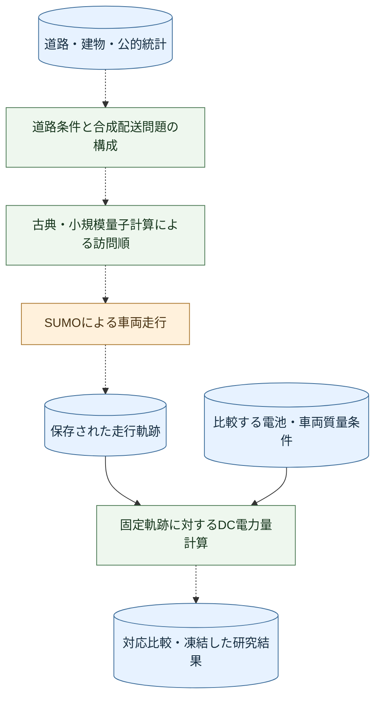
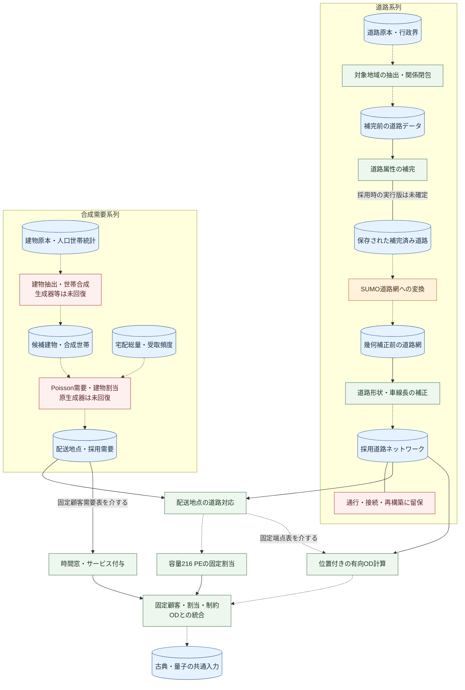
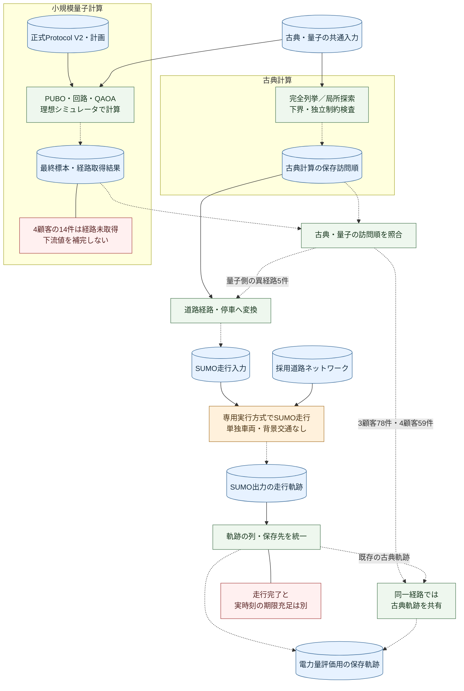
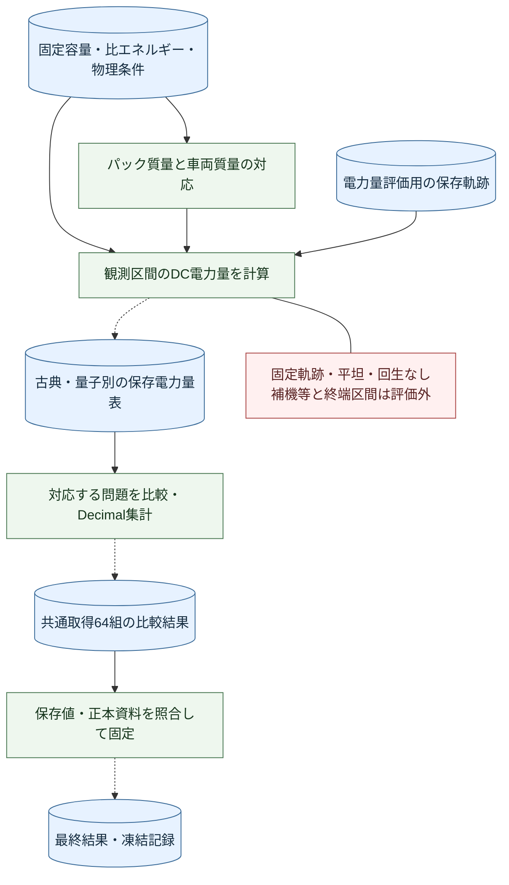

<a name="quantitative-research-guide"></a>

# 定量研究ガイド

本書は、本リポジトリの開発経緯を知らない研究者が、入力の意味、計算工程、保存結果、再利用できる範囲を確認するための文書である。数理モデルの説明に加え、「何を数えた値か」「どのファイルへ渡すか」「そのファイルを現在どこまで確認できるか」を示す。

**今回の確認日：2026-10-18。確認した公開ツリーの基準版：`a27b7ee2d762b0aeea4f4da7d579e1022378b906`。** 作業開始時HEADは依頼時の確認対象と一致し、対象MDを含む追跡ファイルに既存差分はなかった。本書の改訂はこの版を基準とする文書変更である。以下の「今回計測」はファイルの読取りによるbytes・行数・スキーマ・ハッシュ等の検査、「保存記録」は過去の実行・集計記録の読取りを意味する。今回、科学runner、Notebook、道路構築、需要生成、経路最適化、SUMO、DC計算、科学的再集計は実行していない。非同梱資料は作業環境内の研究保存ファイルと保全コピーに限って参照した。遠隔Hayateへの接続・存在確認は行っていない（[保存先と確認範囲](#12-github-and-hayate-responsibilities)）。

**本構成改訂の確認日：2026-10-19。開始時HEAD：`a8df0e3ae2b18097db77ebd2743c0e2dec6f5bdd`。** 前段の2026-10-18付監査記録と第11節の検証履歴は当時の記録として保持する。本改訂では計算問題の定義、因果構造概念モデルの位置付け、文書構成を整理し、科学計算・再集計・専門家評価は実施していない。入力契約を含む今回の直接確認範囲は[計算問題の定義](#computational-problem-and-scope)に示す。

本研究は、必要な配送需要の充足と、そのサービス提供に伴う電力量の低減を両立するために、量子技術がEV（電気自動車）配送へ影響を及ぼす仕組みと成立条件を調べる研究である。量子技術が必ず改善をもたらすことを前提とせず、古典技術を基準とする。現在の研究目的・仮説は[README](../README.md)、実施済み定量実験の位置付けは[研究基準文書](research/RESEARCH_BASELINE_20261009.md)に示されている。

実施済みの実験では、大田区の道路・建物・公的統計から合成配送問題を構成し、古典計算と小規模な量子アルゴリズムで訪問順を求めた。その順序に従う車両走行をSUMO（道路交通シミュレータ）で計算し、保存した軌跡に電池・車両質量の条件を与えて、電池側のDC（直流）電力量を比較した。道路旅行時間の最適化と、その後の電力量評価は別工程である。

**現在得られているのは、限定した配送問題と固定走行軌跡に対する比較結果である。** 実都市の全配送需要の充足、充電を含む運用全体、量子優位性を実証したものではない。現在の中心成果として目指すのは、既存文章・定量資料と専門家インタビュー記述を照合し、量子技術から配送成果へ至る主要因果パスを比較・構造化することである。インタビューは未実施であり、前後比較の結果は未取得である。

<a name="computational-problem-and-scope"></a>

## 計算問題の定義と評価範囲

### 対象とする計算問題

本研究の実施済み定量実験では、道路ネットワーク上に配置された固定顧客集合について、単一の配送車両がデポを出発し、すべての顧客を一度ずつ訪問してデポへ帰還する訪問順を求める。これは、車両への割当を固定した有向旅行時間と時間窓を持つ巡回問題である。

**最適化の目的は道路旅行時間の最小化であり、電力量の最小化ではない。**

顧客の車両間割当と車両台数は事前に固定され、経路最適化の決定対象には含まれない。充電位置・時刻、SOC（電池の充電状態）に基づく再計画、配送需要の再割当もこの最適化の対象外である。電力量は、取得した訪問順を道路経路およびSUMOの走行軌跡へ対応させ、その後に電池条件を与えて別途計算する。

### 入力・決定変数・目的関数・制約

|項目|定義・条件|
|---|---|
|計算問題|固定顧客集合・単一車両の訪問順最適化|
|顧客数|3・4・5・25・99・125。デポを顧客数に含めない|
|デポ|`DEP_006`|
|車両数|1計算問題につき1台|
|位置・道路入力|有向道路ネットワーク上のサービス位置とOD（出発地・到着地の組）|
|旅行時間|顧客間・デポ間の有向OD旅行時間（秒）。計画中は固定|
|需要|顧客別の荷物相当量（PE：parcel equivalent）。kgではない|
|決定変数|顧客の訪問順|
|目的関数|デポ発着を含む道路旅行時間総和の最小化|
|訪問制約|各顧客を一度ずつ訪問|
|車両容量|216 PE|
|サービス時間|102秒／顧客。デポでは0秒|
|時間窓|顧客のサービス開始時刻で判定、幅7,200秒。デポの時間範囲は別に定義|
|計画出発時刻|0秒|
|帰還期限|32,400秒|
|最適化対象外|電力量、充電、車両台数、顧客再割当|

正式入力のNPZは、`nodes`の先頭をデポ、残りを顧客とし、`travel`（秒）、`distance`（m）、`partition`を地点間の行列、`ready`・`due`・`service`（秒）と`demand`（整数PE）を地点別配列として持つ。`group`は対象集合の識別情報である。距離やOD分割情報の列が存在しても、距離を目的関数に加えたという意味ではない。配列の形状・結合と所在は[第8節](#8-data-dictionary)・[第12節](#12-storage-catalog)に示す。

顧客数を $n$、顧客の訪問順を $\pi$、デポを $0$、地点 $i$ から地点 $j$ への道路旅行時間を $\tau(i,j)$ とする。$\pi_1,\ldots,\pi_n$ は顧客 $1,\ldots,n$ の順列であり、$\pi_0=\pi_{n+1}=0$ とする。目的関数は次式である。

$$
\min_{\pi} T(\pi)=\sum_{k=0}^{n}\tau(\pi_k,\pi_{k+1}).
$$

$\tau(i,j)$ は有限・非負の入力値であり、$\tau(i,j)=\tau(j,i)$ は仮定しない。待機時間とサービス時間をこの目的関数へ加えない。これらは次の時刻計算と制約に使われる。

地点 $i$ の時間窓を $[r_i,\ell_i]$（入力の`ready`・`due`）、サービス時間を $s_i$ とする。第 $k$ 訪問の到着を $a_k$、待機を $w_k$、サービス開始を $b_k$、サービス終了後の出発を $e_k$ と置く。計画出発 $e_0=0$ から、$k=1,\ldots,n+1$ について次の順で計算する。

$$
\begin{aligned}
a_k &= e_{k-1}+\tau(\pi_{k-1},\pi_k),\\
w_k &= \max\{0,r_{\pi_k}-a_k\},\\
b_k &= a_k+w_k=\max\{a_k,r_{\pi_k}\},\\
e_k &= b_k+s_{\pi_k},\qquad b_k\leq\ell_{\pi_k}.
\end{aligned}
$$

顧客では $s_i=102$ 秒、$\ell_i-r_i=7{,}200$ 秒である。デポでは $r_0=0$ 秒、$\ell_0=32{,}400$ 秒、$s_0=0$ 秒とし、帰還時刻 $e_{n+1}\leq32{,}400$ 秒を満たす必要がある。**`due`との比較対象はサービス開始 $b_k$ であり、サービス終了 $e_k$ や現実の配送完了ではない。** 早着時には`ready`まで待機する。上記の計画時刻とSUMO走行時刻は別であり、静的制約を満たしたことだけでは走行時の期限遵守を保証しない。

顧客需要を $q_i$（正の整数PE）、デポ需要を $q_0=0$ とする。初期積載は $L_0=\sum_{i=1}^{n}q_i\leq216$ PEである。各訪問で $L_k=L_{k-1}-q_{\pi_k}\geq0$ とし、帰還時は $L_{n+1}=0$ となる。途中補充や需要の省略を含めない。これは容量・荷下ろしの会計であり、電力量モデルが積載質量の変化を反映することを意味しない（[第6節](#6-battery-and-controlled-dc-energy)）。

数式は[solver.py](../src/kmd_quantitative/routing/solver.py)の`replay`・`enumerate_exact`と[independent.py](../src/kmd_quantitative/routing/independent.py)の`validate`・`exact_dfs`を読み、正式入力の条件と照合して記述したものである。量子側も[Protocol V2の実装](../src/kmd_quantitative/quantum/protocol_v2/science.py)の`build_C`と`execute_child`、[Protocol定義](../src/kmd_quantitative/quantum/protocol_v2/protocol.py)により、同じ旅行時間目的と独立制約検査を用いることを確認した。PUBOの罰則を含む探索用目的値と、可行な訪問順の $T(\pi)$、車両のWhを区別する。既存の数理仕様を変更したものではなく、今回、これらの関数を実行していない。

正式入力契約の照合には、[第12節の保全コピーB](#12-storage-catalog)にある `01_research_design/scenario_evaluation/matched_classical_route_scale_20261007/INPUTS/CLASSICAL_SOLVER_SPEC.json`、`01_research_design/scenario_evaluation/matched_classical_route_scale_20261007/MANIFESTS/PROTOCOL.json`、第2節H12の入力準備コードを読んだ（2026-10-19）。公開のsolver・independentは同じ`INPUTS/`内の凍結コピーとバイト一致した。これらの非同梱資料を公開cloneで閲覧できるとはしない。公開の条件表は次項の規模別CSVで確認できる。

### 問題規模と計算方式

|顧客数|古典計算|量子計算|正式量子問題の二値変数数|
|---|---|---|---:|
|3|全列挙・最適性証明|理想状態ベクトルQAOA|9|
|4|全列挙・最適性証明|理想状態ベクトルQAOA|16|
|5|全列挙・最適性証明|未実施|非該当（正式実験なし）|
|25|確定的ヒューリスティック・LP下界|未実施|非該当（正式実験なし）|
|99|確定的ヒューリスティック・LP下界|未実施|非該当（正式実験なし）|
|125|確定的ヒューリスティック・LP下界|未実施|非該当（正式実験なし）|

表の量子計算は最終共通Protocolの正式実験を指す。QAOA（量子近似最適化アルゴリズム）は理想状態ベクトルによるシミュレーションであり、量子実機の実験ではない。正式な位置表現の二値変数数は $n^2$ である。9・16はこの定式化と理想回路の規模を表し、誤り訂正を伴う実機の論理・物理量子ビット数や必要資源の見積もりと同一視しない。大規模側のLPは線形計画による下界であり、ヒューリスティックで取得した経路を大域最適解と呼ばない。

26親問題・各3選択反復・6規模による**468論理条件**と、同一入力をまとめた**460固有問題**を区別する。論理条件は親問題・選択反復・規模の組、固有問題は実際の入力実体である。125顧客の78論理条件は70固有問題を参照する。選択反復の`replicate_id`は独立した量子反復ではない。大田区の39,956合成配送地点を一括して量子計算したわけではなく、固定割当から選択した26親問題の顧客部分集合を比較している。顧客数以外にも需要量、地理、時間窓の構成や計算方式が変わるため、規模別の差を顧客数単独の因果効果としない。

出典は[古典・量子の規模比較](../01_research_design/scenario_evaluation/quantitative_scale_boundary_synthesis_20261008/CLASSICAL_QUANTUM_SCALE_COMPARISON.csv)、[問題条件の規模別一覧](../01_research_design/scenario_evaluation/quantitative_scale_boundary_synthesis_20261008/SCALE_INSTANCE_COMPARISON.csv)、[第3節](#3-routing-model)・[第4節](#4-quantum-model-and-protocol-v2)である。件数・方法・条件は保存記録の記載であり、今回新たに求解・最適性検証した結果ではない。

### 出力と研究成果の区別

|段階|主な出力|意味|
|---|---|---|
|経路最適化|訪問順、道路旅行時間、可行性、経路取得の成否|最適化問題に対する解の取得・品質|
|走行・電力量評価|SUMO走行時刻・速度、停車・帰還診断、限定的なDC電力量|固定した運行・物理条件における結果|
|研究全体の成果指標|期限内需要充足率、走行時の電池側正味DC電力量|配送サービスと電力量の両立を検討するための指標。既存評価だけでは両指標の完全な測定に至らない|
|現段階の中心的研究結果として報告する対象|インタビュー前後の主要因果パスの変化、根拠、成立条件、操作化可能性|因果構造概念モデルの比較による研究成果。インタビューは未実施であり、前後比較の結果は未取得|

経路取得率、静的制約の可行性、SUMO走行完了、期限内需要充足率は別々の指標である。期限内需要充足率は配送実完了・需要量・完了期限の対応が必要であり、現状は**未算出**である。経路取得率や走行完了率から推測しない。既存のDC評価も回生・補機等を除外しており、走行時の電池側正味DC電力量全体の検証とは区別する。保存済み定量結果は[第7節](#7-analysis-and-frozen-results)、因果構造の比較と未取得事項は[第15.3節](#15-3-rvv-and-causal-comparison)に示す。

<a name="model-rvv-results-overview"></a>

## モデルの表現・検証・妥当性と研究結果の位置付け

本研究には、実施済みの配送問題・経路計算・走行・電力量評価を接続する既存定量モデルと、既存資料とインタビュー記述を用いて主要因果パスを構造化する因果構造概念モデル（causal-structure conceptual model）という、目的と到達状態の異なる二つのモデルがある。両者の評価を、Model Representation（何をどのような構造で表すか）、Model Verification（その仕様・根拠と記述・実装が整合するか）、Model Validation（研究目的と対象現象に対して表現がどの程度妥当か）に分ける。「検証済み」という一語で、ファイルの同一性、計算の正しさ、専門家の認識との整合、現実の因果的妥当性を一括して表さない。

|観点|既存の定量モデル|因果構造概念モデル|
|---|---|---|
|Representation|[計算問題の定義](#computational-problem-and-scope)に示した入力、訪問順の決定変数、制約、経路・走行・電力量の計算過程と評価境界を表す。期限内需要充足率や充電を含む運用全体の計算は未完成。|変数、主要因果パス、媒介関係、作用方向、成立条件を表す。量子技術から計画取得・採用・出発・実走行・実完了、または電池比エネルギー・車両質量を経て、期限内需要充足と電力量へ至る構造を検討する。循環構造の形成を完成条件としない。|
|Verification|数理仕様と実装の一致について、一部の独立制約検査、数値回帰、保存結果・ハッシュ・入出力契約の照合記録がある。上流から最終結果までの独立再生成は未達成。|原資料→因果記述→変数・リンク→主要パス→因果図の追跡可能性、符号・方向・条件の整合、前後の変更履歴を検査する計画である。これは実装テストとは別の構造・記述検証であり、前後比較を含む実施結果は未取得。|
|Validation|実注文、実交通、実車電力量との体系的な照合が未完了であり、現実への妥当性は確立していない。|文献と専門家の説明に照らし、主要パスの妥当性、適用条件、矛盾、欠落を検討する。専門家の同意は因果関係の実証ではない。インタビューは未実施であり妥当性の到達結果も未取得。|
|Results|[第7節](#7-analysis-and-frozen-results)に保存された定量実験の結果を報告する。これらは事前モデルの一部の関係を検討する根拠にもなる。|本研究の中心的なResultsは、事前モデルとインタビュー資料を照合した統合後モデルの主要因果パスの差分とその根拠である。現時点で差分の実測結果は存在しない。|

この二層のモデルについて、Representation・Verification・Validationの証拠、未確認事項、および研究結果の報告形式を[第15.3節](#15-3-rvv-and-causal-comparison)に整理する。既存定量結果をインタビューの成果として扱わず、またインタビュー由来の因果認識を定量モデルの物理的妥当性の証明としない。

次の図は実施済み定量実験の見取り図である。青の円筒は入力・保存データ、緑は計算処理、橙は走行環境を表す。実線は確認した入力・処理の関係、破線矢印は保存記録に基づく生成の経緯、矢印のない線は関連を表す。今回の文書改訂で科学実験を再実行したという意味ではない。因果構造概念モデルは、定量結果・文献・インタビュー記述を照合して構成するものであり、定量実験の出力から自動生成される工程として図示しない。



初めて読む場合は、冒頭の[計算問題](#computational-problem-and-scope)と[モデル評価の位置付け](#model-rvv-results-overview)を読み、第0節で工程の意味、第1節で評価範囲、第2節で接続関係を確認し、第3〜7節で方法と結果へ進むとよい。再利用のための設定・環境・検証は第8〜12節、出典と既存成果の限界は第13〜14節、残る課題は第15節にまとめた。本書は研究の説明と再利用のためのガイドであり、正式な仮説・数値・凍結記録を改訂するものではない。

|読む目的|入口と到達点|
|---|---|
|研究内容と主張の範囲を把握する|第0・1節→第7・14・15節。実施済みの限定評価と今後の研究を区別する|
|データを検査・接続する|第2節の工程契約→第8節の辞書・公開CSV例→第12節の正確な所在|
|公開物を使う|第9〜11節。閲覧、読取り専用検査、小規模計算、正式保存値の表示を選ぶ|
|原入力から同じ結果を再生成する条件を調べる|第2・10・12・15節。非同梱入力と未回復の生成来歴を確認する。全量再生成可能との認定はない|

- [計算問題の定義と評価範囲](#computational-problem-and-scope)
- [モデルの表現・検証・妥当性と研究結果の位置付け](#model-rvv-results-overview)
- [15.3 因果構造の前後比較](#15-3-rvv-and-causal-comparison)
- [0. 研究工程の全体像](#0-open-data-to-frozen-results)
- [1. 研究の対象範囲](#1-research-scope)
- [2. 研究モデルと実装の全体構成](#2-model-architecture)
- [3. 古典経路計算の方法](#3-routing-model)
- [4. 量子経路計算とProtocol V2](#4-quantum-model-and-protocol-v2)
- [5. SUMOによる走行と軌跡](#5-simulation-and-trajectories)
- [6. 電池条件とDC電力量の評価](#6-battery-and-controlled-dc-energy)
- [7. 保存結果の分析と解釈](#7-analysis-and-frozen-results)
- [8. データと設定](#8-data-and-configuration)
- [9. Notebookの利用方法](#9-notebook-guide)
- [10. 実行手順と計算環境](#10-quickstart-and-dependencies)
- [11. 再現可能性と実装の検証](#11-reproducibility-and-verification)
- [12. GitHubと研究用保存領域の役割](#12-github-and-hayate-responsibilities)
- [13. データの出典・帰属・利用条件](#13-data-attribution-and-licensing)
- [14. 既存成果の限界と来歴](#14-limitations-and-provenance)
- [15. 残存課題と今後の研究](#15-remaining-research-questions)

<a name="0-open-data-to-frozen-results"></a>

## 0. 研究工程の全体像

本節では、研究の目的からデータ取得、加工、計算、結果の確定までを順に説明する。保存資料の確認と、その処理の再実行は別である。本改訂では新しい科学実験・需要生成・道路再構築を行っていない。

|確認状態|このガイドでの意味|
|---|---|
|確認済み（CONFIRMED）|保存資料・コード・実行記録等から内容を確認できる。科学的妥当性全体の認定ではない|
|記録から再構成（RECONSTRUCTED）|複数の証拠を接続して説明できるが、当時の全操作を直接確認できるわけではない|
|推定（INFERRED）|研究設計上の意味や一般的方法からの解釈であり、採用済みの仕様や実行履歴の代用にしない|
|不明（UNKNOWN）|証拠不足で判断できない。欠落値や工程を推測で補わない|

需要は**荷物相当量（parcel-equivalent、以下PE）**という研究上の単位で扱う。荷物の実個数、顧客訪問数、配送地点数、積載kgとは区別する。**OD**は出発地と到着地の組であり、本研究では道路上の位置と進行方向を含む移動時間・距離を表す。以下の詳細条件と確実性は、節末の工程追跡表から元資料へたどれる。

**正本**とは、その数値・条件・対応関係の根拠として採用した保存物である。**凍結記録（freeze）**は対象版・ハッシュ・評価範囲・状態を固定する記録であり、現実への妥当性認定ではない。**論理条件**は親問題・部分集合選択・規模の組、**物理インスタンス**は重複を除いて実際に計算する問題データであり、実車や実世帯ではない。**対応ブロック**は同じ`parent_id, replicate_id`でR0（3顧客）とR1（4顧客）を対にする単位である。`replicate_id`は部分集合の選択反復であり、独立した量子計算の反復を表さない。

### 数量とデータの性質を読むための要約

|データの性質|本研究での例|読み方|
|---|---|---|
|外部の地理・公的統計|OSM、CityGML、行政界、人口・世帯・受取頻度の集計|実在地域に由来する入力である。全属性の実測・完全性や、この研究の実配送観測を意味しない|
|加工した地理情報|道路補完、SUMO網、建物代表点、道路対応点、位置付きOD|原情報に抽出・モデル規則・計算を加えた値である。補完速度やOD旅行時間は実交通の観測値ではない|
|統計から作った合成値|384,353世帯、一日の需要、39,956配送地点|実世帯個票・注文履歴・実配送先全数ではない。2026-01-01は合成評価日である|
|固定した仮定値|216 PE容量、102秒サービス、7,200秒時間窓、電池B0/B1/B2、Crr二条件|研究条件であり実車・事業者の測定値ではない|
|モデル内の計算・観測出力|訪問順、SUMOのFCD、DC Wh、対応比較|FCDの「観測」はシミュレータ内の時刻・速度の記録である。実車計測ではない|

|量の区分|対象集合と数量|根拠の状態・参照|
|---|---|---|
|研究対象・需要|384,353合成世帯→正の需要73,547レコード・82,246 PE→建物対応73,200レコード・81,859 PE→39,956配送地点|H4・H7の保存記録。CSV行数を今回照合。期待日量82,023 PEとの違いは0.7|
|研究対象・割当|39,956地点を182需要グループ・465担当集合へ固定割当。そのうち125顧客以上の26親問題・25グループを部分問題作成に採用|H8・H9、公開規模条件表。465集合すべてを量子計算したという意味ではない|
|実験条件・問題実体|26親×3選択反復×6規模＝468論理条件、460固有問題。R5の78条件は70実体を参照|H12の論理対応JSONは今回468要素を確認。460は公開凍結集計による|
|実行・取得・比較対象|最終共通ProtocolのR0/R1は各78実行。経路取得78/78・64/78。計画78ブロック中、共通取得64ブロック|P1・公開母集団表。実行完了、経路取得、配送充足は別の量である|
|比較表のレコード|256行＝64×2 Crr×2電池比較。直接電力量表は384行＝64×2 Crr×3電池条件|索引と実CSVを今回照合。両規模・両方式を列に持つため、さらに2×2を行数に掛けない|
|ODの分割とペア|採用索引1,665分割行。全要求13,826,894有向ペア、固定担当内とデポ往復のsolver結合4,008,028ペア|分割索引の行数は今回計測。ペア数はH12の既存summary・監査記録であり、全Parquet行の再計数は未実施。充電施設関係のODも全要求に含み、無充電の主評価へ全行を使うわけではない|
|軌跡と標本|古典対応比較460軌跡。R0の78件とR1の59件は既存軌跡共有、R1異経路5件は追加走行の保存記録|軌跡数はH14・公開凍結記録。方式別結合行数、物理ファイル数、時刻標本数を足し合わせない。全系列の標本総数は今回未確認|
|保存量|道路Releaseは1 tar.gz・48,285,157 bytes、内部14ファイル。代表的な非圧縮CSVと圧縮軌跡のbytesは第8節|Release記録とローカル保全archiveを照合。圧縮量は展開後容量や実行時メモリではない|

本書では、**今回計測／保存記録／仕様上の期待値／不明／非該当**を区別する。行数はヘッダを除くデータ行数である。未計測の全OD・全軌跡・歴史版を含む総容量は不明であり、0ではない。容量は指定したファイルの論理的な保存bytesを示し、ファイルシステムの割当ブロック量、コピー間の重複をハッシュで除いた量、メモリ使用量を表さない。

### 0.1 研究上の問題意識

研究全体は、必要な物流サービスを確保しながら、その実現に伴う電力量を下げることを目指す。既存の定量実験では、訪問順を変える経路（Path 1）と、同じ走行軌跡で電池パック・車両質量条件を変える経路（Path 2）を接続した。評価対象は限定されたDC牽引電力量であり、充電や社会全体の消費まで含む仮説の検証完了ではない。現在の目的・仮説と、実験当時の正式RQ・主仮説の原文は[第1節](#1-research-scope)で区別して保持する。

### 0.2 なぜオープンデータを組み合わせたか

直線距離だけでは、道路の接続、向き、通行可能性が経路選択と走行に与える制約を表せない。一方、道路だけでは配送先の分布や需要量は分からない。このため、OSMの道路、PLATEAUの建物、行政界、公的統計の人口・世帯・受取頻度を異なる役割の入力として接続した。取得台帳、需要工程台帳、最終入力契約の対応から、この設計を再構成できる。道路属性の観測、統計による較正、研究者の仮定は同じ確実性を持たない。

**設計上の解釈（推定）：** 個別企業の注文記録に依存せず、入力の出所と仮定を追跡できる比較問題を構成することは、合成需要を採用する合理的な理由である。ただし、配送会社へのデータ提供依頼や不許可の履歴を確認したわけではなく、「注文データを入手できなかったから」と過去の意思決定を断定しない。実際に用いたのは統計から生成した需要であり、配送会社の実注文履歴ではない。

### 0.3 対象地域とデータ選定

初期実装計画は、東京全域へ直ちに進まず、環境・データ統合検証を大田区で開始すると定めている。研究範囲は国土数値情報N03の2026年東京都行政界から行政区域コード`13111`を選び、東京都・大田区の名称も照合して固定した。観測点数や結果の良否で境界を動かさない設計である。境界矩形は取得用、行政界ポリゴンは地域判定用であり、同一ではない。

**設計上の解釈（推定）：** 一自治体に限定し、道路・建物・統計を共通の地域キーで接続することは、都市規模のデータ処理を管理可能にする。**未確認事項：** 大田区を他自治体より優先した理由を、空港・工業地帯・所属機関との近さ等に帰す根拠は今回確認していない。都市の特性から後付けの選定理由を作らない。

### 0.4 何を、どこから、どう取得したか

道路原本には、地域ごとの時点固定データを取得できるGeofabrikのOSMを用いた。版・取得日・ファイル同一性の情報は下表に示す。[関東配布ページ](https://download.geofabrik.de/asia/japan/kanto.html)と[当時の日付固定URL](https://download.geofabrik.de/asia/japan/kanto-260716.osm.pbf)を区別する。現在のlatestは別の時点固定コピーであり、代用して同じ実験としない。日付固定URLの現在の取得成功までは保証しない。

取得記録に残るコマンドは次である。これは当時のDocker・Hayate側コードを必要とする**履歴上の実行手順**であり、現在の小規模GitHub配布だけで実行できるコマンドではない。

当時の研究ルート直下を実行場所とし、N03・地域設定を読み、原本・抽出物・品質記録を書き込む処理である。原本と抽出物の出力先は第12節D01/D02、実行・環境確認は2026-07-17のH1記録による。今回はこのコマンドを実行していない。

```bash
docker compose run --rm analysis \
  python -m traffic_simulation.network.fetch_osm \
  --region ota_ward --snapshot-date 20260716
```

同処理は日付固定URLを組み立て、`.part`へ取得し、サイズ・PBF形式・要素数・SHA256を検査してから原本を確定した。Overpassやブラウザの手動エクスポートを用いたという記録ではない。道路データベースの出典は© OpenStreetMap contributors、利用条件はODbL 1.0であり、詳細は[帰属表示と配布](#13-data-attribution-and-licensing)を参照する。

建物には国土交通省Project PLATEAUの[3D都市モデル（大田区）（2025年度）](https://www.geospatial.jp/ckan/dataset/plateau-13111-ota-ku-2025)のCityGMLを採用した。保存ZIPの名前・サイズ・ハッシュは下表に示す。保存取得資料は2026-08-21、ZIP内READMEは作成2026-03-13・製品仕様第5.0版を示す。データ年度、README作成日、取得日を混同しない。

配布ページで大田区2025年度を選び、CityGMLのZIP配布ファイルを取得し、ファイル名・README・ハッシュを保存するという取得経路が資料と整合する。**未確認事項：** 個別のブラウザクリック列や当時のcurlコマンドは確認できないため提示しない。建物形状・用途と位置を接続できることが研究上の採用意義であるが、CityGMLの全属性を計算に使ったとはしない。利用条件は配布ZIPの表示と提供元の条件を優先し、研究コードのApache-2.0を適用しない。

|原本|版・取得記録|ファイルと同一性|
|---|---|---|
|関東の道路原本|データ時点 `2026-07-16T20:21:30Z`、2026-07-17取得記録|`kanto-260716.osm.pbf`、476,772,780 bytes、SHA256 `aef890f28b652ed7bd2b0d77e86f263219b479fe3eedbdd8610dcfc1572c420d`|
|大田区の建物原本|2025年度。保存取得資料2026-08-21、ZIP内README作成2026-03-13、製品仕様第5.0版|`13111_ota-ku_pref_2025_citygml_1_op.zip`、543,501,320 bytes、SHA256 `820f2b6c7af9e2a097c0868f3452953cbbe90f81c450ae5880f31eb52d159800`|

需要統計はe-Stat等の公的集計を用いた。2020年国勢調査の小地域CSV（表ID`000032163278`）と500mメッシュ（`T001141034`等）、2023年住宅・土地統計調査（表ID`000040209857`）は世帯構成・住宅区分・地域配分へ接続する。元表の全採用セルと合成世帯への変換は完全には復元できていない。

受取頻度は[国土交通省・東京都市圏物資流動調査、令和6年度「個人のモノの受取調査」](https://www.e-stat.go.jp/stat-search/files?layout=dataset&tclass1=000001223521&tclass2=000001234242&toukei=00600520&tstat=000001078042)のss521「世帯人数別・世帯構成別宅配受取頻度（回数）・再配達頻度（割合）」である。`ss521_r06a.xlsx`、シート`ss521_R06`、SHA256 `5b6ae34c771739869648147487780d4f0bb1f2a556f36c5ff97ee0514de664e0`を保存台帳で識別できる。取得観測日は2026-08-23、台帳固定は08-29である。08-25の9表の原本固定記録にはss521は含まれないため、後続台帳と採用強度CSVで接続を確認した。

e-Statの該当統計・年度・表分類からExcelを取得することが一般的な取得手順である。ss521はworkspaceから供給されたファイルとの記録であり、当該URLから直接通信したログを意味しない。2026-10-09の説明整備時はGeofabrik配布ページを閲覧でき、PLATEAU・e-Statは取得できなかったという記録である。今回2026-10-18も同じ閲覧結果であった。年度・取得日は保存資料に基づき、閲覧失敗から削除や非公開化を推定しない。

### 0.5 道路を走行計算に使える形へ加工する

まずN03行政界からEPSG:4326の外接矩形（西139.652974773、南35.528198081、東139.826027782、北35.613210171）を機械生成した。osmium-tool 1.15.0の`extract --strategy complete_ways --set-bounds`で交差するwayの参照ノードを保持し、12,218,967 bytesの大田区抽出PBFを得た。wayを矩形境界で切断しないため、含まれるノードの範囲は取得矩形より広がり得る。初期抽出には40,880のhighway wayがあるが、その数を最終走行可能有向道路区間数としない。

抽出だけではrelationの参照、方向、車線、速度、通行規制を確定できないため、後続の関係閉包・属性解決工程へ進んだ。保存された入力は`ota_ward_20260716_relation_closure_v16.osm.xml`であり、v17のblocker記録と属性補完へ接続する。highway種別にはmotorway/trunk/primary/secondary/tertiaryと各link、unclassified/residential/service/living_street等がある。自動車系の種別選択と、個別のdelivery車両の通行可否は別の判断である。

three-tier補完器は元の`lanes`、`maxspeed`、`access`等を読み、明示値・推定値・代替規則を分けて記録する。例えば保存コードの速度表はmotorway80、trunk60、primary50、secondary/tertiary40、residential30、service/living_street20 km/h等である。これらは欠損時のモデル規則であり、実測速度ではない。保存された値決定関数はaccess=noをno、他をyesへ処理する箇所を持つため、全法的通行規制を精密に復元したとは説明できない。`EXTRATREES_BENCHMARK_PROXY`という名称だけから学習済み機械学習モデルの使用を推定しない。採用runner・全補完レコード・最終値の完全な対応確認は未完了である。

補完OSMをSUMO/netconvert 1.24.0で`--osm-files --proj.utm --ignore-errors`等の保存コマンドにより変換し、交差点等の接続点（junction）、有向道路区間（edge）、車線（lane）を得た。OSMのwayとSUMOの有向道路区間は単純な一対一ではなく、道路接続と車線許可を含む変換である。変換成功だけで実都市の完全な通行再現や信号・交通量の妥当性を保証しない。

最終幾何補正の実コマンド・`repair_network_geometry_lengths.py`・repair報告は、車線形状を交差点の接続点端点へ接続し、接続後の折線長を車線 lengthへ反映したと記録する。一方、設定の時点固定コピーには「length維持」と実在を確認できない別の生成プログラム名があり、整合しない。本説明は実在コード・コマンド・変換報告に基づくが、PBFから最終XMLまで完全な同一再生成が可能とはしない。最終XMLのハッシュは`460554c7716fe5e3e1410bbee790e69745a2c423146bac88e51e3a2b95f051b2`であり、下流planと一致する。この実ファイルを[道路データRelease](https://github.com/tkm-sano/kmd-analysis/releases/tag/road-data-20261009-rc1)で提供している。

### 0.6 建物と統計を需要の基礎へ加工する

研究用保存領域の参照可能なローカル資料には建物候補CSVが存在し、building_id、building_usage、住宅区分との適合、geometry参照、階数・地下階数・高さ、source_file/feature_id、除外状態を記録している。過去の監査で未回収とされたCSVはその後の資料確認で実在が確認されたが、中間parquetの生成器の回復を意味しない。保存されている高さ・階数の列を、そのまま世帯配分の重みとして使ったとはしない。

CityGMLの建物ID・用途を住宅候補へ対応させ、町丁目との空間的な対応を作り、代表点を後段の配送地点へ渡したという流れが工程台帳と保存出力から読める。**設計上の解釈（推定）：** 通常この接続には座標系を合わせた形状読込み、代表点の計算、行政区画への空間結合が必要である。しかし、代表点が重心か内部点か、使用した全用途コード、境界処理、入力ZIPの混合有無は確認できない。

**未確認事項：** `plateau_buildings_all_with_chocho_points.geo.parquet`の記録ハッシュは`6779656a0719bb91b9bf97513e23498d88f5bc9eacdebccfcc7d5b1b5e161fa0`であるが、原本と直接生成コード・ログは未回復である。ZIP内説明のLOD1建築物158,860棟と工程台帳の候補195,311行は一致しない。その理由を重複や建物分割だと断定しない。ZIP→候補→この中間parquetの完全来歴が残る確認点である。保存記録には `residential_building_candidates.parquet` も現れるが、その実体と正式パスも未回復である。保存候補CSVをこれらのparquetと同一物として代用しない。

公的統計から生成した合成世帯は384,353である。住宅区分は市区町村集計に基づく多項・カテゴリ割当、seed20260830との記録がある。これは実在世帯の個票や居住建物を観測したものではない。建物への割当では許された住宅候補からの一様離散選択を採用し、住戸数、入口、建物収容能力、最寄り候補による救済は使用していないと保存summaryに明示される。全世帯生成の乱数環境・固定行順・採用セルの詳細は未回復である。

### 0.7 世帯から一日の合成配送需要を生成する

基準需要設定は2024年全国宅配便取扱量5,031,470,000、全国人口123,802,000、大田区人口736,652、365日を採用した。全国一人当たり日量を大田区人口へ移す式は`5,031,470,000 / 123,802,000 / 365 × 736,652`で、保存台帳の値は82,023.204937、整数の期待日量は82,023 PEである。これは全国規模の取扱量の人口比例移転であり、大田区住宅の実注文総数の実測・推定精度を保証しない。全国量には住宅B2C以外も含まれ得る。

基準メッシュ工程は2020年人口メッシュを行政界との面積で按分し、2024年大田区人口へ再尺度化し、最大剰余法で整数を配分した。世帯への期待値配分では、ss521の受取経験のある世帯の人数別小計を使用する。採用週頻度は1人0.65148273、2人0.93035232、3〜4人1.18813494、5人以上1.45298673回/週である。共通参照0.8498914166013274回/週で割った相対強度rを用い、`lambda_h = 82023 × r_h / sum(r_h)`として各世帯の日量期待値を与える。週頻度をそのまま全世帯の実日量と解釈せず、都市全体の期待日量を配分する相対情報として使用している。

保存された生成仕様は`N_h,d ~ Poisson(lambda_h)`、seed20260829、合成評価日2026-01-01である。評価日の文字列は取得日より前でも、実際にその日に観測したという意味ではない。Poissonと世帯間独立性はモデル仮定であり、実測分散に適合したことを確認したものではない。保存された期待値合計82,023.00000048117と目標82,023の差は記録された許容差内である。乱数生成ライブラリ・全行順を含む原生成器は未回復なので、乱数seedだけで全く同じ標本を再生成できるとはしない。

|段階|保存値|何を数えるか|
|---|---:|---|
|合成世帯|384,353|統計から作った世帯レコード|
|一日の期待総量|82,023|PE、乱数実現値ではない|
|正の需要レコード|73,547|正の世帯日需要レコード（複数PEを含み得る）|
|生成需要総量|82,246|PE、注文レコード数ではない|
|建物対応済み世帯|382,369|全合成世帯のうち割当済み|
|需要のある対応済みレコード|73,200|建物へ対応した需要レコード|
|建物対応済み需要量|81,859|parcel-equivalent|
|需要のある建物／配送地点|39,956|同一建物でまとめた配送停車|

後段のscoped summaryは、候補なし206世帯・住宅型非対応1,778世帯を残し、割当済み世帯を85,690建物へ対応させる。正の需要を持つレコードをbuilding IDで集約してPEを加算し、39,956地点とした。`matched`および`matched_cross_boundary`の範囲を採用し、曖昧・範囲外等を無断補完しない。生成総量82,246全体の保存ではなく、割当範囲内の81,859だけが配送停車へ保存されている。初期summaryのactive_buildings=0は建物割当以前の記録であり、後段の39,956を打ち消さない。

今回、H7の二つのsummaryとH4の工程台帳を直接読み、需要CSVの73,547行、合成世帯・期待値・建物対応CSVの各384,353行、配送地点CSVの39,956行を確認した。PE合計と対応済み件数は保存summaryの値であり、本改訂で需要を再集計した値ではない。期待日量から乱数実現値への差は82,246−82,023＝223 PE、生成値から採用範囲への差は347需要レコード（73,547−73,200）・387 PE（82,246−81,859）である。これらは保存数値の算術照合であり、実配送失敗件数ではない。206＋1,778＝1,984は全世帯の未割当数であり、347という正の需要レコード数とは母集団が違う。各非採用需要の理由をこの差分だけから割り当てない。

73,200から39,956への減少は同一建物の正の需要を一停車へ集約するためであり、採用範囲の81,859 PEは保持される。全生成需要82,246 PEの保存とは区別する。期待値配分と建物割当は合成世帯から分岐する工程であり、保存summaryだけから両者の実行順序を一意に確定しない。

### 0.8 配送地点から比較可能な配送問題へ

建物代表点は入口・停車場所ではない。配送地点を道路上のサービス位置（MODEL_SERVICE_POINT）へ対応させ、配送車両（delivery）が利用する有向道路区間・車線・道路上の位置を固定した。デポDEP_006はP31物流施設候補に由来する研究上の代理拠点であり、配送会社の営業区域を観測したものではない。位置の道路対応を確定してから、位置付きの有向OD旅行時間・距離、到達可能性を計算した。同一有向道路区間上でも進行方向により周回が必要となるため、道路上の位置を考慮する専用経路探索器を利用する。

容量216 PEは実車積載kgから換算した値ではない。保存された設計は需要グループの需要中央値431を代表として`ceil(431/2)=216`を提案し、2026-09-30の容量の凍結記録が採用を記録する。「代表需要グループを二つの容量予算で扱う」という方法論上の選択である。一次比較で固定し、108/432の感度候補と混ぜない。

固定割当は需要グループ内の道路対応座標を1m整数格子へ置き、Morton/Z順で並べ、需要合計が216を超えない連続next-fit区間に分割する。顧客を分割・他需要グループへ移動・後から詰め替えない。得られた182需要グループ・465車両担当集合は容量上の編成であり、時間窓・SOC（充電率）に関する可行性や最適車両台数を保証しない。空間順序は割当用で、訪問順は後段の経路計算で決める。

最終の対応比較設計は、125顧客以上の26親問題・25需要グループを選ぶ。各親問題について固定ハッシュによる3通りの選択順を定め、それぞれから包含関係を持つ部分集合n=3/4/5/25/99/125を作る。初期のPPS10顧客合成入力やEV41kWhの設計枝を、この最終20kWh評価へ混ぜない。親の需要・OD・時間窓を継承し、固定1車両、サービス102秒、時間窓幅7,200秒、出発0秒・帰還32,400秒を用いる。これらは研究条件であり実サービス時間の観測値ではない。102秒・時間窓幅の根拠の全来歴を今回独立に確定したとはしない。

### 0.9 同じ入力で古典計算と量子計算を比較する

比較対象は訪問順を得る方法である。同じ顧客集合・割当・OD・制約を古典と量子の各方式へ渡し、経路計算後の電力量を別に評価する。以下では3顧客の比較をR0、4顧客の比較をR1と呼ぶ。これらは最終の共通Protocol V2の系列名であり、過去の別ProtocolのR0とは区別する。

古典側は訪問順についてデポ発着を含む道路旅行時間を最小化し、容量・時間窓・全顧客一度訪問・帰還の制約を満たすこと（可行性）を別実装で検査する。保存6規模のうちn≤5は完全列挙、n≥25は確定的ヒューリスティックと割当緩和の線形計画（LP）下界である。**設計上の解釈（推定）：** 旅行時間を共通目的とし、その後で電力量を別評価する設計は、求解対象と物理的影響を分離するために有効であるが、この説明を当初の選定理由の逐語記録とはしない。

量子を比較対象とした根拠は実験当時の正式RQである。同じ物理入力・固定割当・制約を、補助変数なし位置表現（Candidate C）の多項式無制約二値最適化（PUBO）へ写し、旅行時間と罰則を計算する。正式Protocol V2の量子近似最適化アルゴリズム（QAOA）は理想状態ベクトルを使い、回路層数p=1、Hゲートによる初期状態、Xミキサー、COBYLA最大100評価×2,048 shots、独立最終4,096 shotsである。shotsは回路から取得する標本数であり、最終標本と最適化途中の標本を区別する。古典前処理の全順列可行性表を用い、最終標本の復号・独立検査後に最小旅行時間の経路を選ぶ。計算本体・bit順序・同点規則は[第3節](#3-routing-model)と[第4節](#4-quantum-model-and-protocol-v2)を参照する。量子はR0/R1の小規模比較だけであり、古典6規模すべてで量子を実行したわけではない。

### 0.10 訪問順をSUMOの走行軌跡へ接続する

最適化結果の訪問順（customer_order）を配送端点列へ対応させ、隣接端点間の道路経路を専用`duarouter_loop`で得る。区間をつなぐ際の重複道路区間を処理して一本の経路へ連結し、停車車線・停止位置（endPos）・停車時間（duration=102秒）・予定出発までの待機条件（until）を設定する。保存実行計画はSUMO1.24の既存delivery車両挙動、乱数seed20260930、計算刻みとFCD（走行車両データ）の出力周期1秒、単独車両・背景交通なしを指定する。初期計画の状態表示は作成時点の記録であり、後続の軌跡凍結記録を完了の根拠とする。

道路網の初期状態を子プロセスへ複製する専用実行方式（native time-zero fork）で実行し、時刻・速度・座標・車線/有向道路区間等を保存した。OD旅行時間は最適化の目的、SUMO観測所要時間は停車・待機・走行挙動を含む結果、DC入力は保存した1秒時刻・速度列である。車線上の位置を累積走行距離としない。DC側の観測距離は区間速度×dtであり、tripinfoのrouteLengthとも別に記録する。背景交通や複数車両の相互作用を検証したとはしない。

3顧客（R0）の同一経路78件は古典計算軌跡に結合し、4顧客（R1）は同一59・異経路5の取得経路に対して下流評価した。未取得経路の架空軌跡は生成しない。全量再現には専用経路探索器、fork実行環境、端点・固定割当・道路網・保存実行計画が必要で、標準SUMOのみで同一実験になるとは保証しない。[第5節](#5-simulation-and-trajectories)に入出力契約を示す。

<a name="011-軌跡を固定してbattery条件と電力量を比較する"></a>

### 0.11 軌跡を固定して電池条件と電力量を比較する

電池条件を変える評価（Path 2）は容量20kWhを固定し、比エネルギー180/220/250Wh/kgをパック質量111.111111/90.909091/80kgへ写す。以下では、この順に電池条件をB0/B1/B2と呼ぶ。共通の車体等の残余質量を保持して車両質量へ反映するため、車体自体を軽量化した実験ではない。量子計算がこの電池性能を実現したという結果でもない。

各経路の保存軌跡を全電池条件で共通使用し、質量差によってSUMOを再走行させない。固定条件の電力量モデル（Controlled-DC）は転がり・並進・回転・空気抵抗の仕事から正の車輪仕事を取り、効率0.90で電池側DC Whへ換算する。平坦・回生なし、補機等は評価外である。18kWhからの累積消費による残量会計・負残量検出は行うが、SOC停止、充電、再計画は行わない。[第6節](#6-battery-and-controlled-dc-energy)の正式式・単位・凍結記録を優先する。

### 0.12 保存結果を対応させ、最終結果として固定する

正式な量子計算は3顧客（R0）・4顧客（R1）各78件を実行したが、経路取得はそれぞれ78/78、64/78である。親問題と部分集合の選択反復で対応した共通64組について、両計算方式・両顧客規模・電池条件・転がり抵抗係数（Crr）の条件を比較し、未取得14件を配送不能や電力量ゼロへ置換しない。

電池削減率は各条件のB0 DC Whを分母にした百分率、Dは古典計算−量子計算の削減率差、TはD_R1−D_R0であり単位は百分率ポイント（pp）である。全4比較条件でT=0が59、非ゼロが5（正1・負4）であり、非ゼロは異経路5件に一致する。古典6規模は468論理・460異なる問題で、SUMO時刻診断の遅延136停止・116経路、帰還期限超過4経路を保持する。[正式報告](../01_research_design/scenario_evaluation/final_quantitative_study_20261008/FINAL_QUANTITATIVE_STUDY_REPORT.md)と[第7節](#7-analysis-and-frozen-results)が数値の正本・解釈境界への入口である。

以上は「地理・合成需要 → 制約付き経路 → 軌跡 → 質量感度」という接続を示す。ただし顧客数と同時に地理・時間窓・解法も変わり、経路を取得できた部分集合の偏りがある。量子優位、純粋な規模因果効果、物流全体の省エネルギーを実証したとはしない。最終凍結記録はこの限定された定量実験系列の保存結果を固定したもので、論文全体の完成を意味しない。

### 0.13 再実行できる部分と未確認部分

GitHubのNotebook01〜03は合成入力による経路計算・教材QAOA・電池/Controlled-DCの計算例、04〜05は正式保存結果の参照である。これらを連続実行しても、原OSM・CityGML・統計から全量研究を再生成するものではない。道路Releaseの内容・ハッシュ検証、公開API（他のプログラムから呼び出す関数群）の軽量計算、保存集計の照合は公開範囲で行える。[実行手順](#10-quickstart-and-dependencies)を利用する。

**未確認事項：** 原建物parquetの生成器・入力組合せ、合成世帯の全採用セル・乱数生成環境、道路補完と最終幾何までの完全な再生成対応が未確認である。以下の台帳では「ファイルがある」「処理の内容が分かる」「当時その処理で当該出力を生成したことを確認できる」を分ける。Hayate資料は現行GitHubリンクとして提示しない。旧資料のGit管理済みという記述も当時の状態であり、現在の配布を意味しない。

### 工程の追跡表

各工程の意味を読んだ後の確認用である。**P**は現在のGitHubで参照できる資料、**H**は非同梱の研究用保存資料である。Hの名称は公開リンクではなく、その存在だけで現在再実行できることを保証しない。詳細なコード対応は第2節に分けた。

|工程|入力から得たもの・次工程での役割|主な根拠|確認状態|
|---|---|---|---|
|地域・道路取得|関東PBFと行政界から、固定範囲の道路抽出・関係閉包へ進む|H1|保存資料・コードで確認済み|
|道路属性・形式・幾何|欠損値の補完、SUMO変換、形状・長さ補正を経た採用網をODと走行に使う|H2|記録から再構成。採用実行版・完全再生成に不明点あり|
|建物候補|建物用途・形状・町丁目の対応を、世帯割当の基礎にする|H3・H4|候補CSVは確認済み。中間データと直接生成器は未回復|
|期待日量|人口按分と宅配統計から日量82,023 PEを定める|H4・H5|採用式・値は確認済み。実注文の観測ではない|
|世帯・頻度|384,353合成世帯へ受取頻度に応じた期待値を配分する|H4・H6|記録で確認済み。全生成手順は不明|
|需要・配送地点|Poisson標本と建物割当から81,859 PE・39,956地点を採用する|H4・H7|保存結果は確認済み。原生成器は未回復|
|容量・固定割当|182需要グループを465車両担当集合へ分け、顧客部分集合を選ぶ|H8・H9|方法論上の仮定と保存結果を確認済み|
|経路計算|固定顧客・時間窓・ODから訪問順と取得状態を得る|H9・H12・H13、P1|正式実行記録あり。公開APIは別の利用入口|
|走行軌跡|取得訪問順を道路経路・停車へ変換し、1秒の時刻・速度列を保存する|H10・H14|保存実行記録あり。実都市の配送充足は未検証|
|電池・DC|20/18 kWh、質量条件、Crr二条件を保存軌跡へ適用する|P2・H15|限定モデルの計算記録あり。実車校正は未確認|
|分析・凍結|共通64と古典6規模を対応比較し、最終結果を固定する|P1・P3・H15|保存値・来歴を確認済み。全量の独立再現とは別|

Hコードの`network/`・`demand/`は`05_src/traffic_simulation/`以下である。根拠資料は次である（Hは公開リンクではない。H11〜H15は第2節末尾）。

- **H1**：`03_data/metadata/acquisition/20260717_osm_ota_ward_acquisition.md`、`03_data/metadata/traffic_simulation_sources.csv`、`05_src/traffic_simulation/implementation_plan.md`。
- **H2**：`reproducibility/outputs/traffic_simulation/attribute_resolution_v17/phase13_20260903_three_tier_completion/`のrun_2／run_3記録、および上記repairコード。道路再生成の不足は第13節にも保持する。
- **H3**：`03_data/raw/external_statistics/plateau_ota_2025/`の保存ZIP・カタログとZIP内README。
- **H4**：`reproducibility/outputs/traffic_simulation/pipeline_authority_and_r24_capacity_plan/20260914_v1/CURRENT_PIPELINE_STAGES.csv`。工程名・式・採用値と未回復処理を区別する台帳である。
- **H5**：`reproducibility/config/traffic_simulation/baseline_demand.yml`、`05_src/traffic_simulation/demand/prepare_baseline_demand.py`。
- **H6**：`03_data/raw/traffic_simulation/demand_proxy/mlit_tokyo_metropolitan_goods_movement_survey_2024_20260823/manifest.json`、`03_data/processed/traffic_simulation/demand/household_parcel_v1/pipelines_v1/relative_parcel_propensity.csv`。
- **H7**：同`pipelines_v1/`の`pipeline_run_summary.json`、`stop_generation_run_summary.json`、`daily_requests.csv`、`household_building_assignment_scoped.csv`、`building_delivery_stops_scoped.csv`。初期と後段の状態を区別する。
- **H8**：`01_research_design/scenario_evaluation/baseline_capacity_fleet_assignment_20260930/`の`CAPACITY_FREEZE_MANIFEST.json`・`FIXED_ASSIGNMENT_PROTOCOL.md`。
- **H9**：`01_research_design/methodology/PREPARED_ROUTE_SCALE_EXPERIMENT_PROTOCOL.md`。事前計画の状態と後続結果を混同しない。
- **H10**：`01_research_design/scenario_evaluation/matched_classical_trajectories_20261007/GENERATION_PLAN.json`、同`generate.py`、共有`05_src/literature_analysis/generate_canonical_delivery_trajectories.py`。完了の追跡は[P1の正本対応表](../01_research_design/scenario_evaluation/final_quantitative_study_20261008/FINAL_FREEZE_AUTHORITY_CHAIN.csv)を用いる。
- **P1**：[最終結果の凍結記録](../01_research_design/scenario_evaluation/final_quantitative_study_20261008/FINAL_QUANTITATIVE_RESULT_FREEZE.json)。
- **P2**：[Controlled-DCモデル凍結記録](../01_research_design/methodology/CONTROLLED_MASS_TO_DC_MODEL_FREEZE.json)。
- **P3**：[保存結果索引](../results/indexes/CANONICAL_RESULTS.json)。

<a name="1-research-scope"></a>

## 1. 研究の対象範囲

研究全体は、配送需要の充足と運用電力量の低減を両立できる技術・運用条件を対象とする。一方、現在の公開実装と保存結果は、そのための限定された下位実験である。この二つの範囲を分けて読む必要がある。

### 現在の目的・仮説と実施済み評価

現在の研究目的・問いは[READMEの目的と問い](../README.md)に従う。量子技術が配送へ影響を及ぼす仕組みと、その効果が成立・消失・逆転する条件を検討するものである。次の仮説本文はREADMEが保持する正式凍結版v1.0.1に対応し、支持・棄却は未判定である。

|仮説|保持する本文|既存実験から判断できる範囲|
|---|---|---|
|H1：計算方法の相違による作用|量子計算は、古典計算とは異なる計画取得過程を通じて、配送・充電の運用に作用し、配送需要充足と運用電力量に異なる影響を及ぼし得る。|小規模問題での経路取得と保存軌跡の比較までである。計画取得時間を含む運用・充電との接続は未完了である。|
|H2：電池性能の媒介効果|量子化学計算の成果が実用電池性能の改善につながる場合、電池性能の変化は車両・充電条件を通じて、配送需要充足と運用電力量に影響する。|電池比エネルギーを仮定した質量感度を扱う。材料計算から実用電池性能への接続を実証したものではない。|
|H3：周辺条件との相互作用|H1およびH2の効果の方向と大きさは、交通状況、運転特性、充電条件等の周辺要因との相互作用によって変化する。|交通・充電条件全般を変えた検証は完了していない。|

v1.0.1正本は研究用保全領域の `docs/research/RESEARCH_OBJECTIVE_RQ_HYPOTHESES_FREEZE_20261014_v1_0_1.md` と対応する `_MANIFEST.json` にあり、文書SHA256は `c61ce5d4b92b0fa02686bddc305dd03924663fafd3edb2c14c690964a1609f55` である。現在のGitHub配布には含まれない。READMEの2026-10-15付説明では、目的・問いの「作用経路」を「仕組み」とする等の採用表現を区別しており、本書もその区別を維持する。正式凍結文書の改訂を意味しない。

研究全体が主要な電力量指標とするのは、EV配送車両の走行時の電池側正味DC電力量である。既存実験のDCは回生・補機等を含まない固定条件の評価であり、この主要指標の完全な測定・検証とは異なる。必要な配送を省略したことによる低消費を、省エネルギー成果とは扱わない。

### 定量実験当時のRQ・主仮説

次の文言は2026-09-28時点の正式な研究設計の記録である。現在の問いと混同しないよう履歴として保持する。

正式RQ（原文引用）：

> 量子技術の進展は、電気自動車配送の経路計算とバッテリー性能の変化を通じて、ラストマイル配送の運用電力量にどのような影響を与えるか。

正式主仮説（原文引用）：

> 同一の充電を考慮した電気自動車配送問題において、古典計算を用いた場合と比較して、量子計算を用いた場合の方が、バッテリー性能の違いによる電気自動車配送の運用電力量の差が大きくなる。

正本は研究用保存領域の `01_research_design/RESEARCH_QUESTION_AND_HYPOTHESIS.md`（SHA256 `abe729fc925372782bc62c5a4f3e597c09b5c214acfd31c3ec912f3efb85cb33`）である。[2026-10-09の研究基準文書](research/RESEARCH_BASELINE_20261009.md)にも同じ引用がある。充電を考慮した旧主仮説と、無充電・固定軌跡の実験範囲は同一ではない。旧主仮説の検証完了も、現在のH1〜H3の実証完了も主張しない。

<a name="2-model-architecture"></a>

## 2. 研究モデルと実装の全体構成

定量モデルは、入力を配送問題へ変換する段階、訪問順を求めて車両を走らせる段階、走行軌跡の電力量を比較する段階からなる。各段階は保存データを介してつながる。合成需要は実注文の観測とは異なる。また、最適化上の可行性と、車両走行の完了も別の判定である。

図では、青の円筒を入力・設定・保存結果、緑の長方形をコードが存在する処理、橙をSUMO環境、赤を未回復工程・重要な留保とする。緑であることはモデルの妥当性確認済みを意味しない。実線はソースで確認した入力・依存、破線矢印は保存記録から確認・再構成した生成関係、矢印のない線は関連を表す。

各表の**P**は現在のGitHub追跡ファイル、**H**は研究用保存領域にある非同梱資料である。Hの所在は第0節の根拠一覧と本節末尾に示す。ファイルの存在と、過去の正式実験での使用、処理の再実行成功を区別する。

### 2.1 第1段階：入力・道路・配送需要の生成

この段階の目的は、道路上の移動と配送需要を、同じ地域・同じ顧客集合を持つ計算問題へ接続することである。道路は移動時間と到達可能性を与え、建物・統計は配送地点と需要量を与える。



道路系列は、地域抽出、属性補完、SUMO形式への変換、幾何補正を分けている。補完の保存コードはrun_1を出力先に指定する一方、採用網の変換記録はrun_2を指す。この間の実行版は確定していないため、図では生成矢印を用いない。run_2からrun_3への幾何補正は入出力の保存契約を追跡できるが、交通表現の正しさや元データからの完全再生成を意味しない。

需要系列は、保存された合成世帯・需要・配送地点と、未回復の原生成器を分けている。配送地点の道路対応を容量に基づく固定割当へ使い、別工程では共通の顧客需要表へ時間窓を付与する。位置付きの有向ODを統合し、顧客部分集合を固定して古典・量子へ共通入力を渡す。全1,665個のOD分割データを一つの実行処理が生成したとは扱わず、採用集合は最終の一覧表による。

|役割|主な実ファイルと受渡し|根拠・所在・確認状態|
|---|---|---|
|地域抽出と道路属性補完|`fetch_osm.py`、`execute_three_tier_completion_streaming.py`。抽出・関係閉包OSMを入力とする|H1・H2。コードと保存記録あり。run_2の補完実行版は未確定|
|道路網への変換と幾何補正|`netconvert` → 補正前 `three_tier.net.xml` → `repair_network_geometry_lengths.py` → 採用網|H2。`command_contract.txt`・`repair_transform_report.json`。成功時の変換環境には不足資料あり|
|建物・世帯・需要|`synthetic_households.csv`、`daily_requests.csv`、`building_delivery_stops_scoped.csv`|H3・H4・H7。保存出力はあるが原生成器・中間parquetは未回復|
|道路点への対応|`map_points.py` → `DELIVERY_POINT_SUMO_MAPPING_39956.csv`|H11。建物代表点の道路対応であり実入口の観測ではない|
|固定割当と時間窓|`build_assignment.py` → `CUSTOMER_VEHICLE_ASSIGNMENT_39956.csv`、別工程の `generate_temporal_input.py` → `CLASSICAL_TEMPORAL_INPUT.parquet`|H8・H11。容量216 PE・サービス102秒等は研究条件|
|位置付きOD|`corrected_worker.py` と `duarouter_loop`、採用集合の `PARTITION_MANIFEST.csv`|H12、P [設定台帳](../configs/CANONICAL_CONFIG_INDEX.csv)のM03。実行処理は複数版の一例|
|共通問題の固定|`prepare.py` → `prepare_matched_route_scale.py` → `runner.py`の入力準備。索引は `PHYSICAL_INSTANCES.json` と `LOGICAL_BINDINGS.json`|H12、設定台帳M05・M06。468論理条件、460固有NPZ|

道路の左側通行設定、外部車線と交差点内部車線の接続、PROJを含む再構築環境、建物・需要の未回復来歴は、第15節で別々の課題として扱う。下流入力のハッシュ一致だけでこれらを解消したとはしない。

### 2.2 第2段階：古典・量子計算とSUMOによる走行

この段階では、固定された顧客集合について訪問順を求め、その順序を実際の道路区間と配送停車へ変換する。求解できたこと、走行が終了したこと、実時刻で期限を満たしたことはそれぞれ異なる判定である。



古典側は保存した入力コピーを正式runnerから読み、小規模では完全列挙、大規模では確定的ヒューリスティックと下界を用いた。量子側は共通Protocol V2のPUBO、保存回路、実行計画、正式な実験制御処理と計算処理を接続し、最終標本から可行経路を選択した。現行公開APIは科学核の再利用入口であり、当時の正式runnerそのものではない。

取得した訪問順から専用経路探索器で道路区間を求め、停車位置・サービス時間・予定出発時刻を付したSUMO入力を作る。3顧客の量子取得78件はすべて古典と同じ経路である。4顧客では取得64件中59件を共有し、異なる5件のみ追加走行した。経路を取得できなかった14件には下流の軌跡・電力量を補完しない。

|役割|正式実装・保存物|公開APIとの関係・根拠|
|---|---|---|
|古典計算の実行|`matched_classical_route_scale_20261007/runner.py` が `INPUTS/solver.py`・`independent.py` を利用|H12。P [solver](../src/kmd_quantitative/routing/solver.py)・[独立検査](../src/kmd_quantitative/routing/independent.py)は凍結コピーと内容一致|
|古典計算の保存結果|`RESULTS/` の問題別JSON、`MATCHED_CLASSICAL_ROUTE_SCALE_PHYSICAL_RUNS.csv`|H12・H14。P [古典集計](../01_research_design/methodology/MATCHED_CLASSICAL_ROUTE_SCALE_SUMMARY.csv)は集計への入口|
|量子の科学核・条件|P [science.py](../05_src/traffic_simulation/matched_quantum_protocol_v2_shared/science.py)、[protocol.py](../05_src/traffic_simulation/matched_quantum_r1_c_protocol_v2/protocol.py)|正式原実装を保持。src内コピー・AST抽出との関係は第11節|
|回路・正式実行|`static_reduced_circuit_resources.py`、R0の `execute_frozen_full_science.py`、R1の `execute_canonical_plan_serial.py`、各 `worker.py`|H13。R0/R1の同名workerは別の接続処理。実行計画とQPYのパス・ハッシュで結合|
|最終標本・取得結果|各RUNS内の `FINAL_COUNTS.json`、`result.json`、`PROCESS.json`|H13。156実行と取得78/64を区別。P [最終報告](../01_research_design/scenario_evaluation/final_quantitative_study_20261008/FINAL_QUANTITATIVE_STUDY_REPORT.md)|
|道路経路・停車の生成|`generate.py`／`prepare_trajectories.py` が `generate_canonical_delivery_trajectories.py` のbuildを利用|H14。`route.xml`を作り、専用forkは分離後の`vehicle.xml`を読む|
|SUMO実行|`canonical_sumo_fork.cpp` と実行体 `canonical_sumo_fork` → `fcd.xml.gz`等|H14、設定台帳M09・M09_MATCHED。標準SUMO単体による再現ではない|
|正規化と共有|`audit.py`／`audit_core.py`、`bind_existing_trajectories.py`／`finalize_binding.py` → 3系列の軌跡台帳|H14。古典の派生コピーと量子側のAST再利用を区別|
|時刻診断|`PLANNED_NATIVE_STOP_TIMING.csv` と P [配送サービス診断](../01_research_design/scenario_evaluation/quantitative_scale_boundary_synthesis_20261008/LOGISTICS_SERVICE_SCOPE.csv)|460走行完了と136遅延停止・4帰還超過は両立する。詳細は第7節|

### 2.3 第3段階：電力量計算と研究結果の分析

この段階の目的は、経路による運動履歴の違いと、電池比エネルギーによる質量条件の違いを、同じ電力量モデルで比較することである。速度を計算し直さず、保存された観測区間に対して物理量を積算する。



正式適用処理は古典・3顧客量子・4顧客量子の3系列にあり、共通DC計算核を利用する。保存表は同じ親問題と部分集合の選択反復で対応付け、両規模で経路を取得した64組に限定して比較する。Decimalは保存された十進表記を保って差を集計するために使い、物理モデルの精度が無限に高いことを意味しない。

最終的には入力・ソース・上流凍結記録・集計結果の対応を保存する。因果構造概念モデルでは、これらの限定的な数値的証拠を文献・インタビュー記述と照合する。保存結果から因果構造が自動生成されたことを意味しない。

|役割|実ファイル・入力／出力|根拠・利用範囲|
|---|---|---|
|電池・質量条件|P [質量算術の原実装](../05_src/literature_analysis/review_pack_specific_energy.py)、[モデル凍結記録](../01_research_design/methodology/CONTROLLED_MASS_TO_DC_MODEL_FREEZE.json)|20 kWh固定、3比エネルギー条件。量子材料計算の成果ではない|
|軌跡と条件の適用|`apply_matched_classical_battery.py`、`apply_r0_common_protocol_method_battery.py`、`apply_r1_method_battery.py`|H15。3正式入口であり、公開読込みAPIとは別|
|共通DC計算核|P [run_full_controlled_dc.py](../05_src/literature_analysis/run_full_controlled_dc.py)|現行controlled_dc.pyは元関数を別名で公開。軌跡とモデル条件を入力する|
|保存電力量表|`MATCHED_CLASSICAL_BATTERY_PHYSICAL_RESULTS.csv`、`R0_COMMON_PROTOCOL_METHOD_BATTERY_ENERGY.csv`、`R1_METHOD_BATTERY_ENERGY.csv`|H15。3系列を別表として保持|
|対応比較|`analyze_frozen_results.py` → P [共通母集団表](../01_research_design/scenario_evaluation/matched_r0_r1_common_protocol_scale_method_battery_20261008/COMMON_MATCHED_POPULATION.csv)・[比較表](../01_research_design/scenario_evaluation/matched_r0_r1_common_protocol_scale_method_battery_20261008/SCALE_METHOD_BATTERY_MATCHED_CONTRASTS.csv)|H15。共通64に条件付けた結果|
|最終保存|`audit_and_freeze.py` → P [最終凍結記録](../01_research_design/scenario_evaluation/final_quantitative_study_20261008/FINAL_QUANTITATIVE_RESULT_FREEZE.json)・[正本対応表](../01_research_design/scenario_evaluation/final_quantitative_study_20261008/FINAL_FREEZE_AUTHORITY_CHAIN.csv)|H15。保存値監査と科学実験再実行を区別|
|因果構造概念モデルとの関係|[第15.3節](#15-3-rvv-and-causal-comparison)、第1節に保持する正式な目的・仮説|定量資料を主要因果パスの根拠の一部として照合する。インタビュー前後の比較・仮説検証の完了を示すものではない|

### 2.4 非同梱資料の正確な所在

次のパスは研究ルートからの相対位置であり、GitHubリンクではない。第0節のH1〜H10に加え、図の詳細対応を追うための所在を示す。保全領域の説明は第12節による。ディレクトリ名の似た過去版を、ここに挙げた採用版へ読み替えない。

- **H11：地点・割当・時間制約。** `01_research_design/scenario_evaluation/sumo_delivery_point_mapping_20260930/` の `map_points.py` と道路対応CSV、`baseline_capacity_fleet_assignment_20260930/` の `build_assignment.py` と固定割当CSV、`temporal_methodological_assumption_20261005/` の `generate_temporal_input.py`・`PRIMARY_TEMPORAL_BASELINE.json`・時間入力parquetである。共通の顧客需要表は同scenario_evaluation配下の `vehicle_capacity_assignment_20260930/CUSTOMER_DEMAND_39956.csv` である。
- **H12：OD・共通入力・古典実行。** 同scenario_evaluation配下の `sumo_od_same_edge_loop_fix_20261001/native_router/duarouter_loop`、`sumo_od_selective_routing_resume_v4_20261004/corrected_worker.py`、`sumo_od_final_validation_20261005/PARTITION_MANIFEST.csv`、`classical_vrptw_baseline_20261005/prepare.py` を用いる。部分集合準備は `05_src/literature_analysis/prepare_matched_route_scale.py`、正式な対応比較の実行は `01_research_design/scenario_evaluation/matched_classical_route_scale_20261007/` の `runner.py`・`INPUTS/`・`MANIFESTS/`・`RESULTS/` である。
- **H13：量子の回路・計画・実行。** 回路生成元は `05_src/traffic_simulation/matched_quantum_qualification/static_reduced_circuit_resources.py`。scenario_evaluation配下の `matched_quantum_r0_common_protocol_full_v2_20261007/` と `matched_quantum_r1_full_v2_20261007/` に、それぞれ `R0_COMMON_PROTOCOL_FULL_RUN_PLAN.json`／`R1_FULL_RUN_PLAN.json`、上位runner、`RUNS/` を保存する。実行処理は `05_src/traffic_simulation/matched_quantum_r0_common_protocol_full_v2/worker.py` と `matched_quantum_r1_full_v2/worker.py` である。QPYはrun planの指定を正本とし、R0分も `matched_quantum_r1_feasibility_20261007/STATIC_CIRCUITS_A_C/C_POSITION_PUBO_NO_ANCILLA/` に保存される。
- **H14：軌跡の生成と共有。** scenario_evaluation配下の `matched_classical_trajectories_20261007/` に `generate.py`・`audit.py`・`audit_core.py`・時刻診断CSVがある。共有原実装は `05_src/literature_analysis/generate_canonical_delivery_trajectories.py`・`canonical_sumo_fork.cpp`、実行体は `01_research_design/scenario_evaluation/canonical_delivery_trajectories_20261006/canonical_sumo_fork` である。R0共有処理は `matched_quantum_r0_common_protocol_trajectories_20261008/bind_existing_trajectories.py`、R1は `matched_quantum_r1_trajectories_20261007/` の `prepare_trajectories.py`・`execute_five.py`・`finalize_binding.py`・`SUMO_SETTINGS_FREEZE.json` である。古典軌跡索引は `01_research_design/methodology/MATCHED_CLASSICAL_TRAJECTORY_MANIFEST.csv`、量子側の各ディレクトリには `R0_COMMON_PROTOCOL_METHOD_TRAJECTORY_MANIFEST.csv`／`R1_METHOD_TRAJECTORY_MANIFEST.csv` がある。
- **H15：DC適用と分析。** 正式3適用入口は `05_src/literature_analysis/` 配下である。古典DC表は `01_research_design/methodology/MATCHED_CLASSICAL_BATTERY_PHYSICAL_RESULTS.csv`、R0/R1表はscenario_evaluation配下の `matched_r0_common_protocol_method_battery_20261008/`／`matched_r1_method_battery_20261007/` にある。統合分析元は `matched_r0_r1_common_protocol_scale_method_battery_20261008/analyze_frozen_results.py`、最終固定元は `final_quantitative_study_20261008/audit_and_freeze.py` である。

### 2.5 公開APIと保存結果の配置

以下は小規模再利用の入口である。正式実験を行ったrunner、凍結ソースのコピー、AST（抽象構文木：コードを構文として読み取る表現）による一部処理の再利用、保存結果読込みを分ける。

|配置|役割|
|---|---|
|`src/kmd_quantitative/routing/`|訪問順の決定と独立した可行性検査|
|`quantum/`（同src配下）|Candidate C PUBO・正式標本選択・事前適格性確認処理|
|`simulation/`|保存CSV/CSV.gzの時刻・速度読込み|
|`battery/` / `energy/`|質量条件とControlled-DC|
|`analysis/`|保存結果の検査・読込み。科学的再集計ではない|
|`configs/` / `data/examples/`|設定参照と小規模合成入力|
|`results/indexes/`|正本結果の所在・ハッシュ・列・キーの構造|
|`notebooks/` / `tests/` / `scripts/`|公開利用・軽量検証|
|`reproducibility/`|環境lock・配布台帳・凍結原本対応|


通常の利用入口は `src/kmd_quantitative/` のAPI（他のプログラムから呼び出す関数群）である。旧ソース全体を利用者のsys.pathへ追加しない。結果原本は `01_research_design/` に保持する。需要生成・全量割当・OD・全量SUMOの実行環境が、この公開APIだけで提供されるわけではない。

<a name="2-process-contracts"></a>

### 2.6 工程ごとの入出力契約と検証可能性

以下は2.1〜2.3の図を、入力から次工程への受渡しまで同じ書式で読むための説明である。工程A〜Jおよび所在D01等は**本書内だけの参照記号**であり、実データ・実験のID、H/P、設定台帳のM番号を置き換えない。D番号の正確なパス・確認日は[第12節](#12-storage-catalog)、列と数量は[第8節](#8-data-dictionary)にまとめる。「実装」はコードに書かれた処理であり、そのコード版による当時の実行を自動的には証明しない。

#### 工程A：道路取得・地域抽出（2.1道路系列、0.3〜0.5）

|項目|契約|
|---|---|
|目的・入力|道路計算の地域・時点を固定する。関東OSM PBF（D01）とN03行政界（H1）を用いる。PBFの要素粒度はnode/way/relationであり、世帯・配送地点ではない|
|処理・情報の変化|大田区コード13111から取得矩形を決め、complete_ways抽出で参照ノードを保持する。地域を限定し原OSMタグを引き継ぐ。後続のrelation閉包までを単なるPBF→XML変換と呼ばない|
|実装・実行証拠|H1のfetch_osm・study_areas、osmium-tool 1.15.0、2026-07-17取得記録。原本サイズ・ハッシュは0.4の保存記録|
|出力・受渡し|初期抽出PBFは保存記録12,218,967 bytes・40,880 highway way。後続のrelation閉包XML（D02）を工程Bへ渡す。PBF全要素数と最終edge数は別である|
|未確認・利用範囲|公開ガイドで閲覧でき、入力を入手すればファイル検査は可能である。今回原本の存在・サイズを確認したが全PBF解析は未実施。閉包までの全実行履歴は未確認であり、同一再生成を認定しない|

#### 工程B：道路属性の処理（2.1道路系列、0.5）

|項目|契約|
|---|---|
|目的・入力|車線・速度・通行条件を下流で使えるようにする。補完前のrelation閉包OSM XML（D02）を読む|
|処理・情報の変化|元タグの明示値と推定・代替規則を区別して属性を決定する。欠損補完は仮定値の付与であり観測ではない。法的通行規制の完全復元ではない|
|実装・実行証拠|H2のthree-tierコードとrun記録。コードの出力指定run_1と採用入力run_2の不一致を保持する。公開Gitに補完器全体は同梱されない|
|出力・受渡し|採用変換記録が指すrun_2の補完OSM（D02）を工程Cのnetconvertへ渡す。全補完レコード数・採用値との全対応は不明|
|未確認・利用範囲|コード・記録の閲覧と入手ファイルの検査までである。採用実行版未確定のため、公開cloneでの部分実行・同一再生成は保証しない。影響は第15節の道路属性・生成来歴に示す|

#### 工程C：SUMO網への変換・幾何補正（2.1道路系列、0.5・第5節）

|項目|契約|
|---|---|
|目的・入力|ODと車両走行へ共通の有向道路網を与える。補完OSMから作ったrun_2のSUMO XML（D02）を幾何補正へ渡す|
|処理・情報の変化|netconvertでwayをjunction/edge/laneへ変換し、repairで外部車線形状をjunction端点へ接続、lengthを折線長へ更新する。形式変換に道路表現・長さの変化を伴う|
|実装・実行証拠|H2のnetconvert 1.24.0コマンド、repairコード、command_contract、repair_transform_report。Release（D03）は採用XMLとこれらの記録を配布する|
|出力・受渡し|採用XML 285,260,693 bytes（D03）。edge/laneのID、形状、length、speed、通行許可、locationを工程F・Hへ渡す。最終網ハッシュを各planが参照する|
|未確認・利用範囲|Releaseの閲覧・ファイル検査は可能である。設定snapshotの「length維持」と実処理の相違、成功時PROJ環境、左側通行・内部車線の留保が残る。同じXMLの取得とPBFからの同一再生成は別である（第13・15節）|

#### 工程D：建物・統計から合成世帯を用意する（2.1需要系列、0.6）

|項目|契約|
|---|---|
|目的・入力|需要を空間へ配分する単位を作る。CityGML ZIP（D04）、公的統計（D05）、候補建物（D06）が根拠となる|
|処理・情報の変化|建物属性と町丁目を対応させ、統計から合成世帯と住宅区分を作る。建物抽出・空間対応と世帯生成は意味の異なる処理である。統計行参照を保持し、人工的な世帯ID・住宅型を付与する|
|実装・実行証拠|H3・H4の工程台帳、候補CSV、合成世帯CSVの出典列、H7のsummary。原生成器は未回復であり、一般的な空間結合手法を実行済み手順として補わない|
|出力・受渡し|候補195,311行（D06）、合成世帯384,353行と住宅型384,353行（D07）を工程Eへ渡す。household_id・chocho_code・住宅型・建物IDが接続情報である|
|未確認・利用範囲|保存CSVは今回ローカルで検査したが公開clone非同梱である。中間Parquet（D08）の実体・生成器とZIP内158,860棟との件数差は未回復であり、候補母集団と原ZIPの完全対応、同一世帯の再生成を判断できない|

#### 工程E：期待値配分・需要生成・建物対応・配送地点集約（2.1需要系列、0.7）

|項目|契約|
|---|---|
|目的・入力|世帯と建物を配送地点別PEへ接続する。D07の合成世帯、D05の頻度・総量、D06/D08の建物候補を用いる|
|処理・情報の変化|期待日量82,023 PEを相対強度で世帯へ配分し、Poisson実現値の正の世帯日需要を保存する。一方、住宅型等に応じて世帯を候補建物へ一様割当する。両出力を世帯IDで結び、採用建物範囲の正の需要を建物単位へ集約する。需要生成と建物割当の全操作順序は未確定である|
|実装・実行証拠|H4のS07〜S10、H7の初期・scoped summary、保存CSV。seedは需要20260829・割当20260830。原生成器と乱数環境は未回復である|
|出力・受渡し|D09〜D11。73,547需要レコード・82,246 PEのうち73,200レコード・81,859 PEを39,956地点へ集約する。stop_id・building_id・request_ids・代表点・parcel_equivalentを工程Fへ渡す。非採用分を補完しない|
|未確認・利用範囲|列・保存件数・summaryを検査できるが、入力非同梱と原生成器欠落のため公開cloneでの正式生成はできない。実入口・実注文を表すとはいえない。集約は採用PEを保持し、全生成PEの保存ではない（0.7・第15節）|

#### 工程F：道路対応・固定割当・時間条件・ODから共通問題へ（2.1下段、第3節）

|項目|契約|
|---|---|
|目的・入力|両方式へ同じ制約付き配送問題を渡す。D03の網、D11の39,956地点、代理デポ、固定容量・時間条件を用いる|
|処理・情報の変化|道路対応点（D12）を作り、182グループ内を容量216 PEで465担当集合へ固定割当する（D13）。顧客需要表へ時間条件を付ける（D14）。固定端点（D15）の向き・位置に対応するOD（D16）から、同じ担当内の顧客間とデポ往復を行列へ結合する。施設向けOD全体を経路問題へ投入しない|
|実装・実行証拠|H11/H12のmap_points・build_assignment・generate_temporal_input・OD worker/専用router・prepare・prepare_matched_route_scale、M02〜M06、入力監査・OD結合監査・論理対応JSON。時間条件を道路対応点から直接生成したとはしない|
|出力・受渡し|26親から468論理条件・460固有問題（D17）。NPZのnodes/travel/distance/ready/due/demand/serviceとJSONの親・反復・規模・PID対応を工程Gへ渡す。行列添字は保存nodes順、時間s・距離m・需要PEである|
|未確認・利用範囲|公開規模表・設定索引を閲覧できる。今回は保全コピーの端点・時間条件のParquetメタデータ、OD一分割、NPZ一例、対応JSONを検査した。全OD・全問題の再検査ではない。合成例の部分計算入口はNotebook01/02であり、正式生成には非同梱入力・専用環境が必要である|

#### 工程G：古典・量子の訪問順と取得状態（2.2上段、第3・4節）

|項目|契約|
|---|---|
|目的・入力|同じ問題から方式別の訪問順を得る。D17のNPZ・対応表、量子側のPUBO事前情報・QPY・Protocol計画（D18）を用いる|
|処理・情報の変化|古典は旅行時間を求解し独立制約検査を行う。量子は理想回路の最終標本から可行経路を取得する。問題ID・制約を保持し訪問順・目的値・取得状態を付与する。経路同一性を別に照合する|
|実装・実行証拠|2.2のrunner/worker、M06〜M08・M08_R1、RUNSのFINAL_COUNTS/result/PROCESS、公開の正本対応表。計画の未実行表示と後続完了記録を区別する|
|出力・受渡し|R0/R1各78実行、取得78/64。R0同一78、R1同一59・異経路5。取得訪問順と対応PIDを工程Hへ渡す。未取得14件の軌跡・電力量は作らない|
|未確認・利用範囲|公開科学核・結果表は閲覧可能で、小規模合成例の計算入口もある。正式再生成はQPY・worker入力・環境等の復元が必要で今回未検証。未取得は不可行証明ではなく、shots数は独立配送問題数ではない|

#### 工程H：訪問順から走行入力・FCD・保存軌跡へ（2.2下段、第5節）

|項目|契約|
|---|---|
|目的・入力|DC計算に必要な運動履歴を得る。取得訪問順、端点D15、網D03、道路経路、停車・車両設定を用いる|
|処理・情報の変化|専用routerで道路edge列を作り停車lane/endPos/duration/untilを付ける。route.xmlから専用fork用vehicle.xml等へ分離し、SUMOでFCD・tripinfo・停止記録を出力する。FCDをCSV.gzへ写す処理と走行計算を区別する|
|実装・実行証拠|H14の生成・audit・結合処理、M09/M09_MATCHED、軌跡台帳D19と公開軌跡検証。単独車両、1秒出力、seed20260930。GENERATION_PLANのpopulation=465は初期記録であり、対応比較460の完了集合は後続検証による|
|出力・受渡し|時刻ごとに1車両1行のCSV/CSV.gz（D20）。timestamp_s/speed_m_sを工程Iへ、PID・軌跡ID・path/hash・sample_count等を対応台帳へ渡す。古典軌跡の共有は新規SUMO走行ではない|
|未確認・利用範囲|公開の列契約と、入手軌跡の読込み・検査は利用できる。今回一軌跡の圧縮ハッシュと22,380行を確認した。全軌跡標本総数は未確認。標準SUMOのみでの正式再生成、実交通妥当性は保証しない|

#### 工程I：保存軌跡と質量条件からDC表へ（2.3前半、第6節）

|項目|契約|
|---|---|
|目的・入力|同じ運動履歴に対する電池質量条件の感度を求める。D20から取り出す同長時刻・速度配列、モデルD21、B0/B1/B2とCrr二条件を用いる|
|処理・情報の変化|並べ替え・補間せず、N標本の隣接N−1区間を積分する。質量・抵抗・仕事・DC Wh・残量会計を計算する。電池条件変更によるSUMO再走行はない|
|実装・実行証拠|P2のモデル式、公開DC核、H15の3適用入口と各freeze・軌跡hash、M10〜M12。公開readerは時刻・速度だけを使用し、全保存列をDC計算に投入しない|
|出力・受渡し|D22の古典物理電力量表2,760行、R0表936行、R1表768行。PID・方式・stage・rolling_case・軌跡/model hashとWhを工程Jへ渡す。行数の展開は8.1に示す|
|未確認・利用範囲|小規模人工速度の計算例はあるが今回は実行していない。正式再生成には非同梱軌跡・台帳が必要である。終端区間はUNKNOWN、回生ゼロはモデル仮定、対象外成分のnullは未評価である。実車の全消費を判断できない|

#### 工程J：対応比較・凍結（2.3後半、第7節）

|項目|契約|
|---|---|
|目的・入力|取得条件を揃えて両規模・両方式の電池効果を比較する。D22の保存表、D17の論理対応、経路取得・同一性・軌跡台帳を用いる|
|処理・情報の変化|計画78ブロックの取得状態を保持し、共通64を対応比較する。Decimalで保存値の差・要約を求め、入力と成果物のhash連鎖を凍結した。今回の読込み・表示はこの科学的分析の再実行ではない|
|実装・実行証拠|H15のanalyze_frozen_results・audit_and_freeze、M13〜M15、P1と正本対応表。古典6規模分析は別の集計単位を保持する|
|出力・受渡し|D23の78行母集団・256行対応比較・384行直接電力量、D24の最終報告・凍結記録。読者・Notebook04/05へ保存値を渡す。因果構造概念モデルへの自動変換を示すものではない|
|未確認・利用範囲|公開ファイルの閲覧・ハッシュ/スキーマ検査・表示が可能である。詳細な上流証拠は一部非同梱で、独立した全量再生成は未確認。取得偏り、親/グループ依存、規模に伴う条件変化が残る（第14・15節）|


<a name="3-routing-model"></a>

## 3. 古典経路計算の方法

[第2節の入出力契約](#2-process-contracts)の工程F・Gの共通問題と古典側求解に対応する。データ辞書は第8節、正確な所在は第12節に示す。

この工程は、すでに固定された顧客集合・車両割当について、全顧客を一度ずつ訪問してデポへ戻る順序を決めるものである。車両台数や顧客の車両間割当を同時に最適化するものではない。道路旅行時間を最小化し、その結果を後段のSUMO走行へ渡す。

|項目|正式な契約・役割|
|---|---|
|入力|顧客とデポ、方向別の道路旅行時間・距離、需要、サービス時間、時間窓を持つNPZ配列|
|目的|デポ発着を含む全移動区間の道路旅行時間の合計を最小化する。電力量は目的関数に加えない|
|制約|全顧客を一度訪問、固定容量216 PE、サービス開始の時間窓、デポ帰還期限を満たす|
|方法|正式runnerの一般規則は顧客数9以下で完全列挙、それを超える場合は確定的な局所探索3巡とHiGHSによる割当LP（線形計画）下界である。保存6規模では3/4/5顧客が前者、25/99/125顧客が後者に当たる|
|出力|訪問順、道路旅行時間、下界・差、制約検査結果。下界があることと大域最適性の証明は別である|

公開の計算核は [solver.py](../src/kmd_quantitative/routing/solver.py)、別実装による検査は [independent.py](../src/kmd_quantitative/routing/independent.py) である。正式実験では第2節H12のrunnerがINPUTS内の凍結コピーを読み、小規模では全列挙と独立した深さ優先探索を照合し、取得経路の制約と下界の双対条件を検査した。MILP（混合整数線形計画）の候補生成関数も存在するが、保存6規模の採用手順をすべてMILP厳密解と呼ぶことはできない。

道路ODは有向であり、往路と復路の時間が一致するとは仮定しない。時間窓の判定対象はサービス開始である。配送停車の開始・完了、SUMOの実時刻、現実の荷物の受渡し完了を、この静的判定だけで確認することはできない。需要の単位PEはkgではない。

Notebook01はデポ＋3顧客の合成入力で厳密探索し、訪問順・旅行時間・制約を確認する例である。時間窓を変えて再計算できるが、正式結果や全域配送を再生成するものではない。公開低水準核は正式な整数需要・サービス時間等の契約を前提とし、整数化される項目へ任意の小数値を渡した一般化まで検証したAPIではない。小規模の厳密解法と大規模の保存結果・下界の解釈は第7節でも区別する。

<a name="4-quantum-model-and-protocol-v2"></a>

## 4. 量子経路計算とProtocol V2

[第2節の入出力契約](#2-process-contracts)の工程Gの量子側に対応する。データ辞書は第8節、正確な所在は第12節に示す。

量子計算側は、古典側と同じ固定顧客集合・制約に対して訪問順を得る別の方法である。正式方式は、補助変数を使わない位置表現の多項式無制約二値最適化（PUBO）を、量子近似最適化アルゴリズム（QAOA）で扱う。二次式に限定するQUBOとは区別する。ここで得るのは最終標本から取得できた可行経路であり、量子実機での優位性ではない。

公開APIは定式化・復号・検査を再利用する入口である。当時の正式回路生成、最適化を担った実験制御処理（runner）・計算処理（worker）、保存結果との関係は第2節に示した。

<a name="pubo構築"></a>

### PUBOによる訪問順の表現

n顧客の訪問順を、顧客と訪問位置の組に対応するn²個の二値変数で表す。各顧客が一つの位置を占め、各位置に一つの顧客が入る条件をone-hot制約と呼ぶ。目的関数は道路旅行時間であり、電力量ではない。制約違反には罰則を加える。

定式化の入口は[builder.py](../src/kmd_quantitative/quantum/builder.py)の `build_C(model,a)` であり、`(q, poly)` を返す。q=n²、polyはビット添字のタプルをキーとするDecimal係数である。変数の添字は `(customer-1)*n+position` とする。`route_code(order,n)` は添字を下位ビットから数えた整数であり、Qiskit表示文字列の左端がbit0という意味ではない。

二つのone-hot条件、道路旅行時間、可行性事前表で違反とされた完全順列に対するn次罰則を、元の関数のASTから計算する。罰則Aはmodelのpenalty_sである。入力aにはnodes/travel/distance/ready/due/service/demand等の正式配列、modelにはn/penalty_s/capacity_ok/permutations等の完全な事前情報が必要である。欠落した順列表を補ったり、任意の配送問題向けに制約を一般化したりするAPIではない。

### 復号と可行性

標本から経路を復元し、制約を検査する処理は[formal.py](../src/kmd_quantitative/quantum/formal.py)を通じて利用する。

- `feasible_route_table(model,a)`：事前表で容量・時間窓・帰還期限（capacity/TIME_WINDOW/RETURN_HORIZON）を満たす順列を、経路計算とは別実装の制約検査器で調べる。整数コードと経路の対応表、事後評価用の厳密最小旅行時間を返す。表が空なら元実装と同じAssertionErrorである。
- `parse_sample_counts(raw_counts,shots)`：Qiskit形式の文字列キーから空白区切りを除去して整数へ変換し、総shotsを検査する。二進数でない文字はValueError、shots不一致はProtocolFailureとなる。
- `evaluate_final_counts(model,a,counts)`：整数コードを可行表へ照合し、最終経路を再度、別実装の制約検査器で調べて返す。返り値は `final_feasible_count`, `sampled_feasible_routes`, `best_final_feasible_route` である。

このAPIは、指定された標本生成器の入力契約を前提とする。幅・負数・bool等に対する包括的な入力検査を元コードに追加したものではない。未知の整数コードは除外される。正しい可行問題に可行標本がない場合は空経路一覧・Noneであり、可行問題自体がない場合とは異なる。`python -O` は使わない（正式な制約検査器はassertを利用）。

<a name="最終経路選択"></a>

### 最終標本からの経路選択

`select_final_route(routes)` は、別実装で検査済みの正式レコードを前提とする低水準APIである。道路旅行時間のDecimal値、整数ビット列の昇順で最小の経路を選ぶ。頻度・最適フラグは同点の基準ではない。空一覧はNoneを返す。正式標本の復号も必要なら `evaluate_final_counts` を使う。

回路パラメータの採用値には別の選択規則を用いる。定義域内の有限評価から、可行標本数が最大、平均エネルギーが最小、評価添字が最小の順で選ぶ。可行標本がゼロなら平均エネルギー、評価添字の順である。ここでの「エネルギー」はPUBO目的関数の値であり、車両のDC Whではない。この規則はバイト一致で配置した [Protocol定義](../src/kmd_quantitative/quantum/protocol_v2/protocol.py) に保持する。経路取得の根拠は独立した最終4096標本のみであり、最適化途中や予備評価の標本を混ぜない。

### 古典・量子の分担

入力構築、全順列の可行性検査、PUBO構築、COBYLAによるパラメータ最適化、復号・検査・経路選択は古典処理である。量子回路の実行には理想状態ベクトルのStatevectorSamplerを使い、量子実機は使っていない。条件はp=1、Hゲートによる初期状態、Xミキサー、最大100目的評価・各2048shots、独立乱数seedの最終4096shotsである。詳細は凍結したProtocolと実行計画を優先する。

正式回路では、Aで正規化したpolyをx=(1−Z)/2へ変換し、RZ/RZZ/CXによるパリティ列とRx(2β)を構成する。回路生成元は `static_reduced_circuit_resources.py` の `binary_poly_to_z` / `make_circuit` である（Hayate保存参照：`05_src/traffic_simulation/matched_quantum_qualification/static_reduced_circuit_resources.py`、公開ツリー非同梱）。正式科学実装は保存QPYを読み、目的評価のmean_energy_sには非正規化PUBOを使用する。回路の正規化と評価値の単位を混同しない。生成スクリプトはトップレベルに出力処理があるため、再利用目的で直接importしない。本改訂では回路生成・実験を行っていない。

<a name="利用例"></a>

### 量子計算APIの利用例

リポジトリ直下から `PYTHONPATH=src python -B` を用いるか、Jupyterでリポジトリのsrcをsys.pathへ加える。既存Notebook環境を利用する。

```python
from kmd_quantitative.quantum import builder, formal
# aとmodelは02 Notebookまたは正式入力契約に従って用意する。
q, poly = builder.build_C(model, a)
counts = formal.parse_sample_counts(raw_counts, shots)
result = formal.evaluate_final_counts(model, a, counts)
print(result['best_final_feasible_route'])  # Noneも正当な結果
```

例のa/model/raw_countsは自動取得されない。環境と検証は第10・11節を参照する。

<a name="qualificationとの差"></a>

### 事前適格性確認用QUBOとの違い

事前適格性確認用の [qualification_builder.py](../src/kmd_quantitative/quantum/qualification_builder.py) は、prefix-ANDという論理積の補助変数を含むQUBOを構成する。正式Candidate Cは補助変数なしのPUBOである。前者の可行性・罰則に関する情報は最終V2にも利用される。

[decoder.py](../src/kmd_quantitative/quantum/decoder.py) は、ビット配列の幅・二値性・one-hot・物理条件・補助変数を独立に検査する。正式V2はこの復号器を呼ばず、可行表と経路の制約検査器を使う。両者の入力・エラー・出力形式も異なる。

<a name="notebookとの差"></a>

### 教材Notebookとの違い

Notebook02では、未正規化PUBOの全状態を明示的に扱う教材回路を用いる。既定は64shotsであり、任意に有効化する最大6評価の最適化は自動検証の対象外である。正式QPYの正規化、角度、乱数seed、2048/4096shotsを再現するものではない。PUBOと最終標本判定のみを正式APIへ統一している。既定の最終可行標本は0/64であり、未取得（NOT_ACQUIRED）のまま報告する。教材結果を正式な3顧客・4顧客比較の結果に置き換えない。

<a name="5-simulation-and-trajectories"></a>

## 5. SUMOによる走行と軌跡

[第2節の入出力契約](#2-process-contracts)の工程Hの走行と保存軌跡に対応する。データ辞書は第8節、正確な所在は第12節に示す。

訪問順だけでは、どの道路を走り、どこで停車し、どの速度で移動したかは定まらない。この工程は、訪問順を道路区間・停車条件へ変換してSUMOで走行させ、後段の電力量計算に必要な時刻・速度列を得るためのものである。SUMOが保存する車両位置・速度等の記録をFCD（走行車両データ）と呼ぶ。

<a name="routingとの接続"></a>

### 訪問順から道路経路への接続

経路計算は顧客の訪問順を決定する。SUMOで使う有向道路区間の列とは別である。古典比較の軌跡生成入口 `generate.py:prepare` は、保存した訪問順（customer_order）を端点の列（route_sequence）へ対応付ける。端点間の移動要求（trip）を作り、道路上の位置を考慮する専用`duarouter_loop`の保存道路経路を用いる。共通処理 `generate_canonical_delivery_trajectories.py:build` は、移動区間の境界で重複する道路区間を処理して連結し、配送停車の車線/endPos/duration/untilを設定する。正式パスと生成記録は第2節のH14に示す。

量子計算では最終的に取得した経路のみを扱う。最終の3顧客比較は78件が古典と同一経路であり、保存した古典計算軌跡へ結合した。4顧客比較は同一59件・異経路5件という生成の経緯を保持する。未取得経路を新規に補完しない。本改訂でこれらの生成・再結合は実行していない。

### 道路・OD

道路ネットワークは凍結した生成計画（GENERATION_PLAN.json）のnetwork/sha256で指定する。保存端点（FROZEN_ENDPOINTS.parquet）からnode_id/roleごとの道路区間・車線・位置を端点読戻し表（ENDPOINT_READBACK）へ写す。OD旅行時間は経路計算の目的であり、SUMO観測走行時間とは別の指標である。道路グラフの読込みは専用経路探索器とSUMO側が担う。公開Python APIに汎用の道路読込み機能を追加したものではない。

<a name="simulation入力と実行"></a>

### 走行の入力と実行条件

入力には、固定訪問順、端点、道路ネットワーク、隣接配送地点間の道路経路、車両型、配送停車条件が必要である。保存実行計画は計算刻みとFCD周期1秒、乱数seed=20260930、独立した単一車両・背景交通なしを指定する。対応比較の軌跡生成は `canonical_sumo_fork.cpp` による初期時刻状態のプロセス複製（native time-zero fork）を利用する。標準SUMOバイナリだけで同じ実行環境が成立すると仮定しない。

<a name="trajectory出力"></a>

### 保存軌跡の列と単位

基準となる軌跡CSVの保存列は以下である。対応比較版にはphysical_instance_idとcanonical_trajectory_idも含まれる。

|保存列|内容・単位|
|---|---|
|route_id、vehicle_id|経路・車両の識別子|
|timestamp_s、speed_m_s|SUMO時刻（秒）、速度（m/s）|
|x_m、y_m、position_m|座標と車線上の位置（m）。position_mは累積走行距離ではない|
|lane_id、edge_id|車線・有向道路区間の識別子|
|angle_deg、slope_deg|方向角・勾配角（degree）|

このCSVにはdelta_time列・累積distance列・departure_time/arrival_time列はない。dtは隣接時刻差から求める。出発・到着とSUMOが記録した経路長（routeLength）はtripinfo・台帳の別記録である。FCDの観測範囲は出発から到着直前までの `[departure, arrival)` であり、DC評価は最初と最後の観測点の間に限る。最後の観測から到着イベントまでを補間しない。

<a name="controlled-dcへの受渡し"></a>

### 電力量計算への受渡し

```python
from kmd_quantitative.simulation.trajectory_io import read_dc_input
# repo rootからPYTHONPATH=src、またはsrcをsys.pathへ追加
# manifest_rowとhashは正式manifestから別途取得する。
t, speed = read_dc_input(path, expected_sha256=hash_value, metadata=manifest_row)
# 既存run_full_controlled_dc.pyのevaluateへ、この2配列をそのまま渡す。
```

読込みは既存 `apply_r0_method_battery.py` のdf/t/speed代入3文をSHA256確認後にASTで実行する。この旧R0原実装は、最終の3顧客・4顧客共通比較でも利用される。トップレベルの監査・出力・計算ループは実行しない。エネルギー式を接続用処理へ移さない。

公開APIの入力検査は長さ2以上の同長1次元・有限数値・非負速度・厳密1秒刻みを要求する。不正入力はValueError等で拒否し、並べ替え・補間・欠損補充しない。有効配列の数値・dtype・行順は元のpandas読込みと一致する。任意のハッシュ引数は圧縮ファイルのバイト列を照合し、任意の付随情報はsample_count/integration_interval_count/first_sample_s/last_sample_sを確認する。これらの入力検査はAPI境界の検査であり、配送制約判定の変更ではない。

Controlled-DCは右端速度×dtで区間距離を扱い、Whを返す。CSVのposition差やOD距離へ置換しない。元DCの非1秒刻みassertと、新APIの早期ValueErrorは例外型が異なる。全列・SUMO完了・時間窓を、この2列の読込み処理だけで検証したとは扱わない。

保存軌跡の読込みにSUMO本体は不要である。全量生成にはSUMO1.24の専用実行環境・duarouter_loop・canonical_sumo_fork・道路網・端点・固定割当・結果等が必要で、標準SUMOだけで同条件になるとは仮定しない。

<a name="6-battery-and-controlled-dc-energy"></a>

## 6. 電池条件とDC電力量の評価

[第2節の入出力契約](#2-process-contracts)の工程Iの質量条件とDC計算に対応する。データ辞書は第8節、正確な所在は第12節に示す。

この工程は、電池の比エネルギーが変わるとパック・車両質量が変わり、同じ運動を実現するための電力量がどれだけ変わるかを評価する。比エネルギーとは質量当たりの蓄電容量であり、単位はWh/kgである。入力は保存軌跡と固定物理条件、出力は観測区間の成分別仕事・電池側DC Wh・残量会計である。

本書では、この固定条件・固定軌跡の電力量モデルを正式名称に従いControlled-DCと呼ぶ。車両運行や充電を含む動的なSOCモデルとは区別する。

<a name="path-2の対象"></a>

### 電池条件を変える評価の対象

容量20 kWhを固定し、パック比エネルギー180/220/250 Wh/kgによるパック質量の変化を車両質量へ反映する。容量増加や量子材料計算を扱わない。同一の保存走行軌跡に異なる質量条件を与える感度評価であり、実電池性能の達成・実車検証ではない。

<a name="battery入力出力"></a>

### 電池条件の入力・出力

[mass.py](../src/kmd_quantitative/battery/mass.py) は `official_mass_stages()` と `mass_at_specific_energy(selected)` を提供する。前者は元の電池条件ループの全質量レコード、後者は既存Notebookと同じ任意指定の感度条件（CUSTOM）を返す。入力selectedの単位はWh/kg、計算容量は20 kWh固定である。

[scenarios.py](../src/kmd_quantitative/battery/scenarios.py) の `load_model()` はハッシュ固定の [モデル凍結記録](../01_research_design/methodology/CONTROLLED_MASS_TO_DC_MODEL_FREEZE.json) を新しいdictとして読む。`stage_inputs()` は電力量計算へ渡すB0/B1/B2の凍結入力を返す。呼出しごとに読み直すため返却dictの編集は凍結記録を書き換えない。編集した条件は正式条件ではない。

### 比エネルギーとパック質量

原実装の関係は `m_pack = 20000 / e_pack` である。B0/B1/B2のパック質量は約111.111111 / 90.909091 / 80 kgとなる。公開APIへ数式を重複実装せず、`review_pack_specific_energy.py`のcalcと電池条件ループ、または任意指定用の元3文をASTとして呼ぶ。文献レビュー原実装のmain全体・文献処理・表書込みは起動しない。電池条件選定用の相関式は変更していない。

### 車両質量

B0の基準車両質量1100 kgからB0パック質量を差し引いた共通残余に、各条件のパック質量を加える。電力量計算へ渡す走行質量（running_mass_kg）は、さらに共通の運転者55 kgを含む。積載・追加設備は0 kgであり、パック軽量化の結果として車両質量が変わる。

|電池条件|比エネルギー（Wh/kg）|車両質量（kg）|走行質量（kg）|
|---|---:|---:|---:|
|B0：基準|180|1100|1155|
|B1|220|1079.79797979798|1134.79797979798|
|B2|250|1068.888888888889|1123.888888888889|

<a name="controlled-dc入力"></a>

### DC計算核の入力

[controlled_dc.py](../src/kmd_quantitative/energy/controlled_dc.py) の `evaluate(t,v,model,pressure,stage)` は元run_full_controlled_dc.pyの関数そのものを公開する。tは秒、vはm/s、1秒間隔の同長numpy配列、pressureは既存Crr条件p_bar、stageはrunning_mass_kg等を含む電池条件の凍結dictである。配列順を変更しない。

CSV入力は走行軌跡API `read_dc_input` で検査する。電力量の低水準APIのassert/例外は元関数と同一で、汎用の入力検査ではない。一部の長さが異なる配列はNumPyの自動拡張（broadcast）で計算され得るため、直接呼ぶ側も契約を守る。走行シミュレーションの等長/有限値/1秒入力検査を通す。`python -O` は使わない。欠損補充・端点補間・並べ替えはしない。

### 出力と18 kWh

返り値は `(out, arrays)`。outの主項目はtraction_DC_Wh/net_DC_Wh/cumulative_DC_Wh、observed_interval_count/observed_distance_m、成分Wh、Wh_per_observed_km、initial/minimum/terminal_stock_Wh、stock_integrity、boundary等。arraysはroll/translational/rotational/aero/wheel/dcの区間Wh配列（N−1要素）。負仕事は、符号付きの成分と、負側の大きさを非負値で示す値とを区別する。

**18 kWhは実際の残量会計に使われる。** 元核は `18000 - np.cumsum(dc)` を計算し、負残量をSTOCK_INTEGRITY_FAILとして記録する。18000は核内固定値であり、返却modelのstock_accountingだけを編集して可変SOCモデルにできるわけではない。残量で走行を打ち切らず、ゼロへ切り詰めず、充電やSOC依存効率を計算しない。

### 物理モデル・評価境界

元の凍結記録・実装では右端速度×dtで区間距離、隣接速度二乗差で並進・回転運動エネルギーを扱う（加速度配列は返さない）。転がり抵抗係数は `0.005+(0.01+0.0095*(3.6*v/100)^2)/p_bar`。p_bar=4.5/2.6はCrrの上下境界で、実際の圧力変更実験や信頼区間ではない。

g=9.80665 m/s²、rho=1.2041 kg/m³、CdA=1.175 m²、回転等価質量61 kgは段階共通。roll+translation+rotation+aeroの仕事を3600でJ→Whへ変換し、合計した車輪仕事（wheel）の正側を一定効率0.90で除してDC電力量とする。成分ごとに正側を先に切り取る処理ではない。道路は平坦とし、回生なし、補機と旋回損失は対象外である。負の車輪仕事を充電として扱わない。

内部会計の比較関数nearは相対1e-11・絶対1e-7 Whを許容差とする。公開APIの数値回帰は元関数との完全一致を確認する。`scalar_check` も元関数を公開する。

<a name="simulation接続実行例"></a>

### 保存軌跡を使う計算例

既存Notebook環境を使い、リポジトリ直下から `PYTHONPATH=src python -B` で実行する例である。

```python
from pathlib import Path
from kmd_quantitative.simulation.trajectory_io import read_dc_input
from kmd_quantitative.battery.scenarios import load_model, stage_inputs
from kmd_quantitative.energy.controlled_dc import evaluate

t, speed = read_dc_input(Path('notebooks/fixtures/speed.csv'))
model = load_model()
for stage in stage_inputs():
    out, arrays = evaluate(t, speed, model, 4.5, stage)
    print(stage['stage_id'], out['net_DC_Wh'])
```

このCSVは人工4標本で、SUMOの科学結果ではない。正式保存軌跡を使う場合は台帳と圧縮ファイルハッシュをread_dc_inputへ渡す。実軌跡1,319標本も過去の移行検証で6条件の回帰に使用したが、配布合成入力に複製していない。

<a name="7-analysis-and-frozen-results"></a>

## 7. 保存結果の分析と解釈

[第2節の入出力契約](#2-process-contracts)の工程Jの対応比較に対応する。データ辞書は第8節、正確な所在は第12節に示す。

この段階では、同じ問題・同じ条件に対応する保存結果を組み合わせ、経路計算方式と電池条件による差を比較する。新しい経路や軌跡を生成する工程ではない。比較できる母集団を先に定め、経路未取得を含む予定母集団と、値を比較できる取得済み集合を分ける。

### 対象と正式な実装

`src/kmd_quantitative/analysis/` は保存結果の読込み専用APIである。既存の分析ソース・表・凍結記録は原位置で保持する。物理移動、科学的集計の再実装、新規実験、欠損補完は行わない。

- [method_battery.py](../src/kmd_quantitative/analysis/method_battery.py)：共通Protocolによる3顧客・4顧客の方式・電池比較を読む。
- [scale_analysis.py](../src/kmd_quantitative/analysis/scale_analysis.py)：古典6規模の保存表と診断を読む。
- [result_io.py](../src/kmd_quantitative/analysis/result_io.py)：13の保存ファイルについてSHA256・サイズ・列/キー・行数を検査する。返却値は新しいdict/DataFrameである。

統合分析ソース（Hayate保存参照: `01_research_design/scenario_evaluation/matched_r0_r1_common_protocol_scale_method_battery_20261008/analyze_frozen_results.py`、公開ツリー非同梱）と古典問題規模×電池条件分析ソース（Hayate保存参照: `05_src/literature_analysis/analyze_classical_scale_battery.py`、公開ツリー非同梱）にはトップレベルの検証・集計・書込みがある。APIはこれらをimportしない。数式をAPIに複製せず、生成済み結果を読む。

<a name="methodbatteryの比較構造"></a>

### 計算方式と電池条件の比較構造

正式な3顧客比較をR0、4顧客比較をR1と呼ぶ。各78実験条件で最終標本から3顧客側は78経路、4顧客側は64経路を取得した。4顧客側の14件の未取得は配送不可能を意味しない。過去の別ProtocolでのR0の40/78取得結果とは別である。

`parent_id, replicate_id` で対応する計画78ブロックから、両側に経路がある64を使用する。26親問題・25需要グループに属し、3通りの部分集合の選択反復は独立した量子反復や独立地理標本ではない。3顧客と4顧客では訪問顧客数も異なる。未取得14の値をゼロにせず、`population()`は除外理由と空欄を残す。

`contrasts()`は64×2 Crr×2比較＝256行。`energies()`は64×2 Crr×3 電池＝384行。全R0で同一経路、R1で59同一・5異経路。4条件それぞれTゼロ59・非ゼロ5（正1・負4）で、4条件を256独立標本にまとめない。

### 古典6規模の比較構造

顧客数はn=3,4,5,25,99,125であり、それぞれ78の論理的な比較条件を持つ。合計468条件に対し、重複を除いた問題の実体は460である。125顧客（R5）は78条件が70実体を参照し、他の規模は各78実体である。重複対応を独立サンプルとして数えない。

保存された解法・判定の意味は次のとおりである。

|顧客数|解法と判定|保存識別子|
|---|---|---|
|3・4・5|全順列を調べて最適性を証明する|`EXHAUSTIVE_PERMUTATIONS` / `PROVED_OPTIMAL`|
|25・99・125|確定的ヒューリスティック3巡と割当LP下界による評価。一般に大域最適ではない|`DETERMINISTIC_HEURISTIC_3_SWEEPS_PLUS_HIGHS_ASSIGNMENT_LP` / `BOUNDED_GAP_NOT_GLOBAL_OPTIMUM`|

顧客構成、地理、時間窓、解法が異なるため、顧客数単独の因果効果ではない。大規模側の量子計算結果はない。

`conditions()`はデポDEP_006、容量216 PE（kgではない）、計画出発0秒、帰還期限32400秒、時間窓幅7200秒、顧客サービス時間102秒等の保存条件を返す。実業務の条件を実測したことは意味しない。

### 評価指標

正式凍結記録の定義は次のとおりである。方式差と電力量の直接差では符号が異なる。

|指標|定義・単位・分母|
|---|---|
|電池条件による削減率| `100*(E_B0-E_Bk)/E_B0`（%）。分母は各規模・方式・経路・Crr条件のB0 DC Wh|
|削減率の方式差D|古典側の削減率 − 量子側の削減率。正式表記は `D = Classical saving − Quantum saving`|
|方式差の規模間差T|`T = D_R1 − D_R0`。単位は百分率ポイント（pp）。旧正式仮説のkWh応答差とは異なる|
|電力量単位の削減量差|接尾辞 `_Wh` の値も保存するが、ppの指標と混ぜない|
|電力量の直接差|量子 − 古典（量子計算 − 古典計算）。Dの削減率差とは符号の定義が異なる|

`summary()`は最終凍結記録の4条件の保存集計である。母数64、中央値0、標準偏差はddof=1。`mean_decimal`は元のDecimal文字列を保持する。T=0は計算性能の同等性、量子優位性、統計的有意差を示しない。

### 保存結果から確認できる中心値

[最終集計表](../01_research_design/scenario_evaluation/final_quantitative_study_20261008/FINAL_SCALE_METHOD_BATTERY_SUMMARY.csv)の平均Tを、保存されたDecimal文字列のまま示す。各行の母数は共通取得64組であり、4条件を合算した独立256標本ではない。

|転がり抵抗の条件|電池条件の比較|母数|平均T（pp、保存Decimal）|中央値|正／ゼロ／負|
|---|---|---:|---|---:|---|
|下側境界（CRR_LOWER_BOUND）|B0→B1|64|-0.000248222961986721875|0|1／59／4|
|下側境界（CRR_LOWER_BOUND）|B0→B2|64|-0.0003824303659828328125|0|1／59／4|
|上側境界（CRR_UPPER_BOUND）|B0→B1|64|-0.000219201055817571875|0|1／59／4|
|上側境界（CRR_UPPER_BOUND）|B0→B2|64|-0.0003377541726442796875|0|1／59／4|

これは保存表の転記であり、本改訂で計算し直した値ではない。非ゼロの5組は4顧客側の異経路5件に対応する。負のTはこの定義で量子由来軌跡の相対電池削減率が大きい方向を表すが、絶対電力量の優位、計画取得性能、仮説の成立を直接示すものではない。[正式報告](../01_research_design/scenario_evaluation/final_quantitative_study_20261008/FINAL_QUANTITATIVE_STUDY_REPORT.md)では、少数事例への感度が大きいことも留保している。

### 古典側の集計単位

`battery_summary()`は24行を返す。各規模×Crr×B1/B2について、78の論理条件における削減率分布（百分率）を示す。問題規模と電池条件の相互作用の集計そのものではない。

`interaction_summary()`は既存112行を返す。集計単位は次のとおりである。

|行数・単位|集計方法|保存識別子|
|---|---|---|
|40行、pp|対応する組内で規模差を求め、親問題内の3選択反復を平均した後、26親問題を等重みで集計する|`EQUAL_PARENT_MEAN_CONTRAST`|
|72行、百分率|論理条件、重複を除いた実体、親問題等重みという三つの集計を区別する|`REPLICATE_LOGICAL_REDUCTION`、`UNIQUE_PHYSICAL_REDUCTION`、`EQUAL_PARENT_REDUCTION`|

`summary_type`, `unit`, `count`, `planned_count`, `algorithm_stratum` を保持し、異なる推定対象を混ぜない。B2が元分析の主対象、B1は副対象である。

### 入力ファイル

`result_io.artifacts()`がパス・SHA256・サイズ・列・キーの構造・保存行数の一覧を返す。ファイルは既存パスで配布する必要がある。主な所在：

| API | 保存入力 |
|---|---|
| 凍結記録 / summary | `final_quantitative_study_20261008/FINAL_QUANTITATIVE_RESULT_FREEZE.json`, `FINAL_SCALE_METHOD_BATTERY_SUMMARY.csv` |
| population / contrasts / energies | `matched_r0_r1_common_protocol_scale_method_battery_20261008/COMMON_MATCHED_POPULATION.csv`, `SCALE_METHOD_BATTERY_MATCHED_CONTRASTS.csv`, `DIRECT_METHOD_ENERGY_SCALE_COMPARISON.csv` |
| routes / battery_summary / interaction_summary | `01_research_design/methodology/MATCHED_CLASSICAL_ROUTE_SCALE_SUMMARY.csv`, `MATCHED_CLASSICAL_BATTERY_SCALE_SUMMARY.csv`, `CLASSICAL_SCALE_X_BATTERY_SCALE_SUMMARY.csv` |
| methods / conditions / service_diagnostics | `quantitative_scale_boundary_synthesis_20261008/CLASSICAL_QUANTUM_SCALE_COMPARISON.csv`, `SCALE_INSTANCE_COMPARISON.csv`, `LOGISTICS_SERVICE_SCOPE.csv` |
| battery_conditions / trajectory_validation | `01_research_design/methodology/CONTROLLED_MASS_TO_DC_MODEL_FREEZE.json`, `MATCHED_CLASSICAL_TRAJECTORY_VALIDATION.json` |

上表のディレクトリ短縮名は `01_research_design/scenario_evaluation/` 配下である。既存結果をコピー・加工した新しい凍結記録は作成しない。

### 出力と検査

JSONはdict、CSVは既存Notebookと同じ `pandas.read_csv` のDataFrameを返す。CSVで `raw=True` を指定すると文字列dictのリストになり、Decimalの原文・空欄・行順を保持する。DataFrame表示では空欄がNaNへ変換されるが、ゼロ補完・行除外・再集計はしない。APIはファイル出力を行わない。

欠損はFileNotFoundError、改変はValueError、未登録artifact keyはKeyError。ハッシュ確認と列・キーの構造確認はバイト整合性検査で、モデルの科学的妥当性を新たに証明するものではない。証拠内の絶対パスや外部ファイル参照は来歴文字列で、自動追跡しない。`root=`は同じ相対配置を復元したディレクトリに指定でき、ハッシュを回避する機能ではない。

<a name="authority処理区分"></a>

### 正本と表示・検査処理の区別

元の保存値、Notebookでの表示、API接続検査は別の処理区分である。

|区分|保存識別子|意味|
|---|---|---|
|凍結した結果|`FROZEN_RESULT`|元の保存値を保持する|
|教材での表示|`NOTEBOOK_PRESENTATION`|保存結果を表示する|
|接続の軽量検査|`SMOKE_TEST`|API接続を確認する|
|再集計|`DETERMINISTIC_REAGGREGATION`|現在の公開APIには追加していない|

テスト内のDecimal恒等式・件数照合は保存値の整合性確認に限定し、新しい結果や検定を保存しない。

科学成果物の配布台帳（Hayate保存参照：`reproducibility/release/RELEASE_MANIFEST.json`、公開ツリー非同梱）と正式原実装・凍結記録は保持する。公開API整備時の入力ハッシュ一覧（Phase6）は再利用の契約であり、過去の正本を置き換えない。古典側は経路実行、電池評価の検証、後続の問題規模×電池条件分析を区別する。先行検証記録の未実行表示（NOT_YET_EXECUTED）を、後続分析が未実施という意味に読み替えない。

### 配送充足の境界

静的可行性、SUMO走行完了、SUMO観測時刻の診断、現実の全需要充足を区別する。古典対応比較の460問題では走行完了（L2 COMPLETE）が確認されているが、実時刻診断（L3）の遅延は99顧客（R4）が73停止/61経路、125顧客（R5）が63停止/55経路、合計136停止/116経路。帰還期限超過は99顧客（R4）=1、125顧客（R5）=3の計4経路である。全域465経路の別診断と混同しない。

APIはこれらを除外しない。SUMO実時刻に基づく時間窓付き配送問題（VRPTW）の全条件再検証はFalseであり、実業務の充足も未検証である。電力量を計算できることと配送条件を満たすことは別である。未配送による低消費を省エネルギー達成としない。

### エネルギー境界

20 kWh容量固定、180/220/250 Wh/kgによるパック・車両質量条件、同一軌跡内の比較である。18 kWhは既存残量会計条件。2 Crr境界は圧力変更実験・信頼区間ではない。DC Whは保存観測区間のみ、平坦・回生なし・補機対象外・エネルギー側積載0 kg・効率一定。充電・計算・通信・設備・製造を含む社会全体のエネルギーではない。

入口は[正式結果索引](../results/indexes/CANONICAL_RESULTS.json)と[凍結研究報告](../01_research_design/scenario_evaluation/final_quantitative_study_20261008/FINAL_QUANTITATIVE_STUDY_REPORT.md)である。索引は新しい凍結記録ではなく、13保存ファイルを参照する。`from kmd_quantitative.analysis import method_battery as mb, scale_analysis as scale` の後、`mb.summary()`、`scale.service_diagnostics()`等を利用できる。

<a name="8-data-and-configuration"></a>

## 8. データと設定

再利用では、値そのものだけでなく、その設定を読んだ実装と、どの保存結果に対応するかを確認する必要がある。この節では正式設定への参照と、教材用に配布した合成入力を分ける。

[CANONICAL_CONFIG_INDEX.csv](../configs/CANONICAL_CONFIG_INDEX.csv)は19の役割別参照である。需要・固定割当・OD・経路計算・PUBO/QAOA・SUMO・電池/DC・統合分析・古典6規模・検証を対象とする。同じ凍結記録を複数の役割が参照する。設定だけでなく、入力対応付けや実験計画も区別して記録している。

正式設定は元位置に保持する。索引のsource_path、SHA256、サイズ、using_implementation、パラメータ参照、既定値抜粋、乱数seed方針、外部入力を確認する。物理移動・設定値の変更・正式設定のコピーは行っていない。原実装の凍結記録と正本資料の対応表は既存のままである。索引自身は新しい凍結記録ではない。

`config_id`のM01〜M16、M08_R1、M09_MATCHED、M14_PLANは既存の役割識別子であり、19個の独立設定ファイルを意味しない。例えばM10/M11/M12は同じDCモデルを別の使用工程から参照する。`source_path`は設定等の根拠、`using_implementation`は利用実装、`parameter_fields/default_excerpt`は索引作成時の抜粋である。`implementation_exists`や`distribution_intent`は記録時点の状態であり、現行cloneに実装・入力が揃う証明ではない。結果索引の`artifacts`は13保存物のパス・hash・bytesと列順/必須キーを定義する。設定索引の19役割、結果索引の13ファイル、配布台帳の収録集合はそれぞれ別である。

[examples/NOTEBOOK_INPUTS.json](../configs/examples/NOTEBOOK_INPUTS.json)は小規模Notebookの**入力パスを指定する設定例**である。正式実験設定ではなく、QAOAの回路・角度・乱数seed・shots・最適化条件を上書きしない。Notebook02の既定値はgamma=0.001、beta=0.2、shots=64、乱数seed=20261009、DO_OPTIMIZE=False。正式Protocol V2のp=1・最終4096標本等とは別である。

Notebookの接続用処理はこの設定からdata/examplesの合成入力を選び、登録ハッシュを検査する。入力が欠損・改変されていれば停止し、旧合成入力へ自動フォールバックしない。初期入力の値を変える場合はNotebookのメモリ上の条件変更例を用いる。新しい入力ファイルを登録する場合は独立したDEMONSTRATIONとして来歴・ハッシュを更新し、正式凍結記録を書き換えない。


[examples/PROVENANCE.json](../data/examples/PROVENANCE.json)に、既存合成入力からの3つのバイト一致コピーと元SHA256を記録した。実験データの抽出や再生成はしていない。旧notebooks/fixturesは既存テストの互換参照として保持する。配布コピーを独立に変更せず、一致検査を継続する。

|配布入力|用途・単位|種別|
|---|---|---|
|[three_customers.json](../data/examples/three_customers.json)|デポとA/B/C、4×4 travel秒・distance m、時間窓/サービス秒、需要PE、期待40秒の巡回|既存の合成経路計算/PUBO 合成入力。実座標・実道路・現実の配送地点を含まない|
|[speed.csv](../data/examples/speed.csv)|timestamp_s、speed_m_s、4標本の0〜3秒・10m/s|合成軌跡。保存SUMO実験の実測軌跡ではない|
|[speed.json](../data/examples/speed.json)|既存の同じ小規模軌跡・期待電力量等|Controlled-DC検証用の既存証拠|

電池条件は[正式モデル凍結記録](../01_research_design/methodology/CONTROLLED_MASS_TO_DC_MODEL_FREEZE.json)を参照し、別の条件表を複製しない。容量20 kWh、初期利用可能18 kWh、比エネルギー180/220/250 Wh/kg。18 kWhは残量会計・負残量判定に使用し、SOCによる停止・充電・再計画は実装していない。

Notebook01/02は共通の経路計算の合成入力、03は速度CSVをconfigs/examples経由で取得する。APIは既存の科学処理を呼ぶ。欠損時の代替結果はない。

<a name="8-data-dictionary"></a>

### 8.1 保存量・レコード量・研究対象量の対応

以下は2026-10-18に読めた**個別ファイル**の保存bytesとレコード数である。非圧縮CSVはUTF-8（BOM付きの場合もある）のテキストであり、物理型は文字列である。表中の整数・実数は意味上の型を示す。Parquetは今回footerのスキーマ・行数・圧縮方式を確認し、全レコードを展開していない。NPZと軌跡は指定した一例だけを調べた。異版・配布コピー・共有軌跡を含む合計容量は算出しない。

|所在・ファイル|保存bytes・圧縮|レコード量と1レコードの意味|研究対象・条件との関係|
|---|---:|---|---|
|D06 建物候補CSV|36,907,751・非圧縮|195,311行、候補の属性レコード|195,311棟の一意性を今回認定した数ではない。ZIPの158,860棟と未整合|
|D07 synthetic_households.csv|39,486,132・非圧縮|384,353行、合成世帯|実在世帯の観測個票ではない|
|D07 synthetic_households_with_housing_type.csv|60,472,266・非圧縮|384,353行、世帯への住宅型割当|同じ世帯集合の属性表であり、追加384,353世帯ではない|
|D09 household_daily_expected_demand.csv|57,984,226・非圧縮|384,353行、世帯別期待値|82,023 PE/日の期待総量を配分した値|
|D09 daily_requests.csv|10,051,846・非圧縮|73,547行、正の世帯日需要|生成82,246 PEは保存summary。複数PEを持つ行がある|
|D10 世帯・建物対応CSV|64,840,141・非圧縮|384,353行、未割当も残す世帯別対応|割当済み382,369世帯・85,690建物は保存summary|
|D11 配送地点CSV|9,168,049・非圧縮|39,956行、評価日・建物に対応する停車|73,200需要レコード・81,859 PEの集約結果|
|D12 道路対応CSV|22,408,884・非圧縮|39,956行、配送地点の道路対応|位置と品質・仮定フラグを追加する|
|D13 固定割当CSV|7,270,796・非圧縮|39,956行、顧客と担当車両の対応|465担当集合という保存編成の構成員である|
|D14 時間条件Parquet|256,427・ZSTD|39,956行、顧客別時間条件|時刻は合成日のシミュレーション基準秒|
|D15 固定端点Parquet|1,758,745・ZSTD|80,008行、nodeの発着役割別の道路端点|配送地点数ではない。同じnodeにもORIGIN/DESTINATIONがある|
|D16 OD分割索引CSV|1,905,505・非圧縮|1,665行、採用分割への参照|ODペアの総数ではない。分割ごとのsource/output行数とhashを持つ|
|D16 先頭採用Parquet一例|428,966・ZSTD|10,000行、方向付きODペア|C_Cの一分割。全1,665分割の容量・実行時メモリは不明|
|D17 論理対応JSON|849,938・非圧縮|468要素、論理条件→物理PIDの対応|JSONのテキスト行数ではない。固有問題数は460|
|D17 8.3のR0 NPZ一例|2,093・ZIP内DEFLATE|9配列、デポ＋3顧客|4×4行列と長さ4配列等。全460ファイルの総容量は今回未確認|
|D20 8.3の軌跡CSV.gz一例|121,331・gzip|22,380時刻標本、22,379隣接積分区間|1軌跡であり22,380独立走行ではない。全軌跡の展開後容量・標本総数は不明|
|D22 古典物理電力量CSV|2,309,942・非圧縮|2,760行、問題×電池×Crr|460×3×2。468論理条件への展開表とは区別|
|D22 R0電力量CSV|935,245・非圧縮|936行、問題×方式×電池×Crr|78×2×3×2。同一軌跡の方式別参照を含む|
|D22 R1電力量CSV|759,381・非圧縮|768行、取得問題×方式×電池×Crr|64×2×3×2。未取得14件を追加しない|
|D23 共通母集団CSV|33,761・非圧縮|78行、計画対応ブロック|共通取得64・非採用14の理由を保持|
|D23 対応比較CSV|129,866・非圧縮|256行、ブロック×Crr×電池比較|64×2×2。詳細は8.3|
|D23 直接電力量CSV|156,221・非圧縮|384行、ブロック×Crr×電池条件|64×2×3。R0/R1・古典/量子は列に展開|

上表のbytes・行/要素数は今回計測、PE・割当済み件数・460固有問題・取得母数は保存記録との対応である。道路PBFのnode/way/relation全数、CityGML内の全地物数、全QPYの回路数、全OD・全軌跡の総保存bytesは今回未確認である。JSONオブジェクトやQPYにCSVの「データ行数」を当てることは非該当であり、0行とはしない。

PBF内部およびCityGML ZIPの各memberの圧縮方式は今回未検査である。形式名だけから圧縮率や展開後容量を推定しない。1,665分割は索引の採用参照数であり、歴史的コピーを含むディスク上の全Parquetファイル数ではない。

### 8.2 主要データの辞書と結合方法

結合情報は保存コード・対応表の契約を示す。以下の組合せをすべて今回一意性検査したわけではなく、検証済み主キーとは総称しない。CSV識別子やDecimal表記は文字列として保持し、`chocho_code`等の先頭ゼロを数値化で落とさない。空欄・NaN・JSONのnull・未取得・物理ゼロの意味は末尾で区別する。

今回読んだ採用SUMO XMLのlocationはWGS84・UTM zone 54、単位m、`netOffset="-373734.98,-3927703.51"`を記録している。軌跡のx_m/y_mや道路対応のsumo_x/sumo_yをWGS84の経度・緯度として直接結合しない。これらの座標情報の存在は、原建物の代表点算出や全投影処理の来歴が回復したことを意味しない。

|データ・粒度|主要列・配列／意味上の型・単位|結合・次工程での利用／確認限界|
|---|---|---|
|D01/D02 OSM PBF・XML|nodeの位置、wayのノード参照とtags、relationの構成要素。XMLも道路要素を格納する|OSM IDと参照を用いる。PBFはバイナリ、XMLはタグ構造でありCSV行数ではない。全要素スキーマは今回未走査|
|D03 SUMO net XML|junction、edge、laneのID・接続・shape・length（m）・speed（m/s）・許可、location|way→edge/laneは一対一ではない。SUMO座標は投影・netOffset後のmであり緯度経度ではない。採用XMLのlocationを使って変換する|
|D04 CityGML ZIP|ZIP内の建物地物・ID・用途・形状等を持つXML|ZIPはコンテナである。建物→候補の全抽出条件・CRS変換・代表点生成は未回復であり、元の全属性を使用したとはしない|
|D06 候補CSV|building_id、chocho_code、building_usage、housing_type_compatibility、geometry_ref、floors、underground_floors、height_m、source_file、source_feature_id、status|建物ID・町丁目・住宅型適合で世帯割当へ接続する。高さはm、階数は階。列の存在を確認したが、階数や高さが割当重みに使われたとはしない|
|D07 合成世帯CSV・住宅型CSV|household_id、chocho_code、household_size_class、household_composition_class、source_census_table、source_row、synthetic_record。住宅型表はhousing_type、assignment_method、assignment_seed、source_distribution_ref|household_idで期待値・建物対応へつなぐ。元の構成列にunresolvedがあり、実在の世帯構成が確定したとはしない|
|D09 期待値CSV|household_id、relative_propensity（無次元実数）、expected_parcel_equivalent_per_day（PE/世帯/日）、total_calibration_target、calibration_version|乱数の入力期待値である。需要実現値と結合するためのIDを保持する|
|D09 正の需要CSV|request_id、household_id、evaluation_date（YYYY-MM-DD文字列）、parcel_equivalent（整数PE）、generation_seed、generation_model_version、distribution|一行は一世帯一日の正の需要。household_idで建物対応へ接続し、request_idを配送地点へ保持する。評価日は取得日・実測日ではない|
|D10 世帯・建物対応CSV|household_id、housing_type、building_id、candidate_count、mapping_status、assignment_status、assignment_seed|全世帯行に対応状態を付与する。未割当のbuilding_id空欄を架空IDで埋めない。採用範囲はmatched/matched_cross_boundary|
|D11 配送地点CSV|stop_id、building_id、chocho_code、request_count、request_ids、household_count、parcel_equivalent、evaluation_date、building_representative_point|request_idsはセミコロン区切りの需要ID。代表点はWKT POINT（経度・緯度）の保存表記。採用座標変換の完全来歴は未回復。prepareはstop_idと下流customer_idを対応させ、PEをq_iへ照合する|
|D12 道路対応CSV|delivery_point_id、latitude/longitude、sumo_x/sumo_y、selected_edge_id/selected_lane_id、lane_position、projected_x/projected_y、projection_distance_m、mapping_status、model_assumption、real_world_gate_confirmed|緯度経度とSUMO平面座標mを分ける。lane_positionは車線上mである。道路対応点は実入口の確認ではない|
|D13 固定割当CSV|group_id、customer_id、vehicle_id、q_i（PE）、spatial_partition_rank、rank_is_route_sequence|customer_idで需要・時間条件を結び、vehicle_idで固定担当集合を作る。空間順序rankは訪問順ではない|
|D14 時間条件Parquet|customer_id/group_id/demand_date等はstring。tw_ready_seconds、tw_due_seconds、service_seconds、depot_ready_seconds、depot_due_secondsはint64（s）|customer_idを用い、NPZのready/due/serviceへ渡す。時刻は出発0・帰還32,400秒を持つモデル内基準でありUTC timestampではない|
|D15 固定端点Parquet|node_type/node_id/role/edge/lane等はstring、positionとprojection_distance_mはdouble（m）、model_assumptionはbool|node_idとrole（ORIGIN/DESTINATION）でOD発着側を対応させる。80,008端点レコードを80,008地点としない|
|D16 OD Parquet（一分割で確認）|relation_type/origin_id/destination_id、発着edge/lane IDはstring。origin_position/destination_position、route_distance_mはdouble（m）、static_routing_travel_time_sはdouble（s）、route_status/failure_reasonはstring|関係種別＋発着IDが記録上のcanonical key。向き・位置・hashも照合する。Cは顧客、Dはデポ、Fは施設。prepareが使うのはD_C/C_Dと同じ担当内C_Cである。isolated_simulation_duration_s列の存在を最適化目的への使用と混同しない|
|D17 NPZ（デポ＋n顧客）|nodes：長さn＋1のUnicode。travel/distance：(n＋1,n＋1) float64、s/m。ready/due/service/demand：長さn＋1のint64、s/s/s/PE。partition：同形int32。group：Unicode scalar|行列のi,jはnodes順、添字0はデポ。partitionは採用OD索引の位置であり対角は−1、旅行時間・距離の対角0は保存仕様である。今回n=3一例を確認、一般形はprepareコードによる|
|D17 論理対応JSON|instance_id、parent_id、replicate_id、route_scale、n、physical_instance_id、instance_path/hash、membership_path/hash、parent/assignment/temporal hash|論理条件からPID・入力NPZ・顧客集合へ追跡する。同じPIDへの複数の論理参照があり、各行を独立実行と数えない|
|D18 QPY・計画/結果JSON|QPYは正式量子回路のシリアライズ。計画はcircuit_path/hash、instance_path/hash、model_path/hash、run_id、seed、output_dirを持つ。結果は最終標本数・可行経路・取得状態を保持|QPYはOD行列でも測定結果でもない。今回計画と保存コードで用途を確認し、QPYの全逆直列化・回路数検査は未実施。NPZだけでは正式QAOA入力が完結しない|
|D19 軌跡台帳・D20 CSV.gz|PID・canonical_trajectory_id・route_id/vehicle_idは識別文字列。timestamp_s（s）・speed_m_s（m/s）、x_m/y_m/position_m（m）、lane_id/edge_id、angle_deg/slope_deg（degree）|一行は一車両・一時刻の標本。台帳のtrajectory_path/hash、sample_count、integration_interval_count、first/last_sample_sで結合する。DC readerの使用列は時刻と速度のみ。position_mは累積距離でない|
|D21 モデルJSON・DC出力|stage_inputs、running_mass_kg、Crr_model、物理係数、integration_rule、energy_boundary。DC返値はnet_DC_Wh等とN−1区間の成分配列|モデル版/hash・電池stage・rolling_caseを軌跡に対応させる。返却配列は第6節。回生・補機・終端の扱いを区別する|
|D22 電力量CSV|physical_instance_id、canonical_trajectory_id、trajectory_hash、model_freeze_hash、stage、rolling_case、net_DC_Wh、観測距離・残量等。R0/R1はmethodも持つ|物理問題×条件を行に持つ長い形式である。親・反復の対応は論理対応表から得る。D23の両方式を列に持つ形式とは異なる|
|D23 公開比較CSV・母集団CSV|8.3の実例と第7節の定義を参照|matched_block_id、parent_id、replicate_id、R0_PID/R1_PIDと条件列で対応する。取得状態・除外理由を保持する|

**時間と欠損の契約：** 保存軌跡がN標本なら積分区間はN−1である。D20の例は0〜22,379秒の22,380標本、到着22,380秒、積分22,379区間である（到着は台帳、標本数は今回CSVで確認）。最後の標本から到着までの1秒の電力量は不明・評価外であり、ゼロや補間値にしない。軌跡中のspeed_m_s=0は保存された停止標本であり欠測ではない。公開readerは有限値・非負速度・厳密1秒間隔・等長配列を要求する。

公開母集団のR1未取得行では`R1_available=False`、`exclusion_reason=R1_FINAL_ROUTE_NON_ACQUISITION`、`R1_identity`と`transition`は空欄である。CSVをpandasで読むと空欄がNaNとなり得るが、0への置換は行わない。APIの`best_final_feasible_route=None`は取得経路なし、DC出力のnullは成分の対象外・未評価等をscopeと併せて読む。`accepted_regen_Wh=0`は回生なしの仮定であり実測ゼロではない。Decimal文字列`0E-15`は数値ゼロの表現であり未取得を表さない。

<a name="8-public-csv-example"></a>

### 8.3 公開ファイルを一行から読む例

対象は結果索引の`matched_contrasts`である。[SCALE_METHOD_BATTERY_MATCHED_CONTRASTS.csv](../01_research_design/scenario_evaluation/matched_r0_r1_common_protocol_scale_method_battery_20261008/SCALE_METHOD_BATTERY_MATCHED_CONTRASTS.csv)は、共通取得集合について電池削減率の方式差Dと規模間差Tを読むためのCSVである。**256データ行・25列・129,866 bytes**、非圧縮UTF-8であり、今回実ファイルのSHA256・bytes・列順・行数が[索引](../results/indexes/CANONICAL_RESULTS.json)の記録と一致した。所在D23を参照する。

一行は「対応ブロック×rolling_case×comparison」である。64ブロック×2 Crr境界×2比較（B0_TO_B1/B0_TO_B2）で256行となる。R0/R1とClassical/Quantumは列名に含まれる。主要列はブロック・親・反復・group・両PID・経路同一性、条件、両方式のeffect、D、Tである。`*_effect_pp`列は名称にppを含むが保存定義は各方式の**電池削減率（%）**であり、その差D/Tが百分率ポイント（pp）である。`*_Wh`は削減量・その差であり、直接電力量表のenergy_Whとは異なる。

以下はヘッダ直後の実レコードから必要列を抜粋したものである。数字・識別子を置換していない。表内の`\|`はMarkdown表示のエスケープでありCSVの値は`|`である。

|列|保存値|
|---|---|
|matched_block_id|`PROPOSED-OTA-B2C-2026-01-01-001002_V002\|replicate_id=0`|
|rolling_case / comparison|`CRR_LOWER_BOUND` / `B0_TO_B1`|
|R0_PID|`P_e4e8849d5b92b52003f9a19e800dfec57f69efba0a49954abdf4ab2c32a35384`|
|R1_PID|`P_91700fd675f507fefbbef2cc48448d5cc3a71acd0bbf396af3c540fc7f2e4940`|
|R0_identity / R1_identity / transition|`IDENTICAL` / `IDENTICAL` / `I→I`|
|R0_Classical_effect_pp / R0_Quantum_effect_pp|`1.471307688746598` / `1.471307688746598`|
|R1_Classical_effect_pp / R1_Quantum_effect_pp|`1.467196850647555` / `1.467196850647555`|
|D_R0_pp / D_R1_pp / T_R1_minus_R0_pp|`0E-15` / `0E-15` / `0E-15`|
|R0_Classical_effect_Wh / R1_Classical_effect_Wh|`18.080496013688162` / `18.527088420780956`|

この一行はI→Iの一ブロックの値であり、平均Tや全需要の電力量を示さない。replicate_id=0は部分集合選択番号である。256行を独立標本と見なす検定や、ゼロ差からの量子優位・同等性の主張はできない。

追跡は次の順に行える。

1. 公開[COMMON_MATCHED_POPULATION.csv](../01_research_design/scenario_evaluation/matched_r0_r1_common_protocol_scale_method_battery_20261008/COMMON_MATCHED_POPULATION.csv)へmatched_block_idで対応する。この行は両側取得Trueで、R0論理IDは`MATCHED_PROPOSED-OTA-B2C-2026-01-01-001002_V002_REP00_N003`、R1は末尾`N004`である。今回は公開78行でブロックIDの一意性と比較表の条件組の一意性、PID対応を確認した。
2. 公開[直接電力量表](../01_research_design/scenario_evaluation/matched_r0_r1_common_protocol_scale_method_battery_20261008/DIRECT_METHOD_ENERGY_SCALE_COMPARISON.csv)の同じブロック・Crr・B0行には、R0両方式`1228.8725296535952` Wh、R1両方式`1262.7541023281183` Whが保存されている。新しいDC計算ではなく保存値の読戻しである。
3. 公開[正本対応表](../01_research_design/scenario_evaluation/final_quantitative_study_20261008/FINAL_FREEZE_AUTHORITY_CHAIN.csv)から上流freezeのパス/hashを知ることができる。ただし個別入力NPZ・論理対応JSON・軌跡台帳は非同梱（D17〜D20）であり、**公開cloneだけのファイル追跡はここで止まる**。
4. 今回は利用可能な保全コピーのLOGICAL_BINDINGS.jsonで上記R0のPID・instance_path/hashを照合し、対応NPZ（2,093 bytes、9配列）を確認した。軌跡台帳の同PIDはD20のCSV.gzを指し、ローカル研究保存ファイルは台帳の圧縮SHA256と一致した。これは22,380標本の一例であり、台帳の全行・全量科学計算の検証ではない。需要の原生成器・中間建物Parquetへ遡る完全来歴は回復していない。


<a name="9-notebook-guide"></a>

## 9. Notebookの利用方法

Notebookは、各モデルの入出力を小規模に理解するための教材と、正式保存結果を読むための窓口である。全研究を一括再生成する処理系ではない。

各冊は独立したカーネルで上から全セルを実行する。閲覧順序は00→01→02→03→04→05である。

|Notebook|用途・変更できる条件|
|---|---|
|[00_start_here](../notebooks/00_start_here.ipynb)|依存とハッシュ・環境の確認|
|[01_classical_routing](../notebooks/01_classical_routing.ipynb)|3顧客の正式古典ソルバー、時間窓変更|
|[02_pubo_qaoa](../notebooks/02_pubo_qaoa.ipynb)|正式PUBO/判定と教材回路、γ/β/乱数seed/shots|
|[03_battery_energy](../notebooks/03_battery_energy.ipynb)|質量・保存軌跡・DC、比エネルギー/速度係数|
|[04_quantitative_results](../notebooks/04_quantitative_results.ipynb)|R0/R1・計算方式×電池条件保存結果と表示フィルタ|
|[05_scale_analysis](../notebooks/05_scale_analysis.ipynb)|古典6規模保存結果と表示フィルタ|

01〜03は小規模計算、04〜05は保存結果表示で、新しい科学結果ではない。合成入力は人工データ、各assertは初期条件の基準値を含む。任意の問題規模に対応する汎用ソルバーの操作画面ではない。02の既定値はgamma=0.001、beta=0.2、shots=64、乱数seed=20261009、DO_OPTIMIZE=False。任意COBYLA最大6評価は通常無効で自動検証外。既定0/64・NOT_ACQUIREDを隠したり正式科学結果に置き換えたりしない。

`notebooks/adapters.py`は[依存台帳](../notebooks/fixtures/dependencies.json)の38依存をハッシュ照合し、正式APIへ接続する。数理処理をNotebookへ重複実装しない。通常の検証はNotebookを保存し直さない。`notebooks/test_notebooks.py --save-outputs` は表示出力を保存するため、比較検証では一時配置のみで用いる。`--report NEW_PATH.json` は新規報告先を指定する。

<a name="10-quickstart-and-dependencies"></a>

## 10. 実行手順と計算環境

公開された小規模利用と、過去の正式科学実験では、必要な環境が異なる。Python3.12.3/Linuxの新規venvと公開cloneによる検証成功は、第11節に示す過去の特定commitの記録である。本改訂ではインストール、APIテスト、Notebook実行を行っていない。他OS/Python・Colabでの成功も確認していない。

**配布管理上の注意：** 作業開始時点ですでにREADMEと本ガイドは [配布台帳](../reproducibility/release/GITHUB_DISTRIBUTION_MANIFEST.json) の登録SHA256・サイズと不一致であった。ガイドの登録サイズは86,446 bytes、開始時は143,291 bytesであり、今回さらに文書を改訂した。READMEは登録5,029 bytesに対し開始時56,834 bytesで、今回変更していない。台帳は変更対象外のため保持する。`verify_quickstart.py`は配布契約検査を含むため、現在版で完走すると主張しない。台帳と文書の版合わせは、科学結果の凍結記録とは別の管理事項である。

### 10.1 操作を目的別に選ぶ

|操作|前提・実行場所|読取り／書込み・出力先|検証状態・到達範囲|
|---|---|---|---|
|公開ファイルの閲覧|ブラウザ、または公開clone。第8節のCSVリンク・第12節Gのパス|閲覧だけなら書込みなし。保存して読む場合は利用者の取得先へコピー|今回ローカル基準版を確認。科学計算をしない|
|存在・hash・行数・schema検査|リポジトリ直下、Python標準ライブラリ。下記コード|読取り専用、標準出力のみ。元ファイルを書き換えない|今回の環境Python 3.11で実施。正式結果13件の検査であり研究再生成ではない|
|小規模合成計算|第6節例またはNotebook01〜03、既存Notebook依存環境、リポジトリ直下|API例はメモリ上計算・標準出力。Notebookを手動保存するとNotebookを書き換える|本改訂では未実行。過去の特定版の検証実績と現行版の成功を区別|
|正式保存結果の読込み・表示|第7節のanalysis API、Notebook04/05。結果索引のファイルが必要|APIは読取りのみ。表示用DataFrameと元CSVを区別|APIソースの読取りと実CSV照合を実施。Notebookは未実行。再集計や新しい科学計算ではない|
|過去の正式科学実験|第2節H12〜H15の実行計画、専用環境と全入力|runnerは結果・ログ・freeze等へ書込み得る。既存出力先へ実行しない|履歴上の手順であり、公開cloneでそのまま起動する手順ではない。今回は実行していない|
|原入力からの全量再生成|道路・建物・統計、原生成器、採用設定・バイナリ・全入力来歴|全量の新しい成果物を生成する別作業。今回の出力先・実行条件は定義しない|原生成器・環境の未回復部分があるため、第三者の同一結果再生成は未確認|

次は**そのまま実行できる読取り専用検査**である。Linuxでリポジトリ直下から実行し、外部通信・インストール・科学コードimport・ファイル書込みを行わない。JSONは必須キー、CSVは列順とデータ行数を索引と照合する。索引そのものの科学的妥当性や上流全量データの存在は検証しない。

```bash
python -B - <<'PY'
from pathlib import Path
import csv, hashlib, io, json
root = Path.cwd()
index = json.loads((root / 'results/indexes/CANONICAL_RESULTS.json').read_text())
for name, record in index['artifacts'].items():
    path = root / record['path']
    data = path.read_bytes()
    if len(data) != record['size_bytes'] or hashlib.sha256(data).hexdigest() != record['sha256']:
        raise ValueError(f'hash/size mismatch: {path}')
    if record['format'] == 'csv':
        reader = csv.DictReader(io.StringIO(data.decode('utf-8-sig')))
        rows = list(reader)
        if reader.fieldnames != record['columns'] or len(rows) != record['rows']:
            raise ValueError(f'columns/rows mismatch: {path}')
        if any(None in row or any(v is None for v in row.values()) for row in rows):
            raise ValueError(f'malformed CSV: {path}')
    else:
        obj = json.loads(data)
        if not isinstance(obj, dict) or not set(record['required_keys']) <= obj.keys():
            raise ValueError(f'JSON keys mismatch: {path}')
    print('PASS', name, len(data), 'bytes')
PY
```

保存値を文字列のまま読むには標準ライブラリの`csv.DictReader`、公開APIでは`raw=True`を用いる。第4節の`model/a/raw_counts`、第5節の`path/hash_value/manifest_row`を使う断片は、入力を別途用意する**概念例**であり、そのまま実行できるコマンドではない。第6節の合成4標本の例は必要ライブラリと`PYTHONPATH=src`を前提に実行可能だが、今回は計算していない。

### 10.2 環境作成・一括検証の手順と書込み先

<a name="公開された小規模利用の手順"></a>

```bash
python3.12 -m venv .venv
.venv/bin/python -m pip install -r reproducibility/environment/requirements-quickstart.lock.txt
.venv/bin/python -m pip check
.venv/bin/python -B scripts/verify_quickstart.py
```

リポジトリ直下で実行する。venv作成とpipは`.venv/`および通常のpipキャッシュへ書き込み、パッケージ取得の通信を行う。一括検証はテストとNotebookセルを計算し、結果を標準出力へ出すため、上の読取り専用検査とは別操作である。既定ではNotebookの保存出力を更新しない。今回はこれらのコマンドを実行していない。kernel登録はユーザーのJupyter設定へ書き込む。lockは実際に解決したランタイム依存版で、全OSのwheelハッシュロックではない。[直接依存](../notebooks/requirements.txt)と[固定版](../reproducibility/environment/requirements-quickstart.lock.txt)を参照する。UIは不要である。既存Jupyter UIから使うkernel登録例は `.venv/bin/python -m ipykernel install --user --name kmd-notebooks`（UI操作自体は未検証）。通常のPython利用はリポジトリ直下で `PYTHONPATH=src .venv/bin/python -B`。wheelとしてのpipインストールを提供したものではない。


|範囲|必要なもの|提供範囲・用途|
|---|---|---|
|CORE|Python3.12.3、numpy2.3.1、pandas2.2.3、scipy1.16.0、highspy1.15.1、正式原実装・小規模合成入力・保存集計|軽量API検証。凍結ソースの必要部分への接続を含む|
|NOTEBOOK|CORE、qiskit2.1.1、nbformat5.10.4、nbclient0.10.2、ipykernel6.30.1と推移依存|6冊の既定セル。教材回路のためQiskitはquickstartに含む|
|QUANTUM_OPTIONAL|正式Protocolの専用環境、実行処理/QPY等|本番最適化・実機・高負荷シミュレーションは未復元|
|SUMO_OPTIONAL|SUMO/native fork、専用router、道路ネットワーク、全OD、実行処理設定|保存軌跡APIはSUMO不要。全量運行は対象外|
|FULL_RESEARCH|元のanalysis/qgpu/native環境、大容量入力と全量証拠|既存requirements-analysis.txtと科学成果物の配布台帳を保持。quickstartとの同一環境化はしない|

[quickstart lock](../reproducibility/environment/requirements-quickstart.lock.txt)はNOTEBOOKまでの実測解決版である。既存analysis定義（Hayate保存参照: `reproducibility/environment/requirements-analysis.txt`、公開ツリー非同梱）のnumpy/scipy等とは用途が異なるため上書きしない。これは正式研究環境の完全復元ではない。OS、ネイティブライブラリ、配布物の永続保存は別途必要である。

外部ライブラリはpipで取得し、ソースをこのリポジトリへ再配布しない。インストール成功はライセンス互換性・自作コードの公開権限確認とは別である。

### 10.3 過去の正式科学実験の環境

<a name="過去の正式科学実験の環境"></a>

|工程|保存資料で確認できる条件|根拠・未確認範囲|
|---|---|---|
|古典6規模|Python 3.11.15、Linux 6.8.0-136-generic x86_64／glibc 2.39、NumPy 2.2.5、SciPy 1.15.3、highspy 1.15.1。1問題1スレッド、4並列worker、乱数seed 0、自動再試行なし|H12の `MANIFESTS/ENVIRONMENT.json`・`PROTOCOL.json`。公開quickstartのPython・NumPy・SciPyとは別|
|量子Protocol V2|Qiskit 2.1.1、NumPy 2.3.1、SciPy 1.16.0。理想状態ベクトル、並列数1、主要数値ライブラリのスレッド数1。プロセス上限4,294,967,296 bytes、状態ベクトル本体の上限268,435,456 bytes、時間上限3,600秒、自動再試行なし|P [Protocol原本](../05_src/traffic_simulation/matched_quantum_r1_c_protocol_v2/protocol.py)とH13の実行計画。環境名qgpuやPythonパスだけでGPU使用・実機実行を意味しない|
|SUMO走行|SUMO 1.24.0、専用router、C++のtime-zero fork、stepとFCD周期1秒、乱数seed 20260930、単独車両、背景交通なし|H14の設定・ソース・保存記録。標準バイナリだけでは同条件にならない|
|道路再構築|採用XMLはnetconvert 1.24.0のUTM変換記録を持つ一方、現存ビルドにはPROJ不整合が残る|H2のXML header・失敗ログとビルド資料。成功時バイナリ・完全ビルド条件は未確定|

CPU/GPUの機種、全コンパイラ・共有ライブラリ、全工程のメモリ制約、過去の一時ファイルを含む環境の完全な復元は、この表だけでは成立しない。量子Protocol中の予備試験・承認状態はその時点の記録であり、最終78件実行の有無は後続の正式実行計画と凍結結果で判断する。

<a name="11-reproducibility-and-verification"></a>

## 11. 再現可能性と実装の検証

再現可能性には段階がある。保存ファイルを読めることから、研究の結論が対象現象を適切に表すことまでを、一つの「検証済み」で表さない。

|確認の段階|何を確かめるか|このガイドでの扱い|
|---|---|---|
|存在確認|参照先のファイルを読めるか|公開物と研究保存領域を区別する|
|内容・ハッシュ照合|登録された版と同じバイト列か、列・母数が契約に合うか|同一性と保存値の整合性である|
|計算の再実行|指定環境で処理し、期待出力を得られるか|小規模例題・Notebookの過去実績と全量実験を分ける|
|最終研究結果の独立再現|原入力と完全な手順から第三者が最終結果を再生成できるか|上流生成器・環境等の欠落があり、達成済みとはしない|
|モデルの妥当性確認|現実の交通・需要・電力量等と整合するか|ハッシュや同一ソースとの回帰では代替できない|

同じ凍結ソース、AST抽出、保存済み基準値との一致は、移行時に挙動を保持したことの検査である。共有した数理上・モデル上の誤りを排除する独立検証とは異なる。本改訂の検査対象は文書・参照・図の整合性であり、科学実験やCI全体の成功ではない。

### 実行用コピーの方針


公開API整備時の[対応表](../reproducibility/release/FROZEN_RUNTIME_SOURCES.json) に凍結原本・実行用配置・SHA256・読込み範囲を記録している。5ファイルをバイト一致で配置し、科学的な計算文を変更していない。旧原本は研究当時の証拠として元位置に保持する。コピーを別の現役実装として改良・管理しない。変更が必要になった場合は、原本の凍結記録を更新せず、別の科学的変更として検討する。

| 機能 | 実行用配置（src/kmd_quantitative/以下） | 接続方法 |
|---|---|---|
| Candidate Cと正式標本判定 | quantum/protocol_v2/science.py | builder/formalが既存の必要な関数・文だけをASTで読み込む |
| NotebookのProtocol定義 | quantum/protocol_v2/protocol.py | 定義のみ読込み |
| 電池質量 | battery/frozen_sources/review_pack_specific_energy.py | massが既存の計算文のみをASTで読み込む |
| Controlled-DC | energy/frozen_sources/run_full_controlled_dc.py | controlled_dcがevaluate/scalar_check/nearを公開 |
| 保存軌跡読込み | simulation/frozen_sources/apply_r0_method_battery.py | trajectory_ioが読込みの3文だけをASTで読み込む |

### 実行してはいけない入口

コピーしたファイル全体を汎用CLIとして起動しない。`__file__` から構築される全量実験用パスは新配置に移植していない。特に旧R0軌跡原実装にはトップレベルの科学計算・書込みがあり、直接importしてはならない。公開接続用処理が選ぶ処理のみが検証対象である。Controlled-DCのmain/preflight、scienceの実験実行処理・最適化は呼び出さない。

### 原位置に残すもの

旧科学実装、4顧客系列の実行処理、電池・Controlled-DC原本は、原実装の凍結記録と研究結果の追跡用に保持する。4顧客系列の実行処理は回帰テストがAST比較の証拠として読むため配布集合に残すが、通常のAPIとNotebookはそれを起動しない。全量QAOA/SUMO実行処理の旧パス依存は公開APIへの移植対象外である。

`01_research_design/` のモデル凍結記録と正式結果は、設定・保存結果の読込み依存として残す。これは旧配置の計算コード実行とは異なる。結果の入口は [保存結果の入口](#7-analysis-and-frozen-results) と結果索引である。元の凍結記録や正本資料の対応表のパス・値・ハッシュは変更しない。


### 軽量検証と保全

第10節の一括検証は、既存45 API/契約テスト＋原本一致1テスト、Notebook6冊を対象とする。ただし本ガイド改訂後の配布台帳は未更新であるため、現在版での完走を認定していない。`-O`はassertを無効化するため禁止。全量SUMO/OD、正式QAOA最適化、旧互換リンクの検証は含めない。CIも同じ入口を用いる。

公開基準commit 2efe70f854c4871547db6fac9c169db8cd06e706では実clone検証・GitHub Actions成功の記録がある。[基準CI](https://github.com/tkm-sano/kmd-analysis/actions/runs/37904061464)。その後の構造再編はcommit `84bb501`で公開済みであり、研究基準文書追加commit `1376dc5`でも実clone・46テスト・Notebook6冊および[リモートCI成功](https://github.com/tkm-sano/kmd-analysis/actions/runs/37911349043)を確認している。この履歴は全量科学実験の再現を意味しない。

公開配布台帳は配布ハッシュを管理し、科学成果物の配布台帳とは別である。歴史的rights/publicationフィールドは準備時点の記録であり、後続の公開実施記録と区別する。元の原実装の凍結記録・正本となる根拠・結果は変更しない。Notebook01〜05は基準出力との完全一致を検査し、00の依存表示差を別に扱う。

### 今回の文書検証（2026-10-18）

公開結果13件は第10節の読取り専用コードで、存在・SHA256・bytes・CSVの列順/行数またはJSON必須キーを照合した。256行・384行の条件組の一意性、78行母集団へのID対応、実例の原文字列を検査した。非同梱資料は第8・12節に明記したCSV、Parquet footer、NPZ一例、軌跡一例、保存summaryを検査した範囲であり、需要PEの科学的再集計や全入力の再監査ではない。実行用凍結コピー5件と合成入力コピー3件のバイト一致も確認した。

第0〜15節、既存の明示アンカー33件、数理・母集団・評価境界を保持し、相対リンクの存在とGit追跡、表の列数、コードフェンス、文書内参照を点検した。Mermaid4図は既存の内容と線種を保持し、構文上の節点・参照を点検した。今回の環境では利用可能なMermaid CLI/ライブラリを確認できず、**レンダラーによる構文解析・描画は未検証**である。

科学runner、Notebook、quickstart一括検証、インストール、Release archiveの全展開/VERIFY.py実行、遠隔Hayate、公開remote全ファイルの再取得は実施していない。公開Release説明とGeofabrikページは閲覧でき、PLATEAU/e-Statページの取得は失敗したため、現在の取得可否を確定していない。配布台帳のREADME・ガイドの不一致は保持し、結果13件の一致と分けて報告する。これらの検査は独立した全量再現、科学的妥当性、権利確認の完了を意味しない。

<a name="12-github-and-hayate-responsibilities"></a>

## 12. GitHubと研究用保存領域の役割

GitHubは正式API・小規模入力・Notebook・主要集計・検証の利用場所、Hayateは全量科学データ・過去の研究環境と監査の保存場所である。元13,360件の科学成果物の配布台帳、全OD、全軌跡、中間成果、native fork/専用router環境、全量実行処理/QPY/instance/validator等はGitHubにすべて含まれない。小規模利用の成功を全量科学実験の再現成功としない。

Hayate原位置で保持することと、独立した永続バックアップを持つことは別である。研究保存台帳・生成記録はdocs/audits等にあり、公開文書の統合対象外である。Git追跡解除は物理削除ではなく、現行ファイル構成から外れても過去のGit履歴には残る。

全量研究の設定・入力・原実装対応はHayateのRELEASE_MANIFEST.jsonとRELEASE_ARTIFACT_REGISTER.csv、公開側のconfigs/CANONICAL_CONFIG_INDEX.csvに記録されている。後者に辿れることは、未配布の入力を取得したことを意味しない。

本ガイドのH表記は「現在の公開Gitツリーに同梱されない研究資料」を意味する。今回はローカル研究保存領域と保全コピーを区別して参照した。第0・2節のパスは研究ルート相対であり、今回実際に読めた位置は以下のL/B区分で示す。ローカルファイルの実在を、遠隔Hayateの現状確認や独立した永続アーカイブの保証とはしない。

設定台帳の `distribution_intent` や `GITHUB_TRACK` 等は記録時点の意図であり、現在実際に公開されていることの証明ではない。本ガイドの相対リンクは現在のGit追跡対象に限り、非同梱資料はパス文字列と保存場所の説明で示す。

<a name="12-storage-catalog"></a>

### 12.1 ルート、保存領域、確認状態

**Pは公開Git配置、Hは公開Gitツリー非同梱**という従来の区分を維持する。Hは「消失」「外部から一切取得できない」「権利上非公開」を意味する語ではない。本環境にはGit管理外の研究保存ファイルも存在する。今回は次のルートを実際に区別して参照した。

|ルート記号|基準となる正確な位置・領域|役割・現在のアクセス・確認範囲|
|---|---|---|
|G|対象リポジトリのルート。今回のローカル位置は`/home/takuma/kmd-analysis/`|公開Gitの追跡版。確認HEADは冒頭のコミット。ローカル読取り可能、公開配置は既存公開記録による。各remote blobの現時点の一致を全件確認したものではない|
|L|`/home/takuma/kmd-analysis/`|同じディレクトリ内の**非追跡の研究保存領域**。本環境では読めるが通常の公開cloneにはない。Gと物理ルートが同じでも配布範囲は異なる|
|B|`/home/takuma/kmd-analysis-preservation-20261014-173544-a64e484c/backup/`|2026-10-14保全コピー。今回読めた資料に限って存在確認した。正本の置換、遠隔Hayateの現況確認、独立永続アーカイブの保証ではない|
|A|道路Releaseを展開した`kmd-road-network-20261009-rc1/`パッケージルート|配布コピー。今回はBにあるarchiveのメンバーを読取り、展開はしていない。展開先は取得者が指定するためホスト絶対パスは定義しない|
|外部URL|各行の完全URL|GitHub Releaseまたは外部配布元。ページ閲覧、asset取得、保存バイト同一性は別々に確認する|

下表のG/L/B相対パスは上記ルートへそのまま接続する。資料中の`/home/takuma/kmd-analysis/`は当時のパス文字列でもあり、別環境で自動的に有効になるとは限らない。遠隔Hayateの接続先・絶対ルートは今回確認しておらず、取得用SSHコマンドを提示しない。**存在確認日を省略した行は2026-10-18**である。「読取り確認」は内容または形式を読めたこと、「存在・サイズ」はその範囲だけ、「記録のみ」は当該バイトを今回検査していないことを意味する。

権利状態は第13節を優先する。Gの結果・文書・合成入力、L/Bの研究データには一括の再配布許諾を付与しない。台帳のRIGHTS_PENDING/BLOCKEDと後続の公開実施記録を併記し、公開アクセス可能であることを権利確認完了とは扱わない。

### 12.2 道路・建物・需要の保存先

|参照・日本語名|ルートと正確な相対パス／公開URL|役割・アクセス・存在／同一性の根拠|公開・権利状態|
|---|---|---|---|
|D01 関東道路原本|L：`03_data/raw/traffic_simulation/osm/kanto-260716.osm.pbf`|研究入力原本。今回存在・476,772,780 bytesを確認。hashと2026-07-17取得はH1記録。今回原本全hashは再計測していない|H、OSM由来。第13節|
|D01 外部配布元|[Geofabrik関東](https://download.geofabrik.de/asia/japan/kanto.html)、[記録上の日付固定PBF](https://download.geofabrik.de/asia/japan/kanto-260716.osm.pbf)|配布ページは今回閲覧可。日付固定assetの再取得は未実施。latestは別版|外部公開。取得可否と利用条件を区別|
|D01 行政界原本|L：`03_data/raw/traffic_simulation/boundaries/N03-20260101_13_GML.zip`|地域選択用。存在・13,153,227 bytesを確認。選択コード・境界の根拠はH1|H、国土数値情報の条件を要確認|
|D02 初期地域抽出PBF|L：`03_data/processed/traffic_simulation/road_network/osm_extracts/osm_ota_ward_20260716.osm.pbf`|加工入力。存在確認。12,218,967 bytes・40,880 highway wayはH1の記録であり、今回要素再計数なし|H、道路派生物|
|D02 relation閉包XML|L：`03_data/processed/traffic_simulation/road_network/sumo/common/ota_ward_20260716_relation_closure_v16.osm.xml`|補完前入力。存在確認。全生成履歴はH2・第15節の留保付き|H、道路派生物|
|D02 補完OSM|L：`reproducibility/outputs/traffic_simulation/attribute_resolution_v17/phase13_20260903_three_tier_completion/run_2/three_tier_materialized.osm.xml`|採用変換入力。存在・298,931,689 bytesを確認。補完器実行版との連鎖は未確定|H、道路派生物|
|D02 幾何補正前SUMO網|L：`reproducibility/outputs/traffic_simulation/attribute_resolution_v17/phase13_20260903_three_tier_completion/run_2/three_tier.net.xml`|中間出力。存在・269,416,891 bytes。repair契約の入力|H、道路派生物|
|D03 採用SUMO網|LおよびA：`reproducibility/outputs/traffic_simulation/attribute_resolution_v17/phase13_20260903_three_tier_completion/run_3_geometry_reacceptance/three_tier.net.xml`|Lは採用研究入力、Aは配布コピー。Lの存在・285,260,693 bytes・locationを確認。Aのmember名・sizeを確認。採用hashは0.5・Release記録|Git非同梱、Release配布。全来歴・権利の独立確定ではない|
|D03 道路配布archive|[Release説明](https://github.com/tkm-sano/kmd-analysis/releases/tag/road-data-20261009-rc1)、[tar.gz asset](https://github.com/tkm-sano/kmd-analysis/releases/download/road-data-20261009-rc1/kmd-road-network-20261009-rc1.tar.gz)|GitHub Release。説明ページは今回閲覧、asset再ダウンロードは未実施。2026-10-09配布台帳にはpublic_download_verified=trueの記録|公開実施記録あり。準備時BLOCKED表示を保持。第13節|
|D03 archiveの保全コピー|B：`docs/audits/final_data_distribution_20261009/packages/kmd-road-network-20261009-rc1.tar.gz`|48,285,157 bytes、14通常ファイルを内包。今回archive SHA256はRelease記録と一致。gzip圧縮量であり、285,260,693 bytesのXMLと合算しない|保全コピー。現在のremote assetのhash照合ではない|
|D04 建物原本ZIP|L：`03_data/raw/external_statistics/plateau_ota_2025/13111_ota-ku_pref_2025_citygml_1_op.zip`|今回存在・543,501,320 bytes確認。取得2026-08-21、README・hashは保存記録。原ZIP全hash・全地物再計数は未実施|H、PLATEAUの個別条件。第13節|
|D04 建物の外部配布元|[大田区2025年度CityGML配布ページ](https://www.geospatial.jp/ckan/dataset/plateau-13111-ota-ku-2025)|今回閲覧ツールで取得できず、現在のアクセス可否は未確認。削除・非公開化を推定しない|配布元情報は保存カタログに基づく|
|D05 国勢調査・住宅統計|L：`03_data/raw/external_statistics/census_2020_tokyo_small_area/census_000032163278.csv`、`03_data/raw/external_statistics/housing_land_2023/housing_000040209857.xlsx`|原集計の保存先は存在確認。表IDと役割はH4。全採用セルは未確認|H、公的統計の条件。第13節|
|D05 受取頻度原表・台帳|L：`03_data/raw/traffic_simulation/demand_proxy/mlit_tokyo_metropolitan_goods_movement_survey_2024_20260823/ss521_r06a.xlsx`、`03_data/raw/traffic_simulation/demand_proxy/mlit_tokyo_metropolitan_goods_movement_survey_2024_20260823/manifest.json`|原表の存在とmanifest内容を確認。13,187 bytes・hash・2026-08-23取得観測、08-29固定はmanifest記録|H。workspace供給記録と配布元からの直接通信を区別|
|D05 受取頻度の配布元|[e-Stat・個人のモノの受取調査](https://www.e-stat.go.jp/stat-search/files?layout=dataset&tclass1=000001223521&tclass2=000001234242&toukei=00600520&tstat=000001078042)|今回閲覧ツールで取得できず。現在の公開可否は未確認。表・sheetは0.4の保存記録|外部配布元。許諾完了を認定しない|
|D05 採用相対強度|L：`03_data/processed/traffic_simulation/demand/household_parcel_v1/pipelines_v1/relative_parcel_propensity.csv`|加工値。保存ファイルとH4/H6に基づく。週頻度から期待値への役割は0.7|H、統計派生物|
|D06 建物候補CSV|L：`03_data/processed/traffic_simulation/demand/household_parcel_v1/pipelines_v1/plateau_residential_building_candidates.csv`|今回列・195,311行・bytes・hashを確認。H4の記録hashとの照合対象。中間Parquetの代用品ではない|H、建物派生物。完全来歴未回復|
|D07 合成世帯|L：`03_data/processed/traffic_simulation/demand/household_parcel_v1/pipelines_v1/synthetic_households.csv`|今回384,353行・列・bytesを確認。scoped summaryに入力hashあり|H、統計からの合成値。許諾一括付与なし|
|D07 住宅型割当|L：`03_data/processed/traffic_simulation/demand/household_parcel_v1/pipelines_v1/synthetic_households_with_housing_type.csv`|今回384,353行・列・bytes・hashを確認。H4のS06の出力|H、研究上の割当値|
|D08 未回復の建物中間データ|**正式パス不明**。保存summaryの入力名は`residential_building_candidates.parquet`および`plateau_buildings_all_with_chocho_points.geo.parquet`|hashは0.6・H7に記録。今回実体・スキーマ・生成器は確認できていない。既存候補CSVと同一視しない|非同梱、公開・取得・権利状態未確認。全保存領域からの消失を意味しない|
|D09 世帯別期待値|L：`03_data/processed/traffic_simulation/demand/household_parcel_v1/pipelines_v1/household_daily_expected_demand.csv`|今回384,353行・列・bytes・hash確認。H4のS07に対応|H、合成期待値|
|D09 正の世帯日需要|L：`03_data/processed/traffic_simulation/demand/household_parcel_v1/pipelines_v1/daily_requests.csv`|今回73,547行・列・bytes・hash確認。H7の入力hashと対応|H、合成実現値|
|D10 世帯・建物対応|L：`03_data/processed/traffic_simulation/demand/household_parcel_v1/pipelines_v1/household_building_assignment_scoped.csv`|今回384,353行・列・bytes・hash確認。割当済み件数はscoped summary|H、割当・未割当を含む|
|D11 建物別配送地点|L：`03_data/processed/traffic_simulation/demand/household_parcel_v1/pipelines_v1/building_delivery_stops_scoped.csv`|今回39,956行・列・bytes・hash確認。H4/H7の採用出力|H、合成配送地点|
|D11 需要・集約の実行summary|L：`03_data/processed/traffic_simulation/demand/household_parcel_v1/pipelines_v1/pipeline_run_summary.json`、`03_data/processed/traffic_simulation/demand/household_parcel_v1/pipelines_v1/stop_generation_run_summary.json`|内容を今回読取り。初期active_buildings=0と後段39,956を別時点の記録として保持|H、生成の経緯を示す記録。実行コードの回復ではない|

### 12.3 共通問題・軌跡・電力量・公開結果の保存先

この表のB行は保全コピーの読取りである。表にあることを理由に、遠隔Hayateや元の絶対パスに現在同じファイルがあるとは断定しない。B/Lの全量データの第三者取得方法・アクセス許諾は公開cloneに含まれず、今回確定していない。

|参照・日本語名|ルートと正確な相対パス|役割・アクセス・存在／同一性の根拠|公開・権利状態|
|---|---|---|---|
|D12 配送地点道路対応|B：`01_research_design/scenario_evaluation/sumo_delivery_point_mapping_20260930/DELIVERY_POINT_SUMO_MAPPING_39956.csv`|入力対応。今回39,956行・列・bytes確認|H、道路・建物派生物|
|D13 顧客需要・固定割当|B：`01_research_design/scenario_evaluation/vehicle_capacity_assignment_20260930/CUSTOMER_DEMAND_39956.csv`、`01_research_design/scenario_evaluation/baseline_capacity_fleet_assignment_20260930/CUSTOMER_VEHICLE_ASSIGNMENT_39956.csv`|prepareの入力。割当CSVの39,956行・列・bytesを今回確認。顧客需要の接続はコードと保存監査による|H、需要・容量の研究条件|
|D14 顧客別時間条件|B：`01_research_design/scenario_evaluation/temporal_methodological_assumption_20261005/CLASSICAL_TEMPORAL_INPUT.parquet`|今回Parquet footer・39,956行・列型・ZSTDを確認|H、研究仮定|
|D15 発着役割別の固定端点|B：`01_research_design/scenario_evaluation/sumo_od_baseline_20260930/FROZEN_ENDPOINTS.parquet`|今回footer・80,008行・列型・ZSTDを確認|H、道路対応値|
|D16 採用OD索引|B：`01_research_design/scenario_evaluation/sumo_od_final_validation_20261005/PARTITION_MANIFEST.csv`|今回1,665行を読取り。各分割の正確なoutput_path/output_sha256はこの既存索引による|H、索引。各参照先の全現在存在検査は未実施|
|D16 ODペア数の根拠|B：`01_research_design/scenario_evaluation/sumo_od_final_validation_20261005/REQUIRED_DOMAIN_SUMMARY.json`、`01_research_design/scenario_evaluation/sumo_od_final_validation_20261005/RELATION_ACTUAL_COUNTS.csv`、`01_research_design/scenario_evaluation/classical_vrptw_baseline_20261005/DELIVERY_OD_BINDING_AUDIT.json`|今回内容確認。全要求13,826,894とsolver結合4,008,028はこれらの保存値|H、既存検証記録。新規OD再計算なし|
|D16 先頭採用OD分割の実例|B：`01_research_design/scenario_evaluation/sumo_od_selective_routing_resume_v2_20261002/EXECUTION/OD_BASELINE/relation=C_C/C_C_PROPOSED-OTA-B2C-2026-01-01-001001_0000.parquet`|今回footer・10,000行・列型・ZSTD・bytes確認。全分割をこのディレクトリに限定しない|H、道路計算結果|
|D17 論理条件・物理問題索引|B：`01_research_design/scenario_evaluation/matched_classical_route_scale_20261007/MANIFESTS/LOGICAL_BINDINGS.json`、`01_research_design/scenario_evaluation/matched_classical_route_scale_20261007/MANIFESTS/PHYSICAL_INSTANCES.json`|前者は今回468要素を読取り。後者は存在確認のみ。NPZやmembershipの正確なpath/hashは各索引を使う|H、正式問題への対応記録|
|D17 8.3のR0入力NPZ|B：`01_research_design/scenario_evaluation/route_scale_matched_preflight_20261006/instances/MATCHED_PROPOSED-OTA-B2C-2026-01-01-001002_V002_REP00_N003.npz`|今回9配列・型/形状・DEFLATE・2,093 bytes確認。論理対応記録のhashと一致|H、固定問題の入力。教材の3顧客とは別|
|D18 R0正式実行計画|B：`01_research_design/scenario_evaluation/matched_quantum_r0_common_protocol_full_v2_20261007/R0_COMMON_PROTOCOL_FULL_RUN_PLAN.json`|今回内容確認。各runのQPY/NPZ/model/output_dirとhashの根拠|H、計画のPLANNED表示は作成時点|
|D18 R1正式実行計画|B：`01_research_design/scenario_evaluation/matched_quantum_r1_full_v2_20261007/R1_FULL_RUN_PLAN.json`|M08_R1の参照先。QPY/NPZ・結果への指定は各runレコードによる|H、計画と後続完了記録を区別|
|D18 QPY・実行結果の所在規則|B：`01_research_design/scenario_evaluation/matched_quantum_r1_feasibility_20261007/STATIC_CIRCUITS_A_C/C_POSITION_PUBO_NO_ANCILLA/`、`01_research_design/scenario_evaluation/matched_quantum_r0_common_protocol_full_v2_20261007/RUNS/`、`01_research_design/scenario_evaluation/matched_quantum_r1_full_v2_20261007/RUNS/`|ディレクトリは実行計画とH13の保存参照。各ファイルの正確な指定はcircuit_path・output_dirであり、ディレクトリ名から全ファイル数・生成器を推定しない|H。全QPY/全RUNSの今回照合は未実施|
|D19 古典軌跡台帳|B：`01_research_design/methodology/MATCHED_CLASSICAL_TRAJECTORY_MANIFEST.csv`|読取り確認。PID→trajectory_path/hash、native FCD、標本・区間数を結ぶ。D20の一軌跡を直接照合|H、正式軌跡への索引|
|D19 R0/R1方式別軌跡台帳|B：`01_research_design/scenario_evaluation/matched_quantum_r0_common_protocol_trajectories_20261008/R0_COMMON_PROTOCOL_METHOD_TRAJECTORY_MANIFEST.csv`、`01_research_design/scenario_evaluation/matched_quantum_r1_trajectories_20261007/R1_METHOD_TRAJECTORY_MANIFEST.csv`|列と先頭レコードを読取り。同一軌跡の共有・新規生成の参照を保持する|H、共有行は新しい走行ではない|
|D20 8.3の保存軌跡|L：`01_research_design/scenario_evaluation/matched_classical_trajectories_20261007/MATCHED_CLASSICAL_CANONICAL_TRAJECTORIES/P_e4e8849d5b92b52003f9a19e800dfec57f69efba0a49954abdf4ab2c32a35384.csv.gz`|研究保存ファイル。今回圧縮hash・121,331 bytes・13列・22,380行をD19と照合。Bの同相対位置にはなく、Lで確認した|H。他軌跡のパスはD19による|
|D20 同軌跡のnative FCD|記録上の研究ルート相対：`01_research_design/scenario_evaluation/matched_classical_trajectories_20261007/native/P_e4e8849d5b92b52003f9a19e800dfec57f69efba0a49954abdf4ab2c32a35384/fcd.xml.gz`|D19のnative_fcd_path/hashによる所在記録。今回FCD本体の展開・内容検査は未実施|H、現在存在はこの記録だけでは認定しない|
|D21 電池・DCモデル|G：`01_research_design/methodology/CONTROLLED_MASS_TO_DC_MODEL_FREEZE.json`|正本凍結記録。今回結果索引とのhash・bytes・必須キー照合|P、研究条件。第13節|
|D22 古典物理電力量|B：`01_research_design/methodology/MATCHED_CLASSICAL_BATTERY_PHYSICAL_RESULTS.csv`|今回2,760行・列・bytes確認。元の正式保存表|H、モデル計算結果|
|D22 R0電力量|B：`01_research_design/scenario_evaluation/matched_r0_common_protocol_method_battery_20261008/R0_COMMON_PROTOCOL_METHOD_BATTERY_ENERGY.csv`|今回936行・列・bytes確認|H、モデル計算結果|
|D22 R1電力量|B：`01_research_design/scenario_evaluation/matched_r1_method_battery_20261007/R1_METHOD_BATTERY_ENERGY.csv`|今回768行・列・bytes確認|H、取得64のみ|
|D23 計画母集団|G：`01_research_design/scenario_evaluation/matched_r0_r1_common_protocol_scale_method_battery_20261008/COMMON_MATCHED_POPULATION.csv`|正本保存表。78行と索引のhash・bytes・列順が今回一致|P、RIGHTS_PENDING記録を保持|
|D23 対応比較|G：`01_research_design/scenario_evaluation/matched_r0_r1_common_protocol_scale_method_battery_20261008/SCALE_METHOD_BATTERY_MATCHED_CONTRASTS.csv`|正本保存表。256行と索引のhash・bytes・列順が今回一致|P、帰属・再利用条件は第13節|
|D23 直接電力量比較|G：`01_research_design/scenario_evaluation/matched_r0_r1_common_protocol_scale_method_battery_20261008/DIRECT_METHOD_ENERGY_SCALE_COMPARISON.csv`|正本保存表。384行と索引のhash・bytes・列順が今回一致|P、帰属・再利用条件は第13節|
|D24 最終凍結・正本対応|G：`01_research_design/scenario_evaluation/final_quantitative_study_20261008/FINAL_QUANTITATIVE_RESULT_FREEZE.json`、`01_research_design/scenario_evaluation/final_quantitative_study_20261008/FINAL_FREEZE_AUTHORITY_CHAIN.csv`|結果の範囲と上流freezeのパス/hashを読む入口。今回内容確認。前者は結果索引とも一致|P、旧状態表示を履歴として保持|
|D24 最終報告・集計|G：`01_research_design/scenario_evaluation/final_quantitative_study_20261008/FINAL_QUANTITATIVE_STUDY_REPORT.md`、`01_research_design/scenario_evaluation/final_quantitative_study_20261008/FINAL_SCALE_METHOD_BATTERY_SUMMARY.csv`|読取り確認。4条件の平均Tは第7節。詳細非同梱資料は第14節|P、研究解釈と保存値を区別|
|D25 小規模合成例|G：`data/examples/three_customers.json`、`data/examples/speed.csv`、`data/examples/speed.json`、`data/examples/PROVENANCE.json`|1,068/42/199 bytesの3配布コピー。元notebooks/fixturesとの一致を今回確認。正式データの抽出ではない|P、SYNTHETIC_NOT_FROZEN_RESEARCH、RIGHTS_PENDING|
|D26 結果・設定・配布索引|G：`results/indexes/CANONICAL_RESULTS.json`、`configs/CANONICAL_CONFIG_INDEX.csv`、`reproducibility/release/GITHUB_DISTRIBUTION_MANIFEST.json`、`reproducibility/release/FROZEN_RUNTIME_SOURCES.json`|所在・スキーマ・hash・設定役割・コピー方針の索引。今回内容確認。結果13件、設定19役割、凍結実行用コピー5件|P。配布台帳の文書差分は第10・11節|
|D26 需要工程の根拠台帳|L：`reproducibility/outputs/traffic_simulation/pipeline_authority_and_r24_capacity_plan/20260914_v1/CURRENT_PIPELINE_STAGES.csv`|今回内容確認。2026-09-14の段階記録には初期設計枝も含む。最終Protocolへ一括適用しない|H、既存工程台帳|
|D26 全量の歴史的配布台帳|B：`reproducibility/release/RELEASE_MANIFEST.json`、`reproducibility/release/RELEASE_ARTIFACT_REGISTER.csv`|全量保存物への歴史的索引。公開配布台帳からの参照であり、全登録物の今回所在・hash照合は未実施|H。公開13結果・Release14ファイルと集合が違う|

各量の全量検査、正式再生成、権利確認は別の作業である。既存配布台帳のHAYATE_ONLY件数・bytesは記録時の分類集計であり、今回のL/Bの現在容量や独立バックアップ容量へ換算しない。共有ファイル、歴史版、保全コピー、圧縮前後を合算した「研究全体の容量」は本書では提示しない。


<a name="13-data-attribution-and-licensing"></a>

## 13. データの出典・帰属・利用条件

### ライセンス適用範囲


既存の[LICENSE](../LICENSE)はApache License, Version 2.0（SPDX: `Apache-2.0`）である。TAKUMA SANOが公開・ライセンス適用権限を持つ**自作コードおよびNotebookの自作部分**には、既に承認された方針に基づき同ライセンスを適用している。これは将来の適用候補ではなく、この範囲への適用宣言である。LICENSE本文は変更していない。

配布台帳のlicense_scopeは元の適用記録である。ただし全内容について単独著作・権利処理完了を認定したものではない。共同研究・所属機関・第三者由来の部分、Notebookの保存研究結果や外部データはこの宣言から除外し、該当権利者の承認・元の利用条件を別途確認する。既存の公開判断を、第三者由来部分の独立した権利確認完了や新たな許諾とは扱わない。

研究結果・合成入力・文書へApache-2.0を一括適用しない。第三者ライブラリは各自のライセンスに従う。適用対象の利用・改変・再配布では、LICENSEの提供、改変表示、必要な著作権・帰属表示と該当NOTICEの保持等、LICENSEの条件に従う。元のLICENSE付録の`[yyyy]`/`[name of copyright owner]`は記入例であり、全成果物の権利者の認定ではない。

既存の公開Git履歴もこの宣言によって新たに権利処理済みにはならない。公開判断の前提と独立検証の限界は、下記のデータRelease説明にも記録している。


### 外部入力の帰属と加工


以下は保存済み科学結果の生成に使われた研究入力である。上記の合成3顧客・4標本合成入力とは別である。元のPBF、CityGML、統計表、全OD、道路網、全走行軌跡はコード配布に同梱していない。

|提供元・出典|確認できた版・取得記録|研究上の加工・用途|
|---|---|---|
|© OpenStreetMap contributors、[OSM](https://www.openstreetmap.org/copyright)、[Geofabrik関東](https://download.geofabrik.de/asia/japan/kanto.html)|`kanto-260716.osm.pbf`、2026-07-16版、台帳取得2026-07-17|地域抽出、道路属性・形状補正、SUMO道路網、OD・経路・走行評価へ利用。道路データベースは[ODbL 1.0](https://opendatacommons.org/licenses/odbl/1-0/)|
|国土交通省Project PLATEAU、[3D都市モデル（大田区）（2025年度）](https://www.geospatial.jp/ckan/dataset/plateau-13111-ota-ku-2025)|保存された配布元メタデータはCityGML v5、`13111_ota-ku_pref_2025_citygml_1_op.zip`。2026-08-21の調査・取得記録。需要工程台帳も同名ZIPを記載|建物候補・代表点へ加工し、合成世帯の建物割当と配送地点を作成。研究側の加工であり提供機関の公式需要・配送結果ではない。最終scoped parquetまでの変換履歴は未回復|
|国土交通省、[東京都市圏物資流動調査・個人のモノの受取調査（令和6年度）](https://www.e-stat.go.jp/stat-search/files?layout=dataset&tclass1=000001223521&tclass2=000001234242&toukei=00600520&tstat=000001078042)|表ss521「世帯人数別・世帯構成別宅配受取頻度（回数）・再配達頻度（割合）」、`ss521_r06a.xlsx` / `ss521_R06`。保存記録の取得日2026-08-23、台帳固定08-29|受取経験のある世帯の人数別小計を相対需要強度へ加工。週頻度0.65148273 / 0.93035232 / 1.18813494 / 1.45298673（1人、2人、3〜4人、5人以上）。実注文の記録ではない|
|総務省統計局・e-Stat、2020年国勢調査、2023年住宅・土地統計調査|需要工程記録の表ID `000032163278`、`000040209857`、メッシュ重み `T001141034`。対象は大田区等。全採用セル・加工設定の対応は未確認|合成世帯・住宅区分、需要重み。表名や採用セルの未確認部分を確定出典として補っていない|

PLATEAUの利用条件は[サイトポリシー](https://www.mlit.go.jp/plateau/site-policy/)および各配布データの個別条件による。出典と研究者による加工を明示し、各地方公共団体等の権利を保持する。上表の年度・ファイル名は保存資料に基づく確認であり、未回復の中間parquetの同一性を保証しない。

e-Statの[利用規約](https://www.e-stat.go.jp/terms-of-use)では数値データ等の利用と著作物の条件を区別している。ここでは数値表を加工した合成需要の出典を示している。需要工程記録には日量期待値82,023、世帯数384,353、Poisson 乱数seed 20260829、建物割当乱数seed 20260830があり、正の需要レコード73,547件・生成需要量82,246 PE、建物へ割当済み需要量81,859 PE、39,956地点である。母数の違いを維持する。生成プログラム・全採用統計セルの完全な復元は未確認である。

行政界等の補助入力には国土数値情報N03（2026年）等の記録もある。全量再現にはこれらの入力と加工履歴が必要である。ここに元データの再配布許諾や復元可能な外部アーカイブの存在を追加で認定するものではない。

追加確認：保存PLATEAU ZIP内READMEは、政府標準利用規約2.0、CC BY 4.0、ODC BY、ODbLの選択肢を記載している。これは当該ZIPの条件であり、未回復の中間建物データが同ZIPだけに由来する証明ではない。

最終道路網の変換記録は、既存車線形状を交差点の接続点座標へ接続し、車線 lengthを接続後の折線長へ更新したと記録している。保存config_snapshotの「length維持」および生成器名とは不一致がある。道路網の配布候補は最終ハッシュが一致する実ファイルであり、再生成手順の完全性は未確認である。

### 道路データの取得

[データ専用Release](https://github.com/tkm-sano/kmd-analysis/releases/tag/road-data-20261009-rc1)から[道路データパッケージ](https://github.com/tkm-sano/kmd-analysis/releases/download/road-data-20261009-rc1/kmd-road-network-20261009-rc1.tar.gz)と[SHA256](https://github.com/tkm-sano/kmd-analysis/releases/download/road-data-20261009-rc1/kmd-road-network-20261009-rc1.tar.gz.sha256)を取得できる。14ファイル、48,285,157 bytes。archive SHA256：`e160e4fd83cbb529a81815a780c67ce1462f3e17048bdbccab8f087171ce189b`。データ専用タグは最新版のモデルコードを示しない。

空の領域に展開し、展開したパッケージのルートで `python -B VERIFY.py` を実行する。最終道路XMLのSHA256は `460554c7716fe5e3e1410bbee790e69745a2c423146bac88e51e3a2b95f051b2`。SUMOの実行や全量科学実験の再現ではなく、内容とXML構造の確認である。

前提はPython 3標準ライブラリと取得済みの当該archiveである。展開は指定した新規領域へ書込み、VERIFY.py自体はパッケージを読み、件数・hash・XML構造を標準出力に報告する。今回確認したのは保全archiveのhash・member一覧・検証コードの内容であり、この展開・検証コマンドの今回の成功は主張しない。

公開条件充足を前提とした研究者の指示により提供した。package内の準備時点のBLOCKED/未承認表示は、配布バイトを維持した過去の記録である。後続の公開承認はRelease説明に記載している。3集計の法的分類、追加内容/中間DBの提供範囲、PLATEAU中間加工履歴が独立に解決済みであるとは主張しない。元データの来歴を補作せず、研究の数値を維持している。

### 保存結果の帰属範囲


以下の13件について、[入力データの出典・加工表示](#13-data-attribution-and-licensing)を関連する帰属表示とする。© OpenStreetMap contributors。道路入力は[OpenStreetMap](https://www.openstreetmap.org/copyright)データベースに由来し、そのデータベースは[ODbL 1.0](https://opendatacommons.org/licenses/odbl/1-0/)で利用できる。PLATEAU・e-Stat等の出典と加工は本節の出典表に記載している。

これらは原道路網・元統計表そのものではない。研究結果のCSVであることだけでDerivative Databaseと判定せず、逆に統計的集計であることだけでODbLの条件がなくなるとも判断していない。改変道路データからのProduced Workに該当する公開では、ODbL §4.3の表示と、§4.4・§4.6の改変データまたは全変更方法・追加内容の提供条件を確認する必要がある。最終道路網は下記Releaseから取得できる。最終XMLの提供が中間DBを含む全義務を満たすか、また一部集計の法的分類は独立に確定していない。帰属表示と提供の実施を、法的判断の確定と混同しない。

|保存ファイル|内容・残る確認事項|
|---|---|
|[CLASSICAL_SCALE_X_BATTERY_SCALE_SUMMARY.csv](../01_research_design/methodology/CLASSICAL_SCALE_X_BATTERY_SCALE_SUMMARY.csv)|集計値。道路データの提供条件の充足を要確認|
|[MATCHED_CLASSICAL_BATTERY_SCALE_SUMMARY.csv](../01_research_design/methodology/MATCHED_CLASSICAL_BATTERY_SCALE_SUMMARY.csv)|集計・シミュレーション結果。道路データの提供条件の充足を要確認|
|[MATCHED_CLASSICAL_ROUTE_SCALE_SUMMARY.csv](../01_research_design/methodology/MATCHED_CLASSICAL_ROUTE_SCALE_SUMMARY.csv)|集計・道路OD派生結果。道路データの提供条件の充足を要確認|
|[MATCHED_CLASSICAL_TRAJECTORY_VALIDATION.json](../01_research_design/methodology/MATCHED_CLASSICAL_TRAJECTORY_VALIDATION.json)|シミュレーション検証/来歴。道路データの提供条件の充足を要確認|
|[FINAL_QUANTITATIVE_RESULT_FREEZE.json](../01_research_design/scenario_evaluation/final_quantitative_study_20261008/FINAL_QUANTITATIVE_RESULT_FREEZE.json)|統合集計/来歴。道路データの提供条件の充足を要確認|
|[FINAL_QUANTITATIVE_STUDY_REPORT.md](../01_research_design/scenario_evaluation/final_quantitative_study_20261008/FINAL_QUANTITATIVE_STUDY_REPORT.md)|研究説明。道路データの提供条件の充足を要確認|
|[FINAL_SCALE_METHOD_BATTERY_SUMMARY.csv](../01_research_design/scenario_evaluation/final_quantitative_study_20261008/FINAL_SCALE_METHOD_BATTERY_SUMMARY.csv)|集計値。道路データの提供条件の充足を要確認|
|[COMMON_MATCHED_POPULATION.csv](../01_research_design/scenario_evaluation/matched_r0_r1_common_protocol_scale_method_battery_20261008/COMMON_MATCHED_POPULATION.csv)|研究内部識別子・可用性。原データ複製の個別問題は識別されない。研究全体の入力条件の確認とは区別|
|[DIRECT_METHOD_ENERGY_SCALE_COMPARISON.csv](../01_research_design/scenario_evaluation/matched_r0_r1_common_protocol_scale_method_battery_20261008/DIRECT_METHOD_ENERGY_SCALE_COMPARISON.csv)|ブロック別シミュレーション出力。道路データの提供条件の充足を要確認|
|[SCALE_METHOD_BATTERY_MATCHED_CONTRASTS.csv](../01_research_design/scenario_evaluation/matched_r0_r1_common_protocol_scale_method_battery_20261008/SCALE_METHOD_BATTERY_MATCHED_CONTRASTS.csv)|ブロック別派生指標。道路データの提供条件の充足を要確認|
|[CLASSICAL_QUANTUM_SCALE_COMPARISON.csv](../01_research_design/scenario_evaluation/quantitative_scale_boundary_synthesis_20261008/CLASSICAL_QUANTUM_SCALE_COMPARISON.csv)|計算/研究設計の集計。原データ複製の個別問題は識別されない。研究全体の入力条件の確認とは区別|
|[LOGISTICS_SERVICE_SCOPE.csv](../01_research_design/scenario_evaluation/quantitative_scale_boundary_synthesis_20261008/LOGISTICS_SERVICE_SCOPE.csv)|シミュレーション時刻診断集計。道路データの提供条件の充足を要確認|
|[SCALE_INSTANCE_COMPARISON.csv](../01_research_design/scenario_evaluation/quantitative_scale_boundary_synthesis_20261008/SCALE_INSTANCE_COMPARISON.csv)|座標範囲・識別子・集計値。bboxの元建物加工履歴および道路データ提供条件を要確認|

座標範囲を持つSCALE_INSTANCE_COMPARISONは、建物代表点のmin/maxを含む。全建物集合ではないが公開地理情報との照合可能性は残る。科学的数値・凍結記録は変更していない。本節は条件整理であり、研究結果へのApache-2.0一括適用ではない。

<a name="14-limitations-and-provenance"></a>

## 14. 既存成果の限界と来歴

既存成果は、固定された合成配送問題について、計算方式による訪問順と保存軌跡、電池質量条件、限定的なDC電力量を接続した結果である。以下は**既存結果を読むときの限界**であり、回復・追加検証・拡張の対応方向は第15節に分ける。

|評価範囲|確認できること|この結果だけでは判断できないこと|
|---|---|---|
|需要と交通|採用された合成入力・道路網・保存走行の対応|実注文の再現精度、実都市の交通・全車両同時運行の妥当性|
|経路と配送|静的可行性、SUMO走行完了、実時刻の時間窓・帰還診断の区別|実業務の全配送充足。未配送による低消費を省エネルギーとする判断|
|古典・量子比較|取得済み共通64組での条件付き比較、古典6規模の保存値|未取得を含む全78の効果、顧客数単独の因果効果、量子実機・量子優位|
|電池と電力量|仮定した質量条件を同じ軌跡へ適用したDC感度|量子材料計算の成果、実車の全消費、充電込みの旧主仮説、社会全体の省エネルギー|
|研究全体|限定した定量実験の結果の凍結|H1〜H3の支持・棄却、インタビュー前後の因果構造比較の完成、現実の因果効果|

根拠は [最終報告](../01_research_design/scenario_evaluation/final_quantitative_study_20261008/FINAL_QUANTITATIVE_STUDY_REPORT.md)、[電力量モデル](../01_research_design/methodology/CONTROLLED_MASS_TO_DC_MODEL_FREEZE.json)、[配送サービス診断](../01_research_design/scenario_evaluation/quantitative_scale_boundary_synthesis_20261008/LOGISTICS_SERVICE_SCOPE.csv)である。正式な保存結果、後日の説明文書、公開用APIの役割を分けて来歴をたどる。

### 凍結報告の非配布参照

凍結報告と同階層の次の6資料はHayateに保持し、GitHubに含めない。報告のリンクは歴史的証拠として書き換えず、GitHub上では開けない。主要API/Notebook実行には不要であるが、これらを必要とする詳細検証は公開コードだけでは完結しない。

|ファイル|扱い|
|---|---|
|`FINAL_ARTIFACT_MANIFEST.csv`|成果物の対応・検証証拠|
|`FINAL_MECHANISM_SUMMARY.csv`|機構別集計|
|`FINAL_SPEED_DISTRIBUTION_SUMMARY.csv`|速度分布集計|
|`FINAL_SENSITIVITY_VERIFICATION.csv`|感度検証証拠|
|`FINAL_RESULT_SUMMARY.csv`|詳細結果集計|
|`FINAL_IDENTIFIABILITY_AND_LIMITATIONS.md`|研究当時の識別可能性・限界|

### 旧ガイドからの対応

次の旧文書はHayateに保持し、公開ファイル構成では本ガイドへ集約した。旧URLが自動転送されるとは限らない。過去の文書にある旧候補件数、未公開表示、移行途中の依存説明を現在の状態と混同しない。

|旧パス|現在の公開先|
|---|---|
|`CURRENT_EXECUTION.md`|[第10節](#10-quickstart-and-dependencies)|
|`configs/README.md`|[第8節](#8-data-and-configuration)|
|`data/README.md`|[第8節](#8-data-and-configuration)|
|`docs/quantitative/ANALYSIS_API_AND_FROZEN_RESULTS.md`|[第7節](#7-analysis-and-frozen-results)|
|`docs/quantitative/BATTERY_AND_ENERGY_API.md`|[第6節](#6-battery-and-controlled-dc-energy)|
|`docs/quantitative/CURRENT_EXECUTION_GUIDE.md`|[第10節](#10-quickstart-and-dependencies)|
|`docs/quantitative/GITHUB_AND_HAYATE.md`|[第12節](#12-github-and-hayate-responsibilities)|
|`docs/quantitative/QUANTITATIVE_MODEL_INDEX.md`|[第2節](#2-model-architecture)|
|`docs/quantitative/QUANTUM_API_AND_FROZEN_PROTOCOL.md`|[第4節](#4-quantum-model-and-protocol-v2)|
|`docs/quantitative/RUNTIME_AND_FROZEN_SOURCES.md`|[第11節](#11-reproducibility-and-verification)|
|`docs/quantitative/SIMULATION_AND_TRAJECTORY_API.md`|[第5節](#5-simulation-and-trajectories)|
|`notebooks/README.md`|[第9節](#9-notebook-guide)|
|`reproducibility/environment/DEPENDENCY_SCOPE.md`|[第10節](#10-quickstart-and-dependencies)|
|`reproducibility/environment/QUICKSTART_ENVIRONMENT.md`|[第10節](#10-quickstart-and-dependencies)|
|`results/README.md`|[第7節](#7-analysis-and-frozen-results)|

<a name="15-remaining-research-questions"></a>

## 15. 残存課題と今後の研究

本節は、既存結果の解釈に留保を付すだけでなく、何を回復・確認・拡張すれば次の研究へ進めるかを整理するものである。**以下の対応方向は、今回新たに実装・承認した研究仕様ではない。** データ来歴の欠落、確認された設定・記録の不整合、妥当性確認の不足、意図的なモデル境界、将来拡張を分ける。

### 15.1 工程別の課題と対応方向

|工程・課題の種類|確認された事実・根拠|未確認事項|影響する範囲|必要な作業|未解決の間の解釈上の制約|
|---|---|---|---|---|---|
|道路属性・生成来歴：資料の不整合|補完ソースはrun_1指定、採用変換入力はrun_2。幾何補正の実コード・コマンドはlength更新、snapshotはlength維持と記載する（H2）|採用時の補完実行版、全補完記録と最終値の対応|道路入力からOD・走行へ至る来歴|成功・失敗・採用試行を分け、元ソース・コマンド・入力ハッシュを回復する|最終XMLが同一でも、原PBFからの完全再生成を主張しない|
|道路の通行・接続：設定と表現の検証|採用XMLにlefthand指定がなく、保存SUMO 1.24.0 loaderの既定値はfalseである。補正は外部車線をjunction座標へ延長し、internal車線を保持する（H2・H16）|左側通行、交差点接続、距離・走行挙動の適切性と最終効果量への影響|OD、停車位置、走行軌跡、都市交通としての解釈|左側通行・車線接続を実地点と独立に照合し、変更が必要なら別版で影響を検証する|日本の交通を適切に再現したと認定しない。電力量誤差や結論の逆転を推測しない|
|道路再構築：環境の不整合|採用網にはUTM変換記録があるが、保存ログはproj.utm未対応で失敗し、現存ビルド記録はPROJ未検出である（H2・H16）|成功時netconvert実体、PROJ・コンパイラ・共有ライブラリ|OSMから道路網の再生成|成功時のバイナリ・ハッシュ・ビルド条件を回復し、同一入力との関係を確認する|SUMO版番号とXMLの存在だけで再構築可能とはしない|
|建物・需要：データ来歴の欠落|下流CSVと生成summaryはあるが、建物中間parquet 2点・原生成器は未回復。候補195,311行とZIP説明158,860棟の差も未説明である（H3・H4・H7）|採用建物の結合・重複・除外、全統計セル、乱数環境・行順|合成需要の空間分布・量・母集団|原中間データ・生成コード・入力台帳を回復し、段階別の件数と保存量を確認する|seedの一致だけで同じ需要が生成できるとはしない。実需要の観測値として扱わない|
|車両・交通：妥当性確認の不足|単独車両、背景交通なし、既存SUMO delivery挙動と専用forkを用いた（H14）|実車の加減速・車線変更、信号・交通量、配送停車場所との整合|走行時間・速度履歴と外的妥当性|実地点・実車・運行記録との照合、専用forkと標準挙動の境界確認を行う|同時多車両運行や混雑下への一般化はできない|
|配送時刻：判定対象の差|静的時間窓はサービス開始を判定する。保存診断では136停止・116経路で遅延、4経路で帰還期限超過がある（P 配送サービス診断）|実際のサービス開始・完了、荷物受渡しと需要会計への接続|配送需要充足率と運用の評価|計画時刻と走行・配送イベントの定義を対応させ、完了・期限超過・未完遂を独立に検査する|走行完了を期限内需要充足と同一視しない。現実の需要充足率を新たに計算したとはしない|
|古典・量子比較：取得条件と反復の制限|3顧客78/78、4顧客64/78取得。正式計算は問題ごとに一つの乱数seedで1回、部分集合反復は量子反復ではない。計算予算・前処理も異なる（P 最終報告、H12・H13）|取得偏り、反復に対する安定性、古典技術進歩を含む比較可能性|計算方式の効果・将来能力の推論|計算予算、前処理、計画取得時間、反復、失敗時の運用を区別した評価資料を整える|未取得14件をゼロや配送不能に置き換えず、全78の無条件効果・量子優位を主張しない|
|固定軌跡の電池評価：意図的なモデル境界|電池条件を変えてもSUMO軌跡を再利用する。空荷・一定効率・共通車体という条件である（P モデル凍結記録、H15）|質量に伴う運動変化、積載変化、電池別の再計画・充電判断|電池性能が実運用へ与える効果|条件付き質量感度と、運行へ戻る相互作用を別に検証する|電池性能の達成や運行全体の効果と解釈しない|
|電力量境界：未評価成分と将来拡張|回生なし、補機・旋回損失は対象外、平坦であり、最終観測から到着までの終端区間は評価外である（P DC原実装・モデル）|回生受入れ、補機、勾配、終端電力量、SOC制約と充電の接続|走行時正味DCの完全な評価|成分ごとの入出力・符号・単位・観測区間を明確にし、必要資料と独立検証を揃える|対象外・不明のnullを物理ゼロとしない。既存net_DC_Whを全成分込みの評価としない|
|独立再現：資料・実装・環境の不足|公開APIは凍結コピー・AST・保存結果を再利用し、非同梱の原入力・worker・一時snapshotを必要とする工程がある（第11・12・14節）|上流から最終結果までの第三者による独立再生成、共有誤りを避けた検証|研究成果の再現性と説明可能性|入力・ソース・設定・環境・生成物の対応を回復し、互換性検査と独立数理・実測検証を分ける|既存テスト・ハッシュ一致を研究全体の妥当性としない|
|因果構造の前後比較：今後の研究対象|既存文章・定量資料はあるが、専門家インタビューは未実施であり、統合後モデルは未取得である（第15.3節）|主要因果パスの変更、媒介関係・作用方向・成立条件、成果指標への接続と操作化可能性|量子技術から配送成果へ至る仕組みの説明と適用範囲|事前構造と根拠を保持し、インタビュー記述との照合・採否理由・前後差を追跡可能にする|前後比較の結果や専門家による妥当性確認が得られたとはしない。循環構造や数値シミュレーションの完成を要件としない|
|一般的な配送環境：外的妥当性の不足|大田区の合成需要、固定割当、限定顧客部分集合、代理デポ、方法論的な容量・時刻条件である（第0・3・7節）|別地域・実需要・事業者・車種・交通・季節等への適用|研究結果の一般化|独立した実測・外部データと照合し、条件の違いと不確実性を評価する|限定条件の保存結果を、実物流全体の省エネルギー効果へ拡張しない|

表のP資料は、[配送サービス診断](../01_research_design/scenario_evaluation/quantitative_scale_boundary_synthesis_20261008/LOGISTICS_SERVICE_SCOPE.csv)、[最終報告](../01_research_design/scenario_evaluation/final_quantitative_study_20261008/FINAL_QUANTITATIVE_STUDY_REPORT.md)、[電力量モデル](../01_research_design/methodology/CONTROLLED_MASS_TO_DC_MODEL_FREEZE.json)、[DC原実装](../05_src/literature_analysis/run_full_controlled_dc.py)である。Hは第0・2節の保存資料を指す。

**H16（ローカルSUMO環境資料、非同梱）**：研究ルートの `.local/src/sumo-1.24.0/src/netload/NLHandler.cpp` の `SUMO_TAG_NET` 読込み、`build/CMakeCache.txt` のPROJ項目、`build/src/config.h` の `PROJ_API_FILE` が対応する。失敗ログはH2の `run_3_geometry_reacceptance/netconvert.log` である。これらは採用網を成功生成した環境の証明とは別である。

### 15.2 既存成果を維持したまま次段階へ進むための区別

原生成器や環境の回復は、既存結果の来歴を説明するための作業である。実車・実交通・独立手法との照合は、モデルの適用範囲を判断するための作業である。回生・充電・再計画の追加は、定量モデルの評価対象を広げる研究であり、過去の凍結結果を修正する作業ではない。因果構造概念モデルの前後比較は、既存定量結果を根拠の一部として用いて主要因果パスを特定・比較する別の研究成果である。名称と説明の改訂は、正式な研究目的・仮説や過去の研究事実を変更するものではない。

回復できなかった処理を新しい方法で作り直す場合、その成果を旧結果の完全再現とは呼ばず、異なる版と入力条件を明示する必要がある。未取得・欠測・未完遂の扱い、サービス開始と完了の基準、需要量の単位は、今後の接続仕様で明確にする対象である。本書では欠けた値・関数・時間遅れを補っていない。

<a name="15-3-rvv-and-causal-comparison"></a>

### 15.3 Model Representation・Verification・Validationと因果構造の前後比較

本節は、定量モデルの既存証拠と、因果構造概念モデルの事前・事後比較によって報告すべき結果を一つの評価体系に整理するものである（[冒頭の位置付け](#model-rvv-results-overview)）。概念モデルのインタビュー後の変更、専門家による評価、最終的なValidationを既に実施したという記録ではない。以下の判定項目・識別名・論文のResults構成は、既存の正式実験結果を保持したうえでの研究上の提案である。

#### 15.3.1 評価対象と比較単位

本研究の定量モデルを`Q_model`、既存文章・定量資料に基づくインタビュー前の因果構造概念モデルを`M_pre`、インタビューから直接抽出した因果構造を`M_int`、資料照合と研究者の採否判断後の概念モデルを`M_post`と呼ぶ。これらは本節での比較用名称であり、対応成果物がすべて生成・凍結されたという意味ではない。「前後」とは、現実の物流への技術導入前後やインタビューによる回答者の意識変化ではなく、研究者による概念モデルの構築・照合前後である。

|対象|入力・生成方法|比較における役割|現状|
|---|---|---|---|
|`Q_model`：既存定量モデル|地理・統計・合成需要、古典・小規模量子経路計算、SUMO走行、Controlled-DC|事前モデルに利用する限定的な数値的証拠と、未接続区間を明示する|限定した科学実験の保存結果が存在する|
|`M_pre`：事前因果構造概念モデル|既存文章・外部研究・定量資料の因果記述を抽出・照合|インタビュー前の比較基準。根拠と版を固定して扱う|構築・確定・凍結の結果は本節では認定しない|
|`M_int`：インタビュー由来構造|回答記述から原因・結果・媒介・条件・例外を抽出|既存モデルにない関係や相反する説明を含む独立の根拠集合|未取得|
|`M_post`：統合後因果構造概念モデル|`M_pre`と`M_int`の照合、採否と保留理由の記録|`M_pre`との構造比較および最終因果図の対象|未取得|

事前モデルについては、最初のインタビューより前の版、根拠資料集合、変数・リンクID、作成日を特定する。後に取得した知見を事前モデルへ遡及して組み込まない。正式な事前版を固定できなかった場合には、事後的な再構成であることを明示し、厳密な前後比較とは区別する。

#### 15.3.2 Model Representation：計算モデルの境界と主要因果パス

`Q_model`の入力・決定変数・目的関数・制約は、冒頭の[計算問題の定義](#computational-problem-and-scope)に示したとおりである。固定した顧客集合・車両割当・道路ODと時間窓から訪問順を取得し、SUMOの保存軌跡に電池・車両質量の条件を適用して電力量を計算する。旅行時間が経路計算の目的であり、電力量は経路決定後に評価する。量子側は理想状態ベクトルQAOAであり、量子実機による実行ではない（[第3節](#3-routing-model)・[第4節](#4-quantum-model-and-protocol-v2)、[第5節](#5-simulation-and-trajectories)・[第6節](#6-battery-and-controlled-dc-energy)）。

|既存定量モデルの保存事項|確認できる表現の範囲|依然として表現・評価できない事項|
|---|---|---|
|量子側の可行経路取得は3顧客で78/78、4顧客で64/78。4顧客の共通取得64件中59件は古典と同一経路、5件は異経路。|計画取得の可否と取得経路・保存軌跡の対応|計算時間から計画採用・実出発へ至る運用上の接続、および未取得14件の運用上の帰結|
|4顧客・B0・転がり抵抗下側の共通取得64件について、平均DC電力量は古典2,154.842 Wh、量子2,156.742 Wh、量子−古典の平均差は+1.900 Wh（平均電力量比で+0.0882%）。|限定モデル内での取得経路間の電力量差|実交通・実車での電力量差、現実の配送サービス水準への影響、および全78件に対する無条件の効果|
|容量20 kWhを固定し、B0・B1・B2の比エネルギー180・220・250 Wh/kgをそれぞれ質量条件として使用。|同一軌跡に対する電池・車両質量の感度|量子材料計算による実用電池改善、電池別の走行再計画・充電・実完了への効果|
|古典側460固有問題のSUMO走行完了、136停止・116経路の遅延、4経路の帰還期限超過が保存されている。|静的可行性・走行完了・時刻診断の相違|需要量（PE）と配送実完了時刻に基づく期限内需要充足率、古典・量子間のその差|

根拠は[最終定量結果報告](../01_research_design/scenario_evaluation/final_quantitative_study_20261008/FINAL_QUANTITATIVE_STUDY_REPORT.md)、[直接電力量比較表](../01_research_design/scenario_evaluation/matched_r0_r1_common_protocol_scale_method_battery_20261008/DIRECT_METHOD_ENERGY_SCALE_COMPARISON.csv)、[配送サービス診断](../01_research_design/scenario_evaluation/quantitative_scale_boundary_synthesis_20261008/LOGISTICS_SERVICE_SCOPE.csv)、[モデル凍結記録](../01_research_design/methodology/CONTROLLED_MASS_TO_DC_MODEL_FREEZE.json)である。+0.0882%は64件の平均電力量の比であり、個別問題の相対差の算術平均とは異なる。未取得を0 Whや配送失敗として扱わない。古典側の規模別診断を量子・古典のサービス効果比較として扱わない。

**追記時の確認範囲（2026-10-19）**：上記の平均電力量・平均差・百分率は提供された追記原稿の要約値を保持したものである。直接電力量比較表の実在と個別問題の列を確認したが、これらの要約値を記載した既存の集計記録は今回確認できておらず、科学的再集計も実施していない。したがって、要約値と保存された個別値の一致を今回新たに検証したという意味ではない。

因果構造概念モデルの主要パスは次の研究上の絞り込みに従う。正式H1〜H3の文言は[第1節](#1-research-scope)に保持し、この絞り込みで変更しない。

|主要パス|比較する構造・条件|成果指標への接続上の確認点|
|---|---|---|
|H1：計画取得から運用成果への作用|計画取得→計画採用→出発時刻・実走行経路→配送実完了|計画取得の可否・所要時間と採用判断、出発余裕、実完了・電力量への接続を区別する|
|H2：電池性能の媒介効果|パック比エネルギー→パック・車両質量→走行時電力量。充電は固定条件|量子材料計算から実用比エネルギーへの接続の根拠を別に扱い、電力量から実完了・需要充足への未接続箇所を保持する|
|H3：周辺条件|出発余裕・走行条件がH1・H2のどのリンクの作用を条件付けるか|条件の対象リンク、作用方向、成立・消失・逆転の可能性、時間遅れの根拠を区別する|

事前・事後図では、需要充足と電力量を独立した到達先として表示する。期限内需要充足率を定量的に操作化する場合は、同一の需要母集団に対する期限内に実完了した需要量（PE）の割合を候補とする。ただし、既存の`due`はサービス開始期限であり、配送完了期限と同一視しない。完了時刻・期限の定義、未配送需要の分母への保持、計画未取得時の代替運用が確定していない場合は、期限内需要充足率を未算出と記載する（[第7節](#7-analysis-and-frozen-results)）。

電池シナリオB0・B1・B2は、[比エネルギーの資料整理・設定コード](../05_src/literature_analysis/review_pack_specific_energy.py)によるANL公表モデルの参照条件であり、量子材料計算がそれらの性能を実現したことを意味しない。同コードでは主に80 kWh級の参照点を使って比エネルギーを選び、その値を20 kWhパックの質量算術へ適用している。この移転仮定と量子由来の改善は別の不確実性である。古典技術との差を検討するときは、同一時点、容量、パック境界、化学系の対応を先に確認し、B0→B2を量子技術の寄与としない。

#### 15.3.3 Model Verification：実装と因果記述の追跡可能性

定量モデルのVerificationは、仕様と実装、計算結果の一致を対象とする。既存資料には、制約の独立検査、小規模経路の厳密探索、数値回帰、凍結原本とのバイト一致、公開保存結果のハッシュ・構造検査、過去のテスト・CI成功記録がある。一方、これらをもって、道路取得から需要生成、QAOA、SUMO、DCまでの全工程を第三者が独立再現したとはしない（[第11節](#11-reproducibility-and-verification)）。

概念モデルのVerificationは、仮説的因果構造が記述・抽出・変更規則に従って再構成可能かを対象とする。以下を検査項目とし、実際に検査を行った結果と、未実施の項目を別に報告する。

|検査対象|判定可能な確認事項|証拠・記録|
|---|---|---|
|原資料と因果記述|文献・発言の出典、該当箇所、引用範囲、経験・仮定・推論の区分が一致するか|資料ID・発言ID・記述ID、原文と抽出文|
|因果記述とリンク|原因／結果の対応、極性、媒介関係、成立条件、時間遅れを原記述に遡れるか|変数ID・リンクID・条件ID、根拠区分|
|リンクと主要パス・因果図|同一IDが同じ意味で使用され、向き・極性・分岐・境界に矛盾がないか|リンク台帳と図の対応一覧|
|事前・事後の変更|事前版が保持され、追加・維持・修正・除外・保留を対象IDと根拠により追跡できるか|版、変更理由、発言・文献・研究者推論の由来|
|成果指標と適用境界|サービス開始と実完了、取得失敗と配送失敗、限定DCと走行時正味DCを混同していないか|定義・単位・時点・母集団の辞書|

本節でいうリンクのVerificationは、リンクが文献・インタビューに記述され、図に正確に転記されたことの確認であり、そのリンクが現実に因果的に正しいことの実証ではない。また、図に現れない記述も「除外」「範囲外」「保留」を含め台帳に残す。根拠のあるフィードバック関係が確認された場合は因果構造の一部として扱うが、循環構造の存在・形成を検査の合格条件としない。裏付けのない矢印でフィードバックを閉じない。

#### 15.3.4 Model Validation：実測・文献・専門家との整合性

定量モデルのValidationでは、概念・データ・運用の妥当性を区別する。実在地域の道路・統計を用いていても、合成注文・交通挙動・電力量が現実に対応する精度を保証しない。道路の左側通行・交差点接続、合成需要の生成来歴、背景交通なしの単独車両走行、回生・補機等を除外したDC評価には、既存資料上の未確認事項がある（[第14節](#14-limitations-and-provenance)・[第15節](#15-remaining-research-questions)）。現時点で実注文、実車軌跡、実測電力量との体系的照合は未完成である。

因果構造概念モデルのValidationでは、主要因果パスが、対象業務・技術の知識を有する専門家の説明と整合するか、どの条件で不一致・不確実性が残るかを扱う。インタビューは、技術と運用の媒介過程を明確にする経験的資料であり、因果効果量を同定する実験ではない。専門家の同意数を妥当性の確率、因果効果の強度、統計的有意性として解釈しない。

妥当性確認の報告には、回答者の専門領域と対象範囲、質問で取り上げたパス、事前モデルを提示する前後の発言の区別、経験に基づく説明と将来見通しの区別、反例・不一致、質問されなかった関係を含める。明示的な否定、質問しても判断が得られない場合、質問していない場合を別扱いにし、言及の欠如を否定とみなさない。インタビュー後のモデルに残る関係についても、専門家見解との整合と現実の外的妥当性を別に報告する。

外部資料を次の用途別に扱う。文献結果の数値を出典の異なるモデルの効果量へ直接移植しない。

|文献・資料の役割|資料の例・対象|本研究で妥当性について言える範囲|
|---|---|---|
|計算問題・比較基準の設計根拠|旅行時間最小経路と省エネルギー経路のEV実車比較|同一課題・同一物理条件で目的関数を区別する設計の参考となるが、外部研究の電力量削減率を本研究の達成基準や量子優位性の判定閾値へ無条件に転用しない|
|因果関係・成立条件の抽出根拠|文献の因果記述と専門家の業務・技術に関する説明|主要パス、媒介関係、適用条件、反例を照合する根拠となる。文献への記載や専門家の同意だけで現実の因果効果を実証したとはしない|
|電池性能・車両性能のパラメータ根拠|ANL由来のパック比エネルギー相関と車両質量算術|電池条件の設定方法の根拠となるが、20 kWh実用車両への予測精度や量子由来の改善を保証しない|
|実測値との妥当性確認の根拠|同一車種・走行境界での電力量、配送時刻、需要量の測定|条件を揃えた照合が実施されて初めてモデルの運用上の妥当性評価に用いる。現在は未完了|
|量子技術による改善可能性の検討資料|量子材料計算と必要資源に関する研究|量子計算から材料物性までの候補経路であり、材料→セル→パック→配送成果の実証ではない|

第7節で既に算出された古典・量子の電力量差は、同一配送問題・同一電池条件・同一転がり抵抗条件の古典計算結果を主ベースラインとする。量子−古典の差（Wh）と、その差を古典電力量で割った相対差（%）は別に報告する。平均値の比と個別相対差の算術平均も区別する（第15.3.2節）。電力量最小の古典経路との比較は、必要なら別の追加分析として設計し、未計算の効果量を既存の結果に加えない。電池条件は各経路・各CrrのB0を基準とし、量子材料計算による改善という未立証の帰属とは区別する。期限内需要充足率は、配送実完了・需要量・完了期限が定義され、対応付けられるまで未算出とする。サービス開始期限の遵守や経路取得率・走行完了率で代用しない。

#### 15.3.5 論文Results：インタビュー前後の因果パス比較

本研究の中心Resultsは、`M_pre`と`M_post`の主要因果パスの比較であり、`M_int`を変更の根拠として付す。以下の報告単位を用い、変数・リンクの単純な増減件数のみを中心成果としない。**以下のR1〜R5は本小節のResults項目の識別名であり、定量実験の規模識別子R0〜R5とは別である。**

|Resultsの項目|提示する観測・分析結果|主な表・図|
|---|---|---|
|R1：事前モデルの因果構造|H1～H3の主要パス、根拠のある区間、仮説上の区間、未接続区間|事前因果図、根拠と主要パスの対応表|
|R2：インタビュー由来の因果記述|原文に遡れる新規関係、既存関係との整合、反例、専門家間の不一致|匿名化した発言ID・因果記述・条件の対応表|
|R3：事前・事後の差分|主要パスの維持・追加・修正・除外・保留、その理由と変更の出典|主要パスの前後比較表（中心表）|
|R4：統合後の因果構造|最終的に残った経路、媒介関係・作用方向・成立条件、期限内需要充足・運用電力量への接続状況。根拠のあるフィードバック関係が抽出された場合は併記|事前・統合後の対応因果図（中心図）|
|R5：操作化可能性と限界|単位・時間尺度・観測方法・出典まで特定できた関係と、関数・データ等が不足する関係|操作化・未確定事項の対応表|

主たる成果物は、主要因果パスの前後比較表と統合後の因果図である。中心表の1行は、主要パスまたは変更された区間の一つとする。次の列を保持し、`outcome_connection`は期限内需要充足率への接続と運用電力量への接続を別々の欄に分けて記載する。

|列|必須記載内容|
|---|---|
|`path_id`・`link_id`|同一性が追跡できるID。分割・統合時は旧新IDの対応も示す|
|`pre_structure`・`pre_evidence`|事前の因果方向・媒介変数・成立条件・時間遅れと根拠資料|
|`interview_evidence`|発言ID、対象専門領域、支持・相反・追加の記述とその適用条件|
|`post_structure`|統合後の変数列、極性、媒介関係、成立条件と時間遅れ|
|`change_decision`・`decision_basis`|維持／追加／修正／除外／保留、根拠および判断者による解釈の区分|
|`outcome_connection`|期限内需要充足率と運用電力量のそれぞれへの接続済み・未接続・条件付きの状態。接続の記述は指標値の算出を意味しない|
|`quantifiability`|変数定義・単位・観測方法・必要データ・不明な数値関係|

変更の状態と証拠の状態を別々に記録する。構造が変わらなくても新たな根拠・反例が得られた場合は結果として示し、構造変更が大きいほど「改善した」とは判断しない。インタビュー後に追加した文献、研究者による独自の再解釈はインタビュー由来の変更と区別する。事前・事後図は共通IDと可能な限り共通配置を用い、レイアウト変更を構造変更と混同しない。

図には期限内需要充足と運用電力量の二つの成果指標を独立に表示する。比較の中心は因果リンクの方向、媒介変数、成立条件の違いであり、フィードバックループの存在は必須としない。根拠を伴うフィードバック候補を示す場合には全リンク・極性・条件を付し、裏付け不足の場合は候補または保留として示す。図示によって定量的な因果効果・支配的ループ・実運用での同時改善が確定したとはしない。

#### 15.3.6 完了判定と未達成事項

**現段階の研究完成要件は、インタビュー前後の因果パスの特定・比較・根拠付けである。定量シミュレーションの完成は要件としない。** この因果構造概念モデル研究の到達条件は、(i)出典付きの事前モデル、(ii)逐語記述に遡れるインタビュー由来の因果記述、(iii)主要パスの前後比較表、(iv)統合後の因果図、(v)操作化可能性と未確定事項の表をそろえ、各要素の由来と採否理由を検査可能にすることである。すべての専門家の合意、すべてのリンクの実証、循環構造の形成、因果効果量の推定は、この段階の完成条件としない。

|到達状態|判定条件|現時点|
|---|---|---|
|Representationの完了判定|対象範囲、変数定義、主要パス、成立条件、根拠付き／仮説上／未接続の区間を図表で明示できる|インタビュー後の統合モデルは未取得|
|Verificationの完了判定|資料→記述→リンク→パス→図、および前後変更をIDと根拠により追跡・点検できる|前後の変更を含む検査は未実施|
|Validationの到達判定|調査した専門家・文献に対する整合、不一致、適用条件、残る不確実性を示せる。現実の因果実証とは区別する|インタビューに基づく判断は未取得|
|Resultsの到達判定|`M_pre`と`M_post`の主要パスの差分と根拠を報告し、成果指標への接続と操作化可能性を整理できる|インタビュー前後の結果は未取得|

量子計算資源（論理・物理量子ビット数、実行時間等）と配送問題規模の定量的対応、計算資源の見積もりと配送運用を接続する定量モデル、モデル全工程の第三者独立再現、実車データによる妥当性確認は、より長期の研究課題として残る。これらを意図的に不存在と扱わず、現段階の概念モデルだけでは評価できない限界として報告する。定量モデルの追加計算を行う場合は、凍結済みの既存結果とは別の版・母集団・条件として示す。

方法論上の参考文献：Sargent, R. G.（2013）[Verification and validation of simulation models](https://doi.org/10.1057/jos.2012.20)；Eker and Zimmermann（2016）[Using Textual Data in System Dynamics Model Conceptualization](https://doi.org/10.3390/systems4030028)；Tomoaia-Cotisel et al.（2022）[Rigorously interpreted quotation analysis for evaluating causal loop diagrams in late-stage conceptualization](https://doi.org/10.1002/sdr.1701)。これらは因果記述の抽出・図との照合および検証と妥当性の区別のための方法論上の参照である。正式な論文タイトルは原表記を保持するが、特定のモデリング手法や循環構造の形成を本研究の必須要件として採用したこと、記載した検査を既に実施したことを意味しない。
