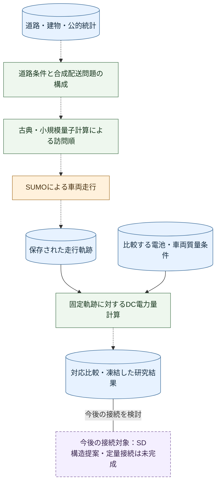
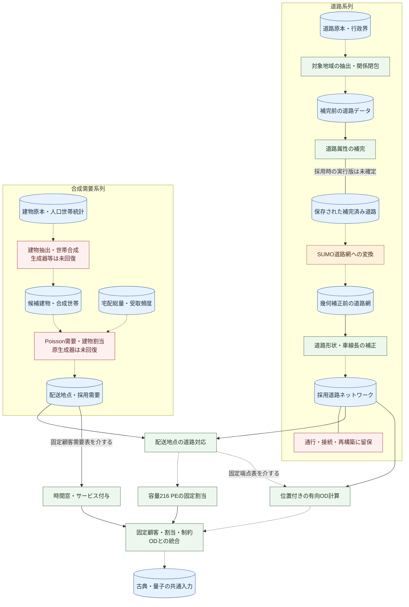
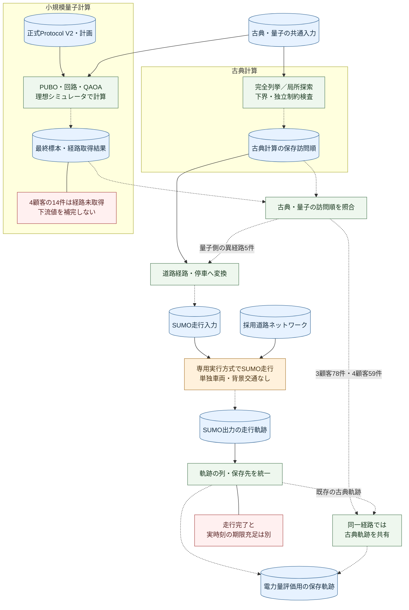
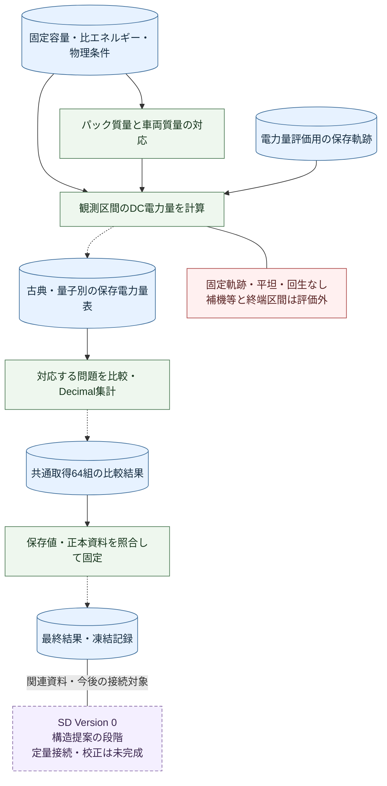

<a name="quantitative-research-guide"></a>

# 定量研究ガイド

本研究は、必要な配送需要の充足と、そのサービス提供に伴う電力量の低減を両立するために、量子技術がEV（電気自動車）配送へ影響を及ぼす仕組みと成立条件を調べる研究である。量子技術が必ず改善をもたらすことを前提とせず、古典技術を基準とする。現在の研究目的・仮説は[README](../README.md)、実施済み定量実験の位置付けは[研究基準文書](research/RESEARCH_BASELINE_20261009.md)に示されている。

実施済みの実験では、大田区の道路・建物・公的統計から合成配送問題を構成し、古典計算と小規模な量子アルゴリズムで訪問順を求めた。その順序に従う車両走行をSUMO（道路交通シミュレータ）で計算し、保存した軌跡に電池・車両質量の条件を与えて、電池側のDC（直流）電力量を比較した。道路旅行時間の最適化と、その後の電力量評価は別工程である。

**現在得られているのは、限定した配送問題と固定走行軌跡に対する比較結果である。** 実都市の全配送需要の充足、充電を含む運用全体、量子優位性を実証したものではない。システムダイナミクス（SD：蓄積量と流量、フィードバック、時間遅れからシステムの変化を扱う方法）は今後の上位モデルの接続対象であり、構造提案の段階にある。

次の図は研究全体の見取り図である。青の円筒は入力・保存データ、緑は計算処理、橙は走行環境、紫の破線枠は今後の構想を表す。実線は確認した入力・処理の関係、破線矢印は保存記録に基づく生成の経緯、矢印のない線は関連を表す。今回の文書改訂で科学実験を再実行したという意味ではない。



初めて読む場合は、第0節で工程の意味、第1節で評価範囲、第2節で接続関係を確認し、第3〜7節で方法と結果へ進むとよい。再利用のための設定・環境・検証は第8〜12節、出典と既存成果の限界は第13〜14節、残る課題は第15節にまとめた。本書は研究の説明と再利用のためのガイドであり、正式な仮説・数値・凍結記録を改訂するものではない。

- [0. 研究工程の全体像](#0-open-data-to-frozen-results)
- [1. 研究の対象範囲](#1-research-scope)
- [2. 研究モデルと実装の全体構成](#2-model-architecture)
- [3. 古典経路計算の方法](#3-routing-model)
- [4. 量子経路計算とProtocol V2](#4-quantum-model-and-protocol-v2)
- [5. SUMOによる走行と軌跡](#5-simulation-and-trajectories)
- [6. 電池条件とDC電力量の評価](#6-battery-and-controlled-dc-energy)
- [7. 保存結果の分析と解釈](#7-analysis-and-frozen-results)
- [8. データと設定](#8-data-and-configuration)
- [9. Notebookの利用方法](#9-notebook-guide)
- [10. 実行手順と計算環境](#10-quickstart-and-dependencies)
- [11. 再現可能性と実装の検証](#11-reproducibility-and-verification)
- [12. GitHubと研究用保存領域の役割](#12-github-and-hayate-responsibilities)
- [13. データの出典・帰属・利用条件](#13-data-attribution-and-licensing)
- [14. 既存成果の限界と来歴](#14-limitations-and-provenance)
- [15. 残存課題と今後の研究](#15-remaining-research-questions)

<a name="0-open-data-to-frozen-results"></a>

## 0. 研究工程の全体像

本節では、研究の目的からデータ取得、加工、計算、結果の確定までを順に説明する。保存資料の確認と、その処理の再実行は別である。本改訂では新しい科学実験・需要生成・道路再構築を行っていない。

|確認状態|このガイドでの意味|
|---|---|
|確認済み（CONFIRMED）|保存資料・コード・実行記録等から内容を確認できる。科学的妥当性全体の認定ではない|
|記録から再構成（RECONSTRUCTED）|複数の証拠を接続して説明できるが、当時の全操作を直接確認できるわけではない|
|推定（INFERRED）|研究設計上の意味や一般的方法からの解釈であり、採用済みの仕様や実行履歴の代用にしない|
|不明（UNKNOWN）|証拠不足で判断できない。欠落値や工程を推測で補わない|

需要は**荷物相当量（parcel-equivalent、以下PE）**という研究上の単位で扱う。荷物の実個数、顧客訪問数、配送地点数、積載kgとは区別する。**OD**は出発地と到着地の組であり、本研究では道路上の位置と進行方向を含む移動時間・距離を表す。以下の詳細条件と確実性は、節末の工程追跡表から元資料へたどれる。

### 0.1 研究上の問題意識

研究全体は、必要な物流サービスを確保しながら、その実現に伴う電力量を下げることを目指す。既存の定量実験では、訪問順を変える経路（Path 1）と、同じ走行軌跡で電池パック・車両質量条件を変える経路（Path 2）を接続した。評価対象は限定されたDC牽引電力量であり、充電や社会全体の消費まで含む仮説の検証完了ではない。現在の目的・仮説と、実験当時の正式RQ・主仮説の原文は[第1節](#1-research-scope)で区別して保持する。

### 0.2 なぜオープンデータを組み合わせたか

直線距離だけでは、道路の接続、向き、通行可能性が経路選択と走行に与える制約を表せない。一方、道路だけでは配送先の分布や需要量は分からない。このため、OSMの道路、PLATEAUの建物、行政界、公的統計の人口・世帯・受取頻度を異なる役割の入力として接続した。取得台帳、需要工程台帳、最終入力契約の対応から、この設計を再構成できる。道路属性の観測、統計による較正、研究者の仮定は同じ確実性を持たない。

**設計上の解釈（推定）：** 個別企業の注文記録に依存せず、入力の出所と仮定を追跡できる比較問題を構成することは、合成需要を採用する合理的な理由である。ただし、配送会社へのデータ提供依頼や不許可の履歴を確認したわけではなく、「注文データを入手できなかったから」と過去の意思決定を断定しない。実際に用いたのは統計から生成した需要であり、配送会社の実注文履歴ではない。

### 0.3 対象地域とデータ選定

初期実装計画は、東京全域へ直ちに進まず、環境・データ統合検証を大田区で開始すると定めている。研究範囲は国土数値情報N03の2026年東京都行政界から行政区域コード`13111`を選び、東京都・大田区の名称も照合して固定した。観測点数や結果の良否で境界を動かさない設計である。境界矩形は取得用、行政界ポリゴンは地域判定用であり、同一ではない。

**設計上の解釈（推定）：** 一自治体に限定し、道路・建物・統計を共通の地域キーで接続することは、都市規模のデータ処理を管理可能にする。**未確認事項：** 大田区を他自治体より優先した理由を、空港・工業地帯・所属機関との近さ等に帰す根拠は今回確認していない。都市の特性から後付けの選定理由を作らない。

### 0.4 何を、どこから、どう取得したか

道路原本には、地域ごとの時点固定データを取得できるGeofabrikのOSMを用いた。版・取得日・ファイル同一性の情報は下表に示す。[関東配布ページ](https://download.geofabrik.de/asia/japan/kanto.html)と[当時の日付固定URL](https://download.geofabrik.de/asia/japan/kanto-260716.osm.pbf)を区別する。現在のlatestは別の時点固定コピーであり、代用して同じ実験としない。日付固定URLの現在の取得成功までは保証しない。

取得記録に残るコマンドは次である。これは当時のDocker・Hayate側コードを必要とする**履歴上の実行手順**であり、現在の小規模GitHub配布だけで実行できるコマンドではない。

```bash
docker compose run --rm analysis \
  python -m traffic_simulation.network.fetch_osm \
  --region ota_ward --snapshot-date 20260716
```

同処理は日付固定URLを組み立て、`.part`へ取得し、サイズ・PBF形式・要素数・SHA256を検査してから原本を確定した。Overpassやブラウザの手動エクスポートを用いたという記録ではない。道路データベースの出典は© OpenStreetMap contributors、利用条件はODbL 1.0であり、詳細は[帰属表示と配布](#13-data-attribution-and-licensing)を参照する。

建物には国土交通省Project PLATEAUの[3D都市モデル（大田区）（2025年度）](https://www.geospatial.jp/ckan/dataset/plateau-13111-ota-ku-2025)のCityGMLを採用した。保存ZIPの名前・サイズ・ハッシュは下表に示す。保存取得資料は2026-08-21、ZIP内READMEは作成2026-03-13・製品仕様第5.0版を示す。データ年度、README作成日、取得日を混同しない。

配布ページで大田区2025年度を選び、CityGMLのZIP配布ファイルを取得し、ファイル名・README・ハッシュを保存するという取得経路が資料と整合する。**未確認事項：** 個別のブラウザクリック列や当時のcurlコマンドは確認できないため提示しない。建物形状・用途と位置を接続できることが研究上の採用意義であるが、CityGMLの全属性を計算に使ったとはしない。利用条件は配布ZIPの表示と提供元の条件を優先し、研究コードのApache-2.0を適用しない。

|原本|版・取得記録|ファイルと同一性|
|---|---|---|
|関東の道路原本|データ時点 `2026-07-16T20:21:30Z`、2026-07-17取得記録|`kanto-260716.osm.pbf`、476,772,780 bytes、SHA256 `aef890f28b652ed7bd2b0d77e86f263219b479fe3eedbdd8610dcfc1572c420d`|
|大田区の建物原本|2025年度。保存取得資料2026-08-21、ZIP内README作成2026-03-13、製品仕様第5.0版|`13111_ota-ku_pref_2025_citygml_1_op.zip`、543,501,320 bytes、SHA256 `820f2b6c7af9e2a097c0868f3452953cbbe90f81c450ae5880f31eb52d159800`|

需要統計はe-Stat等の公的集計を用いた。2020年国勢調査の小地域CSV（表ID`000032163278`）と500mメッシュ（`T001141034`等）、2023年住宅・土地統計調査（表ID`000040209857`）は世帯構成・住宅区分・地域配分へ接続する。元表の全採用セルと合成世帯への変換は完全には復元できていない。

受取頻度は[国土交通省・東京都市圏物資流動調査、令和6年度「個人のモノの受取調査」](https://www.e-stat.go.jp/stat-search/files?layout=dataset&tclass1=000001223521&tclass2=000001234242&toukei=00600520&tstat=000001078042)のss521「世帯人数別・世帯構成別宅配受取頻度（回数）・再配達頻度（割合）」である。`ss521_r06a.xlsx`、シート`ss521_R06`、SHA256 `5b6ae34c771739869648147487780d4f0bb1f2a556f36c5ff97ee0514de664e0`を保存台帳で識別できる。取得観測日は2026-08-23、台帳固定は08-29である。08-25の9表の原本固定記録にはss521は含まれないため、後続台帳と採用強度CSVで接続を確認した。

e-Statの該当統計・年度・表分類からExcelを取得することが一般的な取得手順である。ss521はworkspaceから供給されたファイルとの記録であり、当該URLから直接通信したログを意味しない。2026-10-09の説明整備時、Geofabrik配布ページは閲覧できたが、PLATEAU・e-Statの上記ページは閲覧ツールで取得できず、年度・取得日は保存された資料に基づいている。

### 0.5 道路を走行計算に使える形へ加工する

まずN03行政界からEPSG:4326の外接矩形（西139.652974773、南35.528198081、東139.826027782、北35.613210171）を機械生成した。osmium-tool 1.15.0の`extract --strategy complete_ways --set-bounds`で交差するwayの参照ノードを保持し、12,218,967 bytesの大田区抽出PBFを得た。wayを矩形境界で切断しないため、含まれるノードの範囲は取得矩形より広がり得る。初期抽出には40,880のhighway wayがあるが、その数を最終走行可能有向道路区間数としない。

抽出だけではrelationの参照、方向、車線、速度、通行規制を確定できないため、後続の関係閉包・属性解決工程へ進んだ。保存された入力は`ota_ward_20260716_relation_closure_v16.osm.xml`であり、v17のblocker記録と属性補完へ接続する。highway種別にはmotorway/trunk/primary/secondary/tertiaryと各link、unclassified/residential/service/living_street等がある。自動車系の種別選択と、個別のdelivery車両の通行可否は別の判断である。

three-tier補完器は元の`lanes`、`maxspeed`、`access`等を読み、明示値・推定値・代替規則を分けて記録する。例えば保存コードの速度表はmotorway80、trunk60、primary50、secondary/tertiary40、residential30、service/living_street20 km/h等である。これらは欠損時のモデル規則であり、実測速度ではない。保存された値決定関数はaccess=noをno、他をyesへ処理する箇所を持つため、全法的通行規制を精密に復元したとは説明できない。`EXTRATREES_BENCHMARK_PROXY`という名称だけから学習済み機械学習モデルの使用を推定しない。採用runner・全補完レコード・最終値の完全な対応確認は未完了である。

補完OSMをSUMO/netconvert 1.24.0で`--osm-files --proj.utm --ignore-errors`等の保存コマンドにより変換し、交差点等の接続点（junction）、有向道路区間（edge）、車線（lane）を得た。OSMのwayとSUMOの有向道路区間は単純な一対一ではなく、道路接続と車線許可を含む変換である。変換成功だけで実都市の完全な通行再現や信号・交通量の妥当性を保証しない。

最終幾何補正の実コマンド・`repair_network_geometry_lengths.py`・repair報告は、車線形状を交差点の接続点端点へ接続し、接続後の折線長を車線 lengthへ反映したと記録する。一方、設定の時点固定コピーには「length維持」と実在を確認できない別の生成プログラム名があり、整合しない。本説明は実在コード・コマンド・変換報告に基づくが、PBFから最終XMLまで完全な同一再生成が可能とはしない。最終XMLのハッシュは`460554c7716fe5e3e1410bbee790e69745a2c423146bac88e51e3a2b95f051b2`であり、下流planと一致する。この実ファイルを[道路データRelease](https://github.com/tkm-sano/kmd-analysis/releases/tag/road-data-20261009-rc1)で提供している。

### 0.6 建物と統計を需要の基礎へ加工する

研究用保存領域の参照可能なローカル資料には建物候補CSVが存在し、building_id、building_usage、住宅区分との適合、geometry参照、階数・地下階数・高さ、source_file/feature_id、除外状態を記録している。過去の監査で未回収とされたCSVはその後の資料確認で実在が確認されたが、中間parquetの生成器の回復を意味しない。保存されている高さ・階数の列を、そのまま世帯配分の重みとして使ったとはしない。

CityGMLの建物ID・用途を住宅候補へ対応させ、町丁目との空間的な対応を作り、代表点を後段の配送地点へ渡したという流れが工程台帳と保存出力から読める。**設計上の解釈（推定）：** 通常この接続には座標系を合わせた形状読込み、代表点の計算、行政区画への空間結合が必要である。しかし、代表点が重心か内部点か、使用した全用途コード、境界処理、入力ZIPの混合有無は確認できない。

**未確認事項：** `plateau_buildings_all_with_chocho_points.geo.parquet`の記録ハッシュは`6779656a0719bb91b9bf97513e23498d88f5bc9eacdebccfcc7d5b1b5e161fa0`であるが、原本と直接生成コード・ログは未回復である。ZIP内説明のLOD1建築物158,860棟と工程台帳の候補195,311行は一致しない。その理由を重複や建物分割だと断定しない。ZIP→候補→この中間parquetの完全来歴が残る確認点である。保存記録には `residential_building_candidates.parquet` も現れるが、その実体と正式パスも未回復である。保存候補CSVをこれらのparquetと同一物として代用しない。

公的統計から生成した合成世帯は384,353である。住宅区分は市区町村集計に基づく多項・カテゴリ割当、seed20260830との記録がある。これは実在世帯の個票や居住建物を観測したものではない。建物への割当では許された住宅候補からの一様離散選択を採用し、住戸数、入口、建物収容能力、最寄り候補による救済は使用していないと保存summaryに明示される。全世帯生成の乱数環境・固定行順・採用セルの詳細は未回復である。

### 0.7 世帯から一日の合成配送需要を生成する

基準需要設定は2024年全国宅配便取扱量5,031,470,000、全国人口123,802,000、大田区人口736,652、365日を採用した。全国一人当たり日量を大田区人口へ移す式は`5,031,470,000 / 123,802,000 / 365 × 736,652`で、保存台帳の値は82,023.204937、整数の期待日量は82,023 PEである。これは全国規模の取扱量の人口比例移転であり、大田区住宅の実注文総数の実測・推定精度を保証しない。全国量には住宅B2C以外も含まれ得る。

基準メッシュ工程は2020年人口メッシュを行政界との面積で按分し、2024年大田区人口へ再尺度化し、最大剰余法で整数を配分した。世帯への期待値配分では、ss521の受取経験のある世帯の人数別小計を使用する。採用週頻度は1人0.65148273、2人0.93035232、3〜4人1.18813494、5人以上1.45298673回/週である。共通参照0.8498914166013274回/週で割った相対強度rを用い、`lambda_h = 82023 × r_h / sum(r_h)`として各世帯の日量期待値を与える。週頻度をそのまま全世帯の実日量と解釈せず、都市全体の期待日量を配分する相対情報として使用している。

保存された生成仕様は`N_h,d ~ Poisson(lambda_h)`、seed20260829、合成評価日2026-01-01である。評価日の文字列は取得日より前でも、実際にその日に観測したという意味ではない。Poissonと世帯間独立性はモデル仮定であり、実測分散に適合したことを確認したものではない。保存された期待値合計82,023.00000048117と目標82,023の差は記録された許容差内である。乱数生成ライブラリ・全行順を含む原生成器は未回復なので、乱数seedだけで全く同じ標本を再生成できるとはしない。

|段階|保存値|何を数えるか|
|---|---:|---|
|合成世帯|384,353|統計から作った世帯レコード|
|一日の期待総量|82,023|PE、乱数実現値ではない|
|正の需要レコード|73,547|正の世帯日需要レコード（複数PEを含み得る）|
|生成需要総量|82,246|PE、注文レコード数ではない|
|建物対応済み世帯|382,369|全合成世帯のうち割当済み|
|需要のある対応済みレコード|73,200|建物へ対応した需要レコード|
|建物対応済み需要量|81,859|parcel-equivalent|
|需要のある建物／配送地点|39,956|同一建物でまとめた配送停車|

後段のscoped summaryは、候補なし206世帯・住宅型非対応1,778世帯を残し、割当済み世帯を85,690建物へ対応させる。正の需要を持つレコードをbuilding IDで集約してPEを加算し、39,956地点とした。`matched`および`matched_cross_boundary`の範囲を採用し、曖昧・範囲外等を無断補完しない。生成総量82,246全体の保存ではなく、割当範囲内の81,859だけが配送停車へ保存されている。初期summaryのactive_buildings=0は建物割当以前の記録であり、後段の39,956を打ち消さない。

### 0.8 配送地点から比較可能な配送問題へ

建物代表点は入口・停車場所ではない。配送地点を道路上のサービス位置（MODEL_SERVICE_POINT）へ対応させ、配送車両（delivery）が利用する有向道路区間・車線・道路上の位置を固定した。デポDEP_006はP31物流施設候補に由来する研究上の代理拠点であり、配送会社の営業区域を観測したものではない。位置の道路対応を確定してから、位置付きの有向OD旅行時間・距離、到達可能性を計算した。同一有向道路区間上でも進行方向により周回が必要となるため、道路上の位置を考慮する専用経路探索器を利用する。

容量216 PEは実車積載kgから換算した値ではない。保存された設計は需要グループの需要中央値431を代表として`ceil(431/2)=216`を提案し、2026-09-30の容量の凍結記録が採用を記録する。「代表需要グループを二つの容量予算で扱う」という方法論上の選択である。一次比較で固定し、108/432の感度候補と混ぜない。

固定割当は需要グループ内の道路対応座標を1m整数格子へ置き、Morton/Z順で並べ、需要合計が216を超えない連続next-fit区間に分割する。顧客を分割・他需要グループへ移動・後から詰め替えない。得られた182需要グループ・465車両担当集合は容量上の編成であり、時間窓・SOC（充電率）に関する可行性や最適車両台数を保証しない。空間順序は割当用で、訪問順は後段の経路計算で決める。

最終の対応比較設計は、125顧客以上の26親問題・25需要グループを選ぶ。各親問題について固定ハッシュによる3通りの選択順を定め、それぞれから包含関係を持つ部分集合n=3/4/5/25/99/125を作る。初期のPPS10顧客合成入力やEV41kWhの設計枝を、この最終20kWh評価へ混ぜない。親の需要・OD・時間窓を継承し、固定1車両、サービス102秒、時間窓幅7,200秒、出発0秒・帰還32,400秒を用いる。これらは研究条件であり実サービス時間の観測値ではない。102秒・時間窓幅の根拠の全来歴を今回独立に確定したとはしない。

### 0.9 同じ入力で古典計算と量子計算を比較する

比較対象は訪問順を得る方法である。同じ顧客集合・割当・OD・制約を古典と量子の各方式へ渡し、経路計算後の電力量を別に評価する。以下では3顧客の比較をR0、4顧客の比較をR1と呼ぶ。これらは最終の共通Protocol V2の系列名であり、過去の別ProtocolのR0とは区別する。

古典側は訪問順についてデポ発着を含む道路旅行時間を最小化し、容量・時間窓・全顧客一度訪問・帰還の制約を満たすこと（可行性）を別実装で検査する。保存6規模のうちn≤5は完全列挙、n≥25は確定的ヒューリスティックと割当緩和の線形計画（LP）下界である。**設計上の解釈（推定）：** 旅行時間を共通目的とし、その後で電力量を別評価する設計は、求解対象と物理的影響を分離するために有効であるが、この説明を当初の選定理由の逐語記録とはしない。

量子を比較対象とした根拠は実験当時の正式RQである。同じ物理入力・固定割当・制約を、補助変数なし位置表現（Candidate C）の多項式無制約二値最適化（PUBO）へ写し、旅行時間と罰則を計算する。正式Protocol V2の量子近似最適化アルゴリズム（QAOA）は理想状態ベクトルを使い、回路層数p=1、Hゲートによる初期状態、Xミキサー、COBYLA最大100評価×2,048 shots、独立最終4,096 shotsである。shotsは回路から取得する標本数であり、最終標本と最適化途中の標本を区別する。古典前処理の全順列可行性表を用い、最終標本の復号・独立検査後に最小旅行時間の経路を選ぶ。計算本体・bit順序・同点規則は[第3節](#3-routing-model)と[第4節](#4-quantum-model-and-protocol-v2)を参照する。量子はR0/R1の小規模比較だけであり、古典6規模すべてで量子を実行したわけではない。

### 0.10 訪問順をSUMOの走行軌跡へ接続する

最適化結果の訪問順（customer_order）を配送端点列へ対応させ、隣接端点間の道路経路を専用`duarouter_loop`で得る。区間をつなぐ際の重複道路区間を処理して一本の経路へ連結し、停車車線・停止位置（endPos）・停車時間（duration=102秒）・予定出発までの待機条件（until）を設定する。保存実行計画はSUMO1.24の既存delivery車両挙動、乱数seed20260930、計算刻みとFCD（走行車両データ）の出力周期1秒、単独車両・背景交通なしを指定する。初期計画の状態表示は作成時点の記録であり、後続の軌跡凍結記録を完了の根拠とする。

道路網の初期状態を子プロセスへ複製する専用実行方式（native time-zero fork）で実行し、時刻・速度・座標・車線/有向道路区間等を保存した。OD旅行時間は最適化の目的、SUMO観測所要時間は停車・待機・走行挙動を含む結果、DC入力は保存した1秒時刻・速度列である。車線上の位置を累積走行距離としない。DC側の観測距離は区間速度×dtであり、tripinfoのrouteLengthとも別に記録する。背景交通や複数車両の相互作用を検証したとはしない。

3顧客（R0）の同一経路78件は古典計算軌跡に結合し、4顧客（R1）は同一59・異経路5の取得経路に対して下流評価した。未取得経路の架空軌跡は生成しない。全量再現には専用経路探索器、fork実行環境、端点・固定割当・道路網・保存実行計画が必要で、標準SUMOのみで同一実験になるとは保証しない。[第5節](#5-simulation-and-trajectories)に入出力契約を示す。

<a name="011-軌跡を固定してbattery条件と電力量を比較する"></a>

### 0.11 軌跡を固定して電池条件と電力量を比較する

電池条件を変える評価（Path 2）は容量20kWhを固定し、比エネルギー180/220/250Wh/kgをパック質量111.111111/90.909091/80kgへ写す。以下では、この順に電池条件をB0/B1/B2と呼ぶ。共通の車体等の残余質量を保持して車両質量へ反映するため、車体自体を軽量化した実験ではない。量子計算がこの電池性能を実現したという結果でもない。

各経路の保存軌跡を全電池条件で共通使用し、質量差によってSUMOを再走行させない。固定条件の電力量モデル（Controlled-DC）は転がり・並進・回転・空気抵抗の仕事から正の車輪仕事を取り、効率0.90で電池側DC Whへ換算する。平坦・回生なし、補機等は評価外である。18kWhからの累積消費による残量会計・負残量検出は行うが、SOC停止、充電、再計画は行わない。[第6節](#6-battery-and-controlled-dc-energy)の正式式・単位・凍結記録を優先する。

### 0.12 保存結果を対応させ、最終結果として固定する

正式な量子計算は3顧客（R0）・4顧客（R1）各78件を実行したが、経路取得はそれぞれ78/78、64/78である。親問題と部分集合の選択反復で対応した共通64組について、両計算方式・両顧客規模・電池条件・転がり抵抗係数（Crr）の条件を比較し、未取得14件を配送不能や電力量ゼロへ置換しない。

電池削減率は各条件のB0 DC Whを分母にした百分率、Dは古典計算−量子計算の削減率差、TはD_R1−D_R0であり単位は百分率ポイント（pp）である。全4比較条件でT=0が59、非ゼロが5（正1・負4）であり、非ゼロは異経路5件に一致する。古典6規模は468論理・460異なる問題で、SUMO時刻診断の遅延136停止・116経路、帰還期限超過4経路を保持する。[正式報告](../01_research_design/scenario_evaluation/final_quantitative_study_20261008/FINAL_QUANTITATIVE_STUDY_REPORT.md)と[第7節](#7-analysis-and-frozen-results)が数値の正本・解釈境界への入口である。

以上は「地理・合成需要 → 制約付き経路 → 軌跡 → 質量感度」という接続を示す。ただし顧客数と同時に地理・時間窓・解法も変わり、経路を取得できた部分集合の偏りがある。量子優位、純粋な規模因果効果、物流全体の省エネルギーを実証したとはしない。最終凍結記録はこの限定された定量実験系列の保存結果を固定したもので、論文全体の完成を意味しない。

### 0.13 再実行できる部分と未確認部分

GitHubのNotebook01〜03は合成入力による経路計算・教材QAOA・電池/Controlled-DCの計算例、04〜05は正式保存結果の参照である。これらを連続実行しても、原OSM・CityGML・統計から全量研究を再生成するものではない。道路Releaseの内容・ハッシュ検証、公開API（他のプログラムから呼び出す関数群）の軽量計算、保存集計の照合は公開範囲で行える。[実行手順](#10-quickstart-and-dependencies)を利用する。

**未確認事項：** 原建物parquetの生成器・入力組合せ、合成世帯の全採用セル・乱数生成環境、道路補完と最終幾何までの完全な再生成対応が未確認である。以下の台帳では「ファイルがある」「処理の内容が分かる」「当時その処理で当該出力を生成したことを確認できる」を分ける。Hayate資料は現行GitHubリンクとして提示しない。旧資料のGit管理済みという記述も当時の状態であり、現在の配布を意味しない。

### 工程の追跡表

各工程の意味を読んだ後の確認用である。**P**は現在のGitHubで参照できる資料、**H**は非同梱の研究用保存資料である。Hの名称は公開リンクではなく、その存在だけで現在再実行できることを保証しない。詳細なコード対応は第2節に分けた。

|工程|入力から得たもの・次工程での役割|主な根拠|確認状態|
|---|---|---|---|
|地域・道路取得|関東PBFと行政界から、固定範囲の道路抽出・関係閉包へ進む|H1|保存資料・コードで確認済み|
|道路属性・形式・幾何|欠損値の補完、SUMO変換、形状・長さ補正を経た採用網をODと走行に使う|H2|記録から再構成。採用実行版・完全再生成に不明点あり|
|建物候補|建物用途・形状・町丁目の対応を、世帯割当の基礎にする|H3・H4|候補CSVは確認済み。中間データと直接生成器は未回復|
|期待日量|人口按分と宅配統計から日量82,023 PEを定める|H4・H5|採用式・値は確認済み。実注文の観測ではない|
|世帯・頻度|384,353合成世帯へ受取頻度に応じた期待値を配分する|H4・H6|記録で確認済み。全生成手順は不明|
|需要・配送地点|Poisson標本と建物割当から81,859 PE・39,956地点を採用する|H4・H7|保存結果は確認済み。原生成器は未回復|
|容量・固定割当|182需要グループを465車両担当集合へ分け、顧客部分集合を選ぶ|H8・H9|方法論上の仮定と保存結果を確認済み|
|経路計算|固定顧客・時間窓・ODから訪問順と取得状態を得る|H9・H12・H13、P1|正式実行記録あり。公開APIは別の利用入口|
|走行軌跡|取得訪問順を道路経路・停車へ変換し、1秒の時刻・速度列を保存する|H10・H14|保存実行記録あり。実都市の配送充足は未検証|
|電池・DC|20/18 kWh、質量条件、Crr二条件を保存軌跡へ適用する|P2・H15|限定モデルの計算記録あり。実車校正は未確認|
|分析・凍結|共通64と古典6規模を対応比較し、最終結果を固定する|P1・P3・H15|保存値・来歴を確認済み。全量の独立再現とは別|

Hコードの`network/`・`demand/`は`05_src/traffic_simulation/`以下である。根拠資料は次である（Hは公開リンクではない。H11〜H15は第2節末尾）。

- **H1**：`03_data/metadata/acquisition/20260717_osm_ota_ward_acquisition.md`、`03_data/metadata/traffic_simulation_sources.csv`、`05_src/traffic_simulation/implementation_plan.md`。
- **H2**：`reproducibility/outputs/traffic_simulation/attribute_resolution_v17/phase13_20260903_three_tier_completion/`のrun_2／run_3記録、および上記repairコード。道路再生成の不足は第13節にも保持する。
- **H3**：`03_data/raw/external_statistics/plateau_ota_2025/`の保存ZIP・カタログとZIP内README。
- **H4**：`reproducibility/outputs/traffic_simulation/pipeline_authority_and_r24_capacity_plan/20260914_v1/CURRENT_PIPELINE_STAGES.csv`。工程名・式・採用値と未回復処理を区別する台帳である。
- **H5**：`reproducibility/config/traffic_simulation/baseline_demand.yml`、`05_src/traffic_simulation/demand/prepare_baseline_demand.py`。
- **H6**：`03_data/raw/traffic_simulation/demand_proxy/mlit_tokyo_metropolitan_goods_movement_survey_2024_20260823/manifest.json`、`03_data/processed/traffic_simulation/demand/household_parcel_v1/pipelines_v1/relative_parcel_propensity.csv`。
- **H7**：同`pipelines_v1/`の`pipeline_run_summary.json`、`stop_generation_run_summary.json`、`daily_requests.csv`、`household_building_assignment_scoped.csv`、`building_delivery_stops_scoped.csv`。初期と後段の状態を区別する。
- **H8**：`01_research_design/scenario_evaluation/baseline_capacity_fleet_assignment_20260930/`の`CAPACITY_FREEZE_MANIFEST.json`・`FIXED_ASSIGNMENT_PROTOCOL.md`。
- **H9**：`01_research_design/methodology/PREPARED_ROUTE_SCALE_EXPERIMENT_PROTOCOL.md`。事前計画の状態と後続結果を混同しない。
- **H10**：`01_research_design/scenario_evaluation/matched_classical_trajectories_20261007/GENERATION_PLAN.json`、同`generate.py`、共有`05_src/literature_analysis/generate_canonical_delivery_trajectories.py`。完了の追跡は[P1の正本対応表](../01_research_design/scenario_evaluation/final_quantitative_study_20261008/FINAL_FREEZE_AUTHORITY_CHAIN.csv)を用いる。
- **P1**：[最終結果の凍結記録](../01_research_design/scenario_evaluation/final_quantitative_study_20261008/FINAL_QUANTITATIVE_RESULT_FREEZE.json)。
- **P2**：[Controlled-DCモデル凍結記録](../01_research_design/methodology/CONTROLLED_MASS_TO_DC_MODEL_FREEZE.json)。
- **P3**：[保存結果索引](../results/indexes/CANONICAL_RESULTS.json)。

<a name="1-research-scope"></a>

## 1. 研究の対象範囲

研究全体は、配送需要の充足と運用電力量の低減を両立できる技術・運用条件を対象とする。一方、現在の公開実装と保存結果は、そのための限定された下位実験である。この二つの範囲を分けて読む必要がある。

### 現在の目的・仮説と実施済み評価

現在の研究目的・問いは[READMEの目的と問い](../README.md)に従う。量子技術が配送へ影響を及ぼす仕組みと、その効果が成立・消失・逆転する条件を検討するものである。次の仮説本文はREADMEが保持する正式凍結版v1.0.1に対応し、支持・棄却は未判定である。

|仮説|保持する本文|既存実験から判断できる範囲|
|---|---|---|
|H1：計算方法の相違による作用|量子計算は、古典計算とは異なる計画取得過程を通じて、配送・充電の運用に作用し、配送需要充足と運用電力量に異なる影響を及ぼし得る。|小規模問題での経路取得と保存軌跡の比較までである。計画取得時間を含む運用・充電との接続は未完了である。|
|H2：電池性能の媒介効果|量子化学計算の成果が実用電池性能の改善につながる場合、電池性能の変化は車両・充電条件を通じて、配送需要充足と運用電力量に影響する。|電池比エネルギーを仮定した質量感度を扱う。材料計算から実用電池性能への接続を実証したものではない。|
|H3：周辺条件との相互作用|H1およびH2の効果の方向と大きさは、交通状況、運転特性、充電条件等の周辺要因との相互作用によって変化する。|交通・充電条件全般を変えた検証は完了していない。|

v1.0.1正本は研究用保全領域の `docs/research/RESEARCH_OBJECTIVE_RQ_HYPOTHESES_FREEZE_20261014_v1_0_1.md` と対応する `_MANIFEST.json` にあり、文書SHA256は `c61ce5d4b92b0fa02686bddc305dd03924663fafd3edb2c14c690964a1609f55` である。現在のGitHub配布には含まれない。READMEの2026-10-15付説明では、目的・問いの「作用経路」を「仕組み」とする等の採用表現を区別しており、本書もその区別を維持する。正式凍結文書の改訂を意味しない。

研究全体が主要な電力量指標とするのは、EV配送車両の走行時の電池側正味DC電力量である。既存実験のDCは回生・補機等を含まない固定条件の評価であり、この主要指標の完全な測定・検証とは異なる。必要な配送を省略したことによる低消費を、省エネルギー成果とは扱わない。

### 定量実験当時のRQ・主仮説

次の文言は2026-09-28時点の正式な研究設計の記録である。現在の問いと混同しないよう履歴として保持する。

正式RQ（原文引用）：

> 量子技術の進展は、電気自動車配送の経路計算とバッテリー性能の変化を通じて、ラストマイル配送の運用電力量にどのような影響を与えるか。

正式主仮説（原文引用）：

> 同一の充電を考慮した電気自動車配送問題において、古典計算を用いた場合と比較して、量子計算を用いた場合の方が、バッテリー性能の違いによる電気自動車配送の運用電力量の差が大きくなる。

正本は研究用保存領域の `01_research_design/RESEARCH_QUESTION_AND_HYPOTHESIS.md`（SHA256 `abe729fc925372782bc62c5a4f3e597c09b5c214acfd31c3ec912f3efb85cb33`）である。[2026-10-09の研究基準文書](research/RESEARCH_BASELINE_20261009.md)にも同じ引用がある。充電を考慮した旧主仮説と、無充電・固定軌跡の実験範囲は同一ではない。旧主仮説の検証完了も、現在のH1〜H3の実証完了も主張しない。

<a name="2-model-architecture"></a>

## 2. 研究モデルと実装の全体構成

研究モデルは、入力を配送問題へ変換する段階、訪問順を求めて車両を走らせる段階、走行軌跡の電力量を比較する段階からなる。各段階は保存データを介してつながる。合成需要は実注文の観測とは異なる。また、最適化上の可行性と、車両走行の完了も別の判定である。

図では、青の円筒を入力・設定・保存結果、緑の長方形をコードが存在する処理、橙をSUMO環境、赤を未回復工程・重要な留保、紫の破線枠を将来の構想とする。緑であることはモデルの妥当性確認済みを意味しない。実線はソースで確認した入力・依存、破線矢印は保存記録から確認・再構成した生成関係、矢印のない線は関連を表す。

各表の**P**は現在のGitHub追跡ファイル、**H**は研究用保存領域にある非同梱資料である。Hの所在は第0節の根拠一覧と本節末尾に示す。ファイルの存在と、過去の正式実験での使用、処理の再実行成功を区別する。

### 2.1 第1段階：入力・道路・配送需要の生成

この段階の目的は、道路上の移動と配送需要を、同じ地域・同じ顧客集合を持つ計算問題へ接続することである。道路は移動時間と到達可能性を与え、建物・統計は配送地点と需要量を与える。



道路系列は、地域抽出、属性補完、SUMO形式への変換、幾何補正を分けている。補完の保存コードはrun_1を出力先に指定する一方、採用網の変換記録はrun_2を指す。この間の実行版は確定していないため、図では生成矢印を用いない。run_2からrun_3への幾何補正は入出力の保存契約を追跡できるが、交通表現の正しさや元データからの完全再生成を意味しない。

需要系列は、保存された合成世帯・需要・配送地点と、未回復の原生成器を分けている。配送地点の道路対応を容量に基づく固定割当へ使い、別工程では共通の顧客需要表へ時間窓を付与する。位置付きの有向ODを統合し、顧客部分集合を固定して古典・量子へ共通入力を渡す。全1,665個のOD分割データを一つの実行処理が生成したとは扱わず、採用集合は最終の一覧表による。

|役割|主な実ファイルと受渡し|根拠・所在・確認状態|
|---|---|---|
|地域抽出と道路属性補完|`fetch_osm.py`、`execute_three_tier_completion_streaming.py`。抽出・関係閉包OSMを入力とする|H1・H2。コードと保存記録あり。run_2の補完実行版は未確定|
|道路網への変換と幾何補正|`netconvert` → 補正前 `three_tier.net.xml` → `repair_network_geometry_lengths.py` → 採用網|H2。`command_contract.txt`・`repair_transform_report.json`。成功時の変換環境には不足資料あり|
|建物・世帯・需要|`synthetic_households.csv`、`daily_requests.csv`、`building_delivery_stops_scoped.csv`|H3・H4・H7。保存出力はあるが原生成器・中間parquetは未回復|
|道路点への対応|`map_points.py` → `DELIVERY_POINT_SUMO_MAPPING_39956.csv`|H11。建物代表点の道路対応であり実入口の観測ではない|
|固定割当と時間窓|`build_assignment.py` → `CUSTOMER_VEHICLE_ASSIGNMENT_39956.csv`、別工程の `generate_temporal_input.py` → `CLASSICAL_TEMPORAL_INPUT.parquet`|H8・H11。容量216 PE・サービス102秒等は研究条件|
|位置付きOD|`corrected_worker.py` と `duarouter_loop`、採用集合の `PARTITION_MANIFEST.csv`|H12、P [設定台帳](../configs/CANONICAL_CONFIG_INDEX.csv)のM03。実行処理は複数版の一例|
|共通問題の固定|`prepare.py` → `prepare_matched_route_scale.py` → `runner.py`の入力準備。索引は `PHYSICAL_INSTANCES.json` と `LOGICAL_BINDINGS.json`|H12、設定台帳M05・M06。468論理条件、460固有NPZ|

道路の左側通行設定、外部車線と交差点内部車線の接続、PROJを含む再構築環境、建物・需要の未回復来歴は、第15節で別々の課題として扱う。下流入力のハッシュ一致だけでこれらを解消したとはしない。

### 2.2 第2段階：古典・量子計算とSUMOによる走行

この段階では、固定された顧客集合について訪問順を求め、その順序を実際の道路区間と配送停車へ変換する。求解できたこと、走行が終了したこと、実時刻で期限を満たしたことはそれぞれ異なる判定である。



古典側は保存した入力コピーを正式runnerから読み、小規模では完全列挙、大規模では確定的ヒューリスティックと下界を用いた。量子側は共通Protocol V2のPUBO、保存回路、実行計画、正式な実験制御処理と計算処理を接続し、最終標本から可行経路を選択した。現行公開APIは科学核の再利用入口であり、当時の正式runnerそのものではない。

取得した訪問順から専用経路探索器で道路区間を求め、停車位置・サービス時間・予定出発時刻を付したSUMO入力を作る。3顧客の量子取得78件はすべて古典と同じ経路である。4顧客では取得64件中59件を共有し、異なる5件のみ追加走行した。経路を取得できなかった14件には下流の軌跡・電力量を補完しない。

|役割|正式実装・保存物|公開APIとの関係・根拠|
|---|---|---|
|古典計算の実行|`matched_classical_route_scale_20261007/runner.py` が `INPUTS/solver.py`・`independent.py` を利用|H12。P [solver](../src/kmd_quantitative/routing/solver.py)・[独立検査](../src/kmd_quantitative/routing/independent.py)は凍結コピーと内容一致|
|古典計算の保存結果|`RESULTS/` の問題別JSON、`MATCHED_CLASSICAL_ROUTE_SCALE_PHYSICAL_RUNS.csv`|H12・H14。P [古典集計](../01_research_design/methodology/MATCHED_CLASSICAL_ROUTE_SCALE_SUMMARY.csv)は集計への入口|
|量子の科学核・条件|P [science.py](../05_src/traffic_simulation/matched_quantum_protocol_v2_shared/science.py)、[protocol.py](../05_src/traffic_simulation/matched_quantum_r1_c_protocol_v2/protocol.py)|正式原実装を保持。src内コピー・AST抽出との関係は第11節|
|回路・正式実行|`static_reduced_circuit_resources.py`、R0の `execute_frozen_full_science.py`、R1の `execute_canonical_plan_serial.py`、各 `worker.py`|H13。R0/R1の同名workerは別の接続処理。実行計画とQPYのパス・ハッシュで結合|
|最終標本・取得結果|各RUNS内の `FINAL_COUNTS.json`、`result.json`、`PROCESS.json`|H13。156実行と取得78/64を区別。P [最終報告](../01_research_design/scenario_evaluation/final_quantitative_study_20261008/FINAL_QUANTITATIVE_STUDY_REPORT.md)|
|道路経路・停車の生成|`generate.py`／`prepare_trajectories.py` が `generate_canonical_delivery_trajectories.py` のbuildを利用|H14。`route.xml`を作り、専用forkは分離後の`vehicle.xml`を読む|
|SUMO実行|`canonical_sumo_fork.cpp` と実行体 `canonical_sumo_fork` → `fcd.xml.gz`等|H14、設定台帳M09・M09_MATCHED。標準SUMO単体による再現ではない|
|正規化と共有|`audit.py`／`audit_core.py`、`bind_existing_trajectories.py`／`finalize_binding.py` → 3系列の軌跡台帳|H14。古典の派生コピーと量子側のAST再利用を区別|
|時刻診断|`PLANNED_NATIVE_STOP_TIMING.csv` と P [配送サービス診断](../01_research_design/scenario_evaluation/quantitative_scale_boundary_synthesis_20261008/LOGISTICS_SERVICE_SCOPE.csv)|460走行完了と136遅延停止・4帰還超過は両立する。詳細は第7節|

### 2.3 第3段階：電力量計算と研究結果の分析

この段階の目的は、経路による運動履歴の違いと、電池比エネルギーによる質量条件の違いを、同じ電力量モデルで比較することである。速度を計算し直さず、保存された観測区間に対して物理量を積算する。



正式適用処理は古典・3顧客量子・4顧客量子の3系列にあり、共通DC計算核を利用する。保存表は同じ親問題と部分集合の選択反復で対応付け、両規模で経路を取得した64組に限定して比較する。Decimalは保存された十進表記を保って差を集計するために使い、物理モデルの精度が無限に高いことを意味しない。

最終的には入力・ソース・上流凍結記録・集計結果の対応を保存する。SDへの実装済み数値接続はないため、最終結果からSDへのデータ矢印は描いていない。

|役割|実ファイル・入力／出力|根拠・利用範囲|
|---|---|---|
|電池・質量条件|P [質量算術の原実装](../05_src/literature_analysis/review_pack_specific_energy.py)、[モデル凍結記録](../01_research_design/methodology/CONTROLLED_MASS_TO_DC_MODEL_FREEZE.json)|20 kWh固定、3比エネルギー条件。量子材料計算の成果ではない|
|軌跡と条件の適用|`apply_matched_classical_battery.py`、`apply_r0_common_protocol_method_battery.py`、`apply_r1_method_battery.py`|H15。3正式入口であり、公開読込みAPIとは別|
|共通DC計算核|P [run_full_controlled_dc.py](../05_src/literature_analysis/run_full_controlled_dc.py)|現行controlled_dc.pyは元関数を別名で公開。軌跡とモデル条件を入力する|
|保存電力量表|`MATCHED_CLASSICAL_BATTERY_PHYSICAL_RESULTS.csv`、`R0_COMMON_PROTOCOL_METHOD_BATTERY_ENERGY.csv`、`R1_METHOD_BATTERY_ENERGY.csv`|H15。3系列を別表として保持|
|対応比較|`analyze_frozen_results.py` → P [共通母集団表](../01_research_design/scenario_evaluation/matched_r0_r1_common_protocol_scale_method_battery_20261008/COMMON_MATCHED_POPULATION.csv)・[比較表](../01_research_design/scenario_evaluation/matched_r0_r1_common_protocol_scale_method_battery_20261008/SCALE_METHOD_BATTERY_MATCHED_CONTRASTS.csv)|H15。共通64に条件付けた結果|
|最終保存|`audit_and_freeze.py` → P [最終凍結記録](../01_research_design/scenario_evaluation/final_quantitative_study_20261008/FINAL_QUANTITATIVE_RESULT_FREEZE.json)・[正本対応表](../01_research_design/scenario_evaluation/final_quantitative_study_20261008/FINAL_FREEZE_AUTHORITY_CHAIN.csv)|H15。保存値監査と科学実験再実行を区別|
|SDとの関係|P [READMEの研究構想](../README.md)、第1節の保全v1.0.1文書|構造提案。接続・校正・仮説検証の完了を示すものではない|

### 2.4 非同梱資料の正確な所在

次のパスは研究ルートからの相対位置であり、GitHubリンクではない。第0節のH1〜H10に加え、図の詳細対応を追うための所在を示す。保全領域の説明は第12節による。ディレクトリ名の似た過去版を、ここに挙げた採用版へ読み替えない。

- **H11：地点・割当・時間制約。** `01_research_design/scenario_evaluation/sumo_delivery_point_mapping_20260930/` の `map_points.py` と道路対応CSV、`baseline_capacity_fleet_assignment_20260930/` の `build_assignment.py` と固定割当CSV、`temporal_methodological_assumption_20261005/` の `generate_temporal_input.py`・`PRIMARY_TEMPORAL_BASELINE.json`・時間入力parquetである。共通の顧客需要表は同scenario_evaluation配下の `vehicle_capacity_assignment_20260930/CUSTOMER_DEMAND_39956.csv` である。
- **H12：OD・共通入力・古典実行。** 同scenario_evaluation配下の `sumo_od_same_edge_loop_fix_20261001/native_router/duarouter_loop`、`sumo_od_selective_routing_resume_v4_20261004/corrected_worker.py`、`sumo_od_final_validation_20261005/PARTITION_MANIFEST.csv`、`classical_vrptw_baseline_20261005/prepare.py` を用いる。部分集合準備は `05_src/literature_analysis/prepare_matched_route_scale.py`、正式な対応比較の実行は `01_research_design/scenario_evaluation/matched_classical_route_scale_20261007/` の `runner.py`・`INPUTS/`・`MANIFESTS/`・`RESULTS/` である。
- **H13：量子の回路・計画・実行。** 回路生成元は `05_src/traffic_simulation/matched_quantum_qualification/static_reduced_circuit_resources.py`。scenario_evaluation配下の `matched_quantum_r0_common_protocol_full_v2_20261007/` と `matched_quantum_r1_full_v2_20261007/` に、それぞれ `R0_COMMON_PROTOCOL_FULL_RUN_PLAN.json`／`R1_FULL_RUN_PLAN.json`、上位runner、`RUNS/` を保存する。実行処理は `05_src/traffic_simulation/matched_quantum_r0_common_protocol_full_v2/worker.py` と `matched_quantum_r1_full_v2/worker.py` である。QPYはrun planの指定を正本とし、R0分も `matched_quantum_r1_feasibility_20261007/STATIC_CIRCUITS_A_C/C_POSITION_PUBO_NO_ANCILLA/` に保存される。
- **H14：軌跡の生成と共有。** scenario_evaluation配下の `matched_classical_trajectories_20261007/` に `generate.py`・`audit.py`・`audit_core.py`・時刻診断CSVがある。共有原実装は `05_src/literature_analysis/generate_canonical_delivery_trajectories.py`・`canonical_sumo_fork.cpp`、実行体は `01_research_design/scenario_evaluation/canonical_delivery_trajectories_20261006/canonical_sumo_fork` である。R0共有処理は `matched_quantum_r0_common_protocol_trajectories_20261008/bind_existing_trajectories.py`、R1は `matched_quantum_r1_trajectories_20261007/` の `prepare_trajectories.py`・`execute_five.py`・`finalize_binding.py`・`SUMO_SETTINGS_FREEZE.json` である。古典軌跡索引は `01_research_design/methodology/MATCHED_CLASSICAL_TRAJECTORY_MANIFEST.csv`、量子側の各ディレクトリには `R0_COMMON_PROTOCOL_METHOD_TRAJECTORY_MANIFEST.csv`／`R1_METHOD_TRAJECTORY_MANIFEST.csv` がある。
- **H15：DC適用と分析。** 正式3適用入口は `05_src/literature_analysis/` 配下である。古典DC表は `01_research_design/methodology/MATCHED_CLASSICAL_BATTERY_PHYSICAL_RESULTS.csv`、R0/R1表はscenario_evaluation配下の `matched_r0_common_protocol_method_battery_20261008/`／`matched_r1_method_battery_20261007/` にある。統合分析元は `matched_r0_r1_common_protocol_scale_method_battery_20261008/analyze_frozen_results.py`、最終固定元は `final_quantitative_study_20261008/audit_and_freeze.py` である。

### 2.5 公開APIと保存結果の配置

以下は小規模再利用の入口である。正式実験を行ったrunner、凍結ソースのコピー、AST（抽象構文木：コードを構文として読み取る表現）による一部処理の再利用、保存結果読込みを分ける。

|配置|役割|
|---|---|
|`src/kmd_quantitative/routing/`|訪問順の決定と独立した可行性検査|
|`quantum/`（同src配下）|Candidate C PUBO・正式標本選択・事前適格性確認処理|
|`simulation/`|保存CSV/CSV.gzの時刻・速度読込み|
|`battery/` / `energy/`|質量条件とControlled-DC|
|`analysis/`|保存結果の検査・読込み。科学的再集計ではない|
|`configs/` / `data/examples/`|設定参照と小規模合成入力|
|`results/indexes/`|正本結果の所在・ハッシュ・列・キーの構造|
|`notebooks/` / `tests/` / `scripts/`|公開利用・軽量検証|
|`reproducibility/`|環境lock・配布台帳・凍結原本対応|


通常の利用入口は `src/kmd_quantitative/` のAPI（他のプログラムから呼び出す関数群）である。旧ソース全体を利用者のsys.pathへ追加しない。結果原本は `01_research_design/` に保持する。需要生成・全量割当・OD・全量SUMOの実行環境が、この公開APIだけで提供されるわけではない。

<a name="3-routing-model"></a>

## 3. 古典経路計算の方法

この工程は、すでに固定された顧客集合・車両割当について、全顧客を一度ずつ訪問してデポへ戻る順序を決めるものである。車両台数や顧客の車両間割当を同時に最適化するものではない。道路旅行時間を最小化し、その結果を後段のSUMO走行へ渡す。

|項目|正式な契約・役割|
|---|---|
|入力|顧客とデポ、方向別の道路旅行時間・距離、需要、サービス時間、時間窓を持つNPZ配列|
|目的|デポ発着を含む全移動区間の道路旅行時間の合計を最小化する。電力量は目的関数に加えない|
|制約|全顧客を一度訪問、固定容量216 PE、サービス開始の時間窓、デポ帰還期限を満たす|
|方法|正式runnerの一般規則は顧客数9以下で完全列挙、それを超える場合は確定的な局所探索3巡とHiGHSによる割当LP（線形計画）下界である。保存6規模では3/4/5顧客が前者、25/99/125顧客が後者に当たる|
|出力|訪問順、道路旅行時間、下界・差、制約検査結果。下界があることと大域最適性の証明は別である|

公開の計算核は [solver.py](../src/kmd_quantitative/routing/solver.py)、別実装による検査は [independent.py](../src/kmd_quantitative/routing/independent.py) である。正式実験では第2節H12のrunnerがINPUTS内の凍結コピーを読み、小規模では全列挙と独立した深さ優先探索を照合し、取得経路の制約と下界の双対条件を検査した。MILP（混合整数線形計画）の候補生成関数も存在するが、保存6規模の採用手順をすべてMILP厳密解と呼ぶことはできない。

道路ODは有向であり、往路と復路の時間が一致するとは仮定しない。時間窓の判定対象はサービス開始である。配送停車の開始・完了、SUMOの実時刻、現実の荷物の受渡し完了を、この静的判定だけで確認することはできない。需要の単位PEはkgではない。

Notebook01はデポ＋3顧客の合成入力で厳密探索し、訪問順・旅行時間・制約を確認する例である。時間窓を変えて再計算できるが、正式結果や全域配送を再生成するものではない。公開低水準核は正式な整数需要・サービス時間等の契約を前提とし、整数化される項目へ任意の小数値を渡した一般化まで検証したAPIではない。小規模の厳密解法と大規模の保存結果・下界の解釈は第7節でも区別する。

<a name="4-quantum-model-and-protocol-v2"></a>

## 4. 量子経路計算とProtocol V2

量子計算側は、古典側と同じ固定顧客集合・制約に対して訪問順を得る別の方法である。正式方式は、補助変数を使わない位置表現の多項式無制約二値最適化（PUBO）を、量子近似最適化アルゴリズム（QAOA）で扱う。二次式に限定するQUBOとは区別する。ここで得るのは最終標本から取得できた可行経路であり、量子実機での優位性ではない。

公開APIは定式化・復号・検査を再利用する入口である。当時の正式回路生成、最適化を担った実験制御処理（runner）・計算処理（worker）、保存結果との関係は第2節に示した。

<a name="pubo構築"></a>

### PUBOによる訪問順の表現

n顧客の訪問順を、顧客と訪問位置の組に対応するn²個の二値変数で表す。各顧客が一つの位置を占め、各位置に一つの顧客が入る条件をone-hot制約と呼ぶ。目的関数は道路旅行時間であり、電力量ではない。制約違反には罰則を加える。

定式化の入口は[builder.py](../src/kmd_quantitative/quantum/builder.py)の `build_C(model,a)` であり、`(q, poly)` を返す。q=n²、polyはビット添字のタプルをキーとするDecimal係数である。変数の添字は `(customer-1)*n+position` とする。`route_code(order,n)` は添字を下位ビットから数えた整数であり、Qiskit表示文字列の左端がbit0という意味ではない。

二つのone-hot条件、道路旅行時間、可行性事前表で違反とされた完全順列に対するn次罰則を、元の関数のASTから計算する。罰則Aはmodelのpenalty_sである。入力aにはnodes/travel/distance/ready/due/service/demand等の正式配列、modelにはn/penalty_s/capacity_ok/permutations等の完全な事前情報が必要である。欠落した順列表を補ったり、任意の配送問題向けに制約を一般化したりするAPIではない。

### 復号と可行性

標本から経路を復元し、制約を検査する処理は[formal.py](../src/kmd_quantitative/quantum/formal.py)を通じて利用する。

- `feasible_route_table(model,a)`：事前表で容量・時間窓・帰還期限（capacity/TIME_WINDOW/RETURN_HORIZON）を満たす順列を、経路計算とは別実装の制約検査器で調べる。整数コードと経路の対応表、事後評価用の厳密最小旅行時間を返す。表が空なら元実装と同じAssertionErrorである。
- `parse_sample_counts(raw_counts,shots)`：Qiskit形式の文字列キーから空白区切りを除去して整数へ変換し、総shotsを検査する。二進数でない文字はValueError、shots不一致はProtocolFailureとなる。
- `evaluate_final_counts(model,a,counts)`：整数コードを可行表へ照合し、最終経路を再度、別実装の制約検査器で調べて返す。返り値は `final_feasible_count`, `sampled_feasible_routes`, `best_final_feasible_route` である。

このAPIは、指定された標本生成器の入力契約を前提とする。幅・負数・bool等に対する包括的な入力検査を元コードに追加したものではない。未知の整数コードは除外される。正しい可行問題に可行標本がない場合は空経路一覧・Noneであり、可行問題自体がない場合とは異なる。`python -O` は使わない（正式な制約検査器はassertを利用）。

<a name="最終経路選択"></a>

### 最終標本からの経路選択

`select_final_route(routes)` は、別実装で検査済みの正式レコードを前提とする低水準APIである。道路旅行時間のDecimal値、整数ビット列の昇順で最小の経路を選ぶ。頻度・最適フラグは同点の基準ではない。空一覧はNoneを返す。正式標本の復号も必要なら `evaluate_final_counts` を使う。

回路パラメータの採用値には別の選択規則を用いる。定義域内の有限評価から、可行標本数が最大、平均エネルギーが最小、評価添字が最小の順で選ぶ。可行標本がゼロなら平均エネルギー、評価添字の順である。ここでの「エネルギー」はPUBO目的関数の値であり、車両のDC Whではない。この規則はバイト一致で配置した [Protocol定義](../src/kmd_quantitative/quantum/protocol_v2/protocol.py) に保持する。経路取得の根拠は独立した最終4096標本のみであり、最適化途中や予備評価の標本を混ぜない。

### 古典・量子の分担

入力構築、全順列の可行性検査、PUBO構築、COBYLAによるパラメータ最適化、復号・検査・経路選択は古典処理である。量子回路の実行には理想状態ベクトルのStatevectorSamplerを使い、量子実機は使っていない。条件はp=1、Hゲートによる初期状態、Xミキサー、最大100目的評価・各2048shots、独立乱数seedの最終4096shotsである。詳細は凍結したProtocolと実行計画を優先する。

正式回路では、Aで正規化したpolyをx=(1−Z)/2へ変換し、RZ/RZZ/CXによるパリティ列とRx(2β)を構成する。回路生成元は `static_reduced_circuit_resources.py` の `binary_poly_to_z` / `make_circuit` である（Hayate保存参照：`05_src/traffic_simulation/matched_quantum_qualification/static_reduced_circuit_resources.py`、公開ツリー非同梱）。正式科学実装は保存QPYを読み、目的評価のmean_energy_sには非正規化PUBOを使用する。回路の正規化と評価値の単位を混同しない。生成スクリプトはトップレベルに出力処理があるため、再利用目的で直接importしない。本改訂では回路生成・実験を行っていない。

<a name="利用例"></a>

### 量子計算APIの利用例

リポジトリ直下から `PYTHONPATH=src python -B` を用いるか、Jupyterでリポジトリのsrcをsys.pathへ加える。既存Notebook環境を利用する。

```python
from kmd_quantitative.quantum import builder, formal
# aとmodelは02 Notebookまたは正式入力契約に従って用意する。
q, poly = builder.build_C(model, a)
counts = formal.parse_sample_counts(raw_counts, shots)
result = formal.evaluate_final_counts(model, a, counts)
print(result['best_final_feasible_route'])  # Noneも正当な結果
```

例のa/model/raw_countsは自動取得されない。環境と検証は第10・11節を参照する。

<a name="qualificationとの差"></a>

### 事前適格性確認用QUBOとの違い

事前適格性確認用の [qualification_builder.py](../src/kmd_quantitative/quantum/qualification_builder.py) は、prefix-ANDという論理積の補助変数を含むQUBOを構成する。正式Candidate Cは補助変数なしのPUBOである。前者の可行性・罰則に関する情報は最終V2にも利用される。

[decoder.py](../src/kmd_quantitative/quantum/decoder.py) は、ビット配列の幅・二値性・one-hot・物理条件・補助変数を独立に検査する。正式V2はこの復号器を呼ばず、可行表と経路の制約検査器を使う。両者の入力・エラー・出力形式も異なる。

<a name="notebookとの差"></a>

### 教材Notebookとの違い

Notebook02では、未正規化PUBOの全状態を明示的に扱う教材回路を用いる。既定は64shotsであり、任意に有効化する最大6評価の最適化は自動検証の対象外である。正式QPYの正規化、角度、乱数seed、2048/4096shotsを再現するものではない。PUBOと最終標本判定のみを正式APIへ統一している。既定の最終可行標本は0/64であり、未取得（NOT_ACQUIRED）のまま報告する。教材結果を正式な3顧客・4顧客比較の結果に置き換えない。

<a name="5-simulation-and-trajectories"></a>

## 5. SUMOによる走行と軌跡

訪問順だけでは、どの道路を走り、どこで停車し、どの速度で移動したかは定まらない。この工程は、訪問順を道路区間・停車条件へ変換してSUMOで走行させ、後段の電力量計算に必要な時刻・速度列を得るためのものである。SUMOが保存する車両位置・速度等の記録をFCD（走行車両データ）と呼ぶ。

<a name="routingとの接続"></a>

### 訪問順から道路経路への接続

経路計算は顧客の訪問順を決定する。SUMOで使う有向道路区間の列とは別である。古典比較の軌跡生成入口 `generate.py:prepare` は、保存した訪問順（customer_order）を端点の列（route_sequence）へ対応付ける。端点間の移動要求（trip）を作り、道路上の位置を考慮する専用`duarouter_loop`の保存道路経路を用いる。共通処理 `generate_canonical_delivery_trajectories.py:build` は、移動区間の境界で重複する道路区間を処理して連結し、配送停車の車線/endPos/duration/untilを設定する。正式パスと生成記録は第2節のH14に示す。

量子計算では最終的に取得した経路のみを扱う。最終の3顧客比較は78件が古典と同一経路であり、保存した古典計算軌跡へ結合した。4顧客比較は同一59件・異経路5件という生成の経緯を保持する。未取得経路を新規に補完しない。本改訂でこれらの生成・再結合は実行していない。

### 道路・OD

道路ネットワークは凍結した生成計画（GENERATION_PLAN.json）のnetwork/sha256で指定する。保存端点（FROZEN_ENDPOINTS.parquet）からnode_id/roleごとの道路区間・車線・位置を端点読戻し表（ENDPOINT_READBACK）へ写す。OD旅行時間は経路計算の目的であり、SUMO観測走行時間とは別の指標である。道路グラフの読込みは専用経路探索器とSUMO側が担う。公開Python APIに汎用の道路読込み機能を追加したものではない。

<a name="simulation入力と実行"></a>

### 走行の入力と実行条件

入力には、固定訪問順、端点、道路ネットワーク、隣接配送地点間の道路経路、車両型、配送停車条件が必要である。保存実行計画は計算刻みとFCD周期1秒、乱数seed=20260930、独立した単一車両・背景交通なしを指定する。対応比較の軌跡生成は `canonical_sumo_fork.cpp` による初期時刻状態のプロセス複製（native time-zero fork）を利用する。標準SUMOバイナリだけで同じ実行環境が成立すると仮定しない。

<a name="trajectory出力"></a>

### 保存軌跡の列と単位

基準となる軌跡CSVの保存列は以下である。対応比較版にはphysical_instance_idとcanonical_trajectory_idも含まれる。

|保存列|内容・単位|
|---|---|
|route_id、vehicle_id|経路・車両の識別子|
|timestamp_s、speed_m_s|SUMO時刻（秒）、速度（m/s）|
|x_m、y_m、position_m|座標と車線上の位置（m）。position_mは累積走行距離ではない|
|lane_id、edge_id|車線・有向道路区間の識別子|
|angle_deg、slope_deg|方向角・勾配角（degree）|

このCSVにはdelta_time列・累積distance列・departure_time/arrival_time列はない。dtは隣接時刻差から求める。出発・到着とSUMOが記録した経路長（routeLength）はtripinfo・台帳の別記録である。FCDの観測範囲は出発から到着直前までの `[departure, arrival)` であり、DC評価は最初と最後の観測点の間に限る。最後の観測から到着イベントまでを補間しない。

<a name="controlled-dcへの受渡し"></a>

### 電力量計算への受渡し

```python
from kmd_quantitative.simulation.trajectory_io import read_dc_input
# repo rootからPYTHONPATH=src、またはsrcをsys.pathへ追加
# manifest_rowとhashは正式manifestから別途取得する。
t, speed = read_dc_input(path, expected_sha256=hash_value, metadata=manifest_row)
# 既存run_full_controlled_dc.pyのevaluateへ、この2配列をそのまま渡す。
```

読込みは既存 `apply_r0_method_battery.py` のdf/t/speed代入3文をSHA256確認後にASTで実行する。この旧R0原実装は、最終の3顧客・4顧客共通比較でも利用される。トップレベルの監査・出力・計算ループは実行しない。エネルギー式を接続用処理へ移さない。

公開APIの入力検査は長さ2以上の同長1次元・有限数値・非負速度・厳密1秒刻みを要求する。不正入力はValueError等で拒否し、並べ替え・補間・欠損補充しない。有効配列の数値・dtype・行順は元のpandas読込みと一致する。任意のハッシュ引数は圧縮ファイルのバイト列を照合し、任意の付随情報はsample_count/integration_interval_count/first_sample_s/last_sample_sを確認する。これらの入力検査はAPI境界の検査であり、配送制約判定の変更ではない。

Controlled-DCは右端速度×dtで区間距離を扱い、Whを返す。CSVのposition差やOD距離へ置換しない。元DCの非1秒刻みassertと、新APIの早期ValueErrorは例外型が異なる。全列・SUMO完了・時間窓を、この2列の読込み処理だけで検証したとは扱わない。

保存軌跡の読込みにSUMO本体は不要である。全量生成にはSUMO1.24の専用実行環境・duarouter_loop・canonical_sumo_fork・道路網・端点・固定割当・結果等が必要で、標準SUMOだけで同条件になるとは仮定しない。

<a name="6-battery-and-controlled-dc-energy"></a>

## 6. 電池条件とDC電力量の評価

この工程は、電池の比エネルギーが変わるとパック・車両質量が変わり、同じ運動を実現するための電力量がどれだけ変わるかを評価する。比エネルギーとは質量当たりの蓄電容量であり、単位はWh/kgである。入力は保存軌跡と固定物理条件、出力は観測区間の成分別仕事・電池側DC Wh・残量会計である。

本書では、この固定条件・固定軌跡の電力量モデルを正式名称に従いControlled-DCと呼ぶ。車両運行や充電を含む動的なSOCモデルとは区別する。

<a name="path-2の対象"></a>

### 電池条件を変える評価の対象

容量20 kWhを固定し、パック比エネルギー180/220/250 Wh/kgによるパック質量の変化を車両質量へ反映する。容量増加や量子材料計算を扱わない。同一の保存走行軌跡に異なる質量条件を与える感度評価であり、実電池性能の達成・実車検証ではない。

<a name="battery入力出力"></a>

### 電池条件の入力・出力

[mass.py](../src/kmd_quantitative/battery/mass.py) は `official_mass_stages()` と `mass_at_specific_energy(selected)` を提供する。前者は元の電池条件ループの全質量レコード、後者は既存Notebookと同じ任意指定の感度条件（CUSTOM）を返す。入力selectedの単位はWh/kg、計算容量は20 kWh固定である。

[scenarios.py](../src/kmd_quantitative/battery/scenarios.py) の `load_model()` はハッシュ固定の [モデル凍結記録](../01_research_design/methodology/CONTROLLED_MASS_TO_DC_MODEL_FREEZE.json) を新しいdictとして読む。`stage_inputs()` は電力量計算へ渡すB0/B1/B2の凍結入力を返す。呼出しごとに読み直すため返却dictの編集は凍結記録を書き換えない。編集した条件は正式条件ではない。

### 比エネルギーとパック質量

原実装の関係は `m_pack = 20000 / e_pack` である。B0/B1/B2のパック質量は約111.111111 / 90.909091 / 80 kgとなる。公開APIへ数式を重複実装せず、`review_pack_specific_energy.py`のcalcと電池条件ループ、または任意指定用の元3文をASTとして呼ぶ。文献レビュー原実装のmain全体・文献処理・表書込みは起動しない。電池条件選定用の相関式は変更していない。

### 車両質量

B0の基準車両質量1100 kgからB0パック質量を差し引いた共通残余に、各条件のパック質量を加える。電力量計算へ渡す走行質量（running_mass_kg）は、さらに共通の運転者55 kgを含む。積載・追加設備は0 kgであり、パック軽量化の結果として車両質量が変わる。

|電池条件|比エネルギー（Wh/kg）|車両質量（kg）|走行質量（kg）|
|---|---:|---:|---:|
|B0：基準|180|1100|1155|
|B1|220|1079.79797979798|1134.79797979798|
|B2|250|1068.888888888889|1123.888888888889|

<a name="controlled-dc入力"></a>

### DC計算核の入力

[controlled_dc.py](../src/kmd_quantitative/energy/controlled_dc.py) の `evaluate(t,v,model,pressure,stage)` は元run_full_controlled_dc.pyの関数そのものを公開する。tは秒、vはm/s、1秒間隔の同長numpy配列、pressureは既存Crr条件p_bar、stageはrunning_mass_kg等を含む電池条件の凍結dictである。配列順を変更しない。

CSV入力は走行軌跡API `read_dc_input` で検査する。電力量の低水準APIのassert/例外は元関数と同一で、汎用の入力検査ではない。一部の長さが異なる配列はNumPyの自動拡張（broadcast）で計算され得るため、直接呼ぶ側も契約を守る。走行シミュレーションの等長/有限値/1秒入力検査を通す。`python -O` は使わない。欠損補充・端点補間・並べ替えはしない。

### 出力と18 kWh

返り値は `(out, arrays)`。outの主項目はtraction_DC_Wh/net_DC_Wh/cumulative_DC_Wh、observed_interval_count/observed_distance_m、成分Wh、Wh_per_observed_km、initial/minimum/terminal_stock_Wh、stock_integrity、boundary等。arraysはroll/translational/rotational/aero/wheel/dcの区間Wh配列（N−1要素）。負仕事は、符号付きの成分と、負側の大きさを非負値で示す値とを区別する。

**18 kWhは実際の残量会計に使われる。** 元核は `18000 - np.cumsum(dc)` を計算し、負残量をSTOCK_INTEGRITY_FAILとして記録する。18000は核内固定値であり、返却modelのstock_accountingだけを編集して可変SOCモデルにできるわけではない。残量で走行を打ち切らず、ゼロへ切り詰めず、充電やSOC依存効率を計算しない。

### 物理モデル・評価境界

元の凍結記録・実装では右端速度×dtで区間距離、隣接速度二乗差で並進・回転運動エネルギーを扱う（加速度配列は返さない）。転がり抵抗係数は `0.005+(0.01+0.0095*(3.6*v/100)^2)/p_bar`。p_bar=4.5/2.6はCrrの上下境界で、実際の圧力変更実験や信頼区間ではない。

g=9.80665 m/s²、rho=1.2041 kg/m³、CdA=1.175 m²、回転等価質量61 kgは段階共通。roll+translation+rotation+aeroの仕事を3600でJ→Whへ変換し、合計した車輪仕事（wheel）の正側を一定効率0.90で除してDC電力量とする。成分ごとに正側を先に切り取る処理ではない。道路は平坦とし、回生なし、補機と旋回損失は対象外である。負の車輪仕事を充電として扱わない。

内部会計の比較関数nearは相対1e-11・絶対1e-7 Whを許容差とする。公開APIの数値回帰は元関数との完全一致を確認する。`scalar_check` も元関数を公開する。

<a name="simulation接続実行例"></a>

### 保存軌跡を使う計算例

既存Notebook環境を使い、リポジトリ直下から `PYTHONPATH=src python -B` で実行する例である。

```python
from pathlib import Path
from kmd_quantitative.simulation.trajectory_io import read_dc_input
from kmd_quantitative.battery.scenarios import load_model, stage_inputs
from kmd_quantitative.energy.controlled_dc import evaluate

t, speed = read_dc_input(Path('notebooks/fixtures/speed.csv'))
model = load_model()
for stage in stage_inputs():
    out, arrays = evaluate(t, speed, model, 4.5, stage)
    print(stage['stage_id'], out['net_DC_Wh'])
```

このCSVは人工4標本で、SUMOの科学結果ではない。正式保存軌跡を使う場合は台帳と圧縮ファイルハッシュをread_dc_inputへ渡す。実軌跡1,319標本も過去の移行検証で6条件の回帰に使用したが、配布合成入力に複製していない。

<a name="7-analysis-and-frozen-results"></a>

## 7. 保存結果の分析と解釈

この段階では、同じ問題・同じ条件に対応する保存結果を組み合わせ、経路計算方式と電池条件による差を比較する。新しい経路や軌跡を生成する工程ではない。比較できる母集団を先に定め、経路未取得を含む予定母集団と、値を比較できる取得済み集合を分ける。

### 対象と正式な実装

`src/kmd_quantitative/analysis/` は保存結果の読込み専用APIである。既存の分析ソース・表・凍結記録は原位置で保持する。物理移動、科学的集計の再実装、新規実験、欠損補完は行わない。

- [method_battery.py](../src/kmd_quantitative/analysis/method_battery.py)：共通Protocolによる3顧客・4顧客の方式・電池比較を読む。
- [scale_analysis.py](../src/kmd_quantitative/analysis/scale_analysis.py)：古典6規模の保存表と診断を読む。
- [result_io.py](../src/kmd_quantitative/analysis/result_io.py)：13の保存ファイルについてSHA256・サイズ・列/キー・行数を検査する。返却値は新しいdict/DataFrameである。

統合分析ソース（Hayate保存参照: `01_research_design/scenario_evaluation/matched_r0_r1_common_protocol_scale_method_battery_20261008/analyze_frozen_results.py`、公開ツリー非同梱）と古典問題規模×電池条件分析ソース（Hayate保存参照: `05_src/literature_analysis/analyze_classical_scale_battery.py`、公開ツリー非同梱）にはトップレベルの検証・集計・書込みがある。APIはこれらをimportしない。数式をAPIに複製せず、生成済み結果を読む。

<a name="methodbatteryの比較構造"></a>

### 計算方式と電池条件の比較構造

正式な3顧客比較をR0、4顧客比較をR1と呼ぶ。各78実験条件で最終標本から3顧客側は78経路、4顧客側は64経路を取得した。4顧客側の14件の未取得は配送不可能を意味しない。過去の別ProtocolでのR0の40/78取得結果とは別である。

`parent_id, replicate_id` で対応する計画78ブロックから、両側に経路がある64を使用する。26親問題・25需要グループに属し、3通りの部分集合の選択反復は独立した量子反復や独立地理標本ではない。3顧客と4顧客では訪問顧客数も異なる。未取得14の値をゼロにせず、`population()`は除外理由と空欄を残す。

`contrasts()`は64×2 Crr×2比較＝256行。`energies()`は64×2 Crr×3 電池＝384行。全R0で同一経路、R1で59同一・5異経路。4条件それぞれTゼロ59・非ゼロ5（正1・負4）で、4条件を256独立標本にまとめない。

### 古典6規模の比較構造

顧客数はn=3,4,5,25,99,125であり、それぞれ78の論理的な比較条件を持つ。合計468条件に対し、重複を除いた問題の実体は460である。125顧客（R5）は78条件が70実体を参照し、他の規模は各78実体である。重複対応を独立サンプルとして数えない。

保存された解法・判定の意味は次のとおりである。

|顧客数|解法と判定|保存識別子|
|---|---|---|
|3・4・5|全順列を調べて最適性を証明する|`EXHAUSTIVE_PERMUTATIONS` / `PROVED_OPTIMAL`|
|25・99・125|確定的ヒューリスティック3巡と割当LP下界による評価。一般に大域最適ではない|`DETERMINISTIC_HEURISTIC_3_SWEEPS_PLUS_HIGHS_ASSIGNMENT_LP` / `BOUNDED_GAP_NOT_GLOBAL_OPTIMUM`|

顧客構成、地理、時間窓、解法が異なるため、顧客数単独の因果効果ではない。大規模側の量子計算結果はない。

`conditions()`はデポDEP_006、容量216 PE（kgではない）、計画出発0秒、帰還期限32400秒、時間窓幅7200秒、顧客サービス時間102秒等の保存条件を返す。実業務の条件を実測したことは意味しない。

### 評価指標

正式凍結記録の定義は次のとおりである。方式差と電力量の直接差では符号が異なる。

|指標|定義・単位・分母|
|---|---|
|電池条件による削減率| `100*(E_B0-E_Bk)/E_B0`（%）。分母は各規模・方式・経路・Crr条件のB0 DC Wh|
|削減率の方式差D|古典側の削減率 − 量子側の削減率。正式表記は `D = Classical saving − Quantum saving`|
|方式差の規模間差T|`T = D_R1 − D_R0`。単位は百分率ポイント（pp）。旧正式仮説のkWh応答差とは異なる|
|電力量単位の削減量差|接尾辞 `_Wh` の値も保存するが、ppの指標と混ぜない|
|電力量の直接差|量子 − 古典（量子計算 − 古典計算）。Dの削減率差とは符号の定義が異なる|

`summary()`は最終凍結記録の4条件の保存集計である。母数64、中央値0、標準偏差はddof=1。`mean_decimal`は元のDecimal文字列を保持する。T=0は計算性能の同等性、量子優位性、統計的有意差を示しない。

### 保存結果から確認できる中心値

[最終集計表](../01_research_design/scenario_evaluation/final_quantitative_study_20261008/FINAL_SCALE_METHOD_BATTERY_SUMMARY.csv)の平均Tを、保存されたDecimal文字列のまま示す。各行の母数は共通取得64組であり、4条件を合算した独立256標本ではない。

|転がり抵抗の条件|電池条件の比較|母数|平均T（pp、保存Decimal）|中央値|正／ゼロ／負|
|---|---|---:|---|---:|---|
|下側境界（CRR_LOWER_BOUND）|B0→B1|64|-0.000248222961986721875|0|1／59／4|
|下側境界（CRR_LOWER_BOUND）|B0→B2|64|-0.0003824303659828328125|0|1／59／4|
|上側境界（CRR_UPPER_BOUND）|B0→B1|64|-0.000219201055817571875|0|1／59／4|
|上側境界（CRR_UPPER_BOUND）|B0→B2|64|-0.0003377541726442796875|0|1／59／4|

これは保存表の転記であり、本改訂で計算し直した値ではない。非ゼロの5組は4顧客側の異経路5件に対応する。負のTはこの定義で量子由来軌跡の相対電池削減率が大きい方向を表すが、絶対電力量の優位、計画取得性能、仮説の成立を直接示すものではない。[正式報告](../01_research_design/scenario_evaluation/final_quantitative_study_20261008/FINAL_QUANTITATIVE_STUDY_REPORT.md)では、少数事例への感度が大きいことも留保している。

### 古典側の集計単位

`battery_summary()`は24行を返す。各規模×Crr×B1/B2について、78の論理条件における削減率分布（百分率）を示す。問題規模と電池条件の相互作用の集計そのものではない。

`interaction_summary()`は既存112行を返す。集計単位は次のとおりである。

|行数・単位|集計方法|保存識別子|
|---|---|---|
|40行、pp|対応する組内で規模差を求め、親問題内の3選択反復を平均した後、26親問題を等重みで集計する|`EQUAL_PARENT_MEAN_CONTRAST`|
|72行、百分率|論理条件、重複を除いた実体、親問題等重みという三つの集計を区別する|`REPLICATE_LOGICAL_REDUCTION`、`UNIQUE_PHYSICAL_REDUCTION`、`EQUAL_PARENT_REDUCTION`|

`summary_type`, `unit`, `count`, `planned_count`, `algorithm_stratum` を保持し、異なる推定対象を混ぜない。B2が元分析の主対象、B1は副対象である。

### 入力ファイル

`result_io.artifacts()`がパス・SHA256・サイズ・列・キーの構造・保存行数の一覧を返す。ファイルは既存パスで配布する必要がある。主な所在：

| API | 保存入力 |
|---|---|
| 凍結記録 / summary | `final_quantitative_study_20261008/FINAL_QUANTITATIVE_RESULT_FREEZE.json`, `FINAL_SCALE_METHOD_BATTERY_SUMMARY.csv` |
| population / contrasts / energies | `matched_r0_r1_common_protocol_scale_method_battery_20261008/COMMON_MATCHED_POPULATION.csv`, `SCALE_METHOD_BATTERY_MATCHED_CONTRASTS.csv`, `DIRECT_METHOD_ENERGY_SCALE_COMPARISON.csv` |
| routes / battery_summary / interaction_summary | `01_research_design/methodology/MATCHED_CLASSICAL_ROUTE_SCALE_SUMMARY.csv`, `MATCHED_CLASSICAL_BATTERY_SCALE_SUMMARY.csv`, `CLASSICAL_SCALE_X_BATTERY_SCALE_SUMMARY.csv` |
| methods / conditions / service_diagnostics | `quantitative_scale_boundary_synthesis_20261008/CLASSICAL_QUANTUM_SCALE_COMPARISON.csv`, `SCALE_INSTANCE_COMPARISON.csv`, `LOGISTICS_SERVICE_SCOPE.csv` |
| battery_conditions / trajectory_validation | `01_research_design/methodology/CONTROLLED_MASS_TO_DC_MODEL_FREEZE.json`, `MATCHED_CLASSICAL_TRAJECTORY_VALIDATION.json` |

上表のディレクトリ短縮名は `01_research_design/scenario_evaluation/` 配下である。既存結果をコピー・加工した新しい凍結記録は作成しない。

### 出力と検査

JSONはdict、CSVは既存Notebookと同じ `pandas.read_csv` のDataFrameを返す。CSVで `raw=True` を指定すると文字列dictのリストになり、Decimalの原文・空欄・行順を保持する。DataFrame表示では空欄がNaNへ変換されるが、ゼロ補完・行除外・再集計はしない。APIはファイル出力を行わない。

欠損はFileNotFoundError、改変はValueError、未登録artifact keyはKeyError。ハッシュ確認と列・キーの構造確認はバイト整合性検査で、モデルの科学的妥当性を新たに証明するものではない。証拠内の絶対パスや外部ファイル参照は来歴文字列で、自動追跡しない。`root=`は同じ相対配置を復元したディレクトリに指定でき、ハッシュを回避する機能ではない。

<a name="authority処理区分"></a>

### 正本と表示・検査処理の区別

元の保存値、Notebookでの表示、API接続検査は別の処理区分である。

|区分|保存識別子|意味|
|---|---|---|
|凍結した結果|`FROZEN_RESULT`|元の保存値を保持する|
|教材での表示|`NOTEBOOK_PRESENTATION`|保存結果を表示する|
|接続の軽量検査|`SMOKE_TEST`|API接続を確認する|
|再集計|`DETERMINISTIC_REAGGREGATION`|現在の公開APIには追加していない|

テスト内のDecimal恒等式・件数照合は保存値の整合性確認に限定し、新しい結果や検定を保存しない。

科学成果物の配布台帳（Hayate保存参照：`reproducibility/release/RELEASE_MANIFEST.json`、公開ツリー非同梱）と正式原実装・凍結記録は保持する。公開API整備時の入力ハッシュ一覧（Phase6）は再利用の契約であり、過去の正本を置き換えない。古典側は経路実行、電池評価の検証、後続の問題規模×電池条件分析を区別する。先行検証記録の未実行表示（NOT_YET_EXECUTED）を、後続分析が未実施という意味に読み替えない。

### 配送充足の境界

静的可行性、SUMO走行完了、SUMO観測時刻の診断、現実の全需要充足を区別する。古典対応比較の460問題では走行完了（L2 COMPLETE）が確認されているが、実時刻診断（L3）の遅延は99顧客（R4）が73停止/61経路、125顧客（R5）が63停止/55経路、合計136停止/116経路。帰還期限超過は99顧客（R4）=1、125顧客（R5）=3の計4経路である。全域465経路の別診断と混同しない。

APIはこれらを除外しない。SUMO実時刻に基づく時間窓付き配送問題（VRPTW）の全条件再検証はFalseであり、実業務の充足も未検証である。電力量を計算できることと配送条件を満たすことは別である。未配送による低消費を省エネルギー達成としない。

### エネルギー境界

20 kWh容量固定、180/220/250 Wh/kgによるパック・車両質量条件、同一軌跡内の比較である。18 kWhは既存残量会計条件。2 Crr境界は圧力変更実験・信頼区間ではない。DC Whは保存観測区間のみ、平坦・回生なし・補機対象外・エネルギー側積載0 kg・効率一定。充電・計算・通信・設備・製造を含む社会全体のエネルギーではない。

入口は[正式結果索引](../results/indexes/CANONICAL_RESULTS.json)と[凍結研究報告](../01_research_design/scenario_evaluation/final_quantitative_study_20261008/FINAL_QUANTITATIVE_STUDY_REPORT.md)である。索引は新しい凍結記録ではなく、13保存ファイルを参照する。`from kmd_quantitative.analysis import method_battery as mb, scale_analysis as scale` の後、`mb.summary()`、`scale.service_diagnostics()`等を利用できる。

<a name="8-data-and-configuration"></a>

## 8. データと設定

再利用では、値そのものだけでなく、その設定を読んだ実装と、どの保存結果に対応するかを確認する必要がある。この節では正式設定への参照と、教材用に配布した合成入力を分ける。

[CANONICAL_CONFIG_INDEX.csv](../configs/CANONICAL_CONFIG_INDEX.csv)は19の役割別参照である。需要・固定割当・OD・経路計算・PUBO/QAOA・SUMO・電池/DC・統合分析・古典6規模・検証を対象とする。同じ凍結記録を複数の役割が参照する。設定だけでなく、入力対応付けや実験計画も区別して記録している。

正式設定は元位置に保持する。索引のsource_path、SHA256、サイズ、using_implementation、パラメータ参照、既定値抜粋、乱数seed方針、外部入力を確認する。物理移動・設定値の変更・正式設定のコピーは行っていない。原実装の凍結記録と正本資料の対応表は既存のままである。索引自身は新しい凍結記録ではない。

[examples/NOTEBOOK_INPUTS.json](../configs/examples/NOTEBOOK_INPUTS.json)は小規模Notebookの**入力パスを指定する設定例**である。正式実験設定ではなく、QAOAの回路・角度・乱数seed・shots・最適化条件を上書きしない。Notebook02の既定値はgamma=0.001、beta=0.2、shots=64、乱数seed=20261009、DO_OPTIMIZE=False。正式Protocol V2のp=1・最終4096標本等とは別である。

Notebookの接続用処理はこの設定からdata/examplesの合成入力を選び、登録ハッシュを検査する。入力が欠損・改変されていれば停止し、旧合成入力へ自動フォールバックしない。初期入力の値を変える場合はNotebookのメモリ上の条件変更例を用いる。新しい入力ファイルを登録する場合は独立したDEMONSTRATIONとして来歴・ハッシュを更新し、正式凍結記録を書き換えない。


[examples/PROVENANCE.json](../data/examples/PROVENANCE.json)に、既存合成入力からの3つのバイト一致コピーと元SHA256を記録した。実験データの抽出や再生成はしていない。旧notebooks/fixturesは既存テストの互換参照として保持する。配布コピーを独立に変更せず、一致検査を継続する。

|配布入力|用途・単位|種別|
|---|---|---|
|[three_customers.json](../data/examples/three_customers.json)|デポとA/B/C、4×4 travel秒・distance m、時間窓/サービス秒、需要PE、期待40秒の巡回|既存の合成経路計算/PUBO 合成入力。実座標・実道路・現実の配送地点を含まない|
|[speed.csv](../data/examples/speed.csv)|timestamp_s、speed_m_s、4標本の0〜3秒・10m/s|合成軌跡。保存SUMO実験の実測軌跡ではない|
|[speed.json](../data/examples/speed.json)|既存の同じ小規模軌跡・期待電力量等|Controlled-DC検証用の既存証拠|

電池条件は[正式モデル凍結記録](../01_research_design/methodology/CONTROLLED_MASS_TO_DC_MODEL_FREEZE.json)を参照し、別の条件表を複製しない。容量20 kWh、初期利用可能18 kWh、比エネルギー180/220/250 Wh/kg。18 kWhは残量会計・負残量判定に使用し、SOCによる停止・充電・再計画は実装していない。

Notebook01/02は共通の経路計算の合成入力、03は速度CSVをconfigs/examples経由で取得する。APIは既存の科学処理を呼ぶ。欠損時の代替結果はない。

<a name="9-notebook-guide"></a>

## 9. Notebookの利用方法

Notebookは、各モデルの入出力を小規模に理解するための教材と、正式保存結果を読むための窓口である。全研究を一括再生成する処理系ではない。

各冊は独立したカーネルで上から全セルを実行する。閲覧順序は00→01→02→03→04→05である。

|Notebook|用途・変更できる条件|
|---|---|
|[00_start_here](../notebooks/00_start_here.ipynb)|依存とハッシュ・環境の確認|
|[01_classical_routing](../notebooks/01_classical_routing.ipynb)|3顧客の正式古典ソルバー、時間窓変更|
|[02_pubo_qaoa](../notebooks/02_pubo_qaoa.ipynb)|正式PUBO/判定と教材回路、γ/β/乱数seed/shots|
|[03_battery_energy](../notebooks/03_battery_energy.ipynb)|質量・保存軌跡・DC、比エネルギー/速度係数|
|[04_quantitative_results](../notebooks/04_quantitative_results.ipynb)|R0/R1・計算方式×電池条件保存結果と表示フィルタ|
|[05_scale_analysis](../notebooks/05_scale_analysis.ipynb)|古典6規模保存結果と表示フィルタ|

01〜03は小規模計算、04〜05は保存結果表示で、新しい科学結果ではない。合成入力は人工データ、各assertは初期条件の基準値を含む。任意の問題規模に対応する汎用ソルバーの操作画面ではない。02の既定値はgamma=0.001、beta=0.2、shots=64、乱数seed=20261009、DO_OPTIMIZE=False。任意COBYLA最大6評価は通常無効で自動検証外。既定0/64・NOT_ACQUIREDを隠したり正式科学結果に置き換えたりしない。

`notebooks/adapters.py`は[依存台帳](../notebooks/fixtures/dependencies.json)の38依存をハッシュ照合し、正式APIへ接続する。数理処理をNotebookへ重複実装しない。通常の検証はNotebookを保存し直さない。`notebooks/test_notebooks.py --save-outputs` は表示出力を保存するため、比較検証では一時配置のみで用いる。`--report NEW_PATH.json` は新規報告先を指定する。

<a name="10-quickstart-and-dependencies"></a>

## 10. 実行手順と計算環境

公開された小規模利用と、過去の正式科学実験では、必要な環境が異なる。Python3.12.3/Linuxの新規venvと公開cloneによる検証成功は、第11節に示す過去の特定commitの記録である。本改訂ではインストール、APIテスト、Notebook実行を行っていない。他OS/Python・Colabでの成功も確認していない。

**配布管理上の注意：** このガイドの改訂により、既存の [配布台帳](../reproducibility/release/GITHUB_DISTRIBUTION_MANIFEST.json) に記録された本ファイルのSHA256・サイズとは一致しなくなる。台帳は変更対象外のため未更新であり、次の一括検証が現在の文書版で完走するとは主張しない。台帳の整合は、科学結果の凍結記録とは別の管理事項である。

### 公開された小規模利用の手順

```bash
python3.12 -m venv .venv
.venv/bin/python -m pip install -r reproducibility/environment/requirements-quickstart.lock.txt
.venv/bin/python -m pip check
.venv/bin/python -B scripts/verify_quickstart.py
```

リポジトリ直下で実行する。lockは実際に解決したランタイム依存版で、全OSのwheelハッシュロックではない。[直接依存](../notebooks/requirements.txt)と[固定版](../reproducibility/environment/requirements-quickstart.lock.txt)を参照する。UIは不要である。既存Jupyter UIから使うkernel登録例は `.venv/bin/python -m ipykernel install --user --name kmd-notebooks`（UI操作自体は未検証）。通常のPython利用はリポジトリ直下で `PYTHONPATH=src .venv/bin/python -B`。wheelとしてのpipインストールを提供したものではない。


|範囲|必要なもの|提供範囲・用途|
|---|---|---|
|CORE|Python3.12.3、numpy2.3.1、pandas2.2.3、scipy1.16.0、highspy1.15.1、正式原実装・小規模合成入力・保存集計|軽量API検証。凍結ソースの必要部分への接続を含む|
|NOTEBOOK|CORE、qiskit2.1.1、nbformat5.10.4、nbclient0.10.2、ipykernel6.30.1と推移依存|6冊の既定セル。教材回路のためQiskitはquickstartに含む|
|QUANTUM_OPTIONAL|正式Protocolの専用環境、実行処理/QPY等|本番最適化・実機・高負荷シミュレーションは未復元|
|SUMO_OPTIONAL|SUMO/native fork、専用router、道路ネットワーク、全OD、実行処理設定|保存軌跡APIはSUMO不要。全量運行は対象外|
|FULL_RESEARCH|元のanalysis/qgpu/native環境、大容量入力と全量証拠|既存requirements-analysis.txtと科学成果物の配布台帳を保持。quickstartとの同一環境化はしない|

[quickstart lock](../reproducibility/environment/requirements-quickstart.lock.txt)はNOTEBOOKまでの実測解決版である。既存analysis定義（Hayate保存参照: `reproducibility/environment/requirements-analysis.txt`、公開ツリー非同梱）のnumpy/scipy等とは用途が異なるため上書きしない。これは正式研究環境の完全復元ではない。OS、ネイティブライブラリ、配布物の永続保存は別途必要である。

外部ライブラリはpipで取得し、ソースをこのリポジトリへ再配布しない。インストール成功はライセンス互換性・自作コードの公開権限確認とは別である。

### 過去の正式科学実験の環境

|工程|保存資料で確認できる条件|根拠・未確認範囲|
|---|---|---|
|古典6規模|Python 3.11.15、Linux 6.8.0-136-generic x86_64／glibc 2.39、NumPy 2.2.5、SciPy 1.15.3、highspy 1.15.1。1問題1スレッド、4並列worker、乱数seed 0、自動再試行なし|H12の `MANIFESTS/ENVIRONMENT.json`・`PROTOCOL.json`。公開quickstartのPython・NumPy・SciPyとは別|
|量子Protocol V2|Qiskit 2.1.1、NumPy 2.3.1、SciPy 1.16.0。理想状態ベクトル、並列数1、主要数値ライブラリのスレッド数1。プロセス上限4,294,967,296 bytes、状態ベクトル本体の上限268,435,456 bytes、時間上限3,600秒、自動再試行なし|P [Protocol原本](../05_src/traffic_simulation/matched_quantum_r1_c_protocol_v2/protocol.py)とH13の実行計画。環境名qgpuやPythonパスだけでGPU使用・実機実行を意味しない|
|SUMO走行|SUMO 1.24.0、専用router、C++のtime-zero fork、stepとFCD周期1秒、乱数seed 20260930、単独車両、背景交通なし|H14の設定・ソース・保存記録。標準バイナリだけでは同条件にならない|
|道路再構築|採用XMLはnetconvert 1.24.0のUTM変換記録を持つ一方、現存ビルドにはPROJ不整合が残る|H2のXML header・失敗ログとビルド資料。成功時バイナリ・完全ビルド条件は未確定|

CPU/GPUの機種、全コンパイラ・共有ライブラリ、全工程のメモリ制約、過去の一時ファイルを含む環境の完全な復元は、この表だけでは成立しない。量子Protocol中の予備試験・承認状態はその時点の記録であり、最終78件実行の有無は後続の正式実行計画と凍結結果で判断する。

<a name="11-reproducibility-and-verification"></a>

## 11. 再現可能性と実装の検証

再現可能性には段階がある。保存ファイルを読めることから、研究の結論が対象現象を適切に表すことまでを、一つの「検証済み」で表さない。

|確認の段階|何を確かめるか|このガイドでの扱い|
|---|---|---|
|存在確認|参照先のファイルを読めるか|公開物と研究保存領域を区別する|
|内容・ハッシュ照合|登録された版と同じバイト列か、列・母数が契約に合うか|同一性と保存値の整合性である|
|計算の再実行|指定環境で処理し、期待出力を得られるか|小規模例題・Notebookの過去実績と全量実験を分ける|
|最終研究結果の独立再現|原入力と完全な手順から第三者が最終結果を再生成できるか|上流生成器・環境等の欠落があり、達成済みとはしない|
|モデルの妥当性確認|現実の交通・需要・電力量等と整合するか|ハッシュや同一ソースとの回帰では代替できない|

同じ凍結ソース、AST抽出、保存済み基準値との一致は、移行時に挙動を保持したことの検査である。共有した数理上・モデル上の誤りを排除する独立検証とは異なる。本改訂の検査対象は文書・参照・図の整合性であり、科学実験やCI全体の成功ではない。

### 実行用コピーの方針


公開API整備時の[対応表](../reproducibility/release/FROZEN_RUNTIME_SOURCES.json) に凍結原本・実行用配置・SHA256・読込み範囲を記録している。5ファイルをバイト一致で配置し、科学的な計算文を変更していない。旧原本は研究当時の証拠として元位置に保持する。コピーを別の現役実装として改良・管理しない。変更が必要になった場合は、原本の凍結記録を更新せず、別の科学的変更として検討する。

| 機能 | 実行用配置（src/kmd_quantitative/以下） | 接続方法 |
|---|---|---|
| Candidate Cと正式標本判定 | quantum/protocol_v2/science.py | builder/formalが既存の必要な関数・文だけをASTで読み込む |
| NotebookのProtocol定義 | quantum/protocol_v2/protocol.py | 定義のみ読込み |
| 電池質量 | battery/frozen_sources/review_pack_specific_energy.py | massが既存の計算文のみをASTで読み込む |
| Controlled-DC | energy/frozen_sources/run_full_controlled_dc.py | controlled_dcがevaluate/scalar_check/nearを公開 |
| 保存軌跡読込み | simulation/frozen_sources/apply_r0_method_battery.py | trajectory_ioが読込みの3文だけをASTで読み込む |

### 実行してはいけない入口

コピーしたファイル全体を汎用CLIとして起動しない。`__file__` から構築される全量実験用パスは新配置に移植していない。特に旧R0軌跡原実装にはトップレベルの科学計算・書込みがあり、直接importしてはならない。公開接続用処理が選ぶ処理のみが検証対象である。Controlled-DCのmain/preflight、scienceの実験実行処理・最適化は呼び出さない。

### 原位置に残すもの

旧科学実装、4顧客系列の実行処理、電池・Controlled-DC原本は、原実装の凍結記録と研究結果の追跡用に保持する。4顧客系列の実行処理は回帰テストがAST比較の証拠として読むため配布集合に残すが、通常のAPIとNotebookはそれを起動しない。全量QAOA/SUMO実行処理の旧パス依存は公開APIへの移植対象外である。

`01_research_design/` のモデル凍結記録と正式結果は、設定・保存結果の読込み依存として残す。これは旧配置の計算コード実行とは異なる。結果の入口は [保存結果の入口](#7-analysis-and-frozen-results) と結果索引である。元の凍結記録や正本資料の対応表のパス・値・ハッシュは変更しない。


### 軽量検証と保全

第10節の一括検証は、既存45 API/契約テスト＋原本一致1テスト、Notebook6冊を対象とする。ただし本ガイド改訂後の配布台帳は未更新であるため、現在版での完走を認定していない。`-O`はassertを無効化するため禁止。全量SUMO/OD、正式QAOA最適化、旧互換リンクの検証は含めない。CIも同じ入口を用いる。

公開基準commit 2efe70f854c4871547db6fac9c169db8cd06e706では実clone検証・GitHub Actions成功の記録がある。[基準CI](https://github.com/tkm-sano/kmd-analysis/actions/runs/37904061464)。その後の構造再編はcommit `84bb501`で公開済みであり、研究基準文書追加commit `1376dc5`でも実clone・46テスト・Notebook6冊および[リモートCI成功](https://github.com/tkm-sano/kmd-analysis/actions/runs/37911349043)を確認している。この履歴は全量科学実験の再現を意味しない。

公開配布台帳は配布ハッシュを管理し、科学成果物の配布台帳とは別である。歴史的rights/publicationフィールドは準備時点の記録であり、後続の公開実施記録と区別する。元の原実装の凍結記録・正本となる根拠・結果は変更しない。Notebook01〜05は基準出力との完全一致を検査し、00の依存表示差を別に扱う。

<a name="12-github-and-hayate-responsibilities"></a>

## 12. GitHubと研究用保存領域の役割

GitHubは正式API・小規模入力・Notebook・主要集計・検証の利用場所、Hayateは全量科学データ・過去の研究環境と監査の保存場所である。元13,360件の科学成果物の配布台帳、全OD、全軌跡、中間成果、native fork/専用router環境、全量実行処理/QPY/instance/validator等はGitHubにすべて含まれない。小規模利用の成功を全量科学実験の再現成功としない。

Hayate原位置で保持することと、独立した永続バックアップを持つことは別である。研究保存台帳・生成記録はdocs/audits等にあり、公開文書の統合対象外である。Git追跡解除は物理削除ではなく、現行ファイル構成から外れても過去のGit履歴には残る。

全量研究の設定・入力・原実装対応はHayateのRELEASE_MANIFEST.jsonとRELEASE_ARTIFACT_REGISTER.csv、公開側のconfigs/CANONICAL_CONFIG_INDEX.csvに記録されている。後者に辿れることは、未配布の入力を取得したことを意味しない。

本ガイドのH表記は「現在の公開Gitツリーに同梱されない研究資料」を意味する。今回参照可能な資料には、ローカル保全領域 `kmd-analysis-preservation-20261014-173544-a64e484c/backup/` のコピーがある。第0・2節のパスはその研究ルートからの相対位置である。ローカルコピーの実在を、遠隔Hayateの現状確認や独立した永続アーカイブの保証とはしない。

設定台帳の `distribution_intent` や `GITHUB_TRACK` 等は記録時点の意図であり、現在実際に公開されていることの証明ではない。本ガイドの相対リンクは現在のGit追跡対象に限り、非同梱資料はパス文字列と保存場所の説明で示す。

<a name="13-data-attribution-and-licensing"></a>

## 13. データの出典・帰属・利用条件

### ライセンス適用範囲


既存の[LICENSE](../LICENSE)はApache License, Version 2.0（SPDX: `Apache-2.0`）である。TAKUMA SANOが公開・ライセンス適用権限を持つ**自作コードおよびNotebookの自作部分**には、既に承認された方針に基づき同ライセンスを適用している。これは将来の適用候補ではなく、この範囲への適用宣言である。LICENSE本文は変更していない。

配布台帳のlicense_scopeは元の適用記録である。ただし全内容について単独著作・権利処理完了を認定したものではない。共同研究・所属機関・第三者由来の部分、Notebookの保存研究結果や外部データはこの宣言から除外し、該当権利者の承認・元の利用条件を別途確認する。既存の公開判断を、第三者由来部分の独立した権利確認完了や新たな許諾とは扱わない。

研究結果・合成入力・文書へApache-2.0を一括適用しない。第三者ライブラリは各自のライセンスに従う。適用対象の利用・改変・再配布では、LICENSEの提供、改変表示、必要な著作権・帰属表示と該当NOTICEの保持等、LICENSEの条件に従う。元のLICENSE付録の`[yyyy]`/`[name of copyright owner]`は記入例であり、全成果物の権利者の認定ではない。

既存の公開Git履歴もこの宣言によって新たに権利処理済みにはならない。公開判断の前提と独立検証の限界は、下記のデータRelease説明にも記録している。


### 外部入力の帰属と加工


以下は保存済み科学結果の生成に使われた研究入力である。上記の合成3顧客・4標本合成入力とは別である。元のPBF、CityGML、統計表、全OD、道路網、全走行軌跡はコード配布に同梱していない。

|提供元・出典|確認できた版・取得記録|研究上の加工・用途|
|---|---|---|
|© OpenStreetMap contributors、[OSM](https://www.openstreetmap.org/copyright)、[Geofabrik関東](https://download.geofabrik.de/asia/japan/kanto.html)|`kanto-260716.osm.pbf`、2026-07-16版、台帳取得2026-07-17|地域抽出、道路属性・形状補正、SUMO道路網、OD・経路・走行評価へ利用。道路データベースは[ODbL 1.0](https://opendatacommons.org/licenses/odbl/1-0/)|
|国土交通省Project PLATEAU、[3D都市モデル（大田区）（2025年度）](https://www.geospatial.jp/ckan/dataset/plateau-13111-ota-ku-2025)|保存された配布元メタデータはCityGML v5、`13111_ota-ku_pref_2025_citygml_1_op.zip`。2026-08-21の調査・取得記録。需要工程台帳も同名ZIPを記載|建物候補・代表点へ加工し、合成世帯の建物割当と配送地点を作成。研究側の加工であり提供機関の公式需要・配送結果ではない。最終scoped parquetまでの変換履歴は未回復|
|国土交通省、[東京都市圏物資流動調査・個人のモノの受取調査（令和6年度）](https://www.e-stat.go.jp/stat-search/files?layout=dataset&tclass1=000001223521&tclass2=000001234242&toukei=00600520&tstat=000001078042)|表ss521「世帯人数別・世帯構成別宅配受取頻度（回数）・再配達頻度（割合）」、`ss521_r06a.xlsx` / `ss521_R06`。保存記録の取得日2026-08-23、台帳固定08-29|受取経験のある世帯の人数別小計を相対需要強度へ加工。週頻度0.65148273 / 0.93035232 / 1.18813494 / 1.45298673（1人、2人、3〜4人、5人以上）。実注文の記録ではない|
|総務省統計局・e-Stat、2020年国勢調査、2023年住宅・土地統計調査|需要工程記録の表ID `000032163278`、`000040209857`、メッシュ重み `T001141034`。対象は大田区等。全採用セル・加工設定の対応は未確認|合成世帯・住宅区分、需要重み。表名や採用セルの未確認部分を確定出典として補っていない|

PLATEAUの利用条件は[サイトポリシー](https://www.mlit.go.jp/plateau/site-policy/)および各配布データの個別条件による。出典と研究者による加工を明示し、各地方公共団体等の権利を保持する。上表の年度・ファイル名は保存資料に基づく確認であり、失われた中間parquetの同一性を保証しない。

e-Statの[利用規約](https://www.e-stat.go.jp/terms-of-use)では数値データ等の利用と著作物の条件を区別している。ここでは数値表を加工した合成需要の出典を示している。需要工程記録には日量期待値82,023、世帯数384,353、Poisson 乱数seed 20260829、建物割当乱数seed 20260830があり、正の需要レコード73,547件・生成需要量82,246 PE、建物へ割当済み需要量81,859 PE、39,956地点である。母数の違いを維持する。生成プログラム・全採用統計セルの完全な復元は未確認である。

行政界等の補助入力には国土数値情報N03（2026年）等の記録もある。全量再現にはこれらの入力と加工履歴が必要である。ここに元データの再配布許諾や復元可能な外部アーカイブの存在を追加で認定するものではない。

追加確認：保存PLATEAU ZIP内READMEは、政府標準利用規約2.0、CC BY 4.0、ODC BY、ODbLの選択肢を記載している。これは当該ZIPの条件であり、未回復の中間建物データが同ZIPだけに由来する証明ではない。

最終道路網の変換記録は、既存車線形状を交差点の接続点座標へ接続し、車線 lengthを接続後の折線長へ更新したと記録している。保存config_snapshotの「length維持」および生成器名とは不一致がある。道路網の配布候補は最終ハッシュが一致する実ファイルであり、再生成手順の完全性は未確認である。

### 道路データの取得

[データ専用Release](https://github.com/tkm-sano/kmd-analysis/releases/tag/road-data-20261009-rc1)から[道路データパッケージ](https://github.com/tkm-sano/kmd-analysis/releases/download/road-data-20261009-rc1/kmd-road-network-20261009-rc1.tar.gz)と[SHA256](https://github.com/tkm-sano/kmd-analysis/releases/download/road-data-20261009-rc1/kmd-road-network-20261009-rc1.tar.gz.sha256)を取得できる。14ファイル、48,285,157 bytes。archive SHA256：`e160e4fd83cbb529a81815a780c67ce1462f3e17048bdbccab8f087171ce189b`。データ専用タグは最新版のモデルコードを示しない。

空の領域に展開し、展開したパッケージのルートで `python -B VERIFY.py` を実行する。最終道路XMLのSHA256は `460554c7716fe5e3e1410bbee790e69745a2c423146bac88e51e3a2b95f051b2`。SUMOの実行や全量科学実験の再現ではなく、内容とXML構造の確認である。

公開条件充足を前提とした研究者の指示により提供した。package内の準備時点のBLOCKED/未承認表示は、配布バイトを維持した過去の記録である。後続の公開承認はRelease説明に記載している。3集計の法的分類、追加内容/中間DBの提供範囲、PLATEAU中間加工履歴が独立に解決済みであるとは主張しない。元データの来歴を補作せず、研究の数値を維持している。

### 保存結果の帰属範囲


以下の13件について、[入力データの出典・加工表示](#13-data-attribution-and-licensing)を関連する帰属表示とする。© OpenStreetMap contributors。道路入力は[OpenStreetMap](https://www.openstreetmap.org/copyright)データベースに由来し、そのデータベースは[ODbL 1.0](https://opendatacommons.org/licenses/odbl/1-0/)で利用できる。PLATEAU・e-Stat等の出典と加工は本節の出典表に記載している。

これらは原道路網・元統計表そのものではない。研究結果のCSVであることだけでDerivative Databaseと判定せず、逆に統計的集計であることだけでODbLの条件がなくなるとも判断していない。改変道路データからのProduced Workに該当する公開では、ODbL §4.3の表示と、§4.4・§4.6の改変データまたは全変更方法・追加内容の提供条件を確認する必要がある。最終道路網は下記Releaseから取得できる。最終XMLの提供が中間DBを含む全義務を満たすか、また一部集計の法的分類は独立に確定していない。帰属表示と提供の実施を、法的判断の確定と混同しない。

|保存ファイル|内容・残る確認事項|
|---|---|
|[CLASSICAL_SCALE_X_BATTERY_SCALE_SUMMARY.csv](../01_research_design/methodology/CLASSICAL_SCALE_X_BATTERY_SCALE_SUMMARY.csv)|集計値。道路データの提供条件の充足を要確認|
|[MATCHED_CLASSICAL_BATTERY_SCALE_SUMMARY.csv](../01_research_design/methodology/MATCHED_CLASSICAL_BATTERY_SCALE_SUMMARY.csv)|集計・シミュレーション結果。道路データの提供条件の充足を要確認|
|[MATCHED_CLASSICAL_ROUTE_SCALE_SUMMARY.csv](../01_research_design/methodology/MATCHED_CLASSICAL_ROUTE_SCALE_SUMMARY.csv)|集計・道路OD派生結果。道路データの提供条件の充足を要確認|
|[MATCHED_CLASSICAL_TRAJECTORY_VALIDATION.json](../01_research_design/methodology/MATCHED_CLASSICAL_TRAJECTORY_VALIDATION.json)|シミュレーション検証/来歴。道路データの提供条件の充足を要確認|
|[FINAL_QUANTITATIVE_RESULT_FREEZE.json](../01_research_design/scenario_evaluation/final_quantitative_study_20261008/FINAL_QUANTITATIVE_RESULT_FREEZE.json)|統合集計/来歴。道路データの提供条件の充足を要確認|
|[FINAL_QUANTITATIVE_STUDY_REPORT.md](../01_research_design/scenario_evaluation/final_quantitative_study_20261008/FINAL_QUANTITATIVE_STUDY_REPORT.md)|研究説明。道路データの提供条件の充足を要確認|
|[FINAL_SCALE_METHOD_BATTERY_SUMMARY.csv](../01_research_design/scenario_evaluation/final_quantitative_study_20261008/FINAL_SCALE_METHOD_BATTERY_SUMMARY.csv)|集計値。道路データの提供条件の充足を要確認|
|[COMMON_MATCHED_POPULATION.csv](../01_research_design/scenario_evaluation/matched_r0_r1_common_protocol_scale_method_battery_20261008/COMMON_MATCHED_POPULATION.csv)|研究内部識別子・可用性。原データ複製の個別問題は識別されない。研究全体の入力条件の確認とは区別|
|[DIRECT_METHOD_ENERGY_SCALE_COMPARISON.csv](../01_research_design/scenario_evaluation/matched_r0_r1_common_protocol_scale_method_battery_20261008/DIRECT_METHOD_ENERGY_SCALE_COMPARISON.csv)|ブロック別シミュレーション出力。道路データの提供条件の充足を要確認|
|[SCALE_METHOD_BATTERY_MATCHED_CONTRASTS.csv](../01_research_design/scenario_evaluation/matched_r0_r1_common_protocol_scale_method_battery_20261008/SCALE_METHOD_BATTERY_MATCHED_CONTRASTS.csv)|ブロック別派生指標。道路データの提供条件の充足を要確認|
|[CLASSICAL_QUANTUM_SCALE_COMPARISON.csv](../01_research_design/scenario_evaluation/quantitative_scale_boundary_synthesis_20261008/CLASSICAL_QUANTUM_SCALE_COMPARISON.csv)|計算/研究設計の集計。原データ複製の個別問題は識別されない。研究全体の入力条件の確認とは区別|
|[LOGISTICS_SERVICE_SCOPE.csv](../01_research_design/scenario_evaluation/quantitative_scale_boundary_synthesis_20261008/LOGISTICS_SERVICE_SCOPE.csv)|シミュレーション時刻診断集計。道路データの提供条件の充足を要確認|
|[SCALE_INSTANCE_COMPARISON.csv](../01_research_design/scenario_evaluation/quantitative_scale_boundary_synthesis_20261008/SCALE_INSTANCE_COMPARISON.csv)|座標範囲・識別子・集計値。bboxの元建物加工履歴および道路データ提供条件を要確認|

座標範囲を持つSCALE_INSTANCE_COMPARISONは、建物代表点のmin/maxを含む。全建物集合ではないが公開地理情報との照合可能性は残る。科学的数値・凍結記録は変更していない。本節は条件整理であり、研究結果へのApache-2.0一括適用ではない。

<a name="14-limitations-and-provenance"></a>

## 14. 既存成果の限界と来歴

既存成果は、固定された合成配送問題について、計算方式による訪問順と保存軌跡、電池質量条件、限定的なDC電力量を接続した結果である。以下は**既存結果を読むときの限界**であり、回復・追加検証・拡張の対応方向は第15節に分ける。

|評価範囲|確認できること|この結果だけでは判断できないこと|
|---|---|---|
|需要と交通|採用された合成入力・道路網・保存走行の対応|実注文の再現精度、実都市の交通・全車両同時運行の妥当性|
|経路と配送|静的可行性、SUMO走行完了、実時刻の時間窓・帰還診断の区別|実業務の全配送充足。未配送による低消費を省エネルギーとする判断|
|古典・量子比較|取得済み共通64組での条件付き比較、古典6規模の保存値|未取得を含む全78の効果、顧客数単独の因果効果、量子実機・量子優位|
|電池と電力量|仮定した質量条件を同じ軌跡へ適用したDC感度|量子材料計算の成果、実車の全消費、充電込みの旧主仮説、社会全体の省エネルギー|
|研究全体|限定した定量実験の結果の凍結|H1〜H3の支持・棄却、SDの定量校正、研究全体の完成|

根拠は [最終報告](../01_research_design/scenario_evaluation/final_quantitative_study_20261008/FINAL_QUANTITATIVE_STUDY_REPORT.md)、[電力量モデル](../01_research_design/methodology/CONTROLLED_MASS_TO_DC_MODEL_FREEZE.json)、[配送サービス診断](../01_research_design/scenario_evaluation/quantitative_scale_boundary_synthesis_20261008/LOGISTICS_SERVICE_SCOPE.csv)である。正式な保存結果、後日の説明文書、公開用APIの役割を分けて来歴をたどる。

### 凍結報告の非配布参照

凍結報告と同階層の次の6資料はHayateに保持し、GitHubに含めない。報告のリンクは歴史的証拠として書き換えず、GitHub上では開けない。主要API/Notebook実行には不要であるが、これらを必要とする詳細検証は公開コードだけでは完結しない。

|ファイル|扱い|
|---|---|
|`FINAL_ARTIFACT_MANIFEST.csv`|成果物の対応・検証証拠|
|`FINAL_MECHANISM_SUMMARY.csv`|機構別集計|
|`FINAL_SPEED_DISTRIBUTION_SUMMARY.csv`|速度分布集計|
|`FINAL_SENSITIVITY_VERIFICATION.csv`|感度検証証拠|
|`FINAL_RESULT_SUMMARY.csv`|詳細結果集計|
|`FINAL_IDENTIFIABILITY_AND_LIMITATIONS.md`|研究当時の識別可能性・限界|

### 旧ガイドからの対応

次の旧文書はHayateに保持し、公開ファイル構成では本ガイドへ集約した。旧URLが自動転送されるとは限らない。過去の文書にある旧候補件数、未公開表示、移行途中の依存説明を現在の状態と混同しない。

|旧パス|現在の公開先|
|---|---|
|`CURRENT_EXECUTION.md`|[第10節](#10-quickstart-and-dependencies)|
|`configs/README.md`|[第8節](#8-data-and-configuration)|
|`data/README.md`|[第8節](#8-data-and-configuration)|
|`docs/quantitative/ANALYSIS_API_AND_FROZEN_RESULTS.md`|[第7節](#7-analysis-and-frozen-results)|
|`docs/quantitative/BATTERY_AND_ENERGY_API.md`|[第6節](#6-battery-and-controlled-dc-energy)|
|`docs/quantitative/CURRENT_EXECUTION_GUIDE.md`|[第10節](#10-quickstart-and-dependencies)|
|`docs/quantitative/GITHUB_AND_HAYATE.md`|[第12節](#12-github-and-hayate-responsibilities)|
|`docs/quantitative/QUANTITATIVE_MODEL_INDEX.md`|[第2節](#2-model-architecture)|
|`docs/quantitative/QUANTUM_API_AND_FROZEN_PROTOCOL.md`|[第4節](#4-quantum-model-and-protocol-v2)|
|`docs/quantitative/RUNTIME_AND_FROZEN_SOURCES.md`|[第11節](#11-reproducibility-and-verification)|
|`docs/quantitative/SIMULATION_AND_TRAJECTORY_API.md`|[第5節](#5-simulation-and-trajectories)|
|`notebooks/README.md`|[第9節](#9-notebook-guide)|
|`reproducibility/environment/DEPENDENCY_SCOPE.md`|[第10節](#10-quickstart-and-dependencies)|
|`reproducibility/environment/QUICKSTART_ENVIRONMENT.md`|[第10節](#10-quickstart-and-dependencies)|
|`results/README.md`|[第7節](#7-analysis-and-frozen-results)|

<a name="15-remaining-research-questions"></a>

## 15. 残存課題と今後の研究

本節は、既存結果の解釈に留保を付すだけでなく、何を回復・確認・拡張すれば次の研究へ進めるかを整理するものである。**以下の対応方向は、今回新たに実装・承認した研究仕様ではない。** データ来歴の欠落、確認された設定・記録の不整合、妥当性確認の不足、意図的なモデル境界、将来拡張を分ける。

### 15.1 工程別の課題と対応方向

|工程・課題の種類|確認された事実・根拠|未確認事項|影響する範囲|必要な作業|未解決の間の解釈上の制約|
|---|---|---|---|---|---|
|道路属性・生成来歴：資料の不整合|補完ソースはrun_1指定、採用変換入力はrun_2。幾何補正の実コード・コマンドはlength更新、snapshotはlength維持と記載する（H2）|採用時の補完実行版、全補完記録と最終値の対応|道路入力からOD・走行へ至る来歴|成功・失敗・採用試行を分け、元ソース・コマンド・入力ハッシュを回復する|最終XMLが同一でも、原PBFからの完全再生成を主張しない|
|道路の通行・接続：設定と表現の検証|採用XMLにlefthand指定がなく、保存SUMO 1.24.0 loaderの既定値はfalseである。補正は外部車線をjunction座標へ延長し、internal車線を保持する（H2・H16）|左側通行、交差点接続、距離・走行挙動の適切性と最終効果量への影響|OD、停車位置、走行軌跡、都市交通としての解釈|左側通行・車線接続を実地点と独立に照合し、変更が必要なら別版で影響を検証する|日本の交通を適切に再現したと認定しない。電力量誤差や結論の逆転を推測しない|
|道路再構築：環境の不整合|採用網にはUTM変換記録があるが、保存ログはproj.utm未対応で失敗し、現存ビルド記録はPROJ未検出である（H2・H16）|成功時netconvert実体、PROJ・コンパイラ・共有ライブラリ|OSMから道路網の再生成|成功時のバイナリ・ハッシュ・ビルド条件を回復し、同一入力との関係を確認する|SUMO版番号とXMLの存在だけで再構築可能とはしない|
|建物・需要：データ来歴の欠落|下流CSVと生成summaryはあるが、建物中間parquet 2点・原生成器は未回復。候補195,311行とZIP説明158,860棟の差も未説明である（H3・H4・H7）|採用建物の結合・重複・除外、全統計セル、乱数環境・行順|合成需要の空間分布・量・母集団|原中間データ・生成コード・入力台帳を回復し、段階別の件数と保存量を確認する|seedの一致だけで同じ需要が生成できるとはしない。実需要の観測値として扱わない|
|車両・交通：妥当性確認の不足|単独車両、背景交通なし、既存SUMO delivery挙動と専用forkを用いた（H14）|実車の加減速・車線変更、信号・交通量、配送停車場所との整合|走行時間・速度履歴と外的妥当性|実地点・実車・運行記録との照合、専用forkと標準挙動の境界確認を行う|同時多車両運行や混雑下への一般化はできない|
|配送時刻：判定対象の差|静的時間窓はサービス開始を判定する。保存診断では136停止・116経路で遅延、4経路で帰還期限超過がある（P 配送サービス診断）|実際のサービス開始・完了、荷物受渡しと需要会計への接続|配送需要充足率と運用の評価|計画時刻と走行・配送イベントの定義を対応させ、完了・期限超過・未完遂を独立に検査する|走行完了を期限内需要充足と同一視しない。現実の需要充足率を新たに計算したとはしない|
|古典・量子比較：取得条件と反復の制限|3顧客78/78、4顧客64/78取得。正式計算は問題ごとに一つの乱数seedで1回、部分集合反復は量子反復ではない。計算予算・前処理も異なる（P 最終報告、H12・H13）|取得偏り、反復に対する安定性、古典技術進歩を含む比較可能性|計算方式の効果・将来能力の推論|計算予算、前処理、計画取得時間、反復、失敗時の運用を区別した評価資料を整える|未取得14件をゼロや配送不能に置き換えず、全78の無条件効果・量子優位を主張しない|
|固定軌跡の電池評価：意図的なモデル境界|電池条件を変えてもSUMO軌跡を再利用する。空荷・一定効率・共通車体という条件である（P モデル凍結記録、H15）|質量に伴う運動変化、積載変化、電池別の再計画・充電判断|電池性能が実運用へ与える効果|条件付き質量感度と、運行へ戻る相互作用を別に検証する|電池性能の達成や運行全体の効果と解釈しない|
|電力量境界：未評価成分と将来拡張|回生なし、補機・旋回損失は対象外、平坦であり、最終観測から到着までの終端区間は評価外である（P DC原実装・モデル）|回生受入れ、補機、勾配、終端電力量、SOC制約と充電の接続|走行時正味DCの完全な評価|成分ごとの入出力・符号・単位・観測区間を明確にし、必要資料と独立検証を揃える|対象外・不明のnullを物理ゼロとしない。既存net_DC_Whを全成分込みの評価としない|
|独立再現：資料・実装・環境の不足|公開APIは凍結コピー・AST・保存結果を再利用し、非同梱の原入力・worker・一時snapshotを必要とする工程がある（第11・12・14節）|上流から最終結果までの第三者による独立再生成、共有誤りを避けた検証|研究成果の再現性と説明可能性|入力・ソース・設定・環境・生成物の対応を回復し、互換性検査と独立数理・実測検証を分ける|既存テスト・ハッシュ一致を研究全体の妥当性としない|
|SDとの接続：将来の研究対象|SD Version 0は構造提案であり、保存結果との定量的接続・校正は未完成である（README、第1節）|需要ストック、時間尺度、単位、計画取得・運用・充電の接続、関数・パラメータ|技術・運用・社会システムの時間変化|下位モデルと外部資料の適用範囲を照合し、根拠・不確実性を持つ接続仕様を別途検討する|本書の図を実装済みSD、承認済みフィードバック、校正済み数値モデルと読まない|
|一般的な配送環境：外的妥当性の不足|大田区の合成需要、固定割当、限定顧客部分集合、代理デポ、方法論的な容量・時刻条件である（第0・3・7節）|別地域・実需要・事業者・車種・交通・季節等への適用|研究結果の一般化|独立した実測・外部データと照合し、条件の違いと不確実性を評価する|限定条件の保存結果を、実物流全体の省エネルギー効果へ拡張しない|

表のP資料は、[配送サービス診断](../01_research_design/scenario_evaluation/quantitative_scale_boundary_synthesis_20261008/LOGISTICS_SERVICE_SCOPE.csv)、[最終報告](../01_research_design/scenario_evaluation/final_quantitative_study_20261008/FINAL_QUANTITATIVE_STUDY_REPORT.md)、[電力量モデル](../01_research_design/methodology/CONTROLLED_MASS_TO_DC_MODEL_FREEZE.json)、[DC原実装](../05_src/literature_analysis/run_full_controlled_dc.py)である。Hは第0・2節の保存資料を指す。

**H16（ローカルSUMO環境資料、非同梱）**：研究ルートの `.local/src/sumo-1.24.0/src/netload/NLHandler.cpp` の `SUMO_TAG_NET` 読込み、`build/CMakeCache.txt` のPROJ項目、`build/src/config.h` の `PROJ_API_FILE` が対応する。失敗ログはH2の `run_3_geometry_reacceptance/netconvert.log` である。これらは採用網を成功生成した環境の証明とは別である。

### 15.2 既存成果を維持したまま次段階へ進むための区別

原生成器や環境の回復は、既存結果の来歴を説明するための作業である。実車・実交通・独立手法との照合は、モデルの適用範囲を判断するための作業である。回生・充電・再計画・SDの追加は、評価対象を広げる研究であり、過去の凍結結果を修正する作業ではない。

回復できなかった処理を新しい方法で作り直す場合、その成果を旧結果の完全再現とは呼ばず、異なる版と入力条件を明示する必要がある。未取得・欠測・未完遂の扱い、サービス開始と完了の基準、需要量の単位は、今後の接続仕様で明確にする対象である。本書では欠けた値・関数・時間遅れを補っていない。
