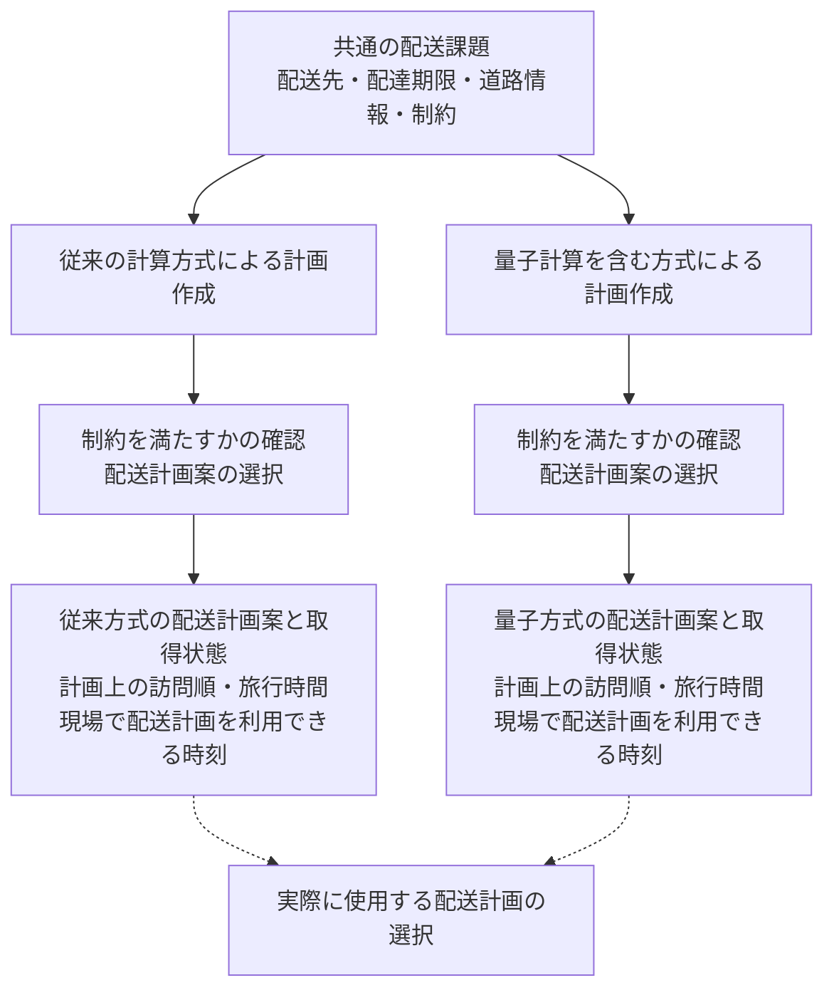
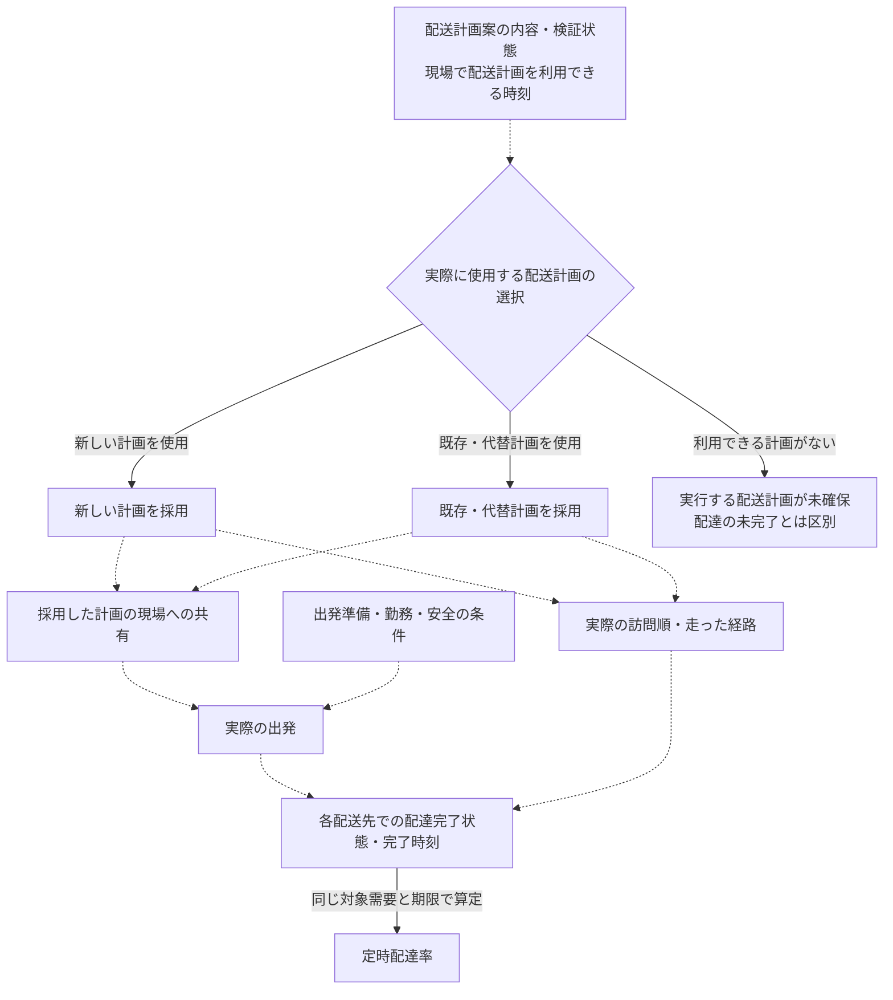
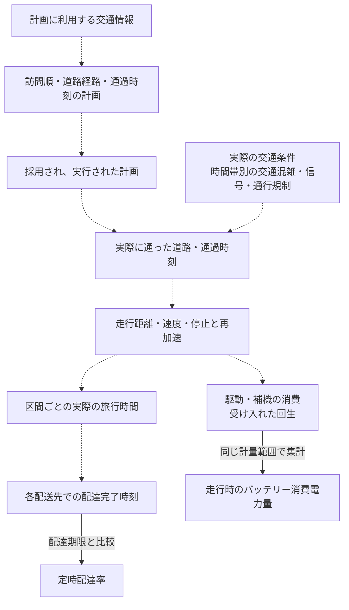
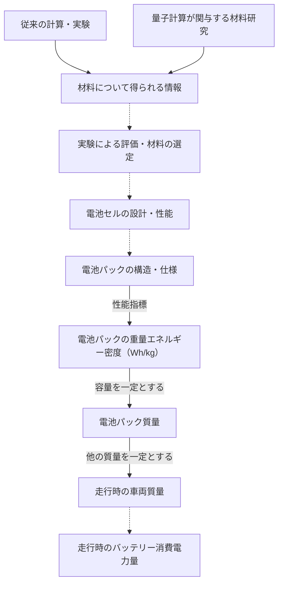

# 専門家インタビュー・面接前モデルM0プロトコル

**版：1.0.1／文書作成日・用語改訂日：2026-10-21（Asia/Tokyo）**

本書は、研究者が本作業指示で採用した設計を文書化した、面接前モデルM0の正本である。固定対象は、4図、質問、提示する前提、評価境界、および本書から参照する分析・改訂規則である。[M0登録情報](EXPERT_INTERVIEW_M0_MANIFEST.json)に実際の作成日時・開始時HEAD・ファイルハッシュを記録する。設計文書化済み・面接未実施・面接後の改訂モデルM1未作成であり、文書登録を倫理承認、予備面接、専門家による確認と同一視しない。

面接には[回答票](EXPERT_INTERVIEW_RESPONSE_TEMPLATE.md)を用い、面接後は[分析ガイド](EXPERT_INTERVIEW_ANALYSIS_GUIDE.md)に従う。回答票は面接・記録を補助する道具であり、方法論そのものではない。

## 1. 研究目的・範囲・評価境界

必要な配送需要を期限内に満たすことと、その配送に伴う走行時のバッテリー消費電力量を抑えることについて、量子技術が従来技術に対してどのように関与し、その関与がどの条件で成立するかを検討する。正式目的・RQ・H1〜H3の本文は[READMEの第1節](../../README.md)に保持する。本書の面接用表現は正式本文の改訂ではない。

### 3経路と4図

| 経路 | 検討する関係 | 使用図 |
|---|---|---|
| ① | 配送計画 → 計画選択・出発・配達実行 → 定時配達率 | 図①-B |
| ② | 配送計画 → 実際に走った経路・速度・加減速 → 走行時のバッテリー消費電力量 | 図② |
| ③ | 材料研究 → 実用化された電池パックの性能 → 走行時の車両質量 → 走行時のバッテリー消費電力量 | 図③ |

図①-Aは経路①・②に共通する技術比較の前提図である。3経路に加わる第4の経路ではない。補足的に、配送を取り巻く交通条件を尋ねる。時間帯別の交通混雑、信号による停止・再発進、通行規制、迂回路・代替経路の有無などを扱う。交通情報を利用して配送計画を変えることと、信号制御などで交通そのものを変えることを区別する。

電池から定時配達率への直接経路は追加しない。充電最適化、貨物再割当、車群増強、量子センシング、交通信号制御を新たな主経路にしない。電池の温度・寿命・劣化を独立した質問群にせず、提示された電池性能値の解釈に必要な試験条件として記録する。新しい数値シミュレーション、量子優位性の実証、量子計算資源見積もりは今回の必須成果ではない。

### 成果指標と時間の区別

| 表示名 | 定義・保持する情報 |
|---|---|
| 定時配達率 | 固定した評価対象の配達のうち、定められた期限までに配達作業を完了した割合である。未配達を分母から除かず、到着時刻と配達完了時刻を同一視しない。未完了と記録の欠測を区別し、配達先ごとの完了状態・完了時刻を保持する。率が同じでも、期限内に完了した配達先が同じとは限らない |
| 走行時のバッテリー消費電力量 | 対象となる走行区間で、車両の駆動や車載機器（補機）が消費した電力量から、回生によって電池が受け入れた電力量（受入回生）を差し引いた正味の電力量である。信号待ち・渋滞など交通上の一時停止を含む。配達作業のための停車、充電、その他の待機は区別する |
| 旅行時間 | 既存計算では、顧客間・デポ間の有向OD道路旅行時間の総和であり、配達作業時間や時間窓待機時間を目的関数へ加えない。図②で実走行の区間旅行時間を扱うときは、計画値・観測値と交通上の停止の扱いを記録する |
| 配達作業時間・計算時間 | 配達作業に要する時間と計画作成の計算時間は別に記録する。計算の終了、制約の検証が完了したこと、現場で配送計画を利用できる時刻も同一視しない |

定時配達率は、既存モデルの「期限内需要充足率」に対応する表示名称である。固定した評価対象、期限内完了の判定、分母、未配達・欠測の扱いは変更しない。配送計画を取得できた割合とは別の指標である。走行時のバッテリー消費電力量も表示名称の統一であり、正式な変数定義・計算式・計量範囲は変更しない。「電費」は距離当たりの消費を意味し得るため、この総電力量の言い換えには用いない。

配送計画案が得られたこと、実際に使用する配送計画を選択したこと、選択した計画を実行したことを区別する。計画上の訪問順と実際の訪問順、計画上の旅行時間と実際の旅行時間も別に記録する。旅行時間を、配達作業や待機を含む全体の所要時間へ読み替えない。

電力量には、計算設備、量子計算機、拠点、車外充電損失、車両・電池製造の電力量を加算しない。端子の正味計測と成分別集計を重複加算しない。未配達による低消費を、同じサービスの省電力化と認定しない。既存の回生・補機を除いた計算結果は、この最終成果指標全体の評価ではない。既存変数ID・式・旅行時間の定義は表示用語の変更によって改変しない。

既存の4顧客問題を用いる評価設計では、問題ごとの固定4タスクを対象とし、モデル上の完了期限をサービス開始期限にサービス時間を加えた時刻とする。これは[CPX資料の第1節D01〜D04](CPX01_D10_PROVISIONAL_20261017.md)の設計であり、一般的な配達期限の定義をその式へ置換するものではない。サービス完了再構成の技術検証は未完了であり、定時配達率の実測・算出済み結果としない。

## 2. 冒頭説明と図の読み方

### 読み上げる説明

> 本研究では、同じ配送先と配達期限を対象として、従来技術と量子技術を比較する。評価するのは、定時配達率と、その配送に伴う走行時のバッテリー消費電力量である。定時配達率は、評価対象の配達のうち、定められた期限までに配達作業を完了した割合である。電力量は、駆動や車載機器の消費から、回生によって電池へ回収された分を差し引いて評価する。図にはモデル上の仮定と未確認の関係が含まれる。図の説明が当てはまる条件と当てはまらない場合を確認したい。量子技術の有効性は前提としない。

> 既存実験では訪問順を求め、道路旅行時間を評価し、その後に電力量を計算している。量子側は小規模の理想シミュレーションであり、背景交通を含む実運用の効果を実証したものではない。「量子計算でより多くの条件を同時に考慮できるとしたら」という説明は、検討する仮説であり、達成済みの事実ではない。条件を増やすことの効果と、同じ条件を量子方式で解くことの追加的な効果を分けて確認する。

### 研究者用の読図・記録規則

4図は、処理順序・情報受渡し、選択、指標定義、算術関係、条件付き因果関係を含む説明図であり、全体を厳密な因果ループ図とは呼ばない。破線は主に成立条件を確認する接続、実線は処理・分岐・情報受渡しやラベルに示した定義・算術関係を表す。線種だけで経験的な実証状態を判定しない。図③の材料研究から情報への実線も、量子による改善の実証を表さない。

研究者は回答を既存の変数・関係へ対応付ける。パラメータはそのための記述要素であり、専門家に網羅的な追加やモデル設計を依頼する対象ではない。独自の変数ID・リンクID・証拠コードを読み上げる質問や表示ラベルへ入れない。構文用のMermaid内部IDは図の版ごとに管理するもので、研究上の変数IDではない。

各図の版は本書の版と共通である。What-ifは、仮想条件を示して説明が成り立つ範囲を確かめる質問である。以下の各節を「図 → 伝える前提・初期仮説 → 中心質問 → 必要な追問 → What-if → 記録する到達点」の順で用いる。

## 3. 図①-A：従来技術と量子技術の比較

### 伝える前提・初期仮説

配送先・期限は同じとする。比較するのは計画作成の仕組み、扱う条件、配送計画案の内容・利用可能性である。量子方式が優れるとは仮定しない。この図は後続の質問で扱う技術差を共有する前提図であり、アルゴリズム内部の診断を面接の中心にしない。

### 中心質問

> この図の計画作成に量子計算を利用するとすれば、従来の方法に対して、どの部分への貢献が考えられるか。把握している具体的な研究・利用例に即して教えてほしい。

### 必要な追問

> その貢献は、従来より多くの条件を同時に考慮することに関係するのか。それとも、同じ条件の計画を求める過程に関係するのか。現時点で違いを判断できない部分はどこか。

### What-if

この前提図では独立したWhat-ifを追加しない。ここで説明された改善とその根拠を、担当範囲に応じて図①-Bまたは図②のWhat-ifへ引き継ぐ。貢献を説明できない場合は、後続へ渡す条件を明示的な仮説として扱う。

### 記録する到達点

以後の面接で用いる「従来との違い」、従来にも共通する部分、根拠、未確認範囲を記録する。多くの条件を扱えることと、同じ条件を量子方式で解く追加的な効果を別欄に記録する。

## 4. 図①-B：配送計画の違いが定時配達率に関係する条件

### 伝える前提・初期仮説

配送先、期限、車両数、担当する需要を共通とする。配送計画案の内容や、現場で配送計画を利用できる時刻が異なる場合を考える。その違いが、実際に使用する配送計画の選択、実際の出発時刻、実際の訪問順へ反映される場合に、期限内に完了できる配達が変わり得る。

### 中心質問

> 従来の計画で出発準備が進んでいるときに、量子方式から別の計画が得られたとする。その計画の違いが、期限内に完了できる配達の違いにつながるのは、どのような条件がそろった場合か。この図の計画選択、出発、訪問順のうち、対象運用ではどの部分が重要になるか。

### 必要な追問

> 今挙げられた条件のうち、計画を早く得ることや、複数の制約を考慮した計画を得ることで満たしやすくなるものはどれか。一方、計画の作成方法を変えても、運用上変えられない条件はあるか。

### What-if

> 先ほど説明された計画作成上の改善が実現しても、定時配達率が変わらない場合はあるか。ある場合、どの条件によって違いが配達結果へ伝わらなくなるのか。先ほどの説明が当てはまらない具体例はあるか。

研究者は、配達完了時刻も不変の場合と、完了時刻は変わったが定時配達率だけが同じ場合を区別する。率が同じでも対象の配達先が入れ替わっていないかを記録で確認する。計画未確保を配達未完了・ゼロ電力量へ自動変換しない。

### 記録する到達点

配送計画の違いが各配送先の配達完了状態・完了時刻と定時配達率に影響する条件を整理する。そのうち計画作成の改善が関係する条件と、現場の準備・勤務・安全などの運用条件を分ける。

## 5. 図②：短時間化と省電力化の両立条件・交通条件

### 伝える前提・初期仮説

同じ配送需要を同じ期限条件で満たし、従来より旅行時間の短い計画が得られた場合を考える。時間の短縮が無駄な走行や停止・再加速の削減によって実現され、迂回や高速化等の負担増に相殺されなければ、電力量も減るという条件付き仮説である。旅行時間が短いことだけを省電力の根拠にせず、旅行時間と電力量を無条件の単調な因果矢印で結ばない。

図では実際に走った経路・速度・加減速を確認する。図の「配達完了時刻」だけで未完了を落とさず、配達先ごとの完了状態も回答票に保持する。旅行時間以外の待機・配達作業等の扱いは対象事例に即して記録する。

### 中心質問

> 従来より旅行時間が短い配送計画で、同じ配達を期限内に完了し、走行時のバッテリー消費電力量も減らせるのは、どのような特徴を持つ計画か。図の訪問順、通過する時間帯、道路経路に即して、満たす必要がある条件を教えてほしい。

### 必要な追問

交通条件について尋ねる。

> その両立を左右する交通条件は何か。どのような交通条件では成立し、どのような条件では成立しにくいか。

必要な場合に限り補足する。

> 混雑する時間帯、信号による停止・再発進、通行規制や迂回路の有無についてはどうか。

量子計算の専門範囲に応じて関与を確認する。

> 今挙げられた条件を同時に満たす訪問順や通過時刻を求めるとき、量子計算が役立ち得る部分はどこか。従来の計算でも同じ条件を考慮した場合と比べて、何に追加的な貢献が見込めるのか。現時点では判断できない部分も分けてほしい。

### What-if

> 交通条件を考慮した計画によって、同じ配達を期限内に完了し、旅行時間も短縮できた。しかし、走行時のバッテリー消費電力量は減らなかったとする。この状況が生じる交通条件や計画の特徴は何か。先ほど挙げられた成立条件に、修正すべき点はあるか。

研究者は、交通専門家に量子アルゴリズムの優位性を回答させず、量子専門家に実配送の未経験部分を推測させない。交通情報の精度・利用と実際の交通状態を分離する。計画が採用されなかった場合、計画の違いが実際の走行に反映されなかった場合、電力量の減少が別の増加によって相殺された場合、記録が不足する場合を区別する。交通に関する表示上の矢印を、既存台帳の効果修飾リンクと同一視しない。「交通条件を増やした効果」と「量子方式を使った効果」を分ける。交通条件そのものの一般的な影響と、従来方式から量子方式へ変更した場合の差が交通条件によってどう変わるかも、別に記録する。

### 記録する到達点

同じ配達を期限内に完了する条件を保ちながら、旅行時間と走行時のバッテリー消費電力量をともに減らせる条件を整理する。交通条件による適用範囲と、計画作成への量子計算の関与を記録する。

## 6. 図③：電池性能に関係する基礎技術と量子計算

### 伝える前提・初期仮説

> 本研究では、電池容量を増やすのではなく、同じ容量をより軽い電池パックで実現する場合を扱っている。電池以外の車両質量と積載条件を同じにし、既存計算では走行経路や速度の記録も変えず、電池の軽量化による走行時のバッテリー消費電力量の違いを評価している。主な入力は電池パックの重量エネルギー密度（Wh/kg）である。ただし、量子計算によってその改善が実現したと確認しているわけではない。

共通の情報箱は同種の情報を整理する表示である。従来と量子の情報が同じ、または両方の使用が必須という意味ではない。回答票では両方式から得られる情報を別々に記録する。

| 前提 | 内容・確認先 |
|---|---|
| 電池容量一定 | 既存計算は20 kWhである。凍結仕様の `stage_inputs[].E_pack_fixed_Wh = 20000` |
| 指標の階層 | 材料の物性・特性、電池セルの性能、電池パックの性能を区別する。モデルへ入力するのは電池パックの重量エネルギー密度（Wh/kg）である |
| 仮定した電池性能 | 180・220・250 Wh/kgは既存感度分析の仮定値である。`stage_inputs[].e_pack_Wh_kg` |
| 非電池質量・積載・走行記録 | 比較間で共通とする。保存仕様は運転者55 kg、積載0 kg、追加装備0 kgであり、実配送の積載再現ではない。`running_mass_definition`。軌跡共通使用は定量研究ガイド第0.11節 |
| 同じ配送内容 | 同じ配送内容を実施する比較である。電池から定時配達率への直接経路は追加しない |
| 既存電力量計算 | 平坦路、回生なし、補機除外、駆動効率0.9の限定評価である。`grade_model`, `regen_model`, `auxiliary_scope`, `eta_prop`, `energy_boundary` |
| 算術と技術効果 | 固定容量からの電池質量換算と、その他質量一定での車両質量換算は算術関係である。量子材料研究による性能改善の実証とは区別する |

出典は[Controlled-DC凍結仕様](../../01_research_design/methodology/CONTROLLED_MASS_TO_DC_MODEL_FREEZE.json)と[定量研究ガイド第0.11節](../QUANTITATIVE_GUIDE.md#011-軌跡を固定してbattery条件と電力量を比較する)である。

研究者用の対応注記：重量エネルギー密度（Wh/kg）は、参照資料の「比エネルギー（specific energy）」に対応する。材料物性の計算値、実験で確認された材料特性、電池セルの性能、電池パックの性能は別の対象である。開発目標、量子計算による改善実績、モデル上の仮定値も区別する。保存変数 `e_pack_Wh_kg` の名称・定義は変更しない。

### 中心質問

> 同じ容量の電池パックを軽くすることに関係する基礎技術のうち、量子計算が貢献し得るものは何か。その技術では、量子計算を使うことで従来と何が変わるのか。

### 必要な追問

必要な場合に限り補足する。

> その技術の中で、量子計算は何を計算・予測するのか。

性能指標と、存在する場合の数値を確認する。

> その貢献は、電池のどの性能指標に関係するか。確認されている数値や、従来との比較結果はあるか。

数値が示された場合だけ確認する。

> その数値は、材料の物性・特性、電池セルの性能、電池パック全体の性能のどれを表すか。

> また、実測値、計算結果、開発目標のどれに当たるか。

### What-if

> 今挙げられた技術は、この図のように「容量を同じにして、電池パックを軽くする変化」として扱ってよいか。その技術が進んでも、電池パックの軽量化にはつながらない場合はあるか。

研究者は、寿命・安全性等への貢献を電池パックの重量エネルギー密度へ読み替えず、予測情報の改善を実物の材料特性の改善と同一視しない。電池セルの性能が改善しても、同じ改善が電池パックの性能に現れるとは限らない。通常の電池開発で得られた改善値を量子計算由来の値にしない。仮定値は質問の正解ではなく、モデル条件である。「量子計算で250 Wh/kgにできるか」と誘導しない。改善量が不明でも、対象指標と量子計算の役割を記録する。全質問への数値回答を要求しない。

### 記録する到達点

基礎技術、量子計算の役割と従来との差、性能指標、数値がある場合の根拠、固定容量・軽量化モデルの適用範囲を確認する。試験条件は提示値の解釈に必要な範囲で根拠情報に添える。

## 7. 全図共通の終了確認

重要な説明が得られたら、研究者が図と回答票へ記入して確認する。

> 今の記載は説明と一致しているか。図のどこまでが研究・開発・運用の記録で確認され、どこからが仮説や推論になるか。

必要に応じて次を尋ねる。

> その説明が当てはまらない具体例はあるか。

> 同じ結果を別の理由でも説明できる場合、何を確認すれば区別できるか。

専門家に完成した因果パスや新規変数の設計を要求しない。未確認の接続を埋めるまで追問し続けない。記載との一致を確認した／訂正した／未確認を記録し、専門家の記載確認を因果関係の実証確認としない。

## 8. 専門範囲別の面接運用

| 専門範囲 | 主に使用する図・質問 |
|---|---|
| 配送計画・運用 | 図①-B、図② |
| 量子・古典最適化 | 図①-A、図②の量子関与部分 |
| 電池・量子材料研究 | 図③ |

一人に全図への回答を求めない。図①-Aで量子の貢献が確認できなくても、運用専門家にはその技術差を仮説として明示した上で、担当範囲の成立条件を尋ねる。複数の専門家の説明を接続するときは、対象事例・条件・量の定義が一致しない区間を自動的につながったものと扱わない。

実施順序は、研究目的と前提の共有 → 対象事例の確認 → 図と中心質問 → 必要な追問 → What-if → 記載内容と根拠の確認である。一般的な仮説とモデルの前提を質問より先に示す。想定回答や正解集は提示しない。研究者が示した前提・図・具体例・追問の内容と順序を、録音・文字起こしの時刻および書込み図への参照とともに記録する。提示が回答に影響した可能性を分析で確認できるようにする。

参加、録音、図への書込み、引用の同意を区別する。倫理手続・承認状態、対象者、人数、日程、面接時間、募集方法、保管期間・場所、アクセス権、撤回条件、予備面接の実施条件は未確定である。必要な手続と同意の確認後に面接を実施する。承認済み、面接済み、飽和達成とは記載しない。実際の個人情報・逐語録の公開リポジトリへの保存は本作業に含まれない。

## 9. 分析方法・M0改訂・限界

中心的方法は、反証志向型インタビューとRIQ（Rigorously Interpreted Quotation Analysis）の二つである。前者は既存モデルの成立条件、例外、不一致を引き出す面接方法、後者は原発言とモデルの構造を明示的に照合する分析方法として用いる。適用範囲と空の記録表は[分析ガイド](EXPERT_INTERVIEW_ANALYSIS_GUIDE.md)を正本とする。

処理順序・情報受渡しは技術記述、指標定義・算術関係は定義・式として検査する。条件付き因果関係にはRIQの原文照合を適用し、What-ifは仮想条件に関する説明として証拠状態を保持する。原発言との整合と、説明の実際の成立を裏付ける証拠の範囲は別の判定である。原著の因果ループ図（CLD）の評価をこの範囲に援用するもので、フィードバックループや因果極性を形式のために追加しない。

明示的な支持には根拠・適用範囲を付して維持し、成立条件の限定には条件追加、定義不足には意味の精緻化を行う。既存属性で重要な接続を説明できない場合のみ必要最小限の構造修正を検討する。反する具体的根拠がある場合には対象範囲を明示して不支持・削除・別構造を検討し、根拠不足は保留とする。経路外の知見は記録するが、自動的に経路を増やさない。M1は現時点では作成しない。

開始時文書に記載されたVersion 0.2の13主変数・13接続・2効果修飾は構造基準として保持する。個別の原本・変数定義・出典台帳は本リポジトリ内で確認できていないため、既存IDとの一対一対応は未確認である。図の箱・矢印の数を新規採択件数に換算せず、未取得のIDを推測して補わない。

提示モデルによる誘導、専門範囲や事例選択の偏り、回顧的説明、解釈の多義性、独立資料の不足を限界として残す。専門家の支持を量子技術効果の実証や正式仮説の支持・棄却としない。仮想的反例と実際の事例に基づく反証も区別する。

## 10. 根拠資料と確認範囲

今回の質問・図・手順の採用根拠は研究者の本作業指示である。既存実験の数値・状態には以下のリポジトリ内資料を用いる。これらの科学的記録は変更しない。

| 相対パス・版 | 参照箇所と用途 | 確認範囲 |
|---|---|---|
| [README](../../README.md)、用語改訂開始時1.0.0 | 第1節の正式目的・RQ・H1〜H3 | 開始時本文を保持。元の正式凍結資料の現物確認とは別である |
| [研究設計総括書](RESEARCH_DESIGN_SUMMARY.md)、用語改訂開始時1.0.0 | 第1・3・5節の正式本文・構造基準・既存実験の位置付け | 開始時参照情報をM0登録情報で識別する。現行の方法は本書に統一する |
| [定量研究ガイド](../QUANTITATIVE_GUIDE.md)、2026-10-19構成改訂 | 「計算問題の定義と評価範囲」、第0.9〜0.12・4・6・7節 | 旅行時間、理想QAOA、背景交通なし、固定軌跡、保存結果と限界 |
| [CPX設計資料](CPX01_D10_PROVISIONAL_20261017.md)、2026-10-17 | 第1節D01〜D09、第4・5節 | 固定タスク・完了期限・計画採用の設計。実運用成果ではない |
| [CPX後発決定](CPX01_D10_ADOPTION_DECISION_20261017.md)、2026-10-17 | 第1・2・4節 | D10は正式採用、サービス完了再構成の検証は未完了。開始時未追跡ファイル |
| [Controlled-DC凍結仕様](../../01_research_design/methodology/CONTROLLED_MASS_TO_DC_MODEL_FREEZE.json)、CONTROLLED_MASS_TO_DC_V1／2026-10-06 | `stage_inputs`, `running_mass_definition`, `grade_model`, `regen_model`, `auxiliary_scope`, `energy_boundary`, `equations` | 図③の容量・質量・積載・計量境界の根拠 |
| [最終定量報告](../../01_research_design/scenario_evaluation/final_quantitative_study_20261008/FINAL_QUANTITATIVE_STUDY_REPORT.md)、2026-10-08の固定結果 | 「実験事実」「識別判定と主張限界」 | 3顧客78/78、4顧客64/78、未取得14。再実験は行わない |

正式凍結資料 `RESEARCH_OBJECTIVE_RQ_HYPOTHESES_FREEZE_20261014_v1_0_1.md`、Version 0.2原本、個別変数・関係・出典台帳の現物は本作業のリポジトリ内探索では未取得である。外部Library・会話履歴・保全領域の内容を今回確認済みとはしない。数値実験からの未確認接続を、面接用の図が補完したとは扱わない。

### 方法論の参考文献

| 書誌情報 | 今回支える手順・適用範囲 | 今回の確認状態 |
|---|---|---|
| Andersen, D. L., Luna-Reyes, L. F., Diker, V. G., Black, L., Rich, E., & Andersen, D. F. (2012). *The disconfirmatory interview as a strategy for the assessment of system dynamics models*. System Dynamics Review, 28(3), 255–275. [DOI](https://doi.org/10.1002/sdr.1479) | モデル評価に面接を用い、不一致や成立しない条件を検討する方針の根拠である | 2026-10-21に[出版社の書誌・要旨](https://onlinelibrary.wiley.com/doi/10.1002/sdr.1479)を確認。本文全体・原著の七つの特徴の詳細は未確認 |
| Tomoaia-Cotisel, A., Allen, S. D., Kim, H., Andersen, D., & Chalabi, Z. (2022). *Rigorously interpreted quotation analysis for evaluating causal loop diagrams in late-stage conceptualization*. System Dynamics Review, 38(1), 41–80. [DOI](https://doi.org/10.1002/sdr.1701) | 原文の表現とモデル要素を対応付け、解釈を明示し不一致を検討する手順の根拠である | 2026-10-21に出版社の書誌・要旨と[学会サイトの原著PDF](https://proceedings.systemdynamics.org/2024/supp/S1524.pdf)を確認。本文の “What is the rigorously interpreted quotation method?”、Table 2、“How implicit structures are identified” を参照。本文全体の精読済みとはしない |

本研究の回答票、4図構成、質問文、二軸判定・改訂表は、本研究の対象と採用指示に合わせた実施仕様である。これら自体が原著で標準化・検証されたとは記載しない。補助的な方法論を独立した柱として追加しない。

## 11. 版管理

本書1.0.1を面接前基準版の用語修正版として登録し、[M0登録情報](EXPERT_INTERVIEW_M0_MANIFEST.json)に本書・回答票・分析ガイドのハッシュを保存する。変更前の1.0.0の登録情報と文書は[上書きしない版保全アーカイブ](interview_versions/EXPERT_INTERVIEW_M0_1.0.0.zip)に保持する。登録は内容の識別であり、実証や承認の状態を変更しない。設計の由来日は本指示受領時点より前へ推定せず、実際の作成日時と区別する。

登録後に図、質問、前提、評価境界、改訂規則を変更する場合は版を更新し、変更理由と適用開始を記録する。変更前の登録内容をGitの参照可能な版または上書きしない登録ファイルで保持してから更新する。未コミットの登録を無記録で上書きしない。各面接で、実際に使用した版・ハッシュ、提示した図と順序を回答票へ記録する。異なる版の回答を同一条件として合算しない。既存の不変スナップショットは上書きしない。

| 版 | 文書作成日 | 登録内容 | 実施状態 |
|---|---|---|---|
| 1.0.0 | 2026-10-21 | 採用指示に基づく3経路・4図・質問・前提・評価境界・改訂規則の文書化 | 面接未実施・M1未作成 |
| 1.0.1 | 2026-10-21 | 成果指標・配送計画・電池の表示名称と質問の日本語を統一。研究設計・定義・数値・3経路・4図の接続を保持 | 面接未実施・M1未作成 |
