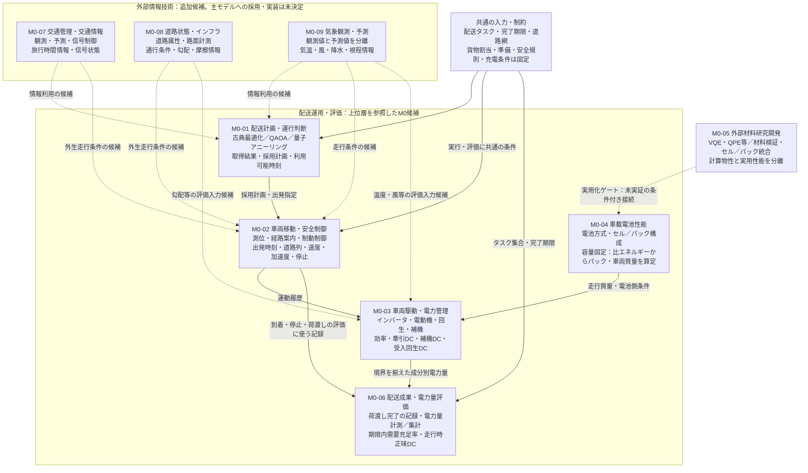
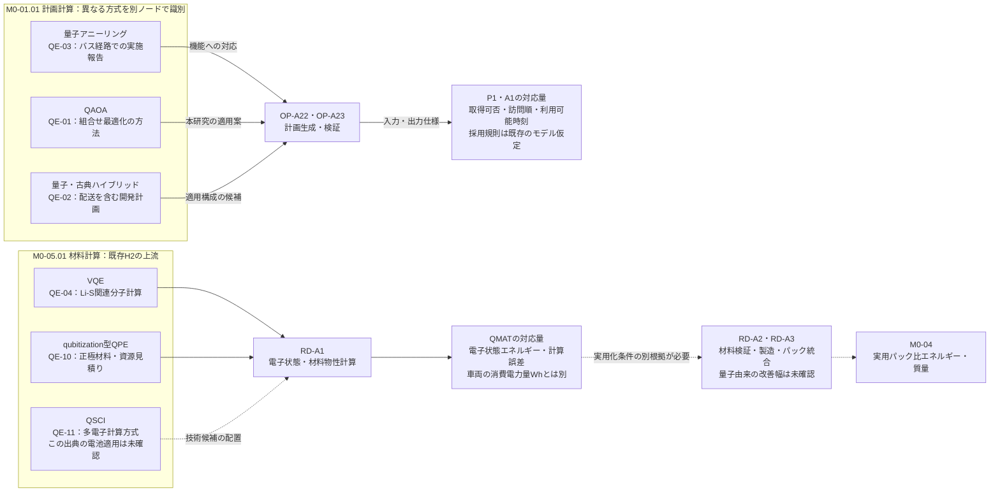
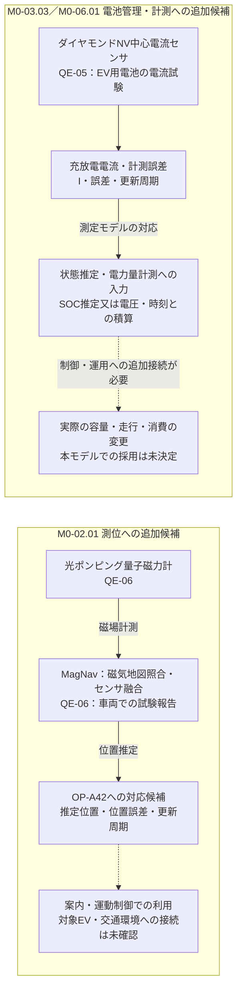

# EV配送システムの技術構造・専門家インタビュー研究設計総括書

**版**：Draft v0.2／2026-10-20。研究者最終承認前。M0正式固定・面接・M1作成は未実施である。

## Table of Contents

1. [研究の概要](#1-研究の概要)
2. [研究対象と境界](#2-研究対象と境界)
3. [研究方法](#3-研究方法)
4. [事前概念モデルM0](#4-事前概念モデルm0)
5. [シミュレーションとの関係](#5-シミュレーションとの関係)
6. [インタビュー設計](#6-インタビュー設計)
7. [構造比較とM1](#7-構造比較とm1)
8. [結果の構成](#8-研究結果の構成)
9. [妥当性と限界](#9-妥当性と限界)
10. [進捗と未決定事項](#10-進捗と未決定事項)
11. [参照資料](#11-参照資料)

## 1. 研究の概要

本研究は、EV配送システムに量子技術が関与する箇所を、**技術名・技術方式→機能→配送移動・電力消費パラメータ**として構造化する。中心成果は、研究者の事前構造と専門家による技術分解・パラメータ対応の差異、および採用変更を反映した概念モデルである。

分析上の問いは、①どの技術方式へ分解できるか、②どの機能・パラメータに対応するか、③事前構造と専門家別構造のどこが異なるか、である。正式RQ・H1〜H3は凍結済み原文を正本とし、本書で改訂しない。H1は計画取得と配送運用、H2は量子材料計算と実用電池性能の条件付き接続、H3は周辺条件による効果修飾を扱う。**面接では因果関係を直接質問しない。**

## 2. 研究対象と境界

都市部のEV配送を対象とし、計画取得・採用、出発、移動、安全制御、駆動、電池、実サービス完了、電力量評価を扱う。既存定量実験の単一車両・固定顧客集合は一般的配送システムの定義ではない。

成果指標は、実サービス完了時刻に基づく**期限内需要充足率**と**走行時電池側正味DC電力量**である。後者は `E_net,DC = E_traction,DC + E_aux,DC − E_regen,accepted` と定義する。既存の回生・補機を除いた限定牽引DCと区別する。充電、貨物割当、倉庫・積込、安全制約等はVersion 0.2の固定・非展開方針を維持する。技術辞書への登録は搭載・実装・効果実証を意味しない。

## 3. 研究方法

国内外の政策・プロジェクト・技術資料から名称・方式を抽出する。政策目標、事業名、技術名、装置、材料、実装、期待性能、報告実績を区別する。原表記と出典位置を保存し、同義・種類・構成・利用関係を別に記録する。既存177件の機能分類は照合資産であり、技術分類の範囲を限定しない。

IDEF0は機能とInput・Control・Output・Mechanismを表現するために用いる。技術名だけの分類木を正式なIDEF0図とは呼ばない。

1. 政策・プロジェクト資料の調査
2. 技術名・方式の抽出
3. IDEF0機能・パラメータとの対応
4. M0提示版の固定
5. 専門家による技術分解
6. 専門家別構造の保存
7. M0との比較・採否判断
8. M1の構築
9. 因果構造・数値モデルへの含意

## 4. 事前概念モデルM0

### 4.1 M0本体と研究工程の区別

本章の図は**更新後の配送シミュレーション案を表すM0候補**である。第3章の資料調査→面接→比較という研究工程とは異なる。図版IDは `M0-DIAGRAM-DRAFT-20261020-02` とする。文書のDraft v0.2と既存因果モデルVersion 0.2は別の版体系である。

M0-01〜06は既存の提示位置、M0-07〜09は追加候補位置である。図示は新しい技術採用、FD機能の追加、数値モデルの実装、M0の正式freezeを意味しない。図の構造は研究者による設計案であり、個々の線が文献によって実証されたと扱わない。

**図M0-A：更新後シミュレーション案を表す概念モデル本体。** 研究工程ではなく、対象システムの入力、処理、技術の配置、受渡す量、評価出力を示す。実線はこの概念案で置く処理・授受関係、破線は条件付き又は未採用の拡張接続である。線の違いは実証の強弱を表さず、実線も実装済み・実証済みを意味しない。M0-番号は上位のモデル位置であり、IDEF0の機能IDや因果リンクIDを置き換えない。

図はIDEF0の機能・ICOMへ対応付けるための模式図であり、全境界矢印の図形規則を満たす正式IDEF0図の完成認定ではない。Version 0.2の13接続関係を増やした図でもない。材料系から期限内需要充足率への新規経路は追加していない。交通・道路・気象の3候補層も採用済みとはしない。外部条件の真値を走行・電力量へ渡すことと、その観測値・予測値を計画・制御へ渡すことは別の接続である。情報精度の変化を実際の気象・道路条件の変化として代入しない。

### 4.2 技術名を単位とする量子関与の配置図

図M0-B・Cは、図M0-Aの技術的な内訳と、モデル上の量への対応を示す。**QE-IDは第11章の技術的根拠資料へ対応する**。技術が存在する根拠、ある用途での計画・試験、対象EVへの適用可能性、配送成果の実証は別段階である。実線は技術から機能・出力量への対応、破線は未確定の用途接続・実用化であり、因果効果の正負や強さを表さない。

#### 図M0-B｜計画計算と材料計算

計画の道路旅行時間、量子計算の目的関数値、材料の電子状態エネルギー、車両の消費電力量を区別する。QE-03のバス道路経路選択を、本研究の固定顧客訪問順問題と同一の実験とは扱わない。材料物性から `SPEC_REAL` の数値を自動算定する式は追加しない。

#### 図M0-C｜測位・電池計測の追加候補

量子磁力計とMagNavは、一つの機器と、それを利用する複合的な航法方式という異なる技術概念である。同じQE-06を引用しても独立した二つの実験に数えない。電流計測についても、電流だけで電力量が定まるわけではなく、電圧、時刻、積算境界等が必要である。精度の改善を実際の容量や電力量の改善に読み替えない。

### 4.3 インタビュー提示表

提示表は**4列・1技術名1行**とする。以下は既存位置を保持した代表行であり、全技術を網羅しない。インタビューではこの位置を起点として分解・統合・再配置を求める。

| 上位層・位置ID | 技術名・技術方式 | 対応機能（IDEF0） | 対応パラメータ候補 |
|---|---|---|---|
| M0-01.01-02 配送計画 | QAOA | 計画生成（OP-A22） | 訪問順、取得可否、計画利用可能までの時間〔s〕 |
| M0-01.01-03 配送計画 | 量子アニーリング | 計画生成（OP-A22） | 訪問順、取得可否、計画旅行時間〔s〕 |
| M0-02.01-01 車両移動 | GNSS測位 | 測位・案内（OP-A42） | 推定位置・測位誤差〔m〕、更新周期〔s〕 |
| M0-02.02-03 安全制御 | AEB | 運動制御・制動（OP-A43、OP-A45） | 制動開始時刻、目標減速度〔m/s²〕 |
| M0-03.01-01 電動駆動 | 駆動用インバータ | 電力変換（OP-A441） | 変換効率〔無次元〕、損失電力〔W〕 |
| M0-03.02-01 制動 | 回生制動 | 制動・回生（OP-A45） | 回生生成量と電池受入量〔Wh〕 |
| M0-04.01-02 車載電池 | 全固体電池 | 蓄電（OP-A51） | パック化後の比エネルギー〔Wh/kg〕、質量〔kg〕 |
| M0-05.01-02 材料研究 | VQE | 電子状態計算（RD-A1） | 対象物性、計算誤差。パック性能との対応は別途必要 |
| M0-06.01-03 成果評価 | 電力量計測技術 | 電力量記録（OP-A63） | 電力量〔Wh〕、計測誤差、計量区間 |

位置IDは図中の上位層への索引であり、恒久的技術IDとは別である。係数・状態量・意思決定変数・観測値・予測値・評価出力を区別する。技術群まで特定できた場合と、技術名を同定できない場合も分ける。

### 4.4 量子関与と根拠資料の照合表

下表は研究者用の根拠表である。対応パラメータ欄は原資料がそのまま与えた本研究の入力値ではなく、**本モデルに配置するための対応案**である。資料の存在だけで接続を完了判定しない。`CAND-`で始まる位置は未採択候補の索引で、既存TECH-IDや主変数を増やす操作ではない。

| モデル位置・技術名 | 機能・対応パラメータの候補 | 根拠資料と確認できる範囲 | 本モデルへの未接続・留保 |
|---|---|---|---|
| `M0-01.01-02` **QAOA** | OP-A22・OP-A23。P1：取得可否・訪問順。総利用可能時間〔s〕は工程を定義して別計測 | [QE-01](#qe-01)：アルゴリズムの提案 | 名称・原理の根拠。配送適用は本研究の設計と既存理想計算を区別する |
| `M0-01.01-03` **量子アニーリング** | OP-A22／OP-A42への適用参照。候補道路経路・計算応答時間〔s〕。P1・TRAJ_REALとの粒度差を確認 | [QE-03](#qe-03)：著者による量子実機を含むシステム運用報告 | バスの道路経路選択。顧客訪問順の最適化とは同一でない |
| `M0-01.01-04` **量子・古典ハイブリッド最適化** | OP-A22・OP-A23／連携部分。問題・解・時刻の受渡し仕様。具体方式と量は未詳部分あり | [QE-02](#qe-02)：用途・開発計画 | 用途・開発計画の裏付け。個別の方式採用や成果を断定しない |
| `M0-05.01-02` **VQE** | RD-A1。QMAT：電子状態エネルギー〔Hartree等〕・計算誤差。PACKへの変換は未確定 | [QE-04](#qe-04)：計算実験・一部量子実機実験 | 電池関連分子への計算実験。e_pack改善の測定値ではない |
| `CAND-M0-05-QPE` **qubitization型量子位相推定** | RD-A1。基底状態エネルギー・精度・計算資源。配送量へは検証・実用化ゲートが必要 | [QE-10](#qe-10)：アルゴリズム提案・資源見積り | 電池材料に関するアルゴリズム・資源推定 |
| `CAND-M0-05-QSCI` **QSCI** | RD-A1への候補。基底・励起状態エネルギー。電池用途と配送パラメータの対応は未確定 | [QE-11](#qe-11)：多電子系計算方式の提案 | 方式自体の根拠に留める |
| `CAND-M0-02-MAG` **光ポンピング量子磁力計** | OP-A42への候補。磁場〔nT〕・感度・帯域。地図照合を介して位置推定に用いる | [QE-06](#qe-06)：開発者による車両・航空の試験報告 | 磁力計単独で位置や道路を取得するとしない |
| `CAND-M0-02-NAV` **量子磁力計を用いたMagNav** | OP-A42への候補。推定位置・位置誤差〔m〕・更新周期〔s〕。制御利用の接続は未確認 | [QE-06](#qe-06)：開発者による車両・航空の試験報告 | 地上試験あり。対象EV配送への適合は未確認 |
| `CAND-M0-03-NV／M0-06` **NV中心電流センサ** | OP-A52・OP-A63への候補。電流〔A〕・計測誤差・温度。SOC推定又は電圧・時刻との電力量積算への入力 | [QE-05](#qe-05)：機関発表によるEV用電池の充放電試験 | 測定改善と実消費削減を区別。対象車両へは未接続 |
| `CAND-M0-07-QI` **量子inspired交通信号最適化** | 外部交通機能：FD-ID未確定。信号現示・青時間〔s〕。停止時間は制御出力ではなく下流の運動結果 | [QE-07](#qe-07)：量子inspiredの実装計画 | 古典方式側の比較候補。量子実機の根拠ではない |
| `CAND-M0-08-GRAV` **量子重力勾配計** | 外部道路点検：FD-ID未確定。重力勾配〔s^-2／E〕・地下構造。通行条件への変換は未確定 | [QE-08](#qe-08)：屋外重力勾配計測試験の報告 | 配送移動パラメータに結べないため運用モデル外で保留 |
| `CAND-M0-09-QGAN` **光qudit型量子GAN** | 外部予測：FD-ID未確定。分布学習。具体的な気象量・予測誤差・利用時刻は未同定 | [QE-09](#qe-09)：将来用途の目標 | 用途目標のみ。予測モデルへの接続と改善を認定しない |

### 4.5 量子関与を断定しない箇所

AEB、通常のLiDAR、インバータ、電動機、タイヤ摩擦、道路勾配などに、量子という名称を一律に付さない。今回確認した資料は、これら全ての量子方式又は量子による改善を裏付けるものではない。

とくにQE-08の重力勾配は道路の傾斜角や摩擦係数ではなく、QE-09の気象用途の目標は運用気象予測の達成報告ではない。両者は技術提案を識別する根拠として残すが、配送移動・電力消費のパラメータへ至る接続が未確定なので、運用モデルへ値を入力しない。量子inspiredのQE-07も量子実機計算の証拠から分離する。

### 4.6 IDEF0・因果構造・既存数値モデルの対応

| モデル位置 | 既存機能の参照先 | 既存因果構造における対応 | 図の扱い |
|---|---|---|---|
| M0-01 | OP-A22・OP-A23・OP-A24 | T1、P1、A1 | 技術・取得結果・採用を区別 |
| M0-02 | OP-A41〜OP-A43、制動はOP-A45 | DEPART_REAL、TRAJ_REAL | 推定位置と真の走行状態を区別 |
| M0-03 | OP-A44・OP-A45・OP-A52・OP-A53 | TRAJ_REAL／MASS_REALとENERGY_TARGETの機構参照 | 機器別の効率は既存一括効率とは別の説明粒度 |
| M0-04 | OP-A51、実用化の上流はRD-A3 | PACK、SPEC_REAL、MASS_REAL | 容量一定の属性・算術関係を保持 |
| M0-05 | RD-A1〜RD-A3 | QMAT、VERIFY、PACK | 条件付き実用化を保持 |
| M0-06 | OP-A61〜OP-A63 | REAL_COMPLETE_TS、FULFILL_REAL、ENERGY_TARGET | 完了・電力量の定義と取得状態を区別 |
| M0-07〜09 | 外部候補。専用FD機能IDは未採択 | 既存走行条件群への対応又は保留 | 新しい通常因果リンク・H3条件群を自動追加しない |

Version 0.2の13主変数・13接続関係・2効果修飾を保持する。H3は出発余裕と走行条件の2群であり、H2から期限内需要充足率への接続は未決定・未接続である。図示によって上位層・技術候補の採否を確定しない。

## 5. シミュレーションとの関係

現行実験は固定顧客集合・単一車両の訪問順最適化、道路経路、SUMO走行軌跡、限定牽引DC評価から構成される。最適化目的は道路旅行時間であり、電力量ではない。正式量子比較は3・4顧客の理想状態ベクトルQAOAであり量子実機ではない。

Controlled-DCは20 kWh固定、180・220・250 Wh/kgの比エネルギー、平坦路面、回生なし、補機除外の限定感度分析である。量子材料計算の実用効果を実証していない。

更新後の**概念モデル案**では、計画取得から採用・出発・実走行・実完了までを対応付け、交通・道路・気象情報と安全・計測技術を追加候補として扱う。更新内容は(A)対応表のみ、(B)入力・設定、(C)計算処理・計量、(D)未対応・保留に区別する。新技術名の登録だけで数値実装しない。

## 6. インタビュー設計

**冒頭でM0を提示し、提示前自由聴取は行わない。** 図を正解とせず、技術の追加・削除・分割・統合・階層移動を認める。

> この概念モデルを具体的な技術名・技術方式に分解し、各技術が担う機能と、配送移動または電力消費のどのパラメータに対応するかを示してほしい。

追問は名称・方式、種類と構成の違い、機能・ICOM、パラメータの定義・単位・計量位置、分解理由、未対応部分に限定する。**因果関係の有無・方向・強さや改善率を直接尋ねない。** 自発的な因果的発言は別記する。

全体図、担当領域の4列表、書込み図、発言と修正理由の記録票を用いる。対象者・倫理・同意・保管条件、予備面接、正式提示版は未確定である。旧プロトコルの提示前自由聴取と因果効果質問は改訂対象である。

## 7. 構造比較とM1

M0と専門家別構造を、①技術名・概念、②階層・構成、③機能・ICOM、④パラメータの定義・単位・計量境界で比較する。専門家別原図・発言を保持し、研究者が採用・保留・不採用を理由付きで判断する。採用変更のみM1へ反映する。T1〜T7・I1〜I5は本研究独自の分析コードである。無回答や専門外を削除・支持と解釈しない。

## 8. 研究結果の構成

結果は(1)専門家別技術分解、(2)M0との構造比較、(3)技術―パラメータ対応の差異、(4)M1の順で報告する。参加者数、技術数、対応関係数、変更件数は分母を分ける。面接未実施のため結果値・引用は記載しない。因果構造・数値モデルへの含意は考察に置き、構造差異を因果効果の実証としない。

## 9. 妥当性と限界

- **Representation**：技術・機能・パラメータ・評価指標の区別。
- **Verification**：ID・単位・参照・版・変更履歴の整合。
- **Validation**：専門家・文献と対象範囲の整合。因果効果の実証とは区別。
- **方法論上の限界**：M0先行提示の誘導、専門家の偏り、政策提案資料の偏り、研究者判断。
- **数値上の限界**：パラメータを識別しても値・関数形・校正・実装が得られたとは限らない。量子資源と配送問題規模の定量的対応も未確立である。

## 10. 進捗と未決定事項

| 項目 | 状態 |
|---|---|
| Version 0.2 | D1〜D6を反映した構造基準版、効果未実証 |
| FD-v0.1・W02/W03 | 機能・ICOM初版 |
| W07 | 177件の機能分類。最新技術方式の全件再分類ではない |
| 技術辞書 | 6領域・15群・45概念の初版を保持。本書の追加候補とQE根拠表は別管理であり、辞書へ採用済みとはしない |
| M0提示資料 | 図M0-A〜C・技術と出典の対応を含む改訂候補、正式freeze前 |
| インタビュー・M1 | 未実施・未作成 |

次工程はM0候補とパラメータ辞書の照合、追加候補の採否、旧質問票の修正、倫理・募集条件の確認、予備面接、提示版固定、本面接、構造比較である。

## 11. 参照資料

### 11.1 量子技術と配置の技術的根拠

確認日：2026年10月20日。以下は取得・照合できた箇所に限る。原著全文未取得、要旨のみ、実施機関による発表、開発計画を区別し、全資料を精読・追試済みとはしない。原資料の英語見出しを所在の手掛かりとして記載する。参照先の更新・版変更は別に管理する。

#### QE-01｜A Quantum Approximate Optimization Algorithm

**出典**：Farhi, Goldstone & Gutmann。2014、arXiv:1411.4028v1。\
**URL**：[A Quantum Approximate Optimization Algorithm](https://arxiv.org/abs/1411.4028v1)。\
**確認箇所・範囲**：Abstract。著者公開要旨・書誌。\
**裏付ける主張**：QAOAを組合せ最適化方式として識別できる。\
**裏付けない主張**：配送業務での採用、総計画取得時間、車両成果はこの原典では確認しない。

#### QE-02｜QCMobility — Quantum Computing & Mobility

**出典**：DLR。公式プロジェクト説明、取得日2026-10-20。\
**URL**：[QCMobility — Quantum Computing & Mobility](https://www.dlr.de/en/qt/research-transfer/projects-missions/qcmobility)。\
**確認箇所・範囲**：Planned tenders：Road transport／Integration of quantum-based methods。上記プロジェクト本文。\
**裏付ける主張**：配送の荷捌き地点及び古典システムと量子計算機の入出力接続を研究対象としている。\
**裏付けない主張**：個別アルゴリズム・運用効果は未特定。QAOA採用の証拠へ読み替えない。

#### QE-03｜Quantum Shuttle: Traffic Navigation with Quantum Computing

**出典**：Yarkoni et al.／Volkswagen・Hexad等。2020、arXiv:2006.14162v1。\
**URL**：[Quantum Shuttle: Traffic Navigation with Quantum Computing](https://arxiv.org/html/2006.14162v1)。\
**確認箇所・範囲**：§1、§3.1–3.4、§5。方式・システム・運行報告の本文。\
**裏付ける主張**：交通情報、候補経路、D-Wave量子アニーリング、案内アプリを接続したバス運行を報告する。\
**裏付けない主張**：固定顧客訪問順問題やEV配送のWh低減の実証ではない。最短アニーリング時間と全体応答時間を分ける。

#### QE-04｜Quantum computation of dominant products in lithium-sulfur batteries

**出典**：Rice et al.／IBM・Mercedes-Benz R&D North America。arXiv:2001.01120v2、2021-12-30。\
**URL**：[Quantum computation of dominant products in lithium-sulfur batteries](https://arxiv.org/html/2001.01120v2)。\
**確認箇所・範囲**：Abstract、.1 Working equations、.2 Computational details、.5 Quantum chemistry calculations on quantum devices。指定節の本文。\
**裏付ける主張**：Li-S関連分子についてVQEによるエネルギー等を計算する。LiHには量子実機を用いる。\
**裏付けない主張**：その他の対象の計算にはシミュレータを使用。セル製造・実用パック比エネルギーの改善は実証していない。

#### QE-05｜電池の充放電電流を広い電流レンジで高精度に計測するダイヤモンド量子センサを世界で初めて開発

**出典**：東京工業大学・矢崎総業等／Q-LEAP。2022-09-07、原著 Hatano et al., Scientific Reports 12, 13991。\
**URL**：[電池の充放電電流を広い電流レンジで高精度に計測するダイヤモンド量子センサを世界で初めて開発](https://www.titech.ac.jp/news/2022/064800)。 原著DOI：[10.1038/s41598-022-18106-x](https://doi.org/10.1038/s41598-022-18106-x)。\
**確認箇所・範囲**：概要／研究成果／今後の展開／論文情報。研究実施機関の発表本文。原著本文は今回未取得。\
**裏付ける主張**：NV中心センサによるEV用電池の充放電電流計測とWLTC相当の電流パターン試験を報告する。\
**裏付けない主張**：BMSへの組込みは今後の展開に含む。容量削減・電費改善の試算を実測効果としない。

#### QE-06｜Quantum-assured magnetic navigation achieves positioning accuracy better than a strategic-grade INS in airborne and ground-based field trials

**出典**：Muradoğlu et al.／Q-CTRL（オーストラリア）。2025、arXiv:2504.08167v1。\
**URL**：[Quantum-assured magnetic navigation achieves positioning accuracy better than a strategic-grade INS in airborne and ground-based field trials](https://arxiv.org/html/2504.08167v1)。\
**確認箇所・範囲**：Q-CTRL MagNav System／System architecture／Q-CTRL optically-pumped magnetometers／Ground trials。構成・測定・地上試験の本文。\
**裏付ける主張**：量子磁力計、古典センサ、慣性航法、地図照合による位置推定を車両等で試験する。\
**裏付けない主張**：配送車両の実装、AEB制御、配送時間・電力量への効果は未確認。量子素子単独の効果に帰属しない。

#### QE-07｜QI-TraSiCo – quantum computing for network-wide traffic light control in real time

**出典**：DLR。公式プロジェクト本文、取得日2026-10-20。\
**URL**：[QI-TraSiCo – quantum computing for network-wide traffic light control in real time](https://www.dlr.de/en/ts/research-transfer/projects/qi-trasico)。\
**確認箇所・範囲**：冒頭の目的・prototypic implementation／Challenge。指定箇所の本文。\
**裏付ける主張**：量子inspired計算を用いる複数信号の制御とインターフェース開発を掲げる。\
**裏付けない主張**：量子ハードウェアを用いる効果実証ではない。具体的解法と対象EVへの影響は別確認。

#### QE-08｜Quantum sensing for gravity cartography

**出典**：Stray et al.／University of Birmingham等（英国）。Nature 602, 590–594（2022）。\
**URL**：[Quantum sensing for gravity cartography](https://research.birmingham.ac.uk/en/publications/quantum-sensing-for-gravity-cartography/)。 原著DOI：[10.1038/s41586-021-04315-3](https://doi.org/10.1038/s41586-021-04315-3)。 [研究機関による説明](https://www.birmingham.ac.uk/news-archive/2022/sensor-breakthrough-paves-way-for-groundbreaking-map-of-world-under-earth-surface)。\
**確認箇所・範囲**：Abstract／大学発表の検出対象の説明。著者所属機関の原著要旨と機関発表。原著全文は今回未取得。\
**裏付ける主張**：量子重力勾配計による地下トンネル検出を報告する。\
**裏付けない主張**：道路勾配・タイヤ摩擦の測定ではない。通行可否への変換規則を特定できず、配送パラメータとの接続は保留。

#### QE-09｜Quantum Generative Adversarial Networks with phoTonic Integrated Circuits (QuGANTIC)

**出典**：European Commission CORDIS／QuGANTIC（EU）。Grant 101099430、ページ更新2026-04-21。\
**URL**：[Quantum Generative Adversarial Networks with phoTonic Integrated Circuits (QuGANTIC)](https://cordis.europa.eu/project/id/101099430)。\
**確認箇所・範囲**：Objective：quDit PIC、quantum Generative Adversarial Networks、weather phenomena。公的プロジェクトの目的本文。\
**裏付ける主張**：光quditによる分布学習と気象現象を用途目標として記載する。\
**裏付けない主張**：具体的な気温・降水予測出力、その精度・時間、配送への効果は確認できない。接続候補の記録に留める。

#### QE-10｜Quantum simulation of battery materials using ionic pseudopotentials

**出典**：Shokrian Zini et al.／Xanadu・Volkswagen（カナダ・ドイツ）。arXiv:2302.07981v2、2023-07-04。\
**URL**：[Quantum simulation of battery materials using ionic pseudopotentials](https://arxiv.org/html/2302.07981v2)。\
**確認箇所・範囲**：Abstract／§2.3／§6 Application: lithium-excess cathode materials／§7 Resource estimation。方式・用途・資源見積りの指定本文。\
**裏付ける主張**：擬ポテンシャルを用いるqubitization型QPEを電池正極材料へ適用する設計と資源推定。\
**裏付けない主張**：大規模FTQCでの実行・電池製造・実用パック改善ではない。

#### QE-11｜Quantum-Selected Configuration Interaction: classical diagonalization of Hamiltonians in subspaces selected by quantum computers

**出典**：Kanno et al.／QunaSys・大阪大学等。arXiv:2302.11320v1を参照。\
**URL**：[Quantum-Selected Configuration Interaction: classical diagonalization of Hamiltonians in subspaces selected by quantum computers](https://arxiv.org/html/2302.11320v1)。\
**確認箇所・範囲**：Abstract。方法の要旨。\
**裏付ける主張**：量子測定による配置選択と古典対角化を組み合わせるQSCIを定義する。\
**裏付けない主張**：今回確認した箇所だけでは電池用途の採用を同定できない。H2の具体的応用根拠とはしない。

### 11.2 基礎技術・方法論・既存研究資料

- **BS-01**：[米国DOE Alternative Fuels Data Center — How Do All-Electric Cars Work?](https://afdc.energy.gov/vehicles/how-do-all-electric-cars-work)。駆動用電池、電動機、電力制御器、変換器等の構成説明。量子関与の根拠としては使わない。

- 因果モデル Version 0.2：`EV_Delivery_SD_Minimal_Concept_Model_v0_2_20261019.md`。本書と同一場所又は公開リポジトリに存在すると確認していないため、名称で参照する。
- [定量研究ガイド](https://github.com/tkm-sano/kmd-analysis/blob/main/docs/QUANTITATIVE_GUIDE.md)。
- [Controlled-DC仕様](https://github.com/tkm-sano/kmd-analysis/blob/main/01_research_design/methodology/CONTROLLED_MASS_TO_DC_MODEL_FREEZE.json)。
- `EV_Tech_Interview_Design_v1_0_20261020/Interview_Protocol_v1_0.md`：旧手順を含む履歴資料。
- `EV_Tech_Interview_Design_v1_0_20261020/M0_Technology_Candidate_v0_1.md`：技術分類初版。
- [NIST FIPS PUB 183（IDEF0歴史的原典）](https://nvlpubs.nist.gov/nistpubs/Legacy/FIPS/fipspub183.pdf)。
- [Gale et al.（2013）, Framework Method](https://doi.org/10.1186/1471-2288-13-117)。
- [Kallio et al.（2016）, 半構造化インタビューガイド](https://doi.org/10.1111/jan.13031)。
- [Tong et al.（2007）, COREQ](https://doi.org/10.1093/intqhc/mzm042)。

**版管理上の注意**：本書は研究設計の統合案であり、凍結済み原文や旧実験の結果を上書きしない。未決定の技術採用、実装、インタビュー結果を確定事項として扱わない。
