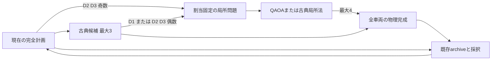

# iterative-d3-v1 実行と検証

D0の正本は旧 budget_pilot、旧本実験登録は formal_J30_final。D3側の正本は `configs/iterative_d3/study_v2.json`、`output/iterative_d3/pilot_v2`、`output/iterative_d3/formal_J30_v2`。接尾辞v2は最初の新版接続で検出した名前衝突の修正版を指す。初回登録・失敗記録は分離して保全している。

| 責務 | 入口と出力 |
|---|---|
| 方式登録・実行・再開 | `scripts/run_iterative_d3.py` → `iterative_d3.campaign`。正式入口は既存J30の登録、共通入力、4枝監視、再開、記述統計を継承 |
| 最終測定の返却 | `operators.select` → `selected_quantum` → `SELECTOR.json`。学習・回路は旧 `iterative_v3.quantum.run` |
| 状態と局所入力 | `operators.local_target` → `order.build/expand`。奇数の親は現在計画、偶数の親は選んだ再配分。CASE、DECODEDに親・境界を保存 |
| 古典近傍 | `operators.proposals/whole_transfer/transfer_routes`。PREPAREDの候補、専用seed、軽量試行、失敗理由と旧枠を保存 |
| 物理評価・採択・予算 | `overlay.variant_worker` でピン留め済みv3反復の所定箇所に新版フックを接続。旧物理評価・archive・Tabu・採択順・再開を使用。COMMITに状態hash、候補、採否、完成枠 |
| 証拠・図・適格性 | `scripts/audit_iterative_d3.py` が既存ファイルを読んで独立の診断と予備集計を生成。D0–D3は同じ予備ケース、Aは換算HOLDの注記 |



使用するリポジトリは `/home/takuma/kmd-analysis`。限定予備の再開は同じ `pilot` コマンド。完了方式は保存結果を読み、未完了枝は同じ設定・試行・乱数streamで再開する。

```bash
PY=/tmp/kmd-p1-pricing-20261118/bin/python
PILOT=output/iterative_d3/pilot_v2
MAIN=output/iterative_d3/formal_J30_v2
CONF=configs/iterative_d3/study_v2.json

"$PY" -B scripts/run_iterative_d3.py preflight --manifest "$MAIN/MANIFEST.json" --output "$MAIN"
"$PY" -B scripts/run_iterative_d3.py readiness --manifest "$MAIN/MANIFEST.json" --output "$MAIN"
"$PY" -B scripts/run_iterative_d3.py aggregate --manifest "$MAIN/MANIFEST.json" --output "$MAIN"

# 限定予備の起動・再開
"$PY" -B scripts/run_iterative_d3.py pilot --manifest "$PILOT/MANIFEST.json" --output "$PILOT" --execute
"$PY" -B scripts/audit_iterative_d3.py summary --config "$CONF" --output output/iterative_d3 --formal "$MAIN"

# 正式比較を将来起動・再開する入口。今回は起動しない
"$PY" -B scripts/run_iterative_d3.py run --manifest "$MAIN/MANIFEST.json" --output "$MAIN" --execute
"$PY" -B scripts/run_iterative_d3.py resume --manifest "$MAIN/MANIFEST.json" --output "$MAIN" --execute
```

正式入口は manifest／登録先／コード／設定／入力／π₀／seedの対応を検査し、D3検証証跡とFreeze結合がそろった場合に正式実行可能とする。準備状態と実行状態を別々に記録する。正式ファイルの内部識別子D_classical/D_quantumは設定がD3を指定する。予備・機構診断・内部枝はJに算入しない。

検証の読み方

- 保存測定を再利用した呼出しはfresh shots・fresh nfevが0。履歴の測定数は別列に残す。そのwall/CPUとD0の新規測定込みwall/CPUは計測範囲が異なる。候補枠が等しくても計算量は等しいと扱わない。
- `diagnostic/TRANSFER_TRIP_TIMES.csv` はCで見つかった車両組を使う機構診断。3規模の各便を配送先順序で照合し、積込開始・終了、バース、FCFS順、帰着の変化が0件であることを確認した。待ち短縮の360秒・360秒・90秒は移管先の外生readyの差。積込能力や配車時刻最適化による短縮とは区別する。
- `FIXED_INPUT_MECHANISM.csv` は独立の対照。D3初回の専用乱数による移管組と同じ測定候補1件を4通りで評価し、その評価は予備の探索状態へ入れない。
- 既存の非公開 `_branch` へ完了済みJOBを手動で渡すと、v3の終了済み短絡処理の未定義名 `measure` が露出する。通常のpilot／正式resumeは完了済み枝のJOBを投入せず、保存計画を親側で検証する。内部workerを手動再開入口としない。未完了反復の再開は単独改善のfixtureで通し、完了済み枝の非投入は別のdispatch検証で確かめる。

保存ファイルの旧v3互換名は `iteration_0000` から始まる。設定と集計上の反復番号は1〜10とし、上記の奇数／偶数はその番号を使う。

S1 D2の途中で共有NFSの読み取り待ちを抑えるため、ハッシュ照合済みの実行ソース・設定・凍結需要のローカルコピーへ切り替えた。出力、OD入力、manifest、CPU割当、native thread、seed、チェックポイントは同じである。切替時の確定反復は `LOCAL_MIRROR_RESUME.json`。workerの実行パスと中断attemptは各ATTEMPTへ残る。時間比較では保存測定の利用とこのI/O条件差を含めて読む。
