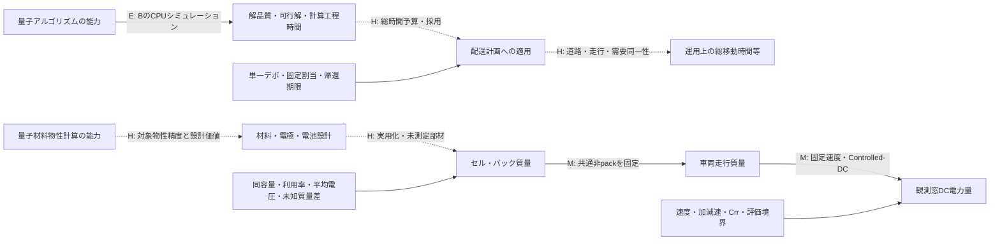

# 統合概念因果モデルのtrial提案

この図は作用経路と証拠状態の表現であり、構造方程式の推定や実証因果グラフではない。実線も実世界の因果証明ではない。Eは保存比較、Mはモデル算術、Hは未検証接続を表す。

旧M0の定時配達率を主たる到達変数とする構造は、trial本文では主分析から外す。旧図はsource DOCXおよび元研究記録に保全する。RIQやM1という調査成果の呼称を新たに付さない。B計画とC旧軌跡を共通母集団とみなす横断矢印も作らない。

A技術能力→B適用→C結果という三層が共通構造である。量子入力の改善を仮定しただけでは、各経路の未接続区間は埋まらない。質量相殺や支持制限は伝達制約として記述できる一方、制度・組織・採用行動の実証は未実施である。
